# IBM《机器学习（数据探索、监督学习的回归和分类）｜machine learning》中英字幕 - P132：43_基于集成的算法和bagging第3部分.zh_en - GPT中英字幕课程资源 - BV1xM4m1D7kY

Now， we know here that our bagging example is built off of multiple trees。

But how is the actual number of trees going to be decided？

This will end up being another hyperparmeter that we can tune that number of trees。

The bigger the number of trees， the less overfit our decision trees will be。

 or our bagging technique here will be。And in practice， there's a point of diminishing return。

 usually around 50 trees should do the trick。

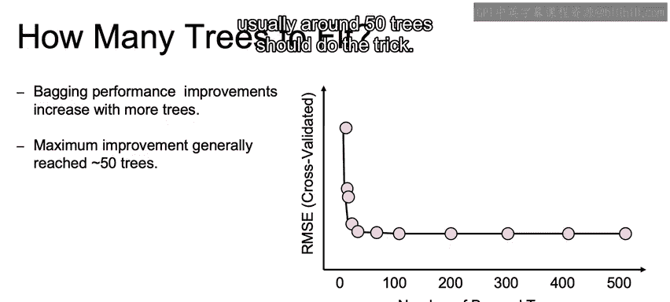

Now it's worth noting some of our similarities and differences between our bagging algorithm built off of decision trees and the basic decision trees。

Like decision trees， bagging trees are fairly easy to interpret as well as implement。

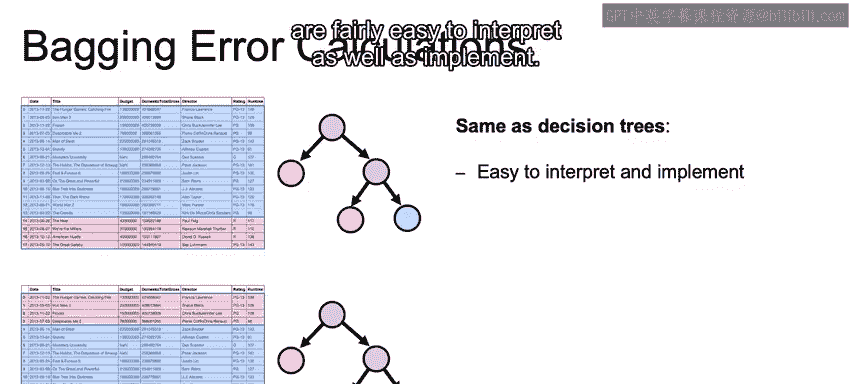

It can easily send in different data types with no preproces required。

 so again we don't need to do those preprocess steps that we had to do with some of our linear classifiers。

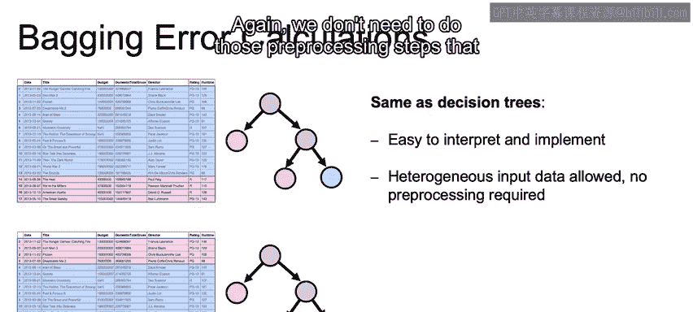

Some things that are specific to bagging， in contrast to just decision trees。

There will not be as much variability。We are reducing the variance and thus the chances of overfitting once we introduce baggging。

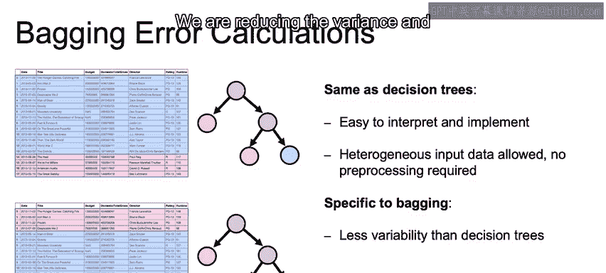

And later on， we're going to introduce boosting methods。

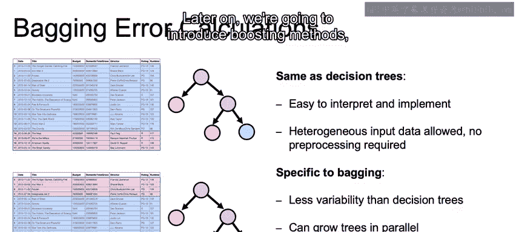

And that can be built with decision trees as well， but those will not compute as efficiently。

Compared to bagging， since bagging can grow trees in parallel。

 So that's going to be a little bit of a precursor here。

 a little bit of foreshadowing when we get into。

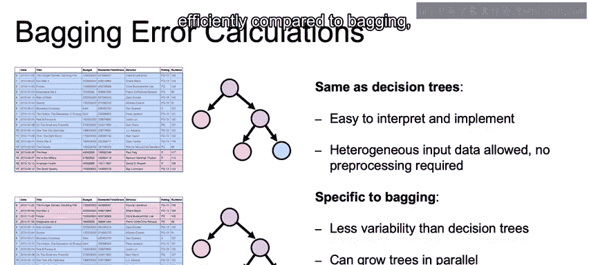

Boosting， we will not be able to build trees in parallel。

 so it won't be as computationally efficient， whereas with bagging， we can grow trees in parallel。

 where each tree is not dependent on any other tree because it's just specific to its own data set。

 so well be able to grow these trees in parallel。

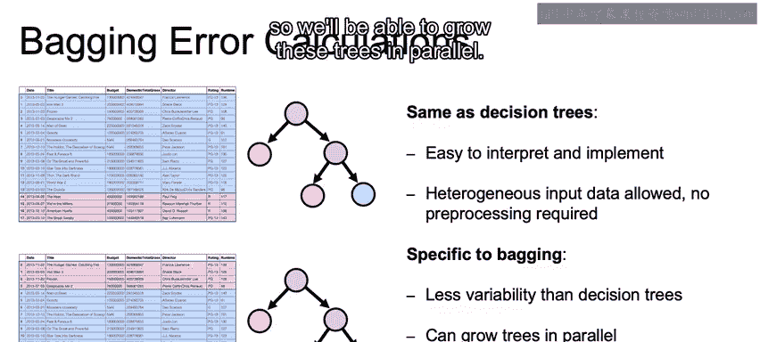

Now let's introduce the code when you want to do bagging。

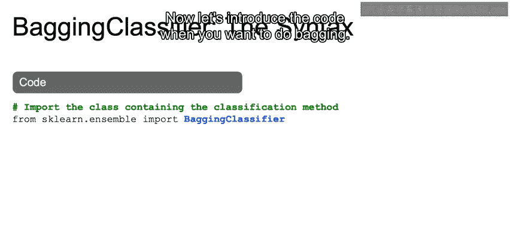

First things first as we import the classification method here from SK learned to ensemble。

 we import the bagging classifier， and then the steps are the same as before our hyperparmmetertor here is going to be the number of estimators。

 which is going to be the number of trees in our example。

 so here we set that equal to 50 and we initiated our object。

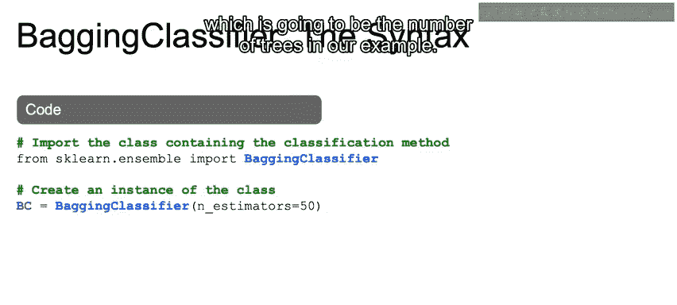

We're then going to fit that instance on our training set as we've done before， just calling BC。

fi and BC do predict on our test set。

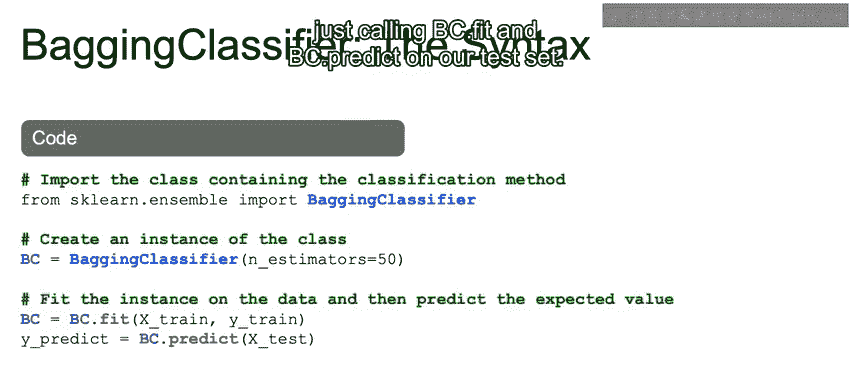

And finally， again， we can tune our parameters cross validation。

 We see all these same steps over and over as these are the main steps that will go through any type of machine learning optimization。

 And then again， if you want to do regression， you can just use bagging reser rather than bagging classifier。

😊。

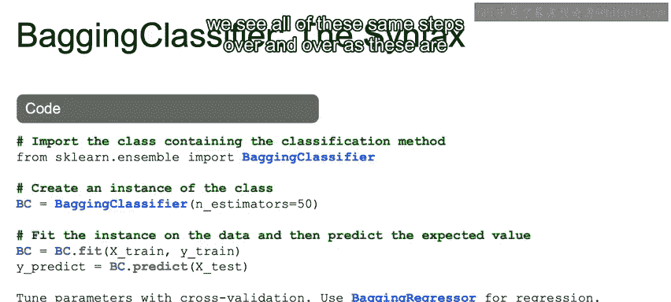

So that close up this video in the next video， we'll see how we can take the randomization of bagging one step further。

In order to produce the algorithm that you're probably more familiar with， the random for us。

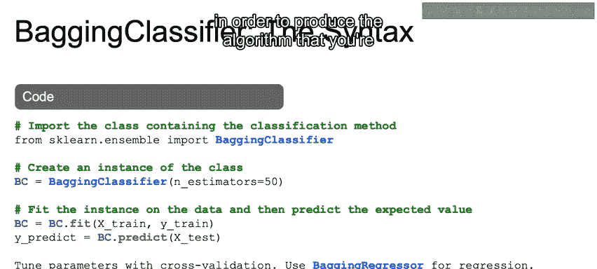

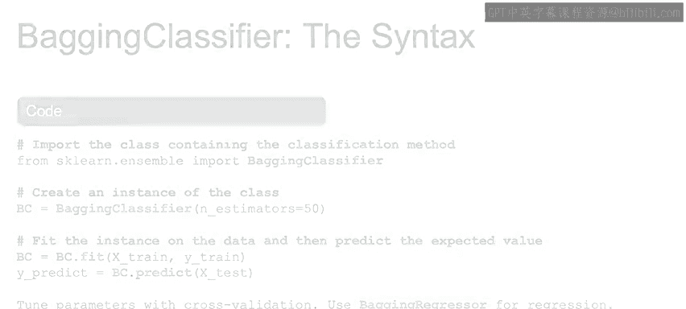