# IBM《机器学习（数据探索、监督学习的回归和分类）｜machine learning》中英字幕 - P134：45_bagging笔记本（选修部分）第1部分.zh_en - GPT中英字幕课程资源 - BV1xM4m1D7kY

Welcome to our demo notebook here on Baging Here we're going to be using the customer churn data from the telecom industry that we introduced in the Can nearest neighbors lab。

 since we already pre processcessed the data there。

 we're going to take that preprocessed data from earlier in order to build out our different bagging solutions here。

Now， as mentioned。😡，We don't need to actually pre process most of our data for bagging。

 We will need for S K learn to put them in some type of numerical form。

 such as using one hot encoding or ordinal encoding。

 but we don't need to scale the data As we do between 0 and1。

 and as we' have done with the Can nearest neighbor's data， But it won't hurt either。

 The orderings stayed the same。 We should still be able to come up with the same splits。

 So there's no harm in actually preprocessing our data。

So the first thing that we're going to do is import all the necessary libraries as usual。

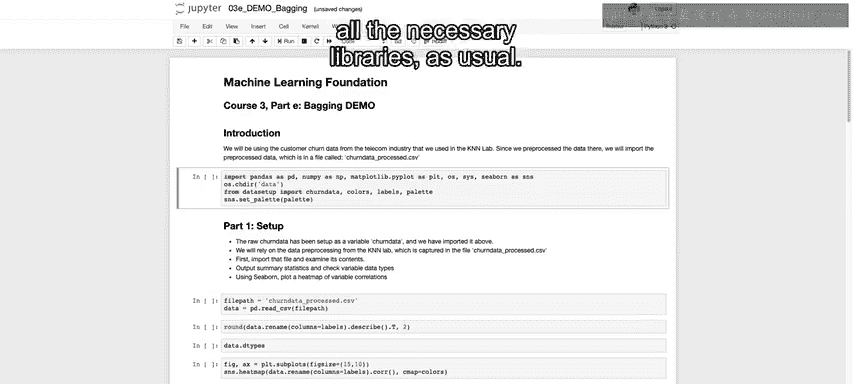

We're then going to import our data。Our pre processcess data。

 which was churn data underscore processed。 CSv。And set that equal to data。

And then we're going to use the dot described to see the breakdown of each one of our different columns Now here we're renaming our columns according to these labels。

 and that's just to make them a little bit easier to interpret so if we look at labels we're taking each one of those original labels and renaming them accordingly so rather than months it'll say ten year and months。

 so that's a bit easier to understand。

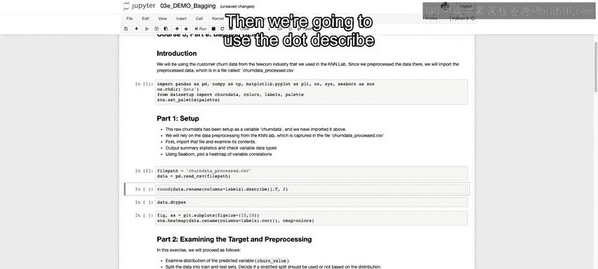

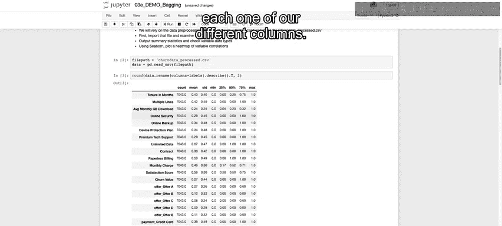

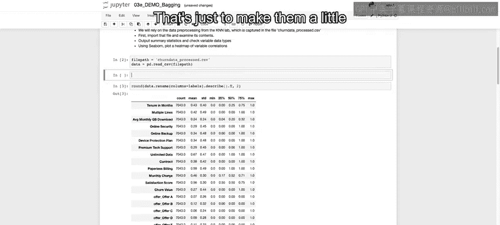

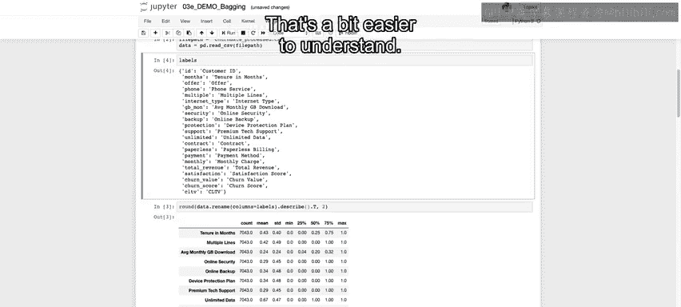

And as we expected， all the values are between 0 and 1 because they've been scaled and we see the different standard deviations。

 the different averages in between that0 and1， and all the values are now also either floats or integers。

 they're all in numerical form。 So when we run data do D types。

 we see that that they're either floats or integers for each one of those values。

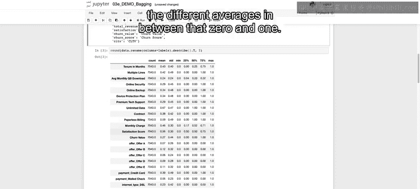

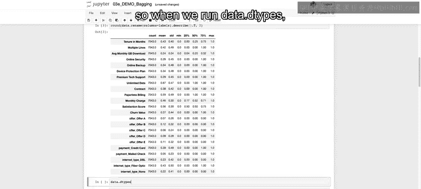

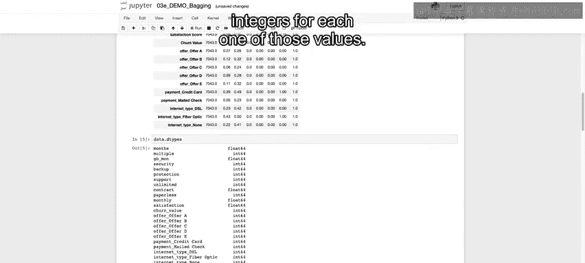

The next thing that we want to do here is check the correlation between each one of our different features as well as with our target column。

 so all we're going to do is initiate that plot so we have our figure as well as that bounding box and that's going to have a figure size of 15 by 10。

We're then again， just renaming the columns to those labels and then calling dot core。

 and that should just give us a correlation matrix。

 which should just be a square with every single feature and its correlation to the other features。

So I'm actually going to remove the CMMap equals colors here。

 you can keep that in it's just a little bit easier to interpret with the default setting。

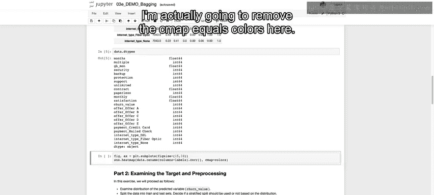

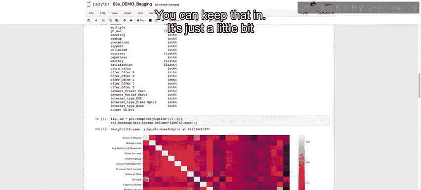

And what we see here。Is that the churn value？Is going to be highly correlated or negatively correlated because that's dark with。

The satisfaction score。Which makes sense， the more satisfied they are。

 the less likely they are to churn。 So that's going to be seems like one of the darker values。

 We also see contracts。 So， and we can look at the contract variable from before。

 And contract was just the type of contract that they had。

 So they're more likely to churn if they have a less lower term contract and as expected contract should have a high correlation with ten0 year in months。

 the longer that contract is so that twoy contract versus oney year contract versus month the month。

 the higher that is， the higher the tenure in months。

 And you can continue to explore here and see each one of the difference。

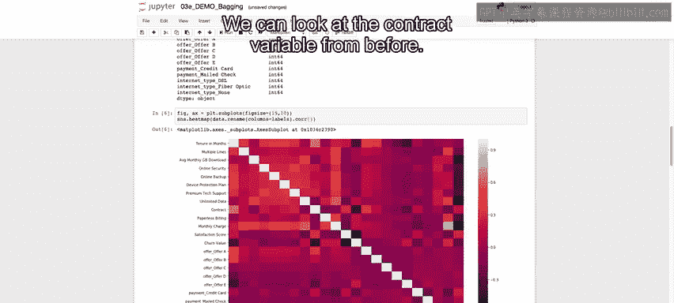

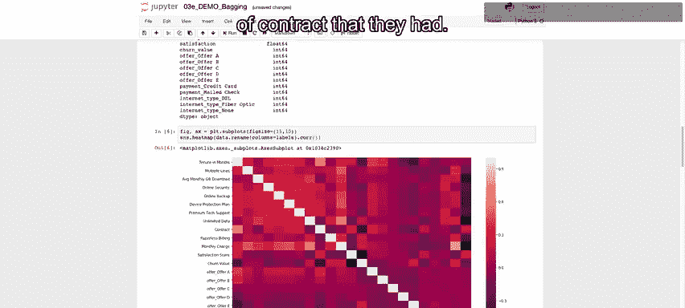

Types of variables and their relative correlation with one another。

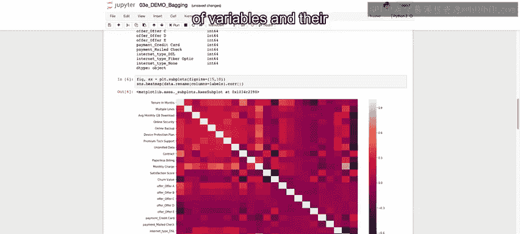

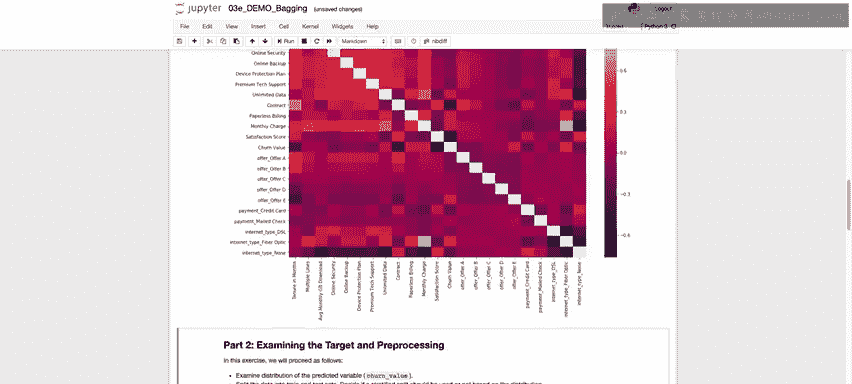

In part two， we want to examine the target and the preprocess。

 so we're going to examine the distribution of our predicted variable， that churn value。

 which should be 0 or1。We're then going to split the data into train and test sets and decide whether or not we should use a stratified split General we'll do that if we have a bit of a skewed distribution of our outcome variable。

And then we're going to examine the distribution of the predictive variable in the train and test set to just see if we maintain that same distribution。

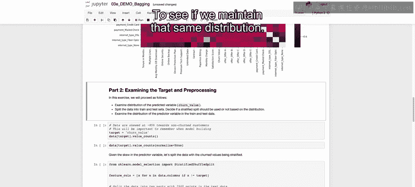

So the first thing is set our target equal to turn value。

 that's what we're going to ultimately be trying to predict。

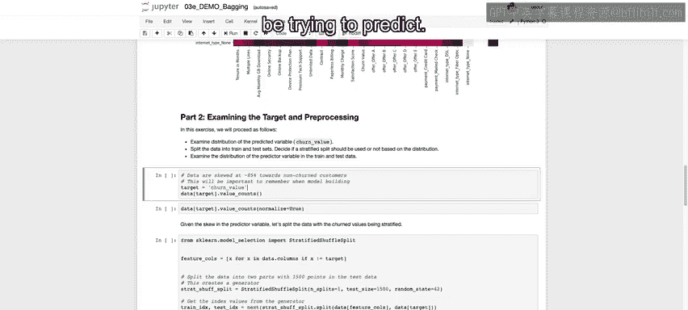

And when we call the value counts for that specific column。

 we see that 5174 did not churn while 1869 did churn， and we have a bit of imbalance。

 And we can see exactly what that is by calling value counts with normalized equal to true。

 So we see 73% cent do not churn whereas 26。5 do churn。

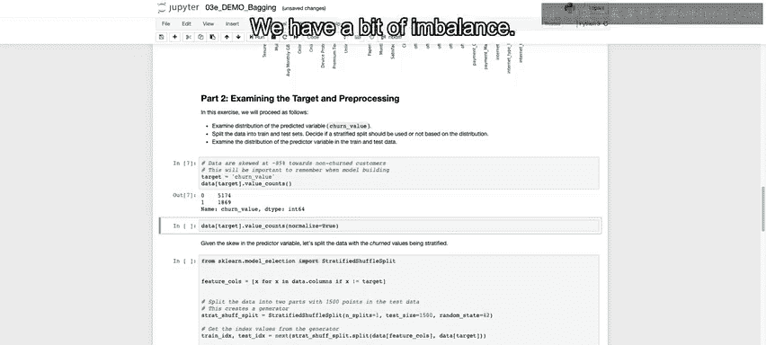

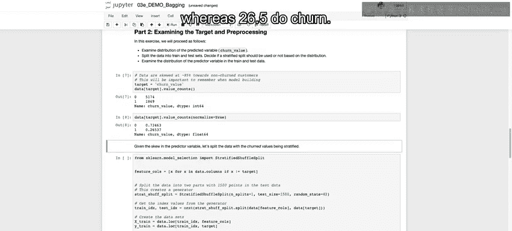

So with that skew in mind， we decide that a stratified shuffle split will probably make sense here。

So we import our stratified shuffel split。We then set our feature columns equal to every single column。

 except for that target that we defined up here， which was churn value。

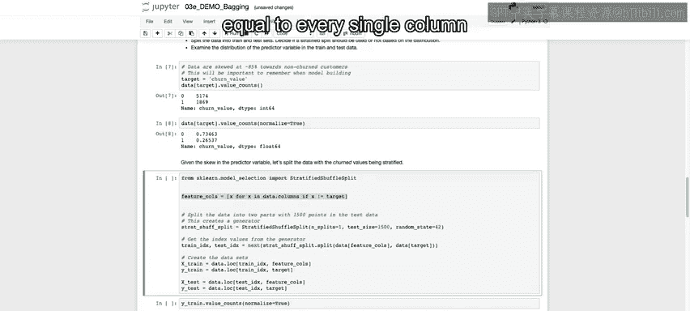

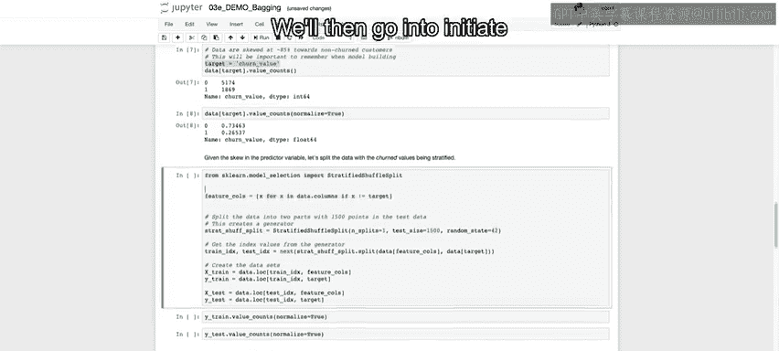

We're then going to initiate our stratified Cheuffel split object。 We only want one split。

 We're sending that test size to an actual integer。

 so that'll be the actual number of rows in our holdout set rather than using a percentage。

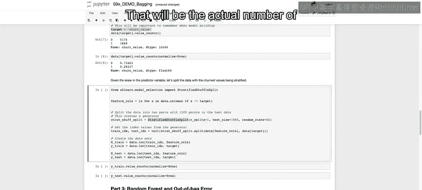

We're then going to output our train index and our test index by calling again this is a generator object。

 we're going to call out that first object there should only be one since we call number of splits equal to1。

We call strapat shuffle split。 That's the object we created。 We call dot split。 We call that method。

 and we say we want to split， according to the feature columns。And the target column。

 where we maintain。Our distribution of that target column by using the stratified shuffel split。

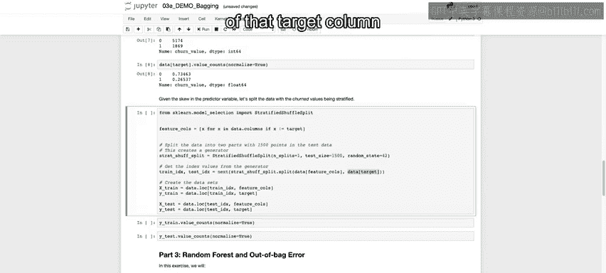

We then set x train equal to our data where the train index。

 those are the rows that we will use and the feature columns is every column except for the。

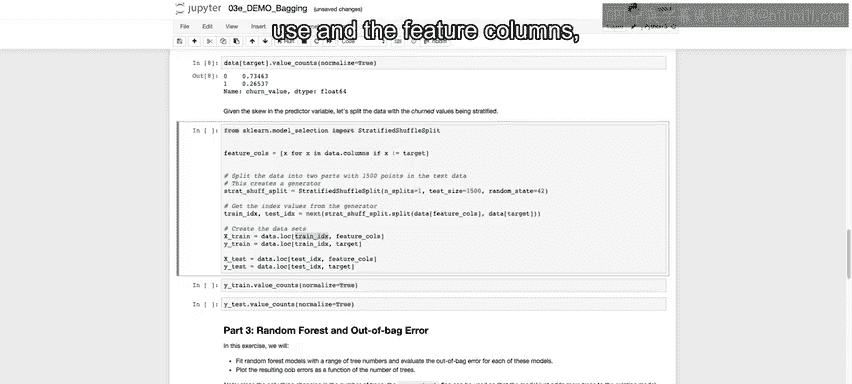

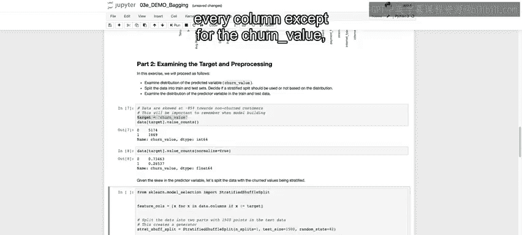

Turn value， which was our target here。And then， of course。

 the Y train will just be the same indices for the rows， except just the target。

 just the churn value， and then for x tests， we do the same things where the rows are just going to be the test indices and the columns are going to be either feature columns or target。

 depending if youre working with X or Y respectively。

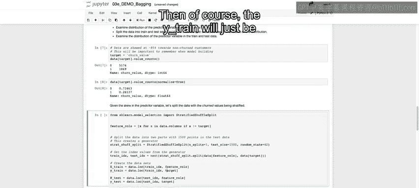

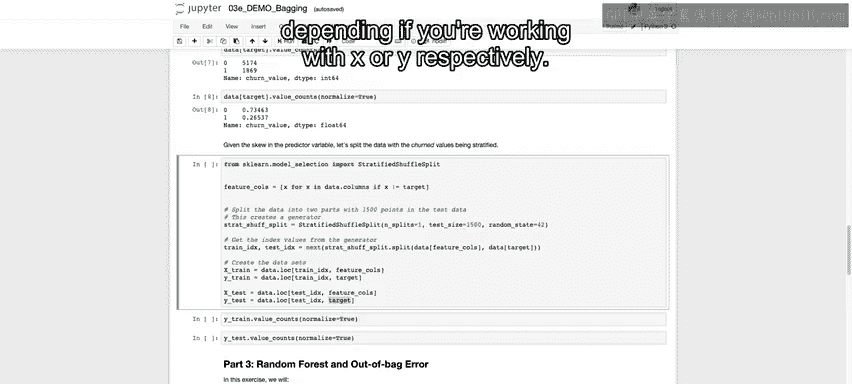

We can then check our Y train。 value counts and our Y test。

 value counts and see that we have really maintained that distribution between churnN and not churn in both our train and test sets。

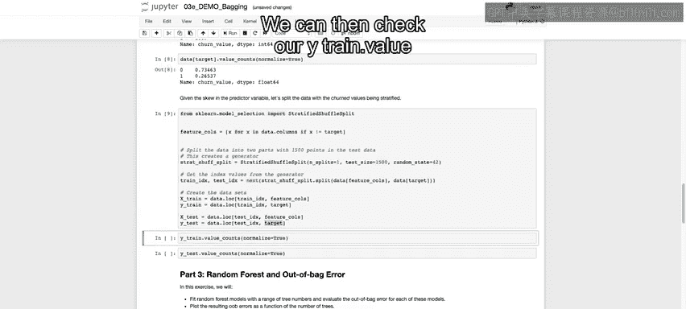

All right that closeds out this portions a video in the next video we will start to introduce how to actually implement our random force and check that out of bag air All right。

 I'll see you there。

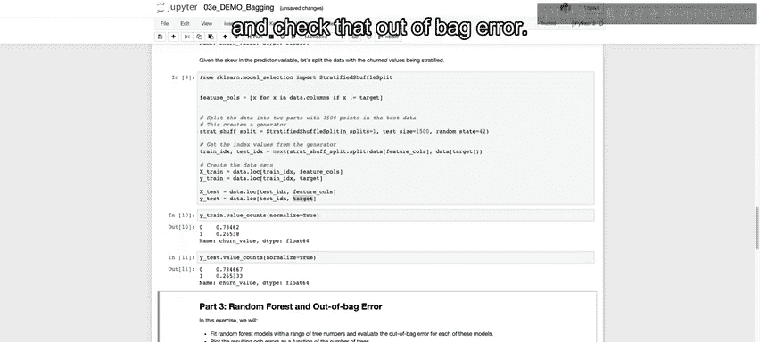

