# IBM《机器学习（数据探索、监督学习的回归和分类）｜machine learning》中英字幕 - P136：47_bagging笔记本（选修部分）第3部分.zh_en - GPT中英字幕课程资源 - BV1xM4m1D7kY

Welcome back for part five of our notebook here on backing。

Here we're going to select one of our better performing models。

And then find each one of those classification metrics that we discussed earlier in the course。

So the first thing that we do is take that random forest。And we set the parameters equal to。

Number of estimators equal to 100。 so that way' working with 100 trees。

 which we saw performed very well for a random forest。

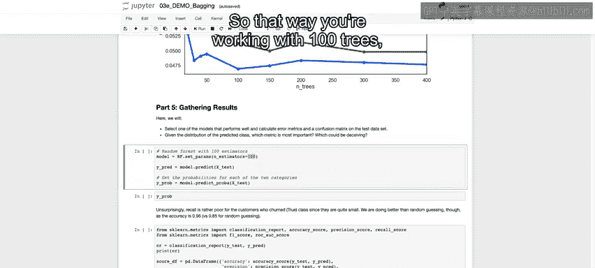

We're then going to use that model to come up with the predictions for X test。

 so either one or0 for churn versus not churn。

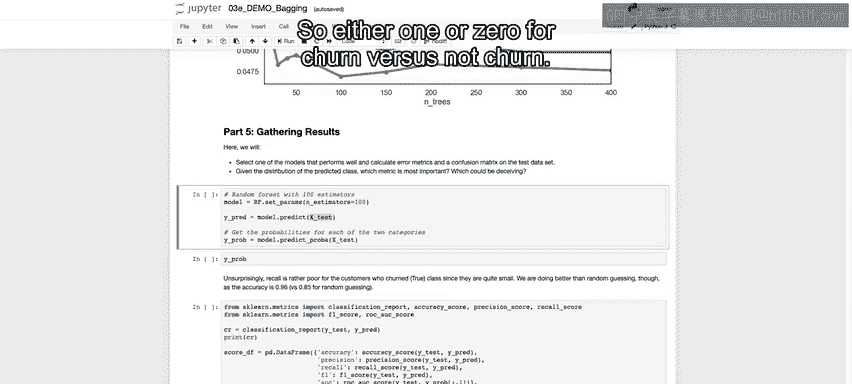

And then we're also going to come up with the predicted probabilities。

Now this is going to be important because the predicted probabilities are going to be needed in order to calculate our ROCAU score。

 as we saw earlier。Now we didn't discuss much how probabilities are predicted for random force or even for decision trees for that matter。

But it's very simple。 The way that it works is for that decision tree。

 If we imagine way at that bottom of the decision tree at one of the leaves。We find our decision。

 so we decide churn or not churn， but in that leaf。Let's say they were 10 different values。

 either churn or not churn。And out of those 10， nine have outcomes of churn。

 and one has an outcome of not churn。Then we will predict。Sure， because it has more values。

 but it also has a 90% chance of being true because nine out of those 10 values were true。

So that's how we come up with a probability。 That would be a 90% probability for the decision tree。

 When we extend that to random forests， all we do is take an average of each one of those decision trees for that row。

 where it would end up for that leaf could be 70% and1，90% of the other 80% in the third。

 and we'd end up with an average of that 70，80 and 90 and ended up with an average of 80% for that predicted probability。

So you run this。

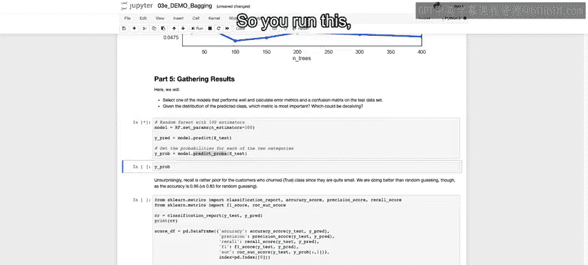

And then just to take a look at that Y Pro， we see that's going to output the probability of either one of the classes。

 so of class  zero and of class one on the second column。And when we actually use our ROC AU。

 we only want the probability for that positive class。

 and we'll see that come into play in just a second。

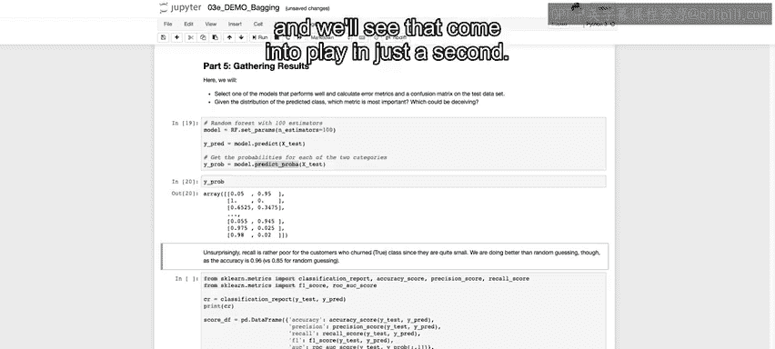

So we import for metrics， our classification report， our accuracy score， precision score。

 recall score， F1 score， and our ROCAUC score。So the first thing that we're going to do is pull out that classification report and as we saw earlier in earlier notebooks。

 the classification report will give us each one of these scores for both the negative and positive class。

 so it'll give us that accuracy precision， pretty much all the scores we have here except for the ROC AUC score。

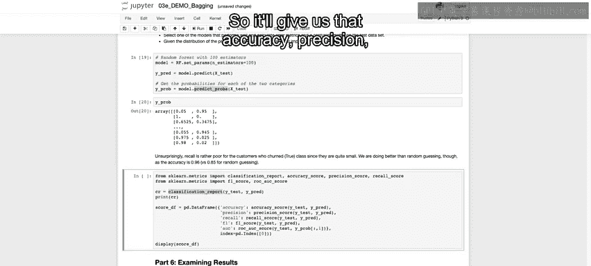

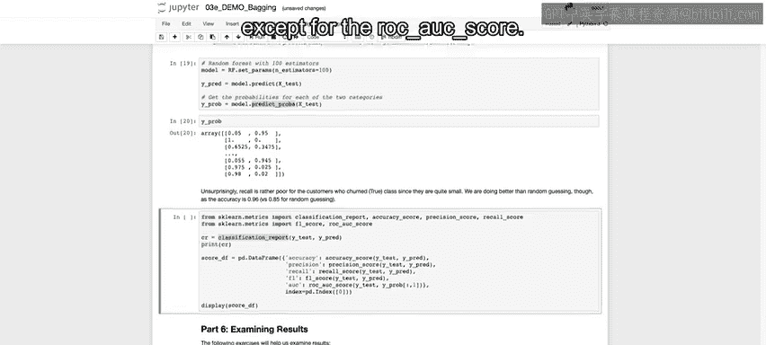

And then we're going to also just to ensure that we got it all correct。

Pull out each one of these values， accuracy precision， recall F1 for that positive class。

 as well as the ROC AU score。Which we'll have to use the probability for And here。

 as we discussed just a second ago， we're going to take all the rows， but only that second column。

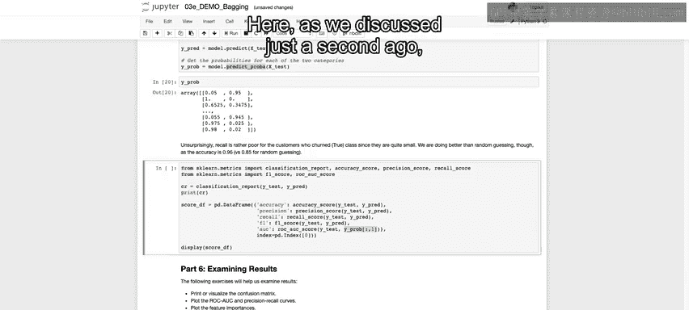

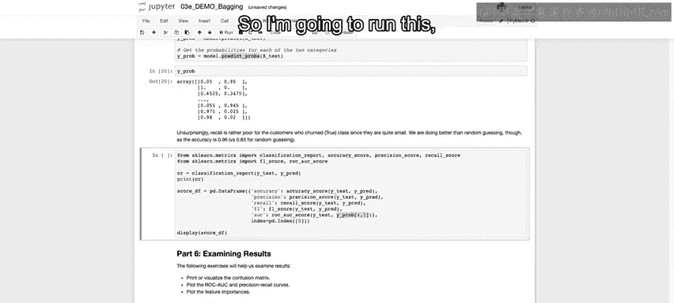

So I'm going to run this。And we see that we get for our negative class， which has a lot more values。

 We see the higher support， fairly high scores。 and then for the。Positive class。

 which is that they did churn， we didn't do quite as well。

 there's a smaller fraction and we did okay in terms of let's say。

 recall predicting the actual values。Better than just a coin flip， but not great。

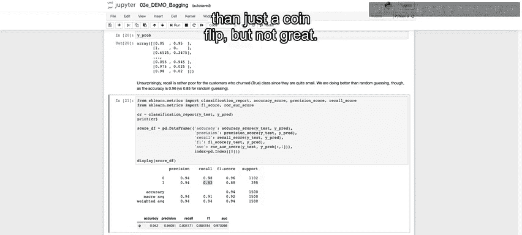

And then we see that each one of these will match up with the scores that we have for our positive class。

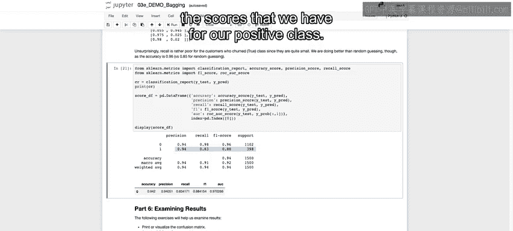

And then you see that we were also able to get the AU score， which was fairly high as well。

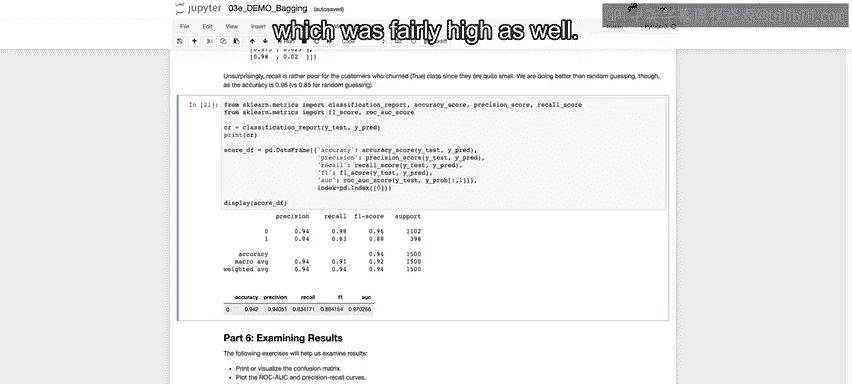

Again， for that positive class。And well， that's for positive or negative class。

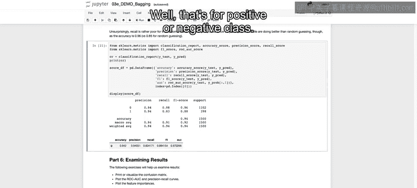

Now for part six。

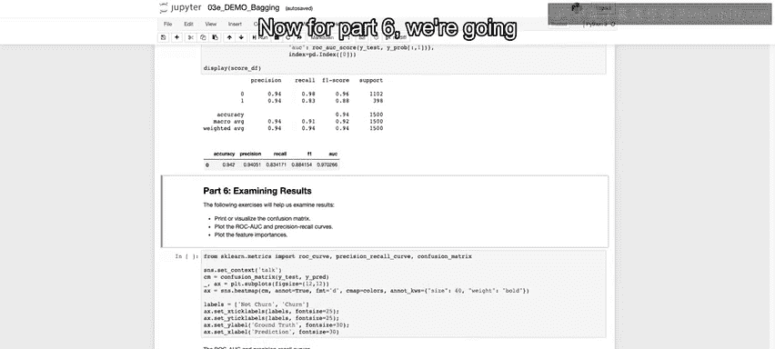

We're going to。Visualize our confusion matrix。Plot out the ROC AU as well as the precision recall curves。

And then we're also going to plot our feature importances。

 So we'll see how those feature importances come out as we go through and see。

 and hopefully they'll be in relation to what we saw before in regards to the correlations between our churn value and each one of those different columns。

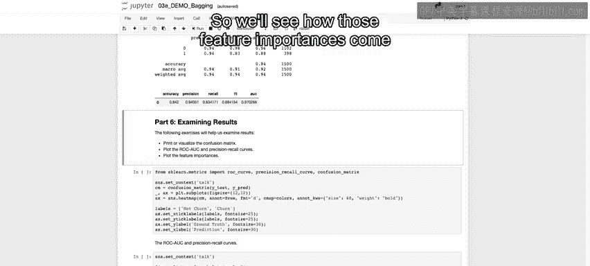

So we're going to create our confusion matrix using our Y test and our predicted values。

We're then going to initiate our bounding box。We're going to call a heat map。

Using that confusion matrix that we just came up with。

 we want to annotate it so we can see the actual numbers and all these different defaults that we saw before just to get the confusion matrix visualization that we'd like with the labels for not churn and churn。

 the exic labels， Yticch labels， and so on。

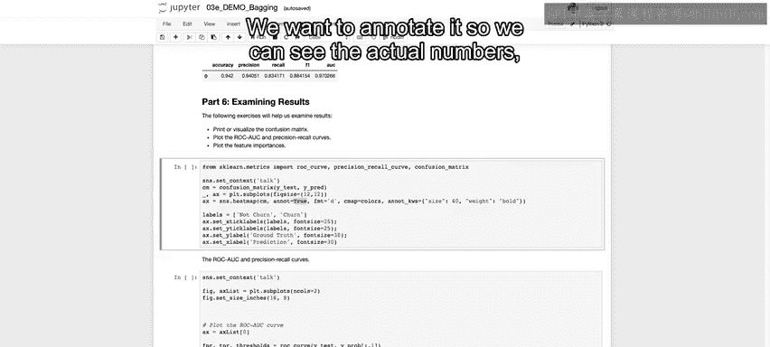

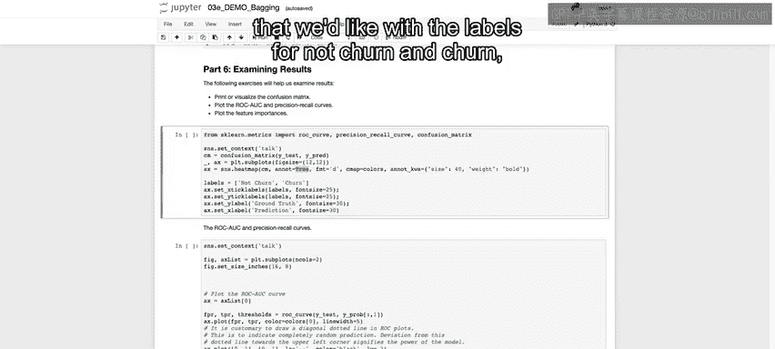

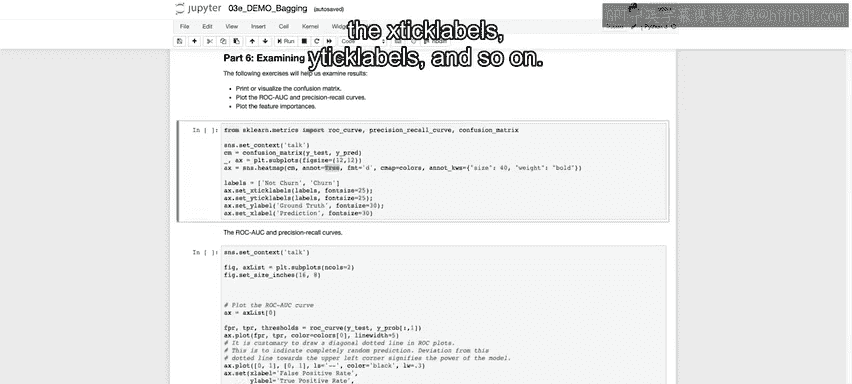

And we saw all these labels before。 and we can see here the confusion matrix between the ground truth。

 So for those that did not churn， we predicted。

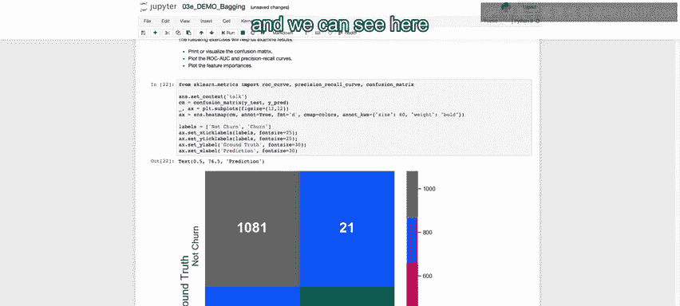

Fairly well at 081 out of those that were。Actually， not churn。

 So there's only 21 predicted incorrects。 But out of the predicted of not churn。

66 of them actually did churn。 So we didn't do as precise for。

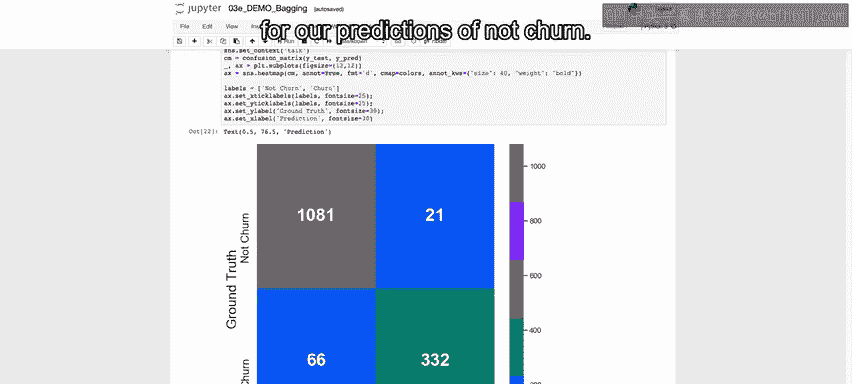

Are predictions of notturnern。And then for the ground truth of churnern。

 we see that 66 out of our total were incorrect。 and that's why we had that low recall score that we saw earlier。

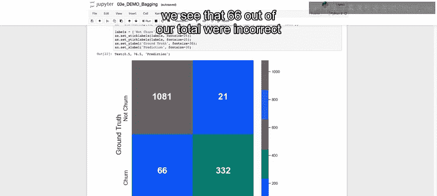

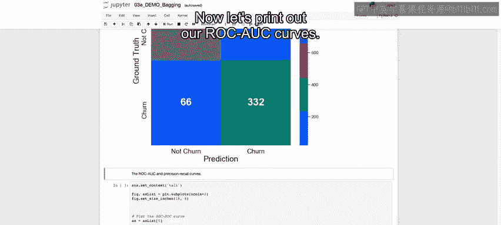

Now let's print out our ROC AUC curves。Now， the way that this is going to work here we're going to actually have two different subplots。

 so we're going to have an axe list， so two bounding boxes that we're going to be putting our plots。

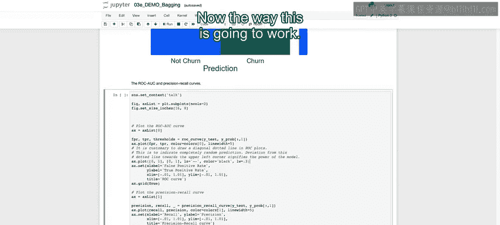

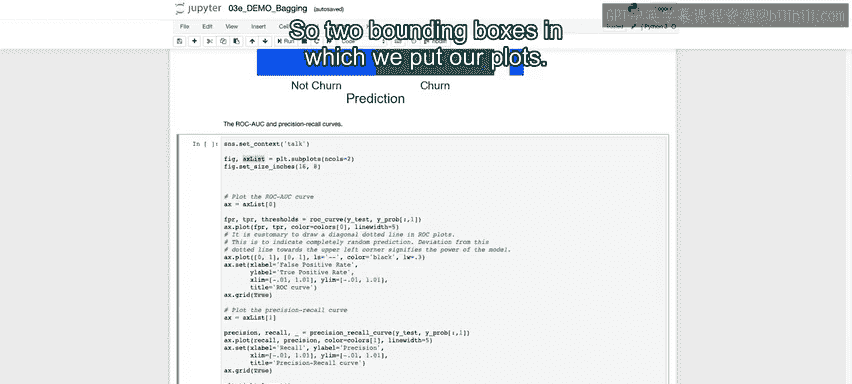

That in which we put our plantss。

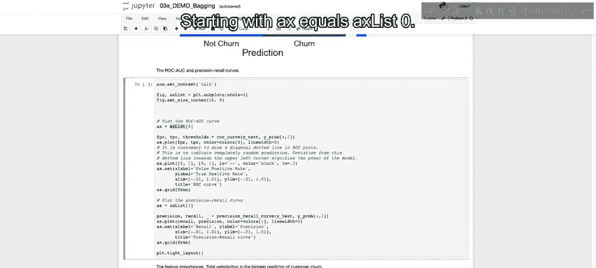

Starting with x equals x less zero。We are going to get our R OC curve。

 which will output the false positive rate， the true positive rate。

 which are the two values we want to plot against one another， as well as the different thresholds。

 So if you call the R O C A you see is going to plot across multiple different thresholds。

 what the actual class， how well it was able to predict each one of the classes。

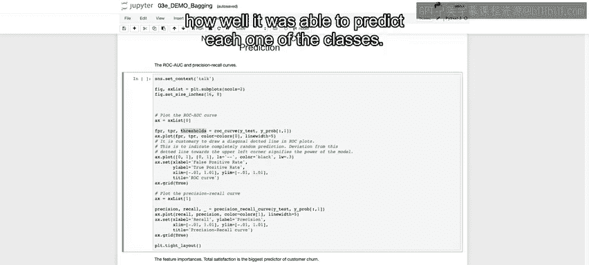

And we pass in that Y test， and then we pass in our probability values。Which we calculated earlier。

 again just for that positive class。We're then going to plot the false positive rate on our x axis。

 the true positive rate on our Y axis。

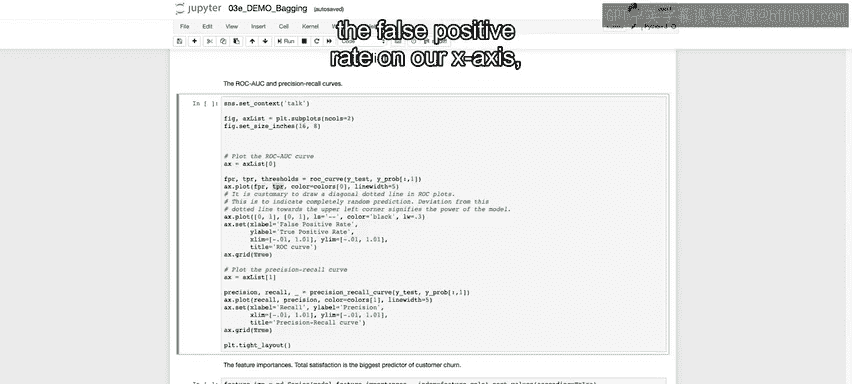

Using one of the colors from our color scheme that we have。

 and we're setting our line width here equal to five。

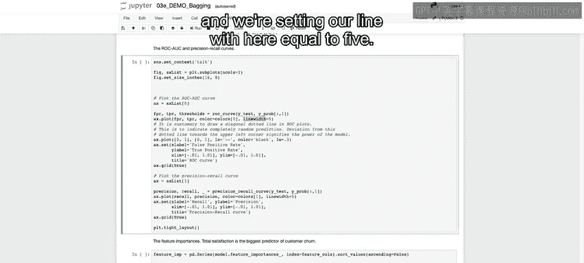

We're then going to plot， make sure that that's between zero and1， just a dashed line。

From to create that diagonal from 01 to 01 with a line width equal to 03。

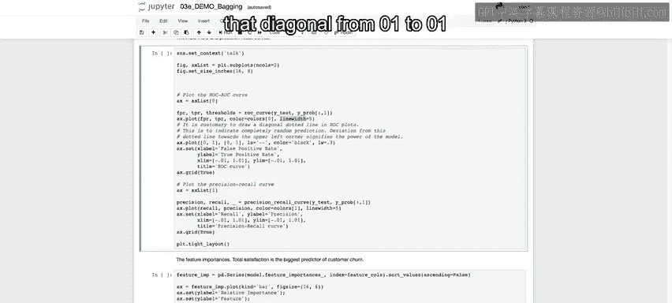

We're then going to set each one of our X label， Y label， our X limits， Y limits and the full title。

 and we're going to pass a grid on top of that object。Then for the precision recall curve。

 we're moving to ax list 1。We call that precision recall curve on our Y test and our Y Prob for just that second column。

We get our output of precision recall， as well as our thresholds。 We don't need that here。

We're going to call the P on recall and precision， so recall the X axis， precision the Y axis。

 and we should see that trade off。And again， using many of the same defaults that we saw before。

 we set our X label， our Y label。Ploot a grid and so on on our again second bounding box here。

So let's run this。

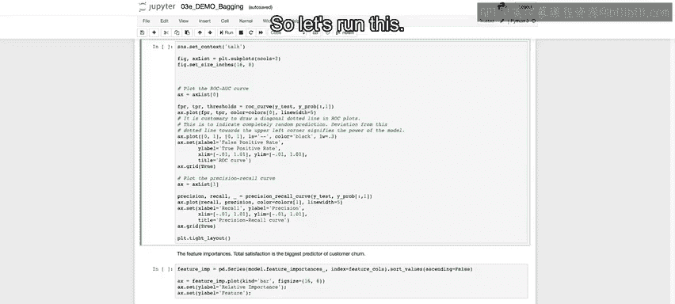

We see our ROC curve， this diagonal is just going to be as good as a 5050 split。

 We have a fairly strong curve。And then we see， in the other end， that precision recall trade off。

 again， a pretty strong curve。 We are doing a fairly good job in regards to our prediction here。

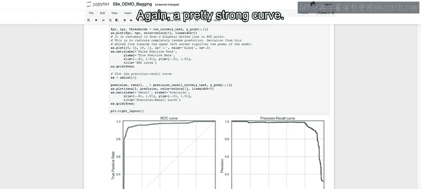

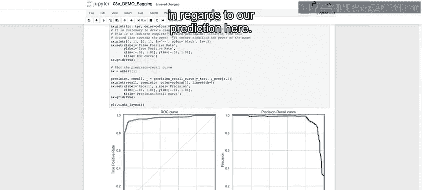

Now to get our feature importances， all we have to do is call model dot feature Is。

And that will give us a value where a larger value means it's more important and a smaller value means it's less important。

We're going to create a series。With the index equal to each one of our different feature columns。

Any one of our values are equal to the respective feature importance。

 and then we're going to sort those values。We're then just going to call that panda series。 plot。

 we're going to create a bar plot。

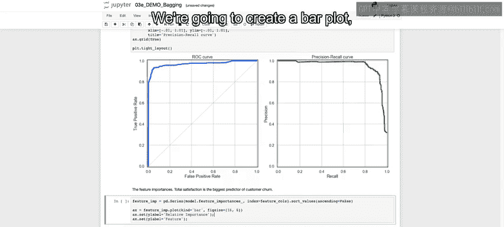

Said our Y label。And we run this。

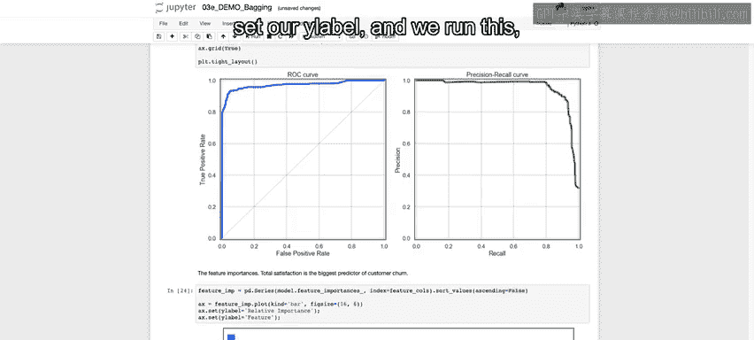

And we see that satisfaction。Is by far the most important feature， which makes sense。

 as if someones more satisfied， theyre less likely to churn。

 as well as that correlation that we saw earlier， or that was the most heavily weighted point in regards to which one of the different values correlated most with churn value。

Now that closes out our notebook here on bagging from here， we will go back to our lecture。

 talk about another ensemble method， which is boosting。 All right， I'll see you there。

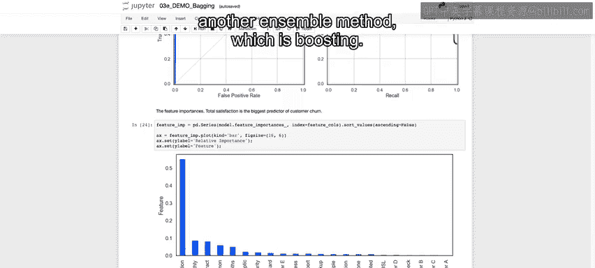

