# IBM《机器学习（数据探索、监督学习的回归和分类）｜machine learning》中英字幕 - P137：48_bagging回顾.zh_en - GPT中英字幕课程资源 - BV1xM4m1D7kY

In this next set of videos， we're going to discuss other methods of metaclassifiers that is bringing many classifiers together to output a single decision。

Specifically， we will be using boosting and stacking methods。

So let's go over the learning goals for this section， and this section。

 we're going to cover boosting approaches to combining models。And as we'll see。

 as opposed to bagging， whose main function is to find a way of reducing variance。Boosting。

 while it does help with reducing variance as well。

 is more meant for business problems where we may want to continue to better fit or can even say correct our model to ensure that we get even rare events correct。

 So some foreshadowing gear， unlike with baggging， it will be easily possible to overfit our data set。

We'll then briefly touch on different models available， both gradient boosting and add a boost。

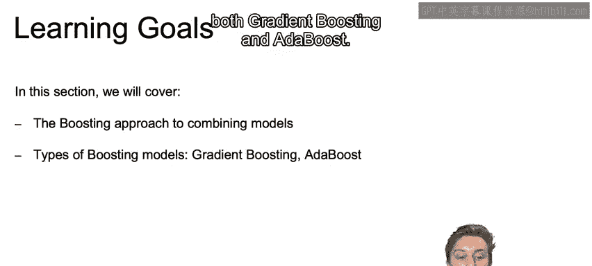

We will also discuss the loss functions of each of these models mentioneds。

 gradient boosting and addbus， and then finally we'll introduce how to combine heterogeneous classifiers to create one combined classifier using something called stacking。

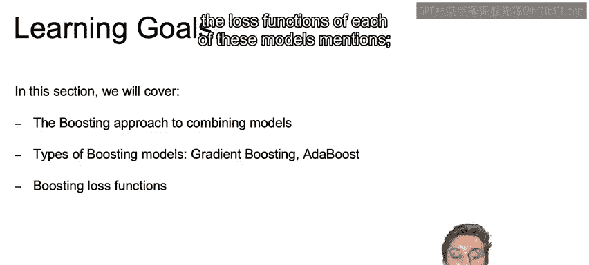

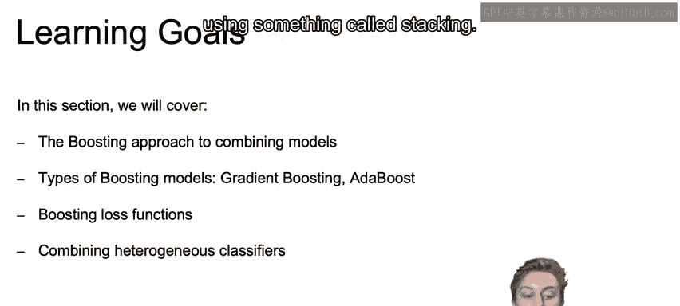

Let's start with a quick review of backing of our bootstrap aggregating。

Here we create Botrap samples。Followed by building independent decision trees on each one of these samples。

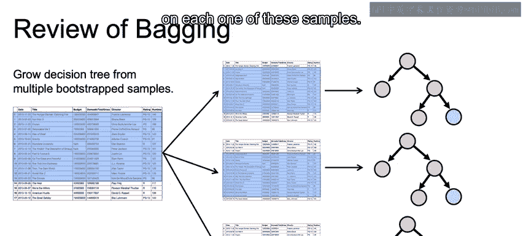

In contrast， when we begin to discuss boosting， we'll see that each one of these decision trees are not independent。

 but rather depends on prior trees that were built， so that's going to be our first main difference。

Also here， the decision trees can be fairly deep。 As we see here。

 we have two different splits for each one of our trees。And in practice。

 can have many more with boosting， we will discuss how we generally only have one split for each one of our different trees that we aggregate together。

So now we have our three decision trees in our bagging example。

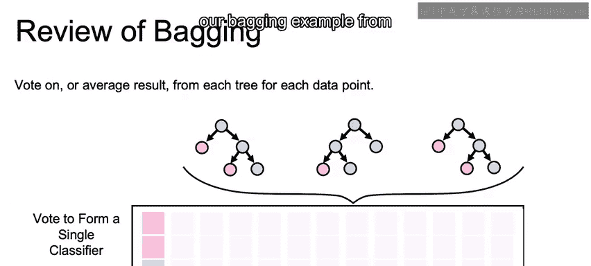

From our three different bootsrappped samples。

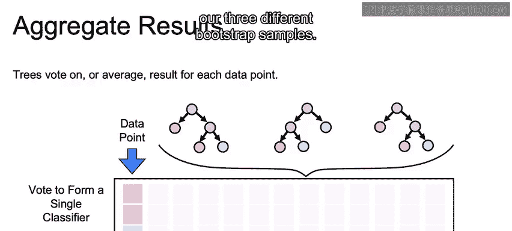

We then use those separate trees to vote on the results。So for a new record。

 we see that for a given record， we have two red and one blue。

 So we would come up with a classification of red using just that majority vote with each one of those different trees having equal weights。

😊。

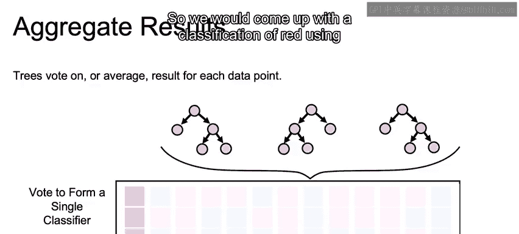

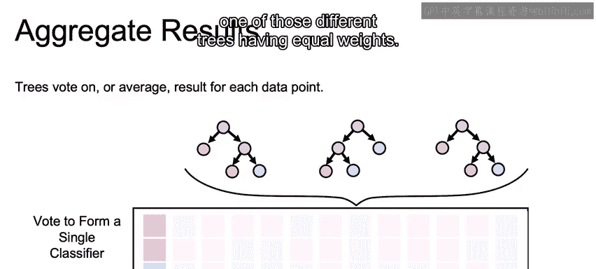

For boosting， on the other hand， another major difference。

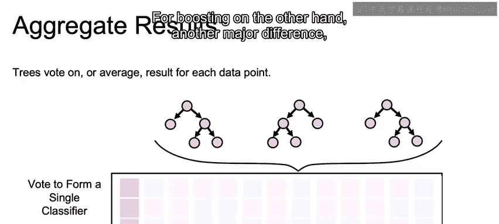

Will be that， rather than waiting each one of these trees equally。

We'll have a system of weighting our different trees with different weights and we'll see how we do that in just a bit。

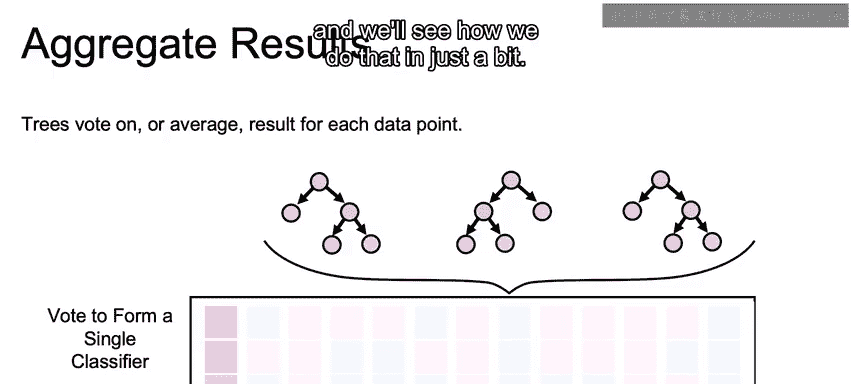

And finally， for both bagging as well as boosting， we apply our respective methods for all of our records to see the metaclassifier for each one of these different records。

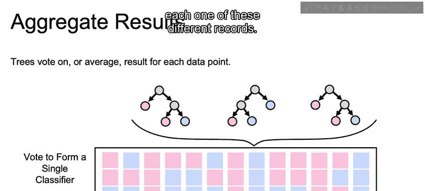

So that was how baggging worked， simply taking many random trees and voting for that majority class。

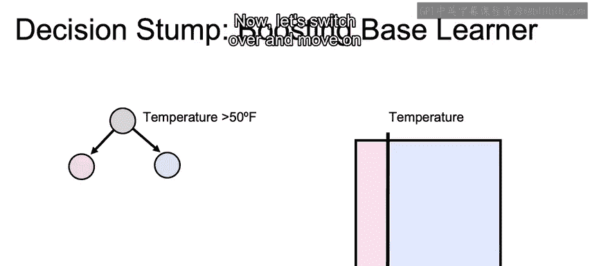

Now let's switch over and move on to how we'd actually come up with our boosting method。

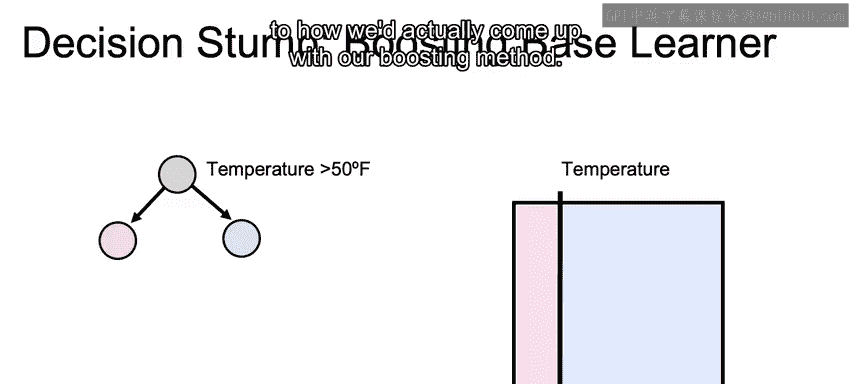

As mentioned here we are beginning with a decision tree with just one split， so no deep trees。

 just one split， and the term for a decision tree with just one split that well be using is a decision stump。

And this first st will split the universe of outcomes into two different values。

 as we see across this temperature line that's splitting between our pink and blue and our overall data set。

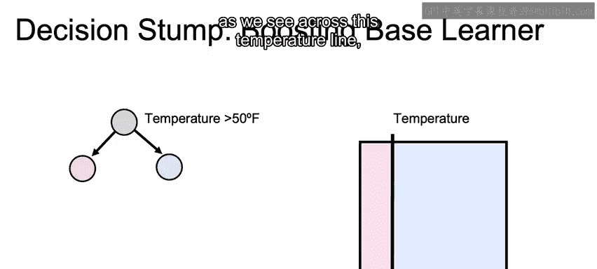

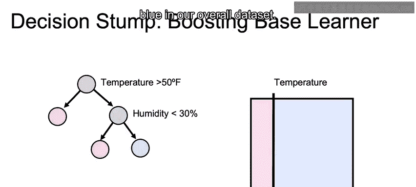

In prior cases。We would experiment with more complicated base learners beyond this stump。

 And if we added one more node， say humidity， we would get something like this。😊。

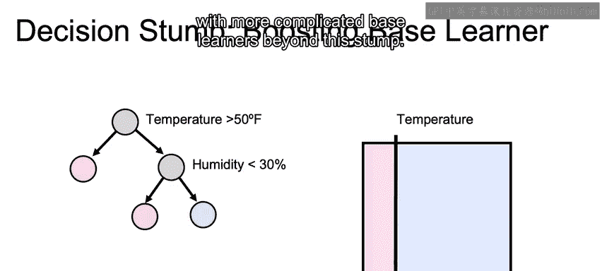

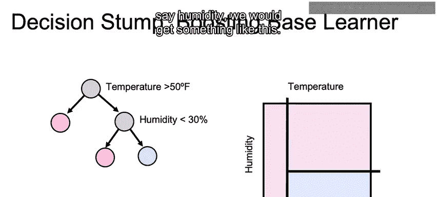

Now this looks very similar to our deeper decision trees。

But the intuition that we're trying to build here is that we're just building from our original decision stump。

Further small decision stumps in order to improve our original decision boundary。

Each one of these stumps are going to be called weak learners。

 so we're also going to call these weak learners throughout and with boosting。

We create a new way to decide on and stack together many weak learners intelligently to ultimately come up with a strong classification algorithm。

 and we'll see how we actually do this in the videos to come。

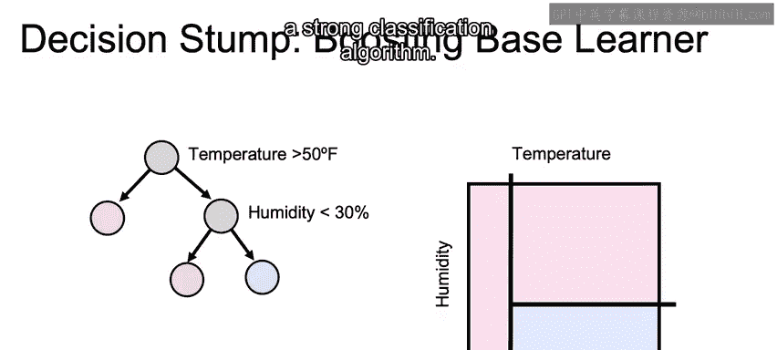

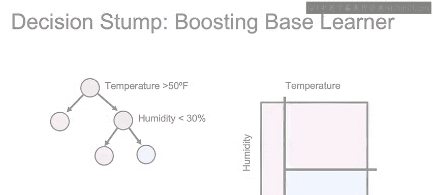