# IBM《机器学习（数据探索、监督学习的回归和分类）｜machine learning》中英字幕 - P140：51_Adaboost和梯度boosting语法.zh_en - GPT中英字幕课程资源 - BV1xM4m1D7kY

In this video， we're going to only focus on the Python syntax for the boosting algorithms。

 and we're going to go over gradient boosting and add a boost using Python。

So first step is that we're going to import the class containing our classification method here focusing on gradient boosting。

 so from SK learned to ensemble， we import the gradient boosting classifier。

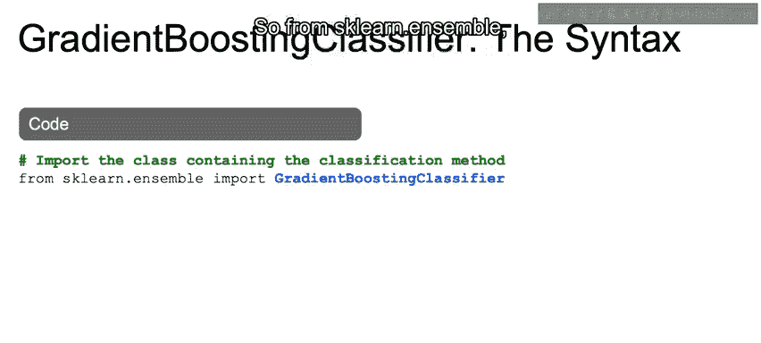

We're then going to initiate an instance of the class。

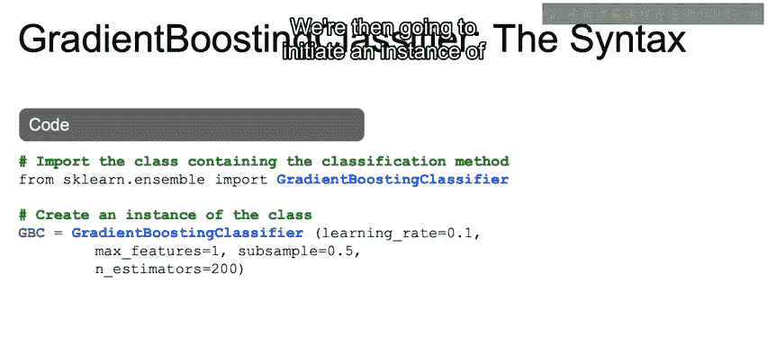

And we pass in the hyper parameterss， many of which we discussed in the last video。

 We have a learning rate of 0。1， which is a normal choice。

 Max features equal to  one is a very low choice。 That means that every single one of our splits。

 we're only going to look at one feature to split on。

 So that will be introducing more bias and reducing our variances。 and then subsample equals 0。

5 again， that is normally along the normal range of values that would be passed。

 and there we as discussed in last video， just using a subsample in order to fit each one of our different trees。

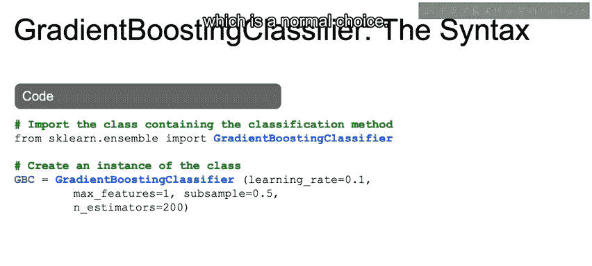

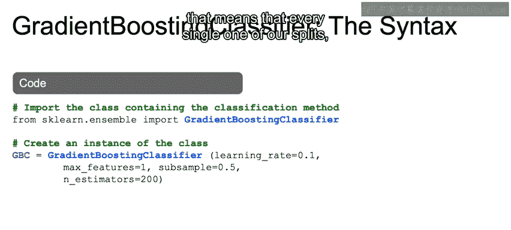

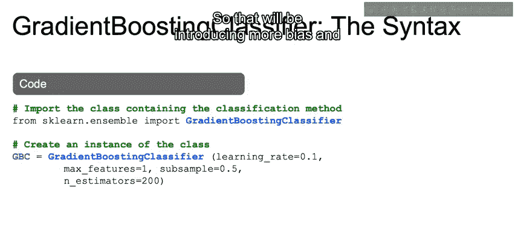

And then our number of estimators here is equal to 200。

 and that's as is with all these other features as well。

 going to be something you have to iterate on to figure out what the right number of trees is in order to optimize our model on a hold outset。

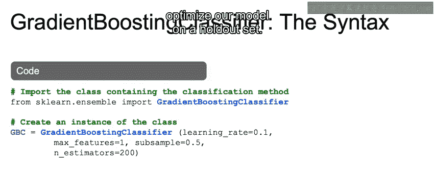

Then we're going to fit our instance， so we're passing in our training set and calling JBC。

fit on our Xtrain and Y train， and then we're going to predict on our test set as we've done with all of our other models。

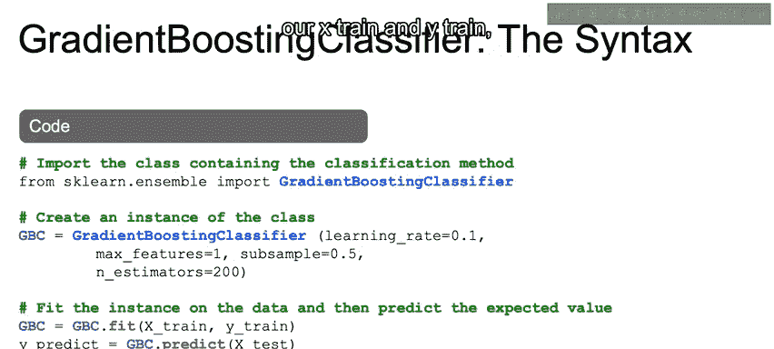

And then as usual， if you want to make sure that you get each one of these hyperparameter optimized。

 we want to use cross validation， and if you want to do regression。

 you use gradient boosting regressiongressor。

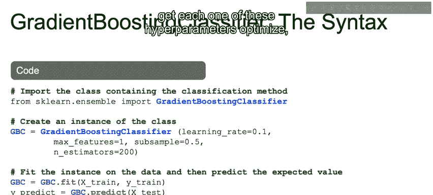

Something to keep in mind whenever we're doing Boing is， again， we do need these successive trees。

 So every tree can only be fit after that last tree was fit。

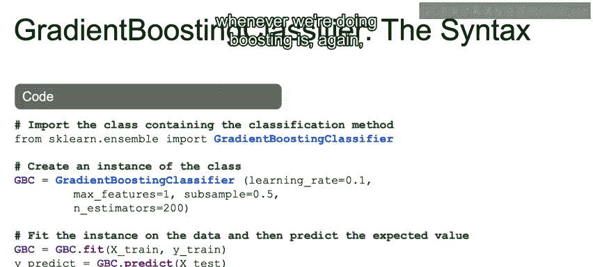

So when we have a lot of trees or a lot of estimators， as the hyper parametermtor calls it。

 we may end up taking a very long time to fit our model。

 So we want to be careful when using gradient boosting since we can't paralyze as well as we can with the bagging techniques that we take this time consideration into account。

😊。

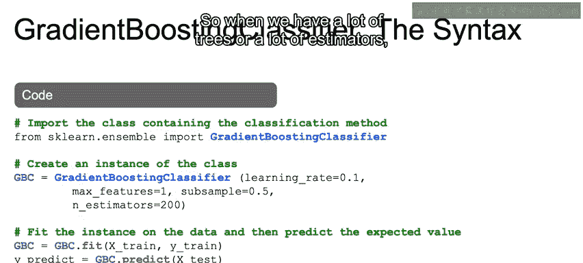

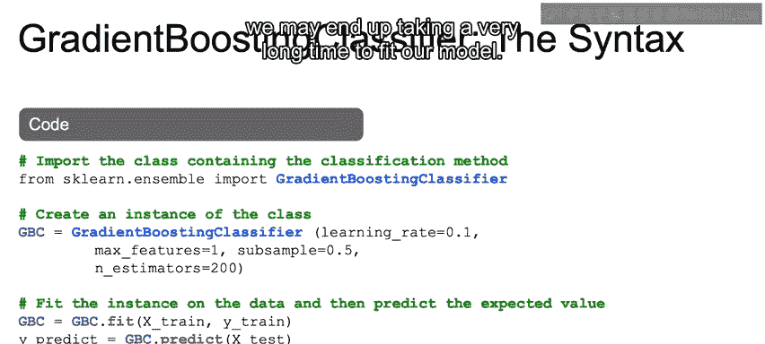

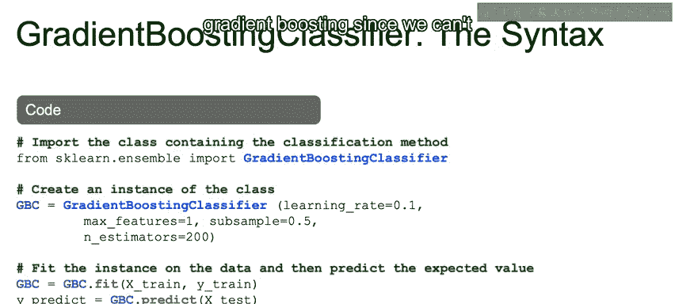

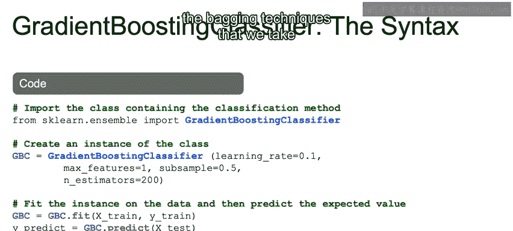

Now let's look at the add boost classifier。Here we're going to import， as usual。

 SK learned to ensemble， we import our Addbu classifier。

 and then here we're also going to import the decision tree classifier and we'll see why in just a second。

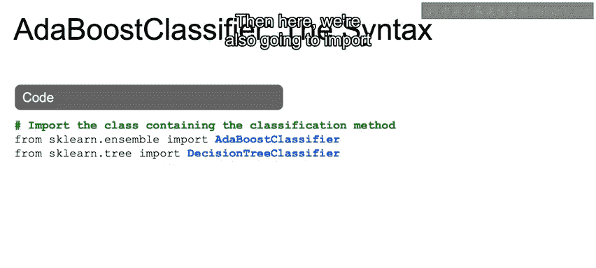

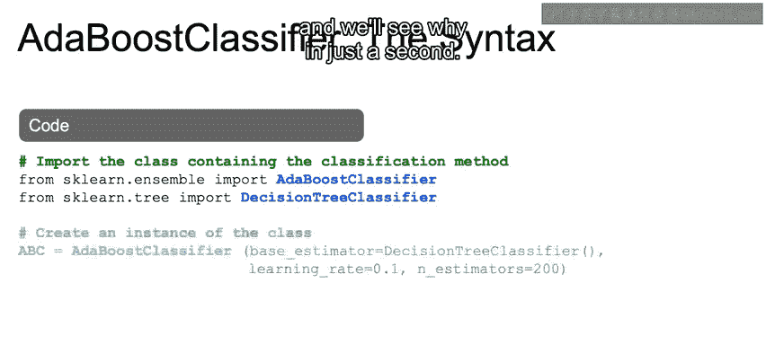

So we're going to createate an instance of the class， so as usual。

 we say add a boost classifier and pass in each one of our different hyperparameter。

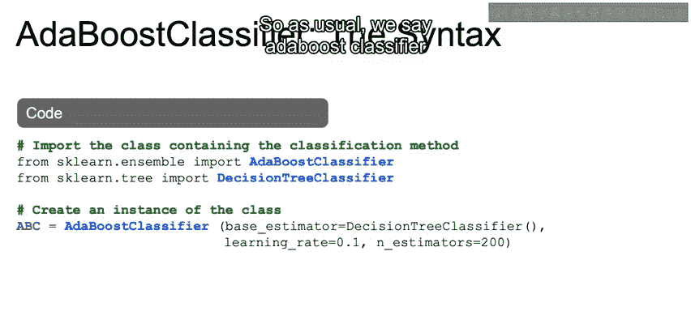

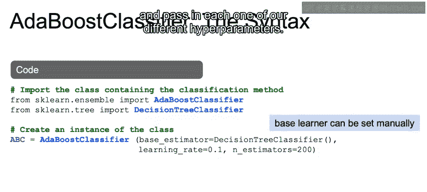

And then we see here that we can set that base estimator manually。

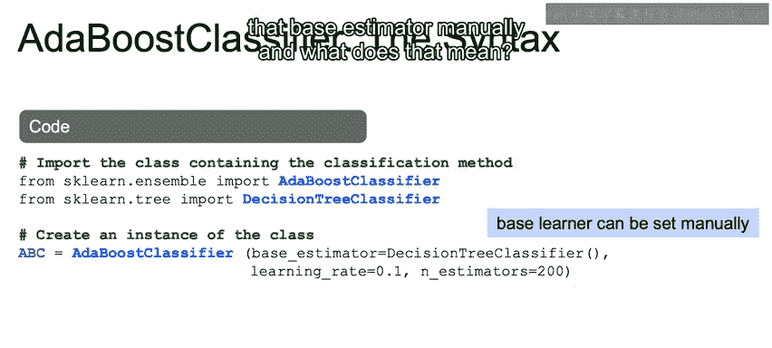

And what does that mean， We don't， first of all， necessarily have to have a decision tree classifier。

 It will be difficult to intertwine some of the different models。

 but you can look at the documentation as to what you would need in regards to the space estimator。

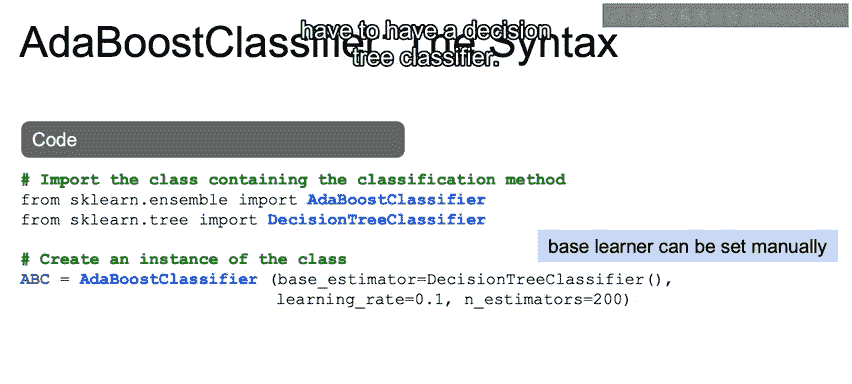

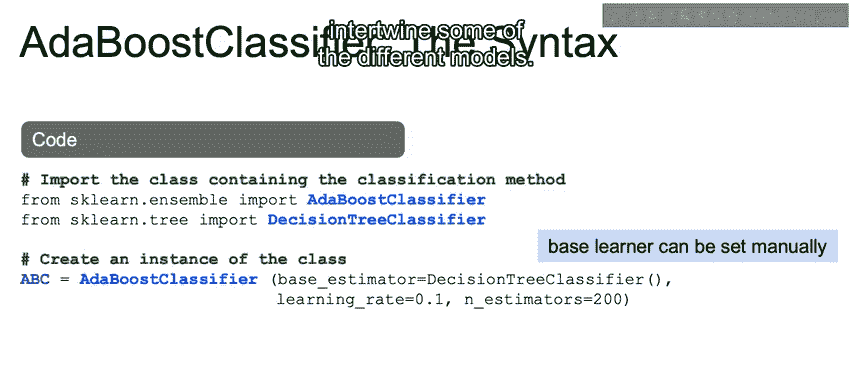

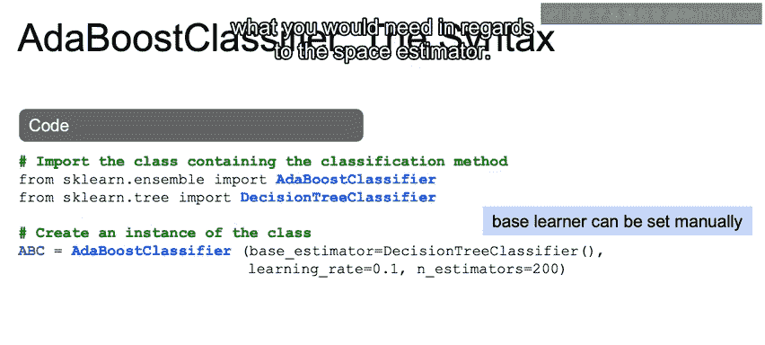

But another thing that you can do here。Is that。You can actually set the max depth of your decision tree within your base estimate。

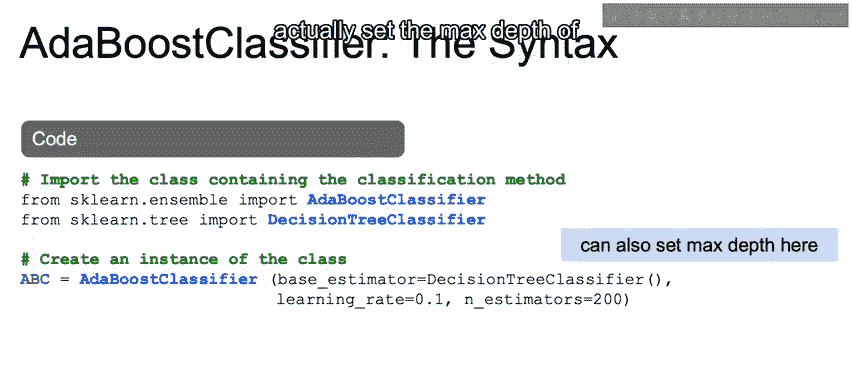

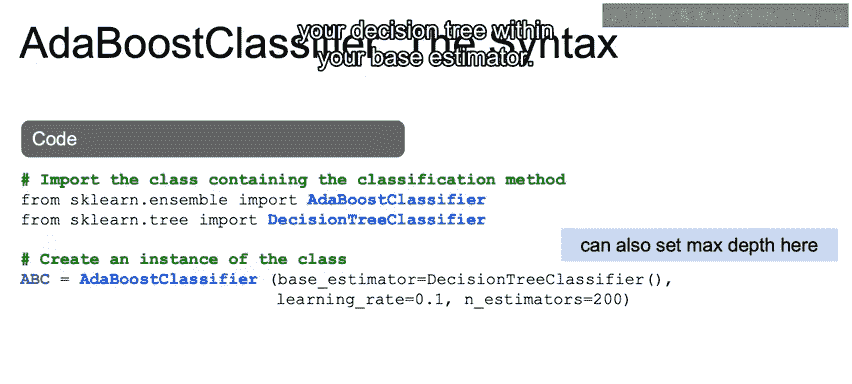

So rather than having that decision stump， you can change it by passing in a decision tree classifier and then setting the max depth for that decision tree classifier that you passed in as the base estimator。

Something to note the way that it's written here it's using the default values for the decision tree classifier。

 so this is actually going to be much larger than a stump because if you recall when we did decision trees。

 this actually has no max depth。

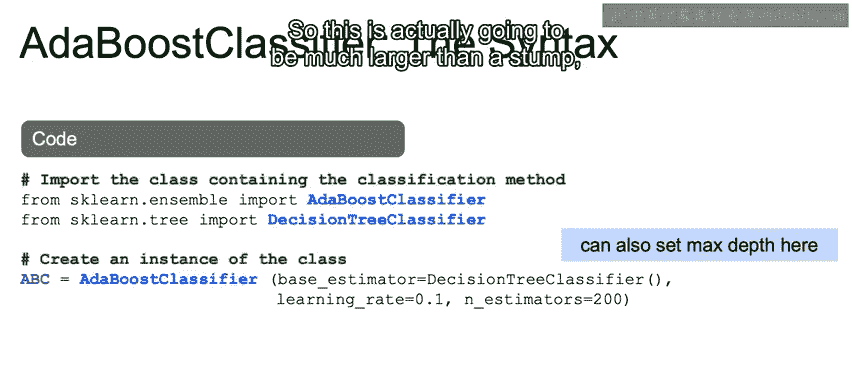

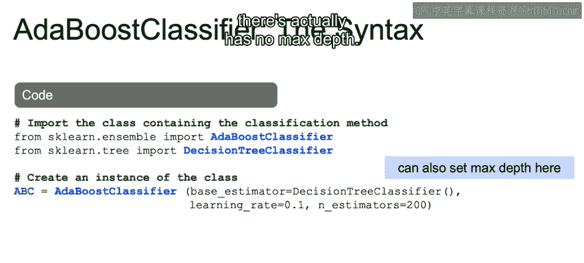

The default is going to be a max depth of one， as we discussed with your normal add a boost classifier。

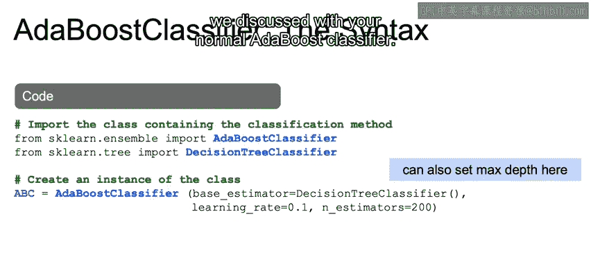

We then set our learning rate equal to 0。1 and our number of estimators equal to 200。

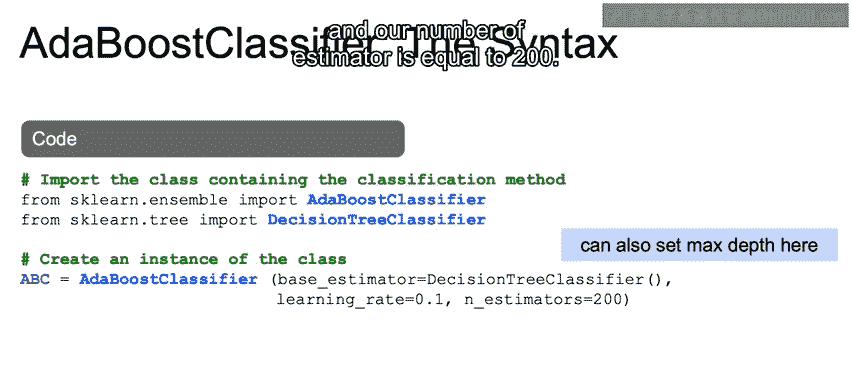

We can fit our model on our training set， predict it on our test set， and then again。

 we can tune this with cross validation， and we can also use add a booster wreser if we want to do regression。

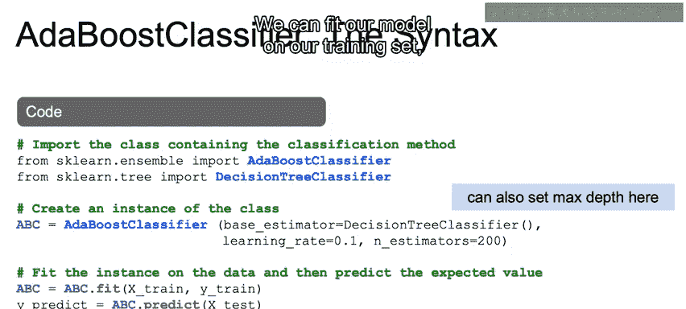

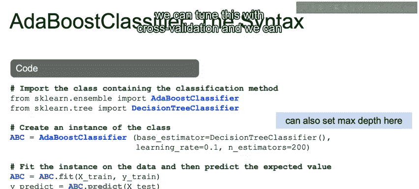

Now that closes out our discussion here on boosting in the next section we're going to take the ensemble methods one step further and discuss stacking as well。

 Allright， I'll see you there。

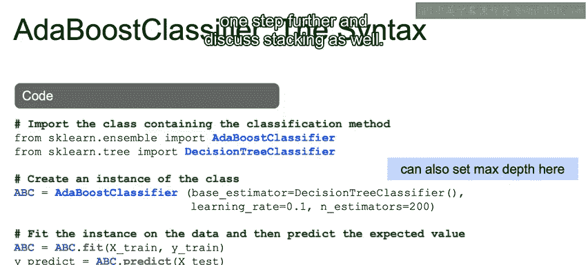

