# IBM《机器学习（数据探索、监督学习的回归和分类）｜machine learning》中英字幕 - P145：56_模型可解释性.zh_en - GPT中英字幕课程资源 - BV1xM4m1D7kY

Welcome to Machine Learning Model Interability After watching this video。

 you will be able to explain why machine learning model interpretability is important and differentiate between self interpretable and non self interpretable types of models。

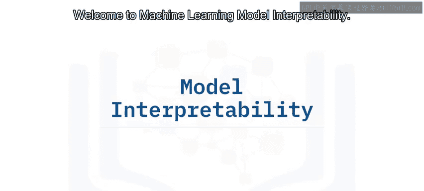

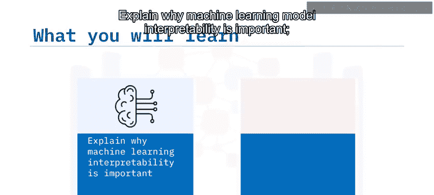

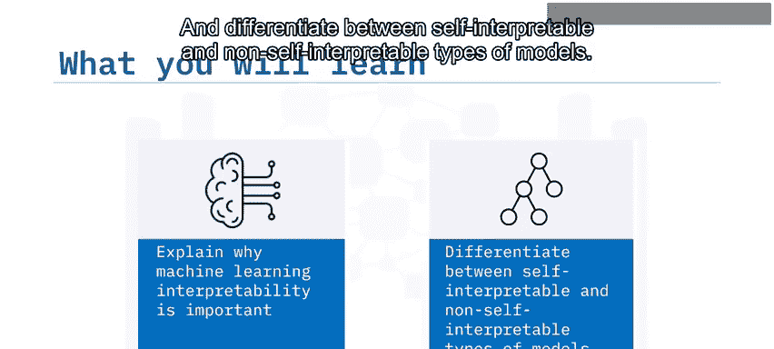

Dear seller， it is estimated that your house could be sold for $855，000。

HCan you tell me why， Because I think the price is lower than I expected。 Definitely。

 this prediction is based on an ensemble of 200 decision trees with 50 features。

 Do you want to see the details。Okay， never mind。Ideally， all systems。

 even a system as complex as a space station should be understandable by human beings， however。

 for AI or machine learning systems due to their implicit self learning and evolving nature are becoming more and more complicated。

For example， the random forest is a classification algorithm potentially containing hundreds of different decision trees。

Such complicated machine learning systems normally can perform well on their predictive tasks。

 but grasping the outcomes of complex models can be hard to comprehend。In general。

 we need explanation methods that can make the behaviors and predictions of machine learning models understandable to humans。

We need to use those methods to understand the model structures。

 what important features should be included in the model。

 and how those models map features to prediction outcomes。In addition。

 sometimes knowing how models work exactly may give us more insights than merely predicting the outcomes。

For example， understanding how an AI system diagnoses cancer may help human health experts identify evidence based risk factors。

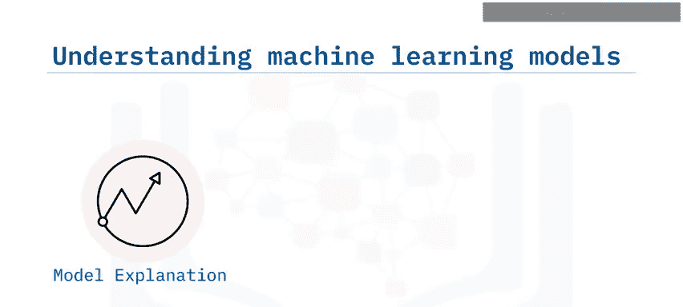

For decision makers， interpretability is important。

 especially for those in very sensitive or high risk domains such as finance or health。

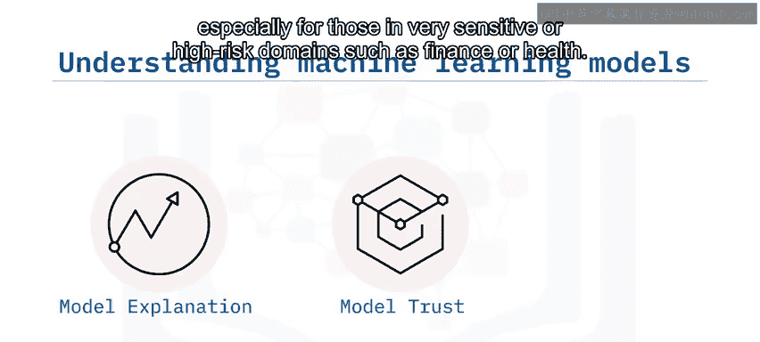

We need to be confident and be able to trust that the model is working correctly。

Black box Ma learning systems cannot be trusted unless they have been monitored and interpreted。

As such， building trustable models is sometimes even more important than building high performing models。

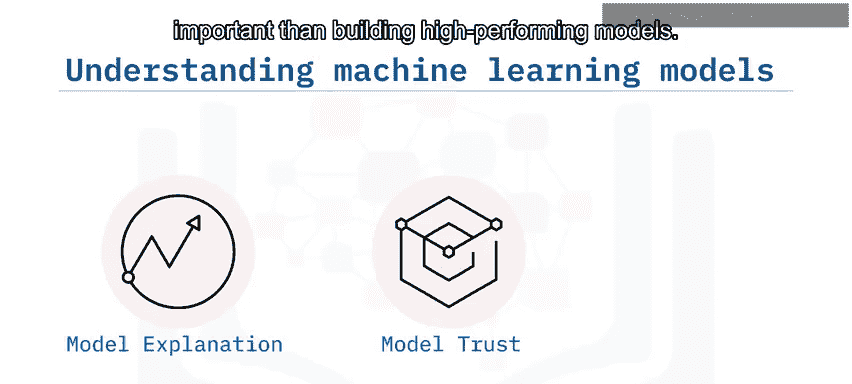

Deployed models in production may have unexpected issues such as low prediction accuracy or unacceptable bias。

To debug and fix those issues， developers need to understand how and why the model made such problematic predictions。

 which again requires models to be interpretable by the model's developers。

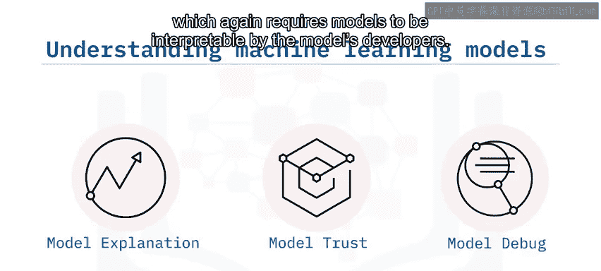

Basically， machine learning models can be categorized into two groups regarding their interpretability Se interpretable models refer to those models with simple and intuitive structures which are easily comprehended by humans without extra explanation methods。

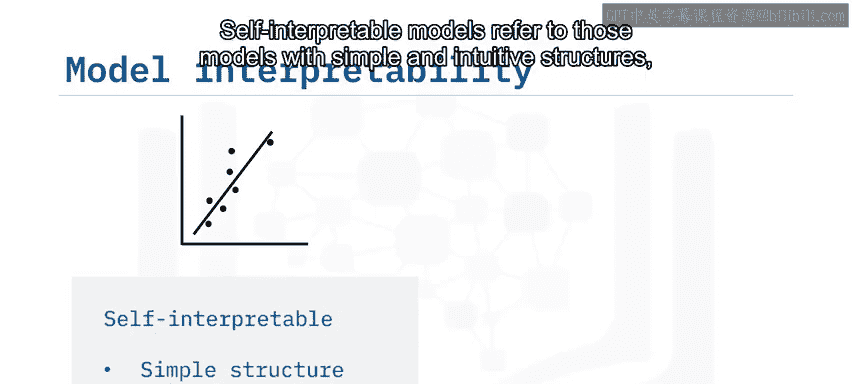

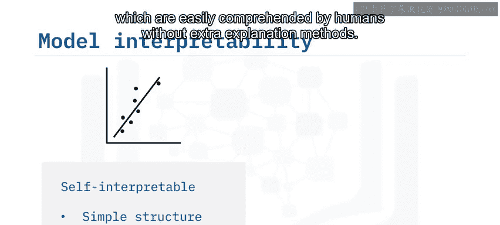

Self interpretable models are usually preferred in high risk areas， such as finance or health。

 because humans could also understand the model's logic and make similar predictions。

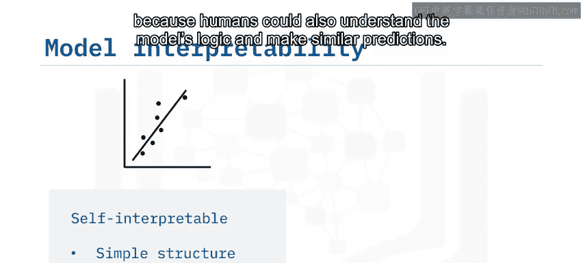

In contrast， non self interpretable models are those models with complex structures and can be described as the black box models。

The main reason we use those complex models is they normally can achieve the state of the art performance in specific problems。

 such as natural language translations， image recognition， and traffic patterns。Next。

 you will see some examples of self interpretable and non self interpretable models。

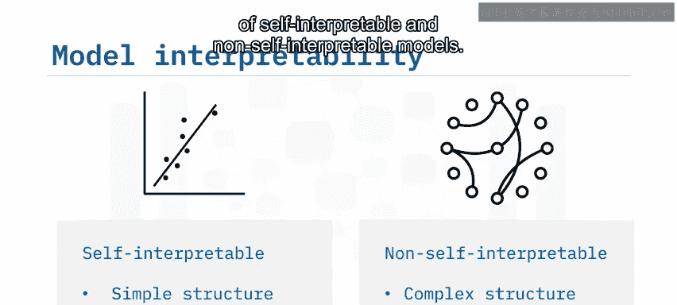

In this video， you learned that we can only trust and effectively debug machine learning models if they are understandable。

And machine learning models can be either self interpretable or non self interpretable。

