# IBM《机器学习（数据探索、监督学习的回归和分类）｜machine learning》中英字幕 - P147：58_模型无关性解释.zh_en - GPT中英字幕课程资源 - BV1xM4m1D7kY

Welcome to Model agnostic Expations。

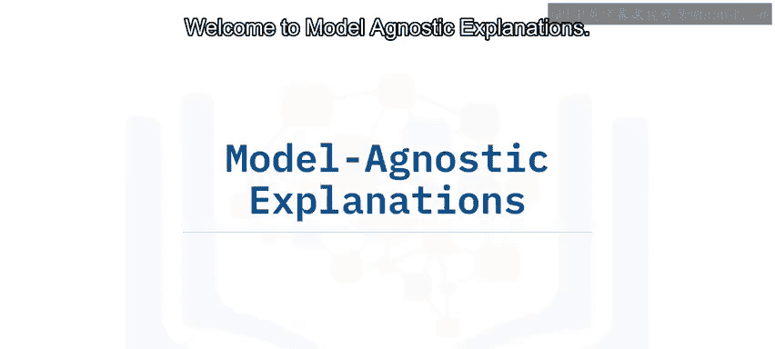

After watching this video， you will be able to describe what model agnostic explanation methods are。

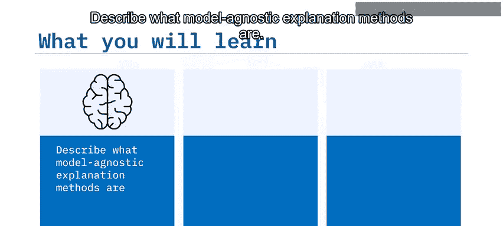

Identify the main features of a model by applying permutation feature importance。

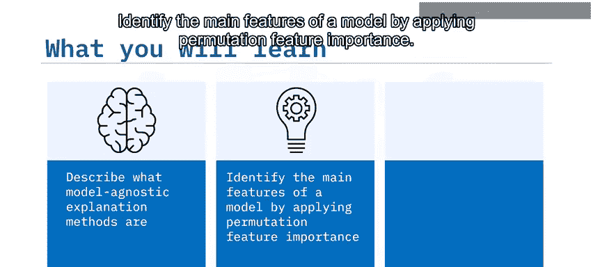

And identify how specific features affect prediction outcomes using a partial dependency plot。

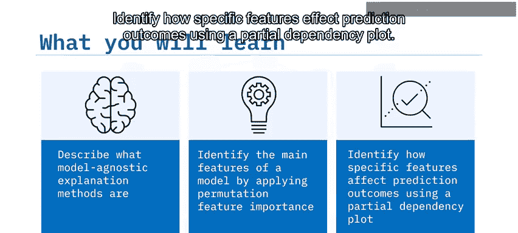

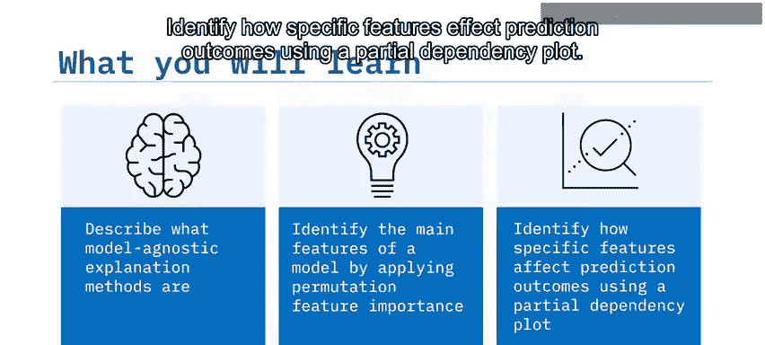

So far， you have learned about many machine learning models with different structures。

 training methods and outcome presentations and we typically explain them very specifically for example。

 we use feature coefficients to explain linear models or use the tree paths from root to leaves to explain tree based models。

 This would make the model interpretability process very challenging as we would need a different explanation method for each type of model。

To tackle such model specific explanation challenges。

 we can use a unified or model agnostic explanation method to explain different types of machine learning models。

 no matter how complex they are。And produce effective model explanations that have the same formats and presentations。

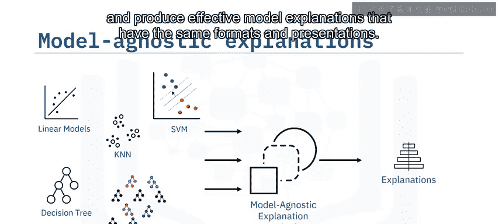

Let's use a specific classification task to examine how a model agnostic explanation method works。

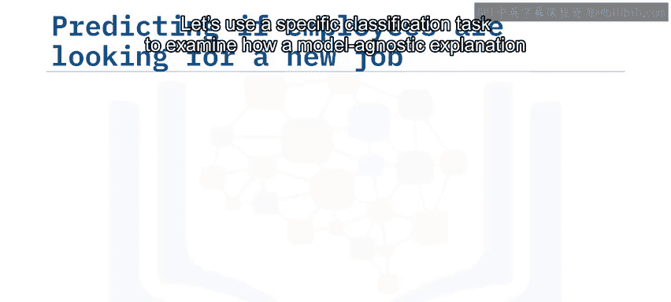

In this example， suppose we have built an accurate but complex classification model using employees profiles such as their city development index。

 their company size， and type， their education and experience levels。

 etc to predict if they are looking for a new job or not。

Now let's take a look at how a couple different popular model agnostic explanation methods work to explain this classification model one common way to explain a machine learning model is by identifying its most salient features。

 this provides two benefits。

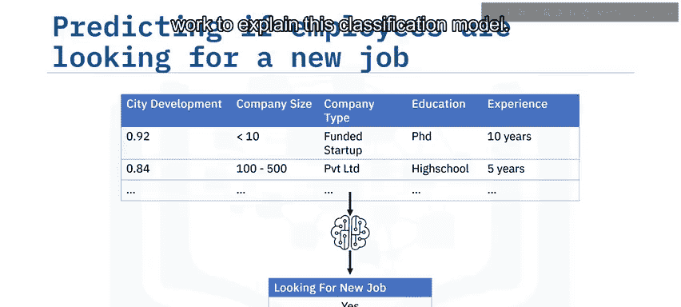

First， you may want to simplify your model by including only important features to reduce the risk of overfitting。

Second， you may interpret how the models make decisions by analyzing their most important features。

 so how do we measure feature importance， There are many algorithms such as permutation feature importance。

 impurity based feature importance and Shaplely additive explanations known as Shap values to name a few they all share similar principles。

 and in this video， we will focus on the most popular method， permutation feature importance。

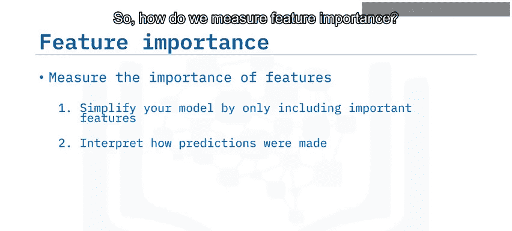

The basic idea of permutation feature importance is very simple。For each feature。

 we shuffle its feature values and use the model to make predictions based on the shuffled values。

 In most cases， the prediction error will increase。

 permuting important or impactful features will tend to generate large prediction errors。

 and less important features will tend to generate small error increases。As such。

 feature importance can be measured by calculating the difference between the prediction errors before and after permutation。

Let's go back and consider our example for predicting if an employee is going to look for a new job。

 Sose we want to measure the prediction error if we permute the city development index feature First we shuffle or permute its feature values。

 which could be a random permutation， or it could be based on certain distributions due to such feature value changes the model's predictions will be downgraded。

 which causes increasing prediction errors we could thus calculate the importance of the city development feature by measuring the difference in prediction errors caused by permutating its values。

Furthermore， we can calculate and then rank the permutation importance for all features and visualize them using bar charts or box plots。

As shown here， we immediately find the top five most important features used to predict if an employee is going to look for a new job or not。

 Those top five features are city development， company size， education experience。

 and the company type is private limited。

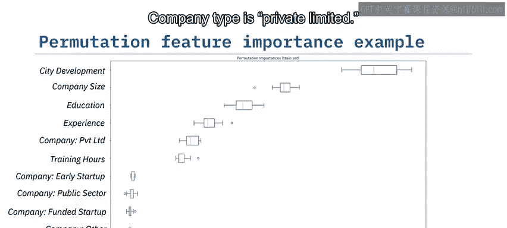

By now， you have learned how to find the relative importance for each feature using permutation feature importance。

However， sometimes just figuring out importance is not enough。

 we also may want to know the relationship between interesting features and model outcomes。

 such as if the relationships are linear， nonlinear or monotonic， etc。

 this will help us understand more about those importance features。For example。

 in predicting job change， we know experience is important。

 but we also may want to know if senior employees are more likely to look for a job change than junior employees。

Partial dependency plot is an effective way to illustrate the relationship between a feature and the model outcome。

It essentially visualizes the marginal effects of a feature， that is。

 it shows how the model outcome changes when a specific feature changes in its distribution。

Note that we keep the rest of the features unchanged while changing the interested feature for example。

 we want to see the relationship between experience and the model outcome。

 so we just need to alter experience values from its values that range from  zero to 20 while keeping other features unchanged and calculate the average predictions over all instances。

If we visualize the marginal effects of the experience feature using a line chart。

 then we can get the partial dependency plot or PDP。As we can see in this PDP。

 there is a rough linear relationship between employees experience and the probability of job change。

 and the decreasing line indicates that the more senior employees are。

 the less likely they will change their current job。

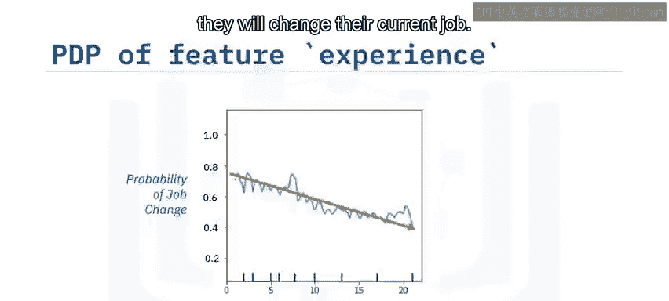

In this video， you learned that you can use model agnostic explanation methods to understand different models。

 regardless of their structures。

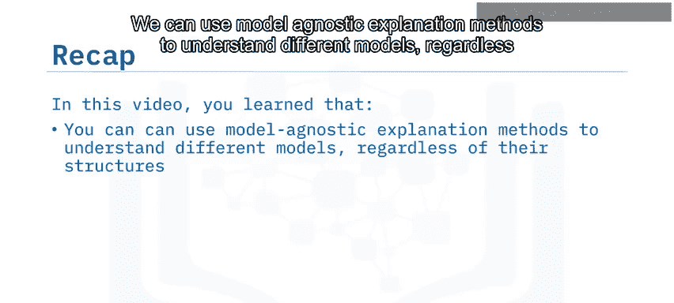

You can use permutation feature importance to calculate and rank feature importance。

And you can illustrate the relationship between an interested feature and model outcome using a partial dependency plot。

