# IBM《机器学习（数据探索、监督学习的回归和分类）｜machine learning》中英字幕 - P148：59_替代模型.zh_en - GPT中英字幕课程资源 - BV1xM4m1D7kY

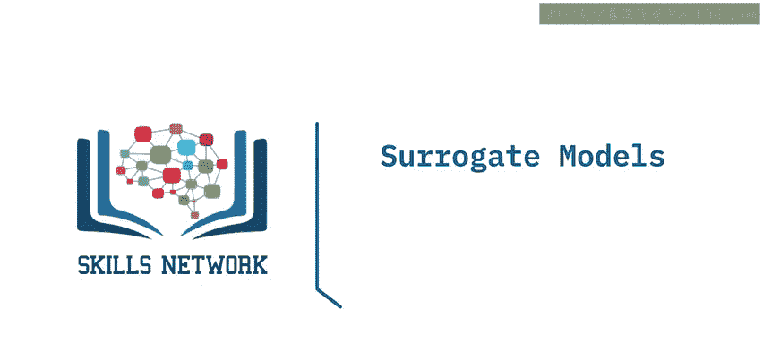

Welcome to Surrogate Models。

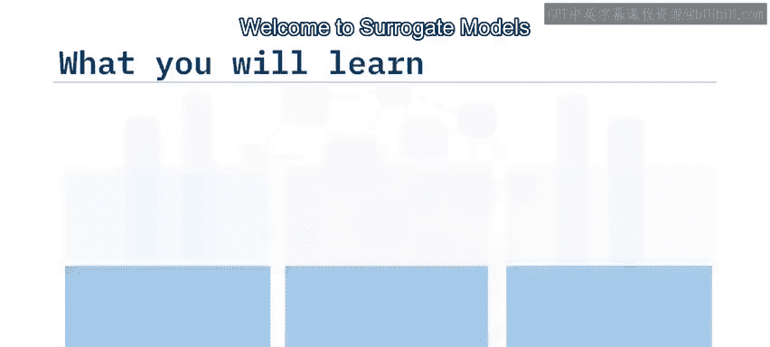

After watching this video， you will be able to explain the term global surrogate model。

 explain the steps involved in building global surrogate models。

 and describe how local interpretable model explanations。

 also called limemes make predictions given specific variable instances。

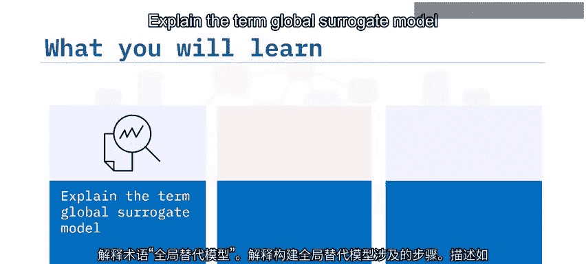

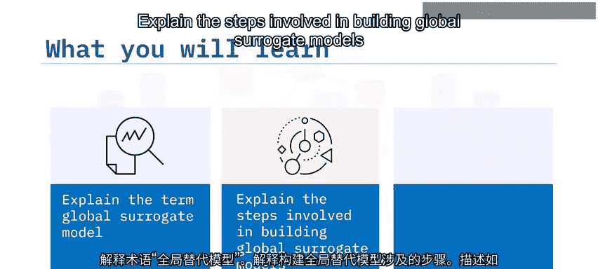

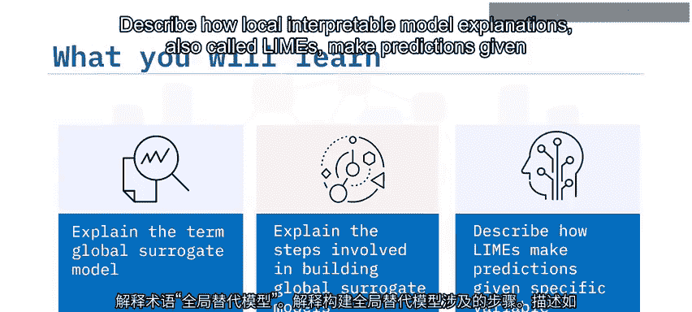

So far， we have learned how to explain a complex machine learning model via analyzing feature importance and PDP。

 both of which are focused on analyzing features。

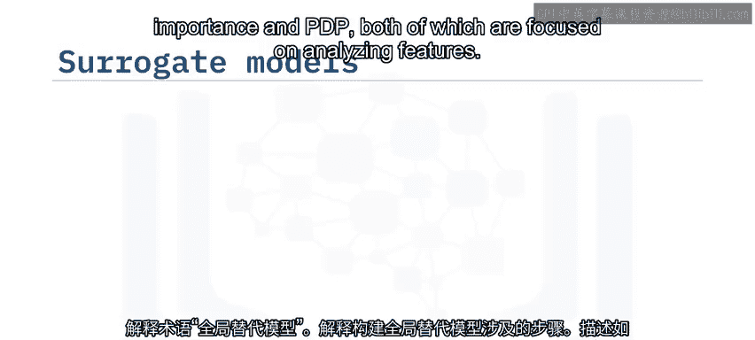

Next， you will be learning about another type of explanation methodology called surrogate models。

The principles of surrogate models are straightforward。

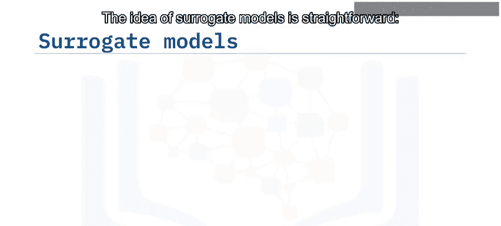

Suppose you have some non self interpretable models trained on a data set。

Now you want to understand them， but they are so hard to understand。

 and you have to treat them as black box models for now。In other words。

 we only know their inputs and outputs， but don't know how the inputs map to the outputs。

One way to explain them is trying to approximate their inputs and outputs by training self interpretable models。

 such as linear models or tree models， using the inputs and outputs of the black box models。

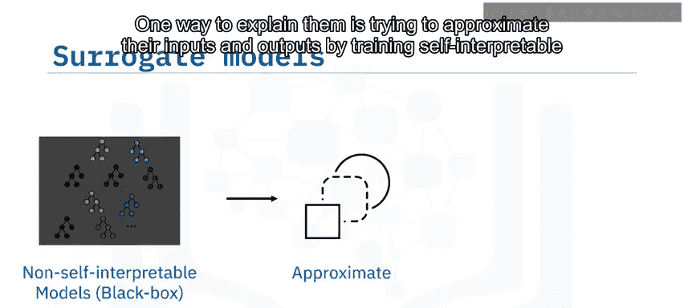

Such self interpretable models are called surrogate models。

If surrogate models have similar prediction outcomes as the black box models。

 and since they have high interpretability， we could just interpret the surrogate models instead。

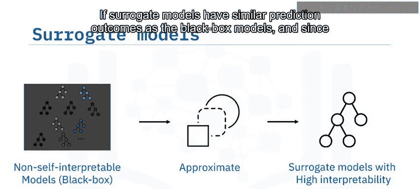

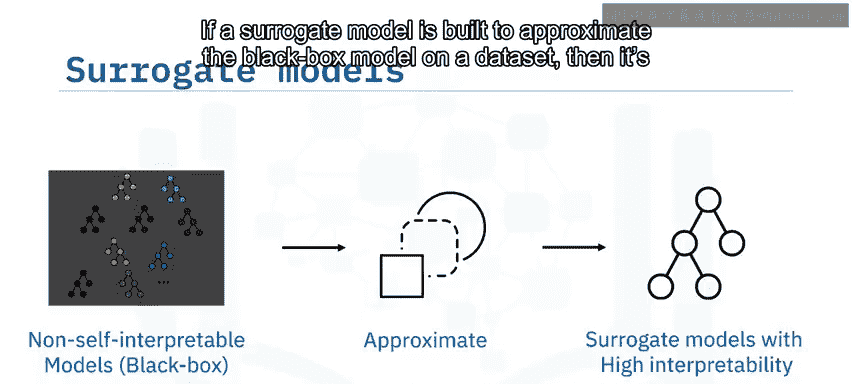

If a surrogate model is built to approximate the black box model on a data。

 then it's called a global surrogate model because it tries to approximate the black box model globally on every instance in the dataset。

You can follow these general steps to build a global surrogate model。First。

 we select a dataset set X as input。Then we use the black box model to make predictions Y using the dataset X。

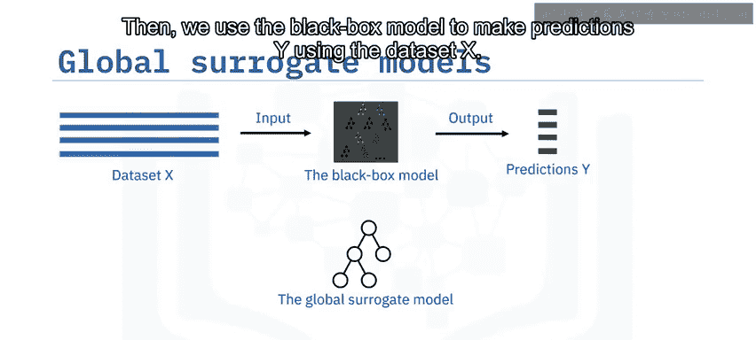

With both training data and labels ready， we can use them to train a global surrogate model。

 such as a linear model or tree model。

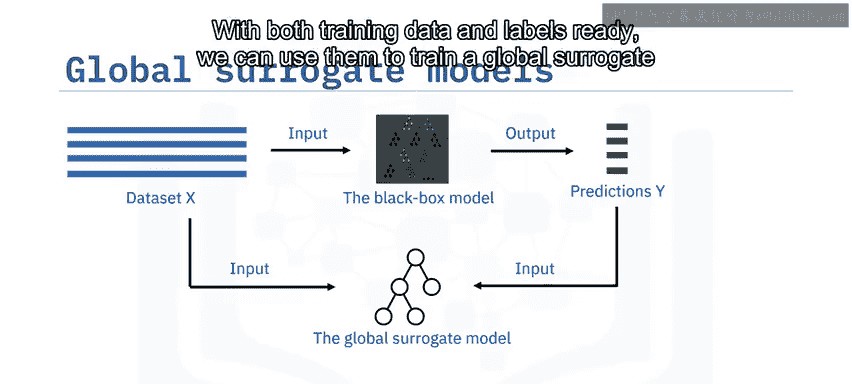

The surrogate model outputs its own predictions Y prime。

 which normally has a different distribution than the predictions Y generated by the black box model Lastly。

 we can measure the difference between Y's and Y primes， such as using R squared value。

 Kappa or categorical cross entropy loss。If their difference is relatively small。

 then we can see the surrogate model did a very good job approximating the black box model。

Then we can start to interpret the simple surrogate model instead of the original black box model。

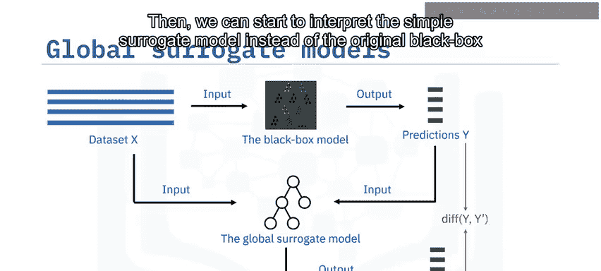

Global surrogate models are straightforward to build and can be effective in explaining black box models。

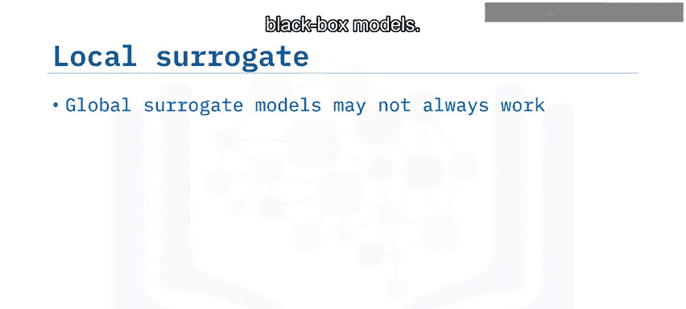

However， it may fail if there are large prediction inconsistencies between the complex black box model and the simple surrogate models。

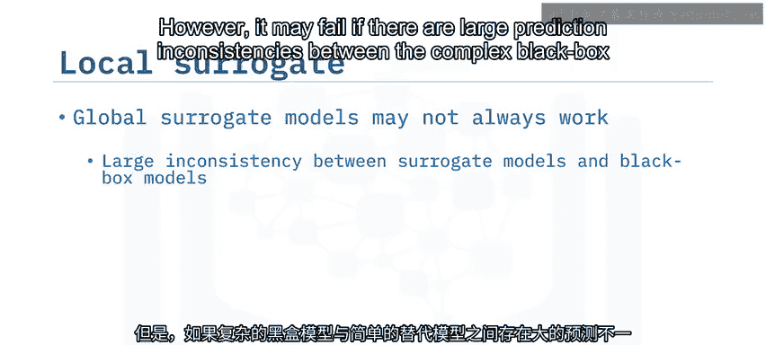

Or there are many instance groups or clusters in the data set。

 which make the surrogate model more generalized to those different patterns。

 causing a loss of interpretability on a specific data group。

These two scenarios are actually quite common when working with real world data and thus make global surrogating sometimes difficult to achieve。

On the other hand， we may also be interested in how black box models make predictions on some specific instances。

By understanding these very typical examples， we sometimes can obtain valuable insights without understanding the model's behaviors on the entire data set。

Thus， we want to be able to build a local surrogate model using one or a few instances。

 but is it possible to train a model using such a small amount of data？

The local interpretable model agnostic explanations or Lyme is a popular method used to build a local surrogate model。

The main difference between Lyme when compared to building a global surrogate model。

 is that Lyme first generates an artificial data set based on the selected data instance。

Suppose we have selected a representative data instance。

 and we want to understand how the black box model makes predictions with this data instance by building a local surrogate model using this single instance。

As mentioned earlier， we want to use this single data instance as a seed to build an artificial data set that is big enough to train a model。

One way to generate such a data set is using feature permutations。 In other words， for each feature。

 we randomly sample its values based on its value distribution This is similar to what we did with permutation feature importance。

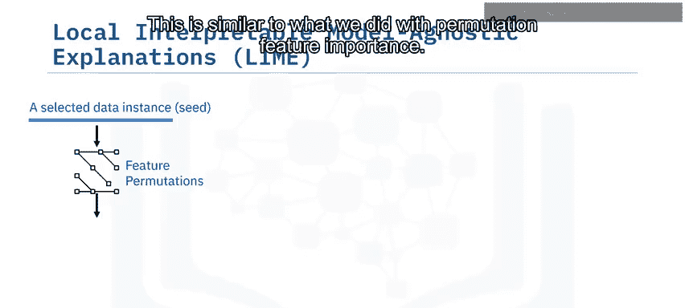

Next， we feed the artificial data X into the black box model and ask the model to generate the Y predictions。

 which will be used to train a local surrogate model。

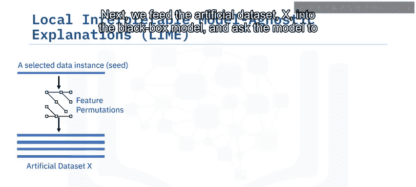

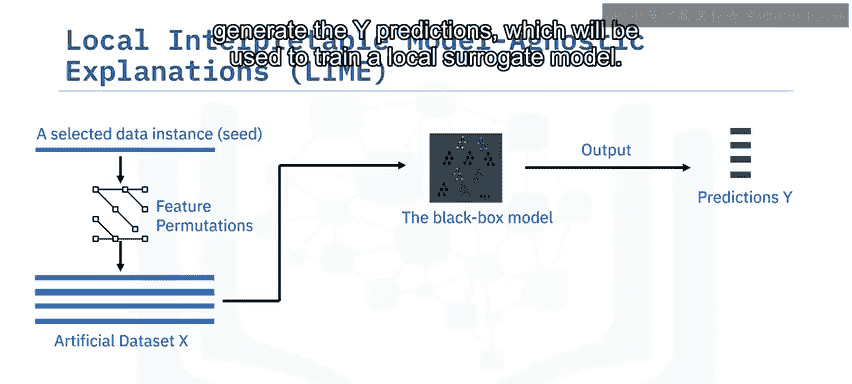

Then we need to weight each instance in X based on how close they are to the seed instance。

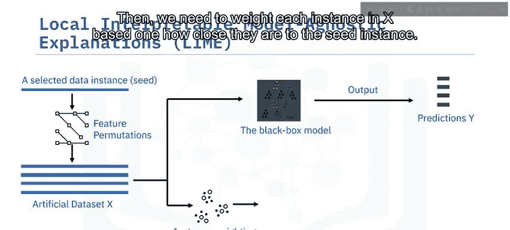

Instances similar to the seed data instance will have larger weights。

The main benefit of doing instance weight is that instances with larger weights will have a larger impact on model training。

 and the trained model thus will be more reflective of the black box model。

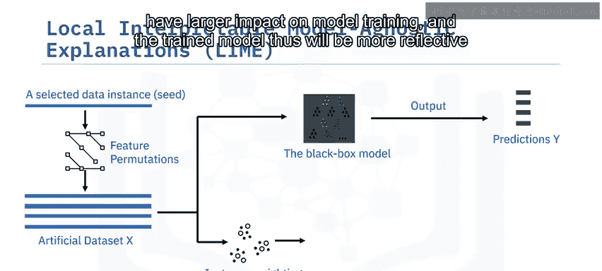

Lastly， we use the weighted data set X prime and predictions Y to train a local surrogate model。

 such as linear models or tree models。

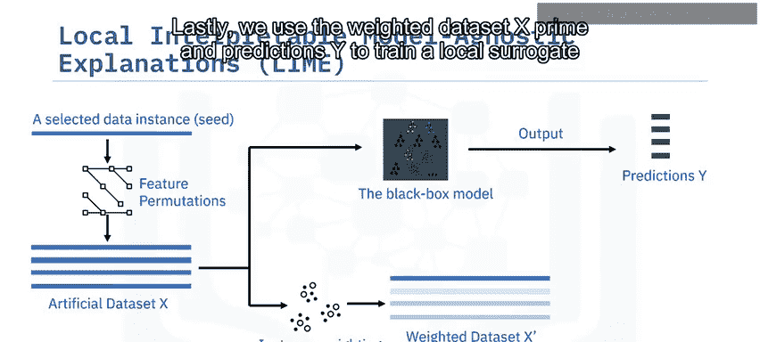

By analyzing the local surrogate model， we should be able to explain how the original black box model makes predictions on the selected data instance。

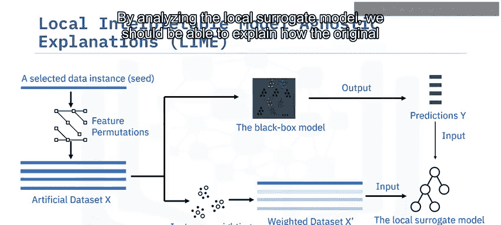

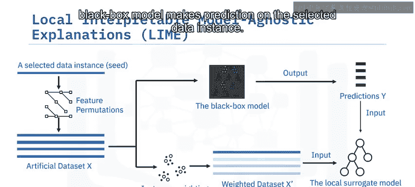

Let's look at an example， Sose we have an employee instance here。

 and our black box model predicts that this employee is very likely looking for a new job。

 and we used Lyme to explain why this decision has been made。

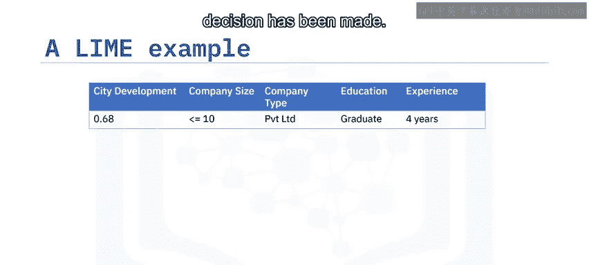

Here is the Limes outcome。It produces a visualization which shows the contribution of each feature and corresponding values using a color labeled horizontal bar chart where green means a positive contribution and red means a negative contribution。

As we can see， its company type， company Private Limited contributes roughly 45% to the model outcome。

 followed by its city development index next， then company size， and then graduate education。

Note that the company is not in the public sector， which makes some negative contribution。

The public sector company type feature means this type of employee would be less likely to change jobs since they are not in a public sector company。

After analyzing the Lyme outcome， we come up with a convincing story as follows。

This employee is looking for a new job， mainly because he works in a very small private company located in a city that is not highly regarded。

Since this person is well educated with a university degree。

 they will likely decide to look for new opportunities after working at the same company for about four years。

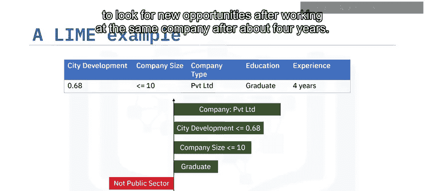

In this video you learned that a surrogate model is a way of explaining complex black box models using simpler models。

 the general steps to build global surrogate models are straightforward。

 and you can build local surrogate models using the limeme algorithm。

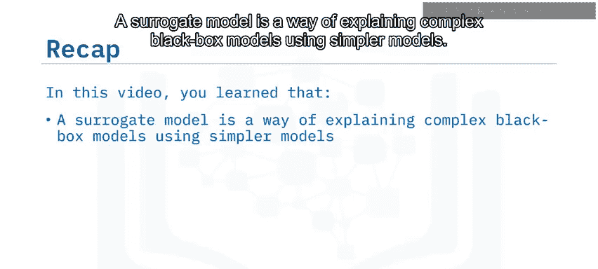

