# IBM《机器学习（数据探索、监督学习的回归和分类）｜machine learning》中英字幕 - P151：62_建模方法：加权和分层抽样.zh_en - GPT中英字幕课程资源 - BV1xM4m1D7kY

In this next set of videos， we will introduce more complex。

 commonly used modeling approaches available for working with unbalanced data sets。

Now let's go over the different learning goals for this section。

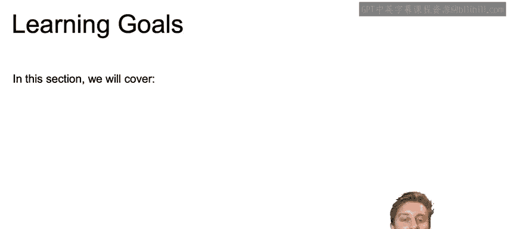

In this section， we'll go over some additional approaches to dealing with unbalanced outcomes。

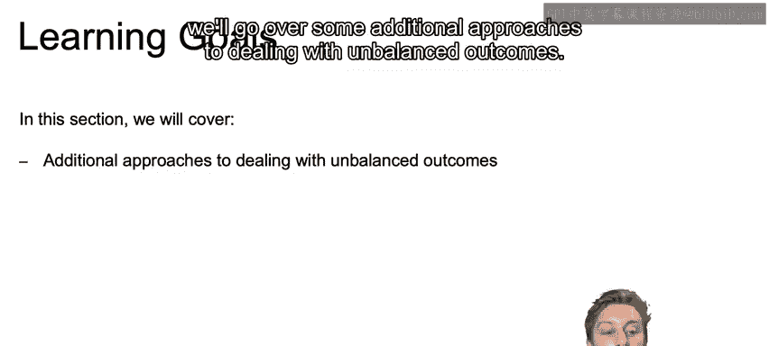

We'll go over random oversampling as well as introducing the concept of synthetic oversampling。

You'll go over some techniques for under sampling。

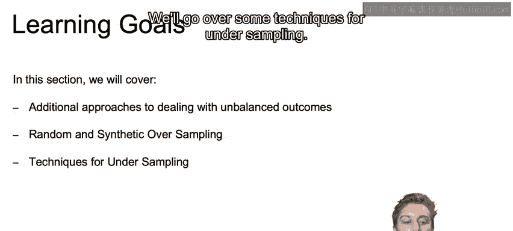

And then we'll touch on using balanced baggging or blogginggging to address unbalanced class data as well。

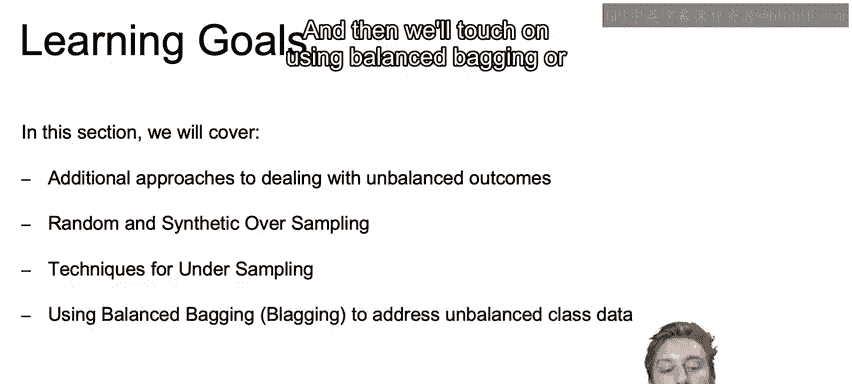

Now I want to start off by restating the problem when working with unbalanced classes。

So our problem is that in the learning phase for our machine learning models。

 as well as the eventual predictions that they make。

They can easily be affected by our imbalanced data。

We see here an example of support vector machines with different levels of imbalance and how with the imbalanced data sets。

 such as the top two that we see here， we end up heavily favoring that majority class。

 and we end up unable to correctly classify the values in that minority class。

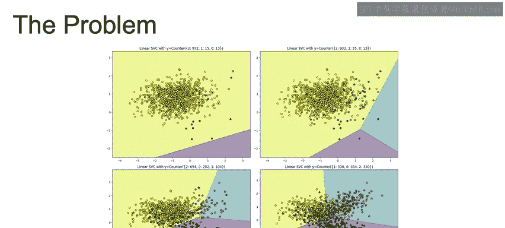

Now to correct this， there are many approaches that we can actually use in practice。First off。

 we just have the general SK learn approaches， so with many of our models。

 we'll see that there's a hyperparameter available called class weight。By default。

 this will be set to none， but we can set it to balance literally the string balanced to help balance out the error attributed to our minority and majority classes。

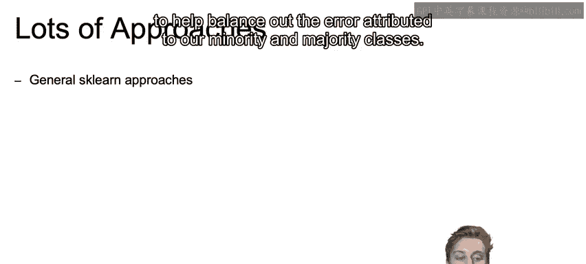

We can oversample our minority class。Or under sample our majority class。

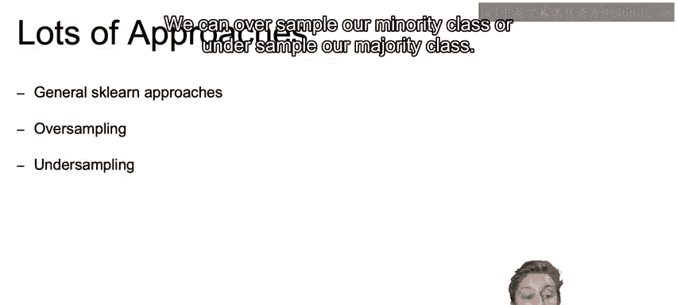

And then we can also do a combination of oversampling and undersampling as well。

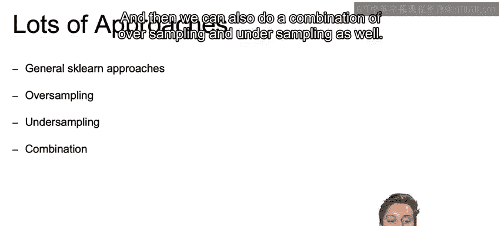

And we can even use ensemble methods where we will leverage the oversling or undersampling techniques to ensure balance between each one of our classes。

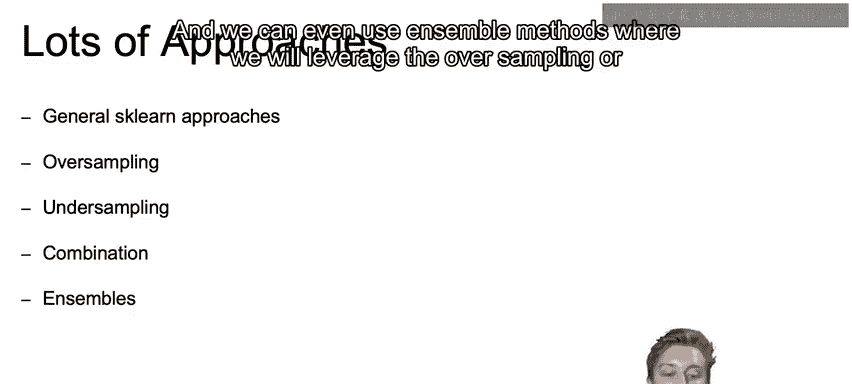

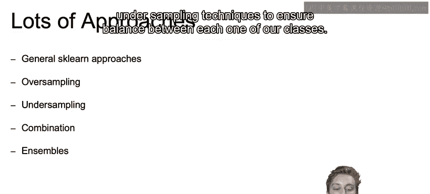

Now I would highly suggest you looking at this link after we go through this lecture or through this number of videos。

 as we're just going to be showing you the techniques and in order to apply them in Python。

 you'll want to look at all the code that's available within this library。

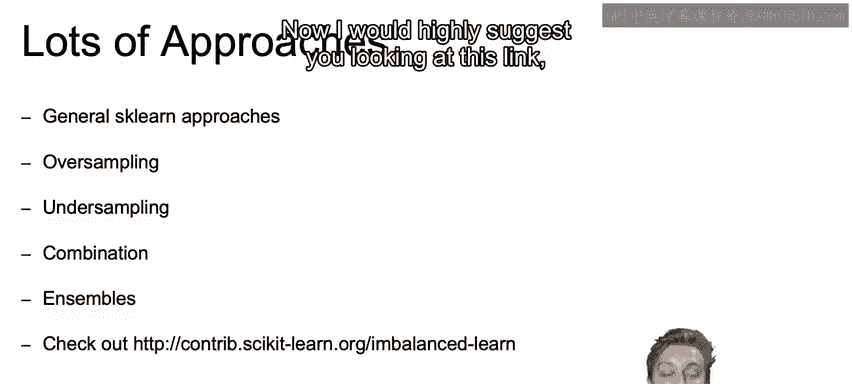

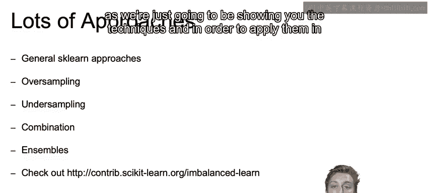

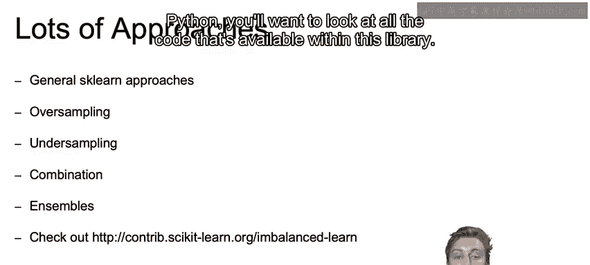

Now， as mentioned。

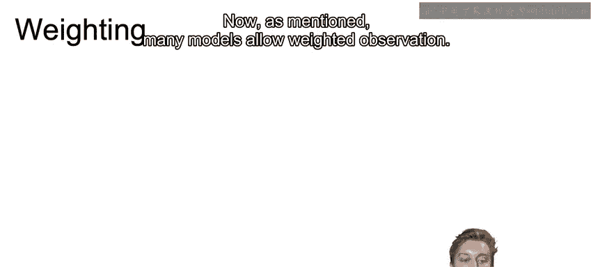

Many models allow weighted observations。We can adjust these so that the total weights are equal across classes again by setting that class weight hyperparameter to either balanced。

Again， literally this string balanced or we can use some other specific weighting of your choosing。

Now this can be convenient as it's easy to do as long as it's available for that specific model。

And there's no need to sacrifice data with either over or under sampling。

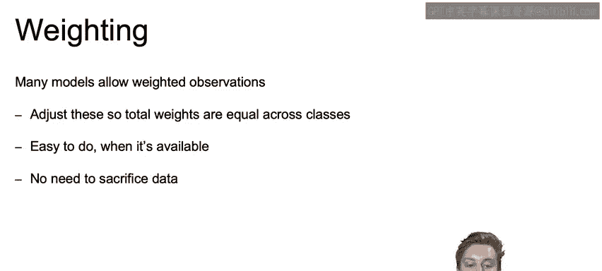

Now， as we've seen。We can and should also stratify our samples when working with unbalanced data sets。

This ensures that our class balance remains consistent in both our train and test set。

So options available in Python are going to be using the stratify arguments in our train test split function。

 so our actual vanilla train test split function also has this option of stratify。

We can use the stratified shuffel split method， which we've used in many of our notebooks。

 which will also allow for us to stratify according to the balance of our outcome variable。

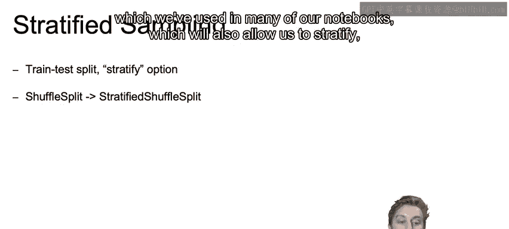

Or we can use a stratified Kfold or repeated stratified Kfold to create many different training and test sets that are stratified as well。

In our next video， we'll go and start going over。More technical means of balancing out our data set。

 starting off with oversling。 All right， I'll see you there。

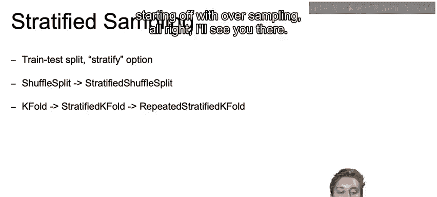

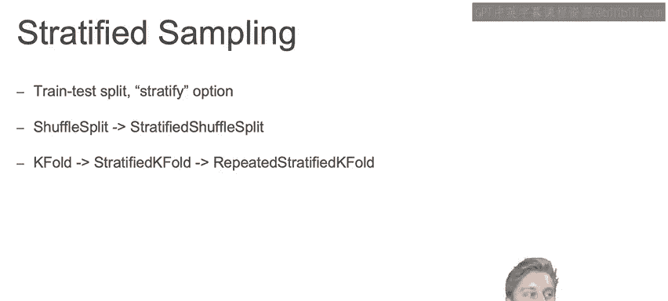