# IBM《机器学习（数据探索、监督学习的回归和分类）｜machine learning》中英字幕 - P153：64_建模方法：近邻方法.zh_en - GPT中英字幕课程资源 - BV1xM4m1D7kY

In this section， we're going to focus on the idea of undersampling。

Now the concept here is going to be to try and decrease the size of that majority class so that it is similar in size to that minority class。

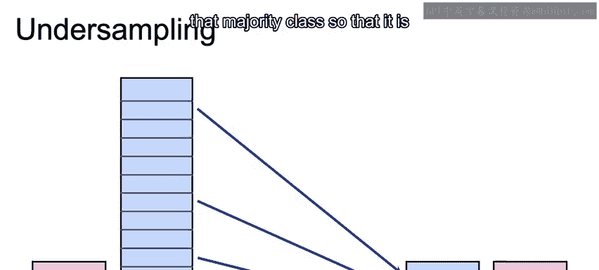

Now let's work with methods called nearar miss。Here we will look through different means of keeping points that are closest to nearby minority points。

So here we have in our plot that the positives are going to be the majority class。

 and the minuses are going to be our minority class。

And the goal here is to only select the positive sample。 So from that majority class。

 for which the average distance to the n closest samples of that negative class are the smallest。

So we are generally trying to keep points that are near our decision boundaries。

 that's going to be our goal。

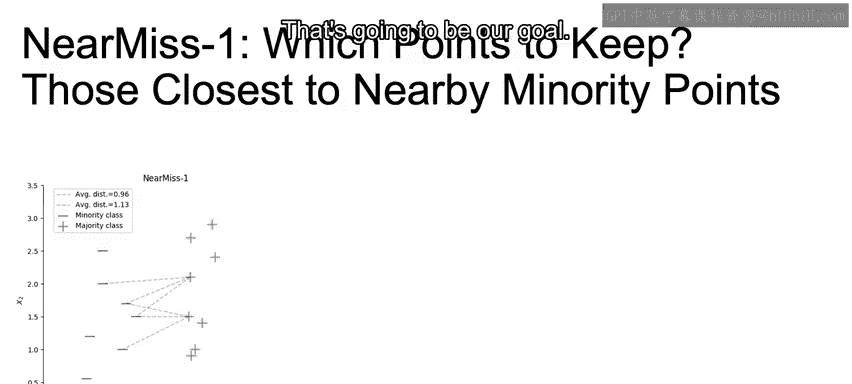

Now， what we need to be aware of， though。Is that with this type of down samplingamp。

 it can easily be skewed by the presence of some outliers or some noise that may cause those clusters to stick together far from that boundary。

 As we see here in our example， that we have this difference in clustering。

 And then we come up with the decision boundary that we see in the middle。

 base off of these new boundaries from down sampling。

 And that's due to the fact that we may have some outliers。

 which makes all the points near a certain cluster， the closest points to that cluster。

 and we end up with different decision boundaries， Then we probably would want optimally。

 So this can be easily thrown off by outliers。😊。

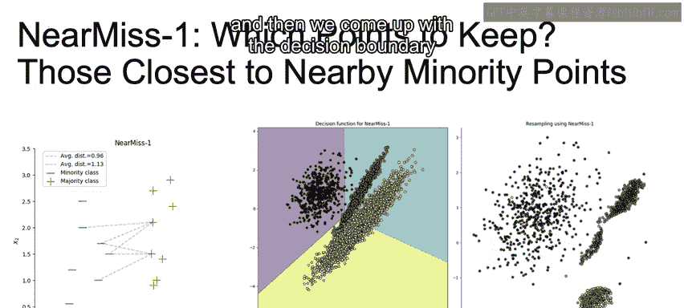

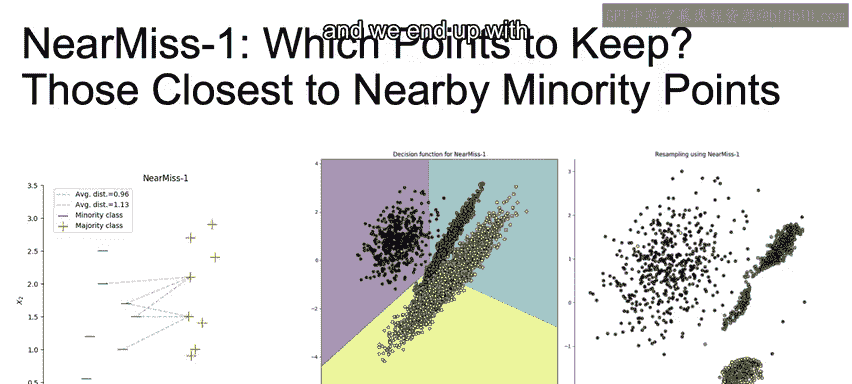

Now， with near miss 2。It's going to select the positive samples for which the average distance to the farthest samples of the negative class is the smallest。

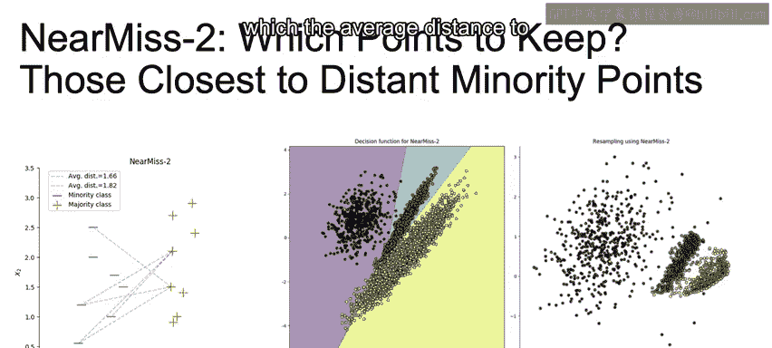

So near miss2 will not be as affected by outliers， since it does not focus on minimizing distance to the nearer samples。

 but rather minimizing the distance from the farthest samples。 So still minimizing distance。

 but now minimizing distance from the farthest samples。

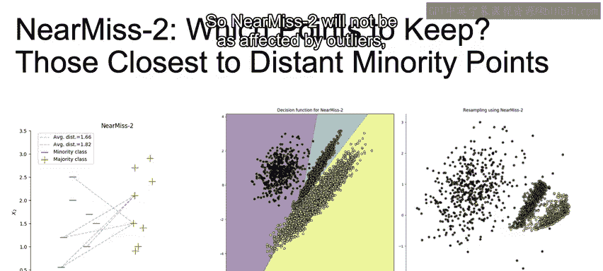

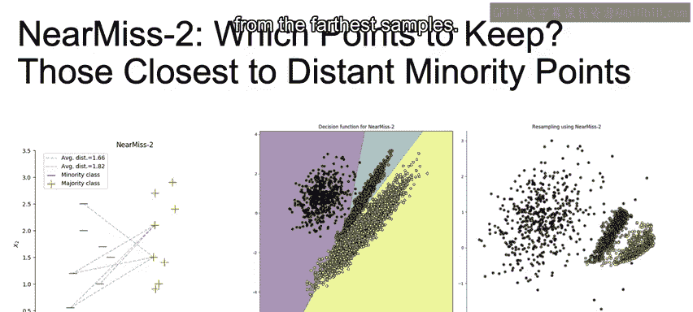

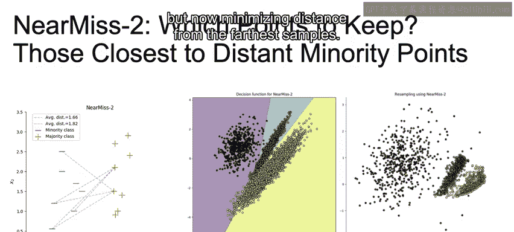

Thus， looking to minimize the distance to the fartherthest samples can help reduce the effects of noisier。

And as we can see， we end up with a bit better of a classification， but again。

 we should note that this can still be affected by marginal outliers， so it's not perfect。

Now， near Miss 3 is going to be a two step algorithm。

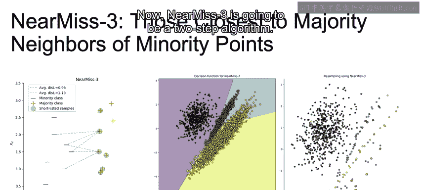

First iss going to be for each negative sample we're going to find decayane nearest neighbors。

Of the positive class。Then the positive sample selected。

Are going to be the ones for which the average distance to the N nearest neighbors is the largest。

 So first， we only take the nearest neighbors， and then we take the largest distance。Thus。

 we are then taking points that are a bit further apart from one another。And due to that。

 near miss 3 is probably the version， which will be less affected by noise due to this first step sample selection。

 so won't be less affected by outliers。 And again， we have a fairly good different decision boundary that we see here in the middle plot。

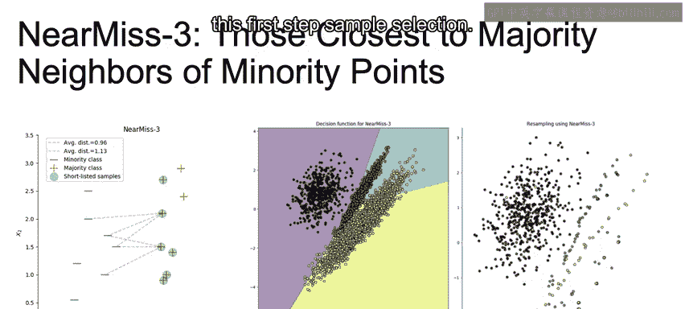

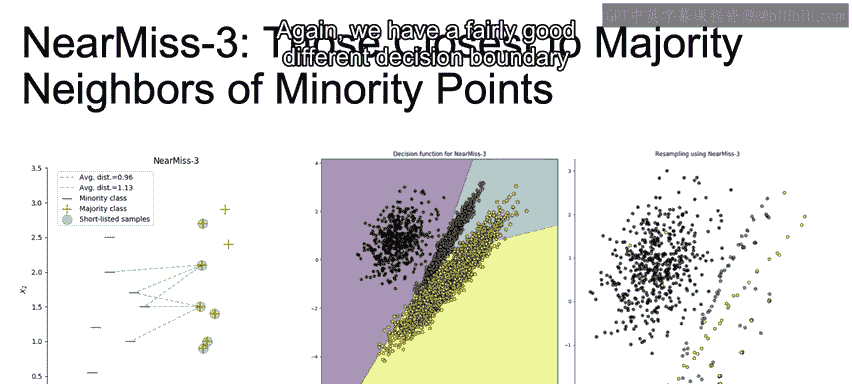

Now， another method available is going to be the toec links。Now， atomic link exists。

If two samples from different classes are the nearest neighbors of one another。So in the figure here。

We see a Tomics link is illustrated by highlighting the samples of interests in green。

 so we see the green highlighted samples， those are each other's nearest neighbors。

 but they are from different classes。We then can either just remove the majority class。

 as we see in the middle figure， where we just removed the positive。Or we can remove both classes。

 as we see in the figure to the right。The point being that this will remove the points that are too close together and create more distinct classes。

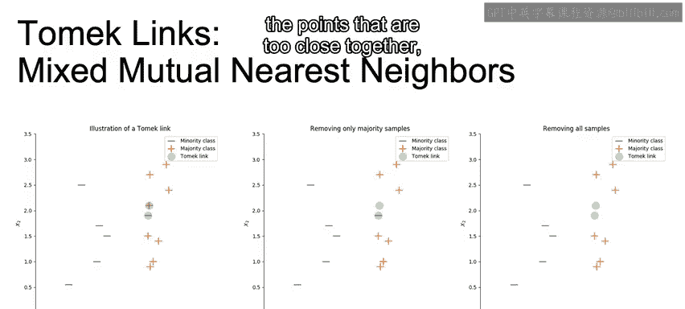

And then finally， we have edited nearest neighbors。Essential。

 all we do here is run K nearest neighbors with k equal to 1。

Then if you misclassify a point in one of the majority classes， that point will be removed。

And we again end up with clusters that are more distinct with the new values being as we see on the right and the decision boundary。

 given our new data， using our downs， our undersampling is going to be with the decision boundary we see to the left。

Now that closes out the section on under samplingamp and then next video well briefly touch on bringing over samplingampling and under samplingampling together。

 as well as closing out the section on working with unbalanced classes。 Allright， I'll see you there。

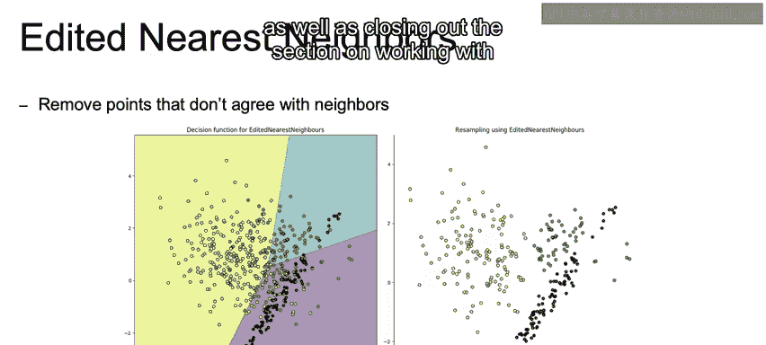

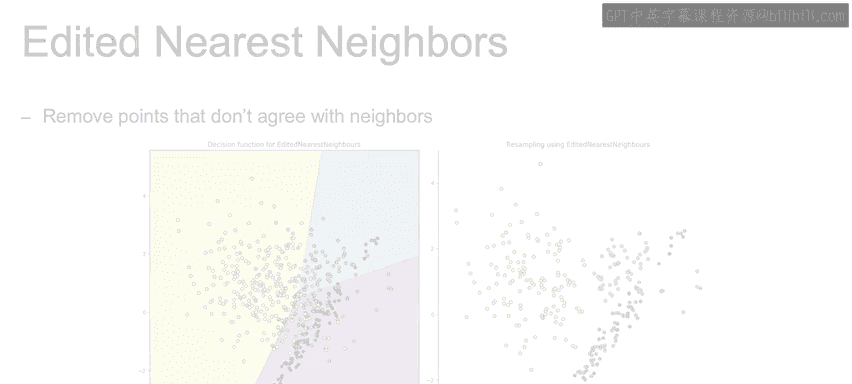