# IBM《机器学习（数据探索、监督学习的回归和分类）｜machine learning》中英字幕 - P21：20_EDA笔记本解决方案（选修部分）第1部分.zh_en - GPT中英字幕课程资源 - BV1xM4m1D7kY

So in lecture， we got the opportunity to get a brief look at how we can use Python code in order to see all these different visualizations as well as the summary statistics。

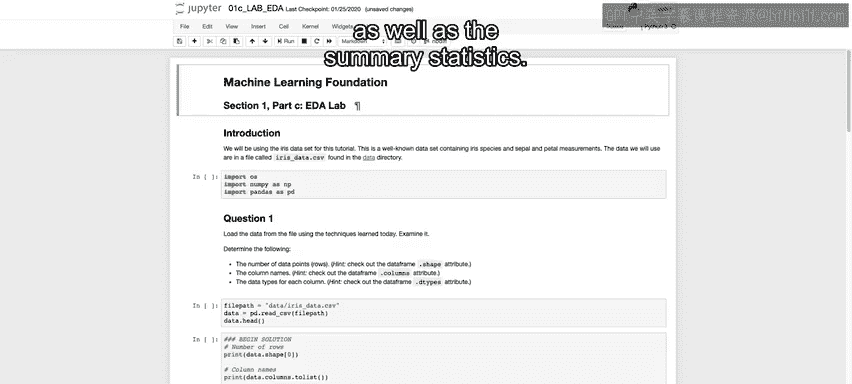

Now we will dive into an actual notebook and run this code ourselves。

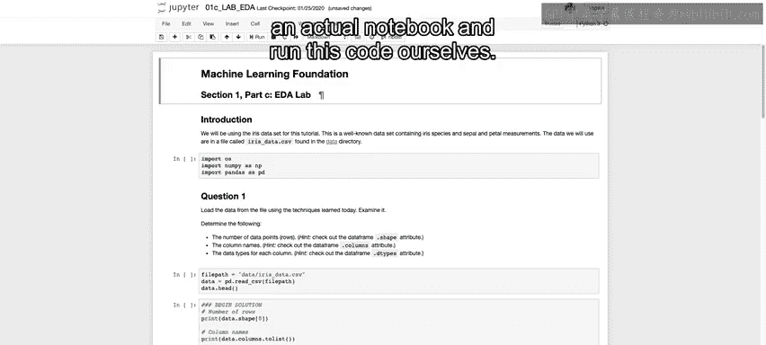

So we're going to be using the IIS data set that we've discussed earlier。

Our first step is going to be to import the necessary。

Libraries OS is just going to allow us to access our operating system NumpI is going to be the numerical library that we'll be using very often throughout。

 and then as we've seen we are importing Padas SPD and that's going to be the library that we use for the majority of our data manipulation before actually going into visualizations。

So let's import those。Our first question here is to load the data from the file using the techniques that we've already learned。

 so we'd want to determine the following the number of data points， so how many rows。

 and we have a hint here to use the dot shape attribute which is an attribute of a panda's data frame。

 the column names， which is again going to leverage another attribute of our panda's data frame。

 which is the dot columns， and then finally the different data types。

 and we're going to use the dot types attribute here。So we bring in the file。

 we set fileile path as our variable， and then the path to that actual file is going to be the data folder with the IIS data CSV file。

We use pandas。read CSsv in order to bring in that actual file， and we're going to use data。

head to just look at the first five rows。

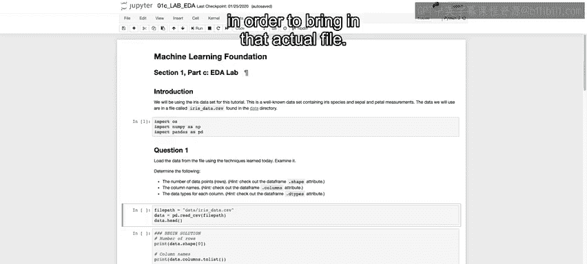

And there we have it the first five rows with our different features， sepple length， sepple width。

 pal length， pal width， as well as our different species。

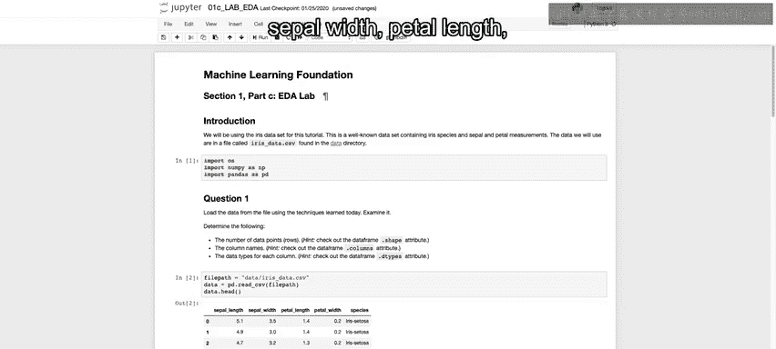

Now I want to create a cell above here。

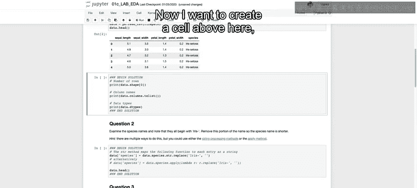

just to get an idea of what each one of these attributes do individually before printing them all out if I run data do。

Data dot shape。

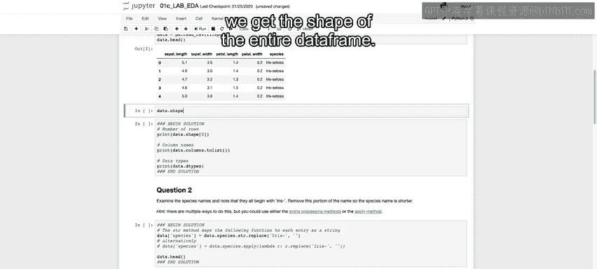

We get the shape of the entire data frame， what we care about is the number of rows。

 so we're just going to select the first value and Python that's the zero with value to get the number of rows。

We also， just so you know， could have done the length。Of data。And that'll also be 150。

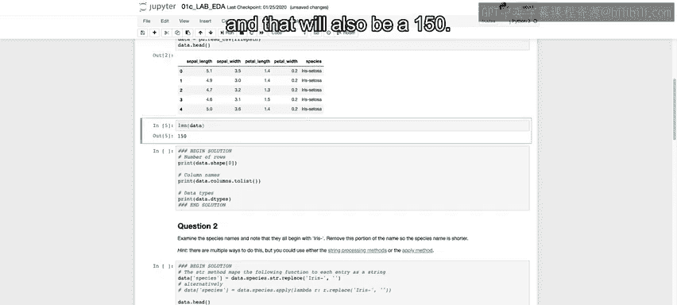

The next attribute that we pull out are the column names。

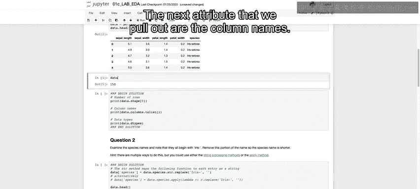

We can do data。coms。And that will give us the values。

 we bring that to list because this is actually going to be an index type rather than a list type。

 and it may just be a little bit easier to look at and to manipulate for most intents and purposes。

 you should be fine if you're just trying to see the column names that just do data。comns。

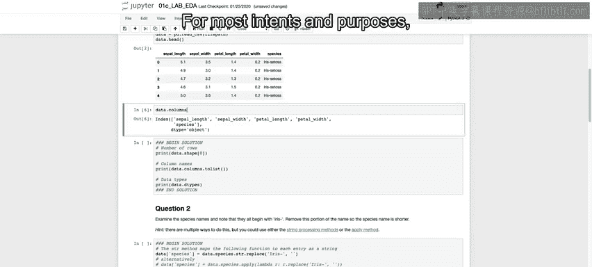

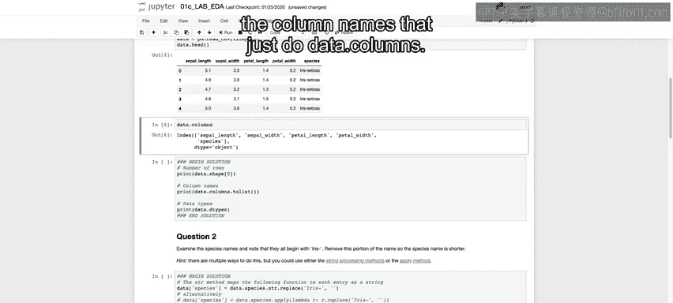

But just to look at it， we can see how we bring this to a list and how that looks a little bit different。

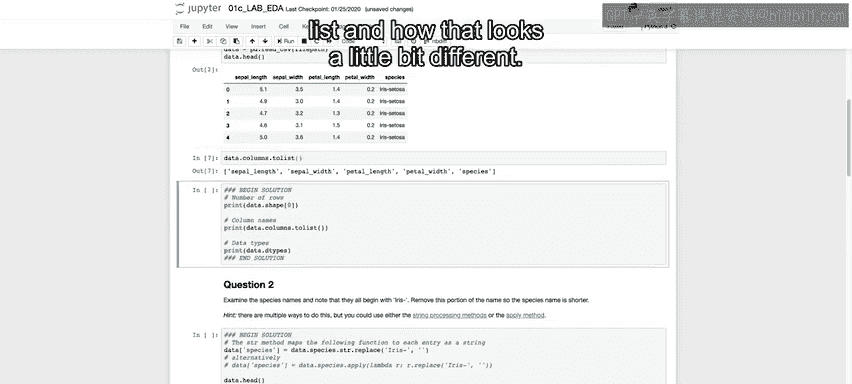

Then finally， we do data。D types。

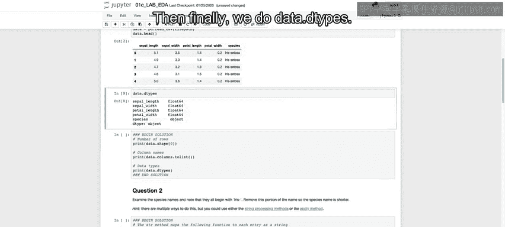

And we see for each one of our different features that we had earlier。As well as our target variable。

 we see that the first four are all floats， and the final one is an object which makes sense because it's not a numerical value。

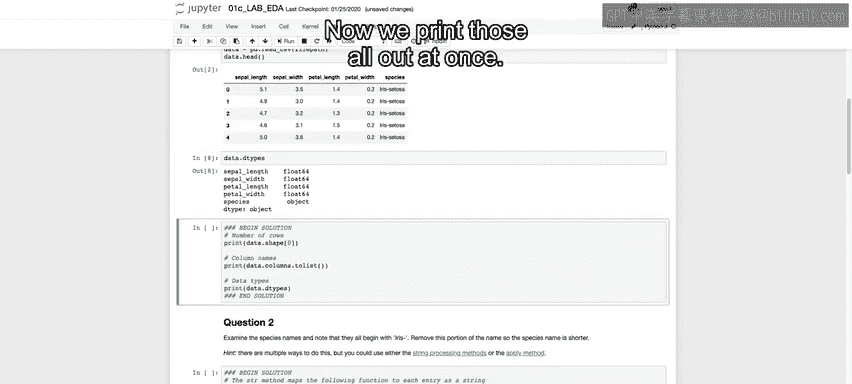

And now we print those all out at once。

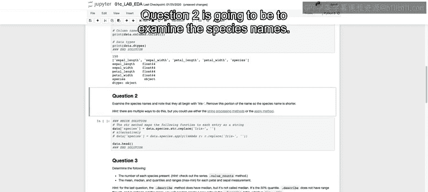

Question2 is going to be to examine the species names and note that as we just saw when we looked at the head over here。

 when we look at the species， we have the iris before each one of the different species。

 So iris satossa， iris veric color， so on and so forth。

 So we want to remove this portion of the name。 So the species names are shorter。

 the iris dash is not adding any extra information。

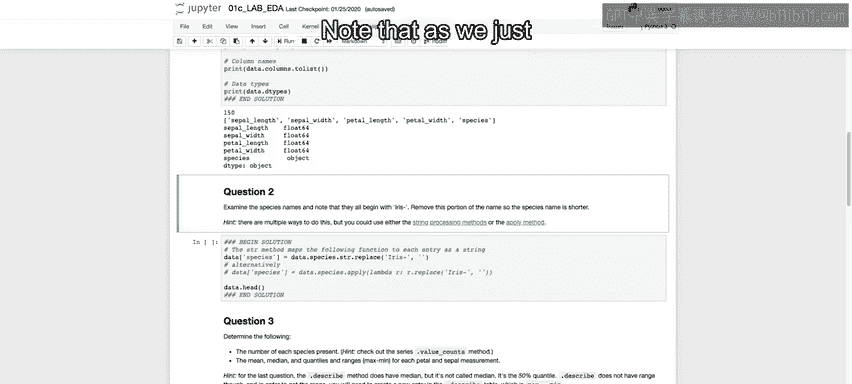

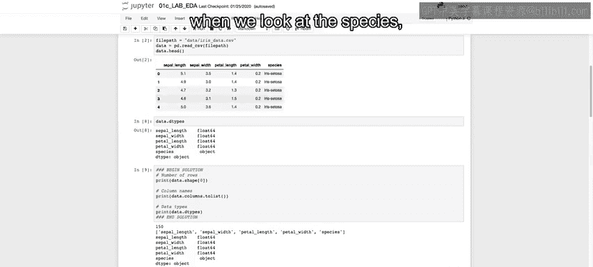

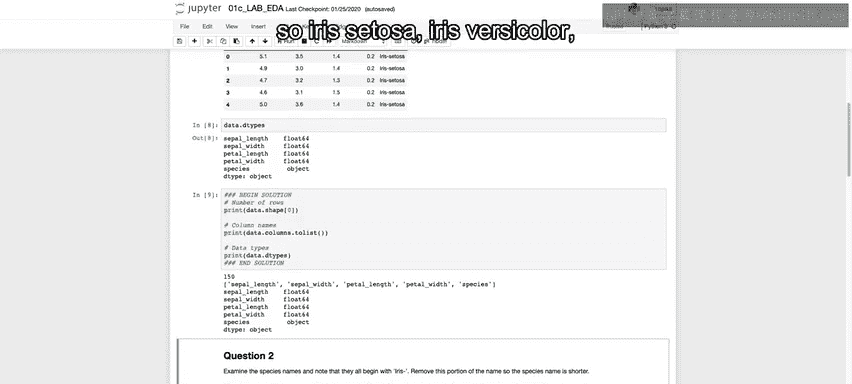

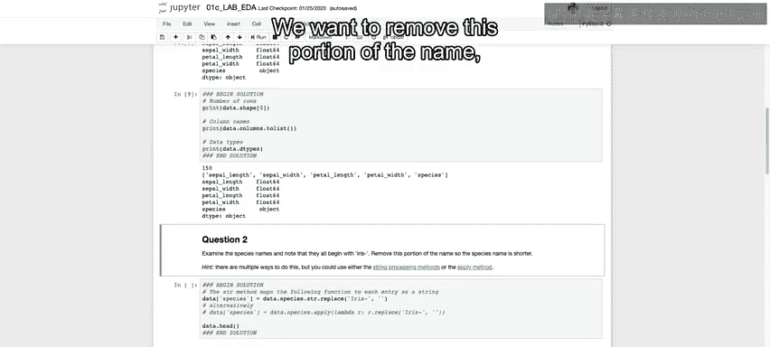

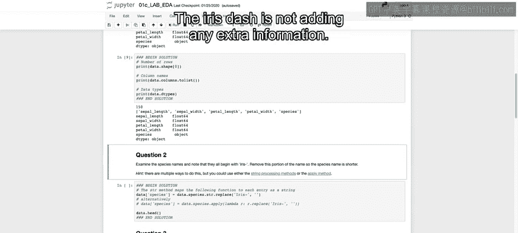

So we have a hint that there are multiple ways to do this。

 but you could use either the string processing method。

 which is what we use here or the apply method。

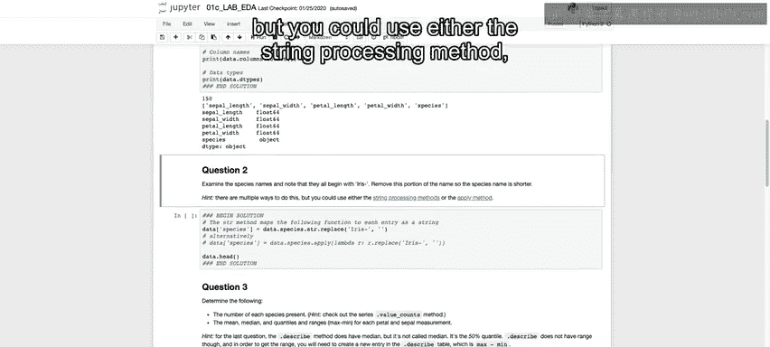

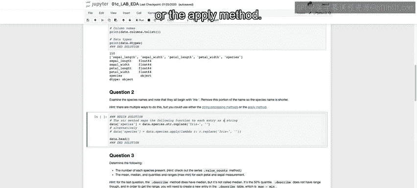

Now， I'm going to show you both。We're going to first look at data。Species。

 just to look at that column。

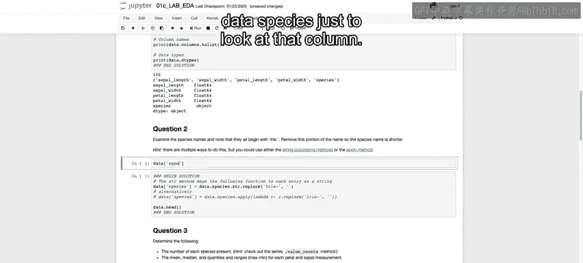

And we see that， as was mentioned that we have Iis dash and then the name。

 What we can do is we can actually just eliminate the first five letters since they're always the same。

 So I'm going to use the dot apply first。Which is not in the solution here。

And we're going to do lambmbda X。 So our inputs can be x。 and we want the output to be。

From the fifth value onwards。Right， starting at 0。And if we run that。

 we see that we have eliminated the iris from the beginning of each one of those words。

And then we could set as we do here。Data species， equal to this。Now。

 what we do here rather than using the apply function is we use the string processing method。

 When you're working with strings as the column， you generally have the option to do string。

 And then there's a multitude of different methods that are available here。

 We're going to use the replace。

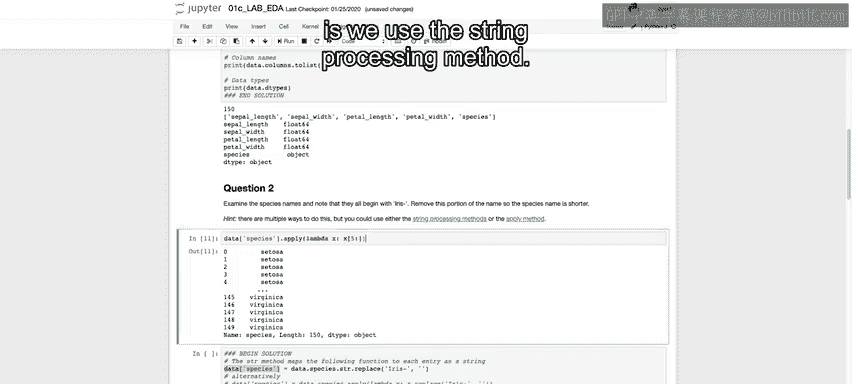

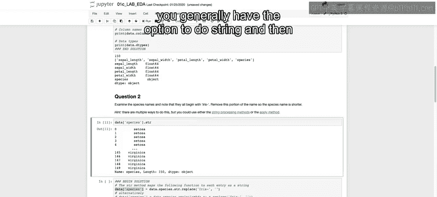

And we're going to replace Iis。Dash。With。A blank。And that'll do the same。Thing as before。 so again。

 we haven't replaced it yet， this is what it looks like。

 and then we can run the string dot replace in order to replace the iris with just a blank。

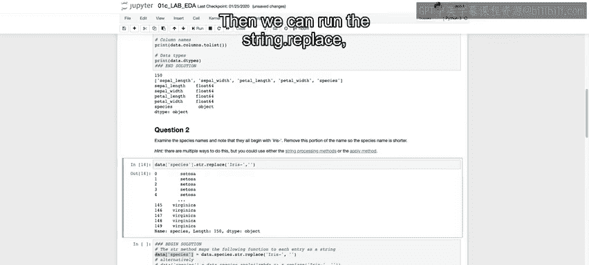

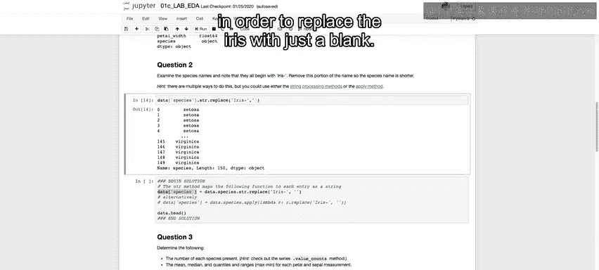

And then we set that equal to the data species column， so we're replacing that column。

 and if we look at the head， we see that the first five rows now no longer have the iris as a prefix for each one of the species。

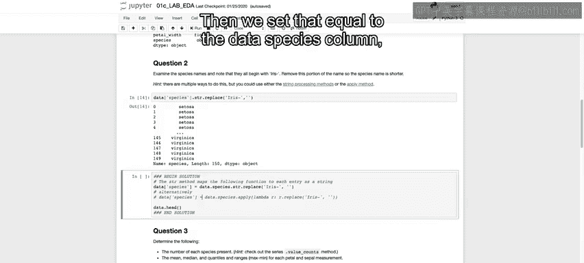

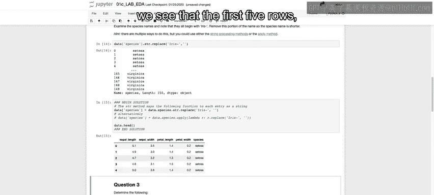

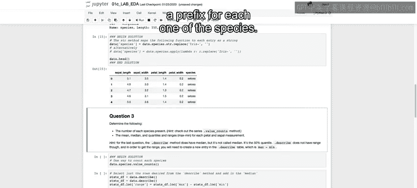

We're going to stop here and in the next section will' do question three。

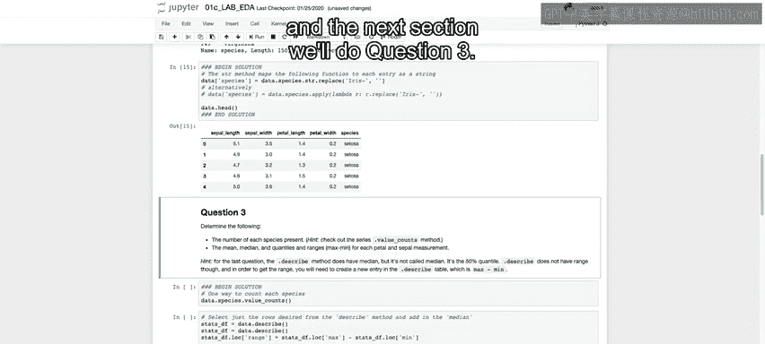

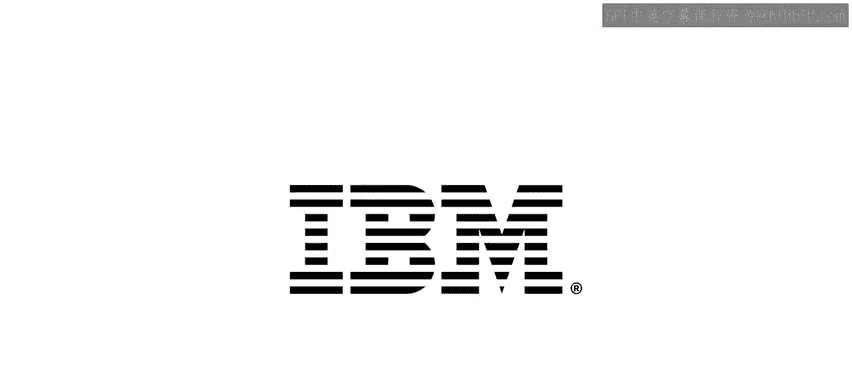