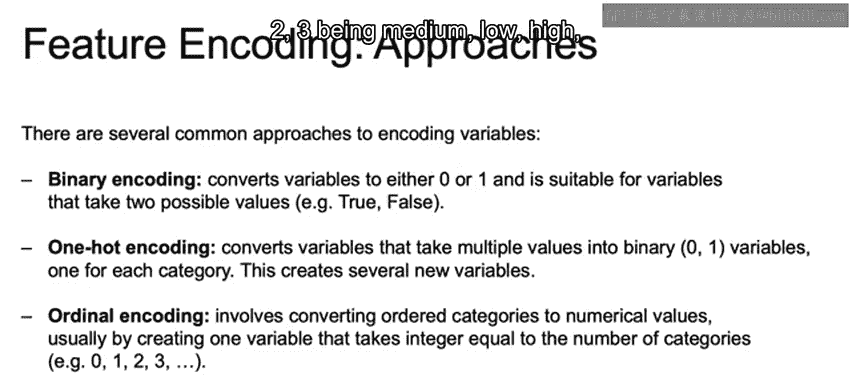

# IBM《机器学习（数据探索、监督学习的回归和分类）｜machine learning》中英字幕 - P27：26_特征编码.zh_en - GPT中英字幕课程资源 - BV1xM4m1D7kY

So variable selection is going to involve choosing the set of features to include in our model。 Now。

 variables must often be transformed， as mentioned before。

 before they can even be included in our models。 In addition to a log and polynomial transformation。

 this can involve encoding， converting nonnumeric features such as categorical or ordinal features to numeric features。

And scaling， which will be just converting the scale of numeric data so that they're on a comparable scale。

And the appropriate method of scaling or encoding will just depend on the type of feature。

 which we'll see in just a second。So encoding is often applied to categorical features。

That's going to take non numeric values and transform them to numeric values。

 Now there's two primary ways of doing this。If we are working with nominal data。

 that would be categorical variables， take on values with no order built in， such as red， blue。

 green， or are they married， true or false？Or on the other hand， working with ordinal data。

 and that's just going to be categorical data that actually has some type of order built in。

 such as high medium low， cold， warm hot。Now， there are several common approaches to encoding variables。

There's binary encoding， and that's going to convert variables to either 0 or  one。

 And that's suitable for variables that can only take on two possible values。 Ma or female。

 married versus not married。 And then you can think of that as anything that has a true or false。

 Are they married， true or false， Are they female， true or false。

 And you can encode that as0 and one。Now， that's important because we can extend that into what is called one hot encoding。

 and that's going to take variables that may take on multiple values into multiple columns that are binary variables。

 one for each category。 So this is going to create several new variables。 Imagine we have one column。

 that's color and it's red， blue and green。 We would separate that one column into three new columns called red。

 blue and green。 Those are now the column names。 And for red， we'd either mark true or false。

 whether the original column was red， then we would mark it one。 If it was not red。

 then we'd melt that as0。 And if blue is true， then blue would be marked as one and so on and so forth。

And we'll see this in practice when we go into the notebooks。And then finally。

 ordinal encoding involves converting ordered categories into numerical values。

Usually this is done by creating one variable that takes integer equal to the number of categories。

 so if you have low medium and high， youd convert that to one for low。

 two for medium and three for high。For this， we would have to take into account whether that ordering or the separation of categories is more important as you are then assigning a set distance between low and medium and medium and high that may not actually exist。

So this will become something that you'll become more familiar with and you'll be able to play around with as you get a better understanding of how to incorporate categorical data with ordering and deciding whether you want to use this ordinal encoding of1。

2，3， medium being medium low high versus maybe sticking with one hot encoding and losing the fact that you have an ordering within your。

Category within your column that you are working with。

