# IBM《机器学习（数据探索、监督学习的回归和分类）｜machine learning》中英字幕 - P29：28_Python中的常见变量转换.zh_en - GPT中英字幕课程资源 - BV1xM4m1D7kY

So let's recap and go through all the transformations we may want to apply depending on the feature type。

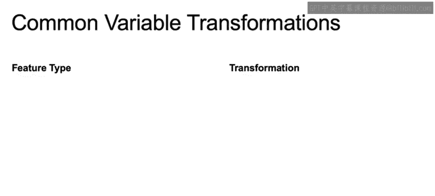

For continuous numerical values， we'd want to use the transformations that we just discussed。

 such as standard scaling， MinAC scaling， and robust scaling。

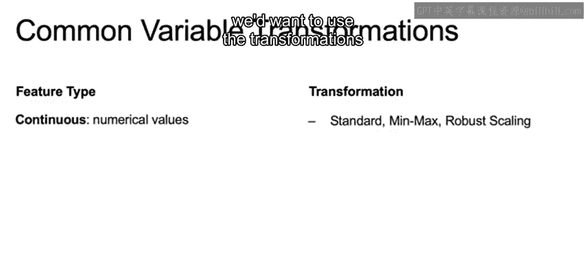

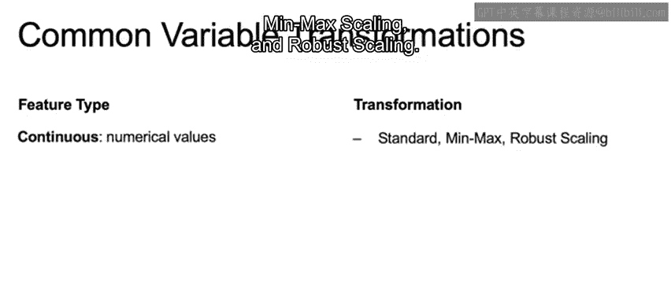

And then in order to do this in Python， we can pull in from Scalar do preprocessing。

 we can pull in the standard Scalar for standard， for Min Max scaling and the robust scalealar for the respective category as well。

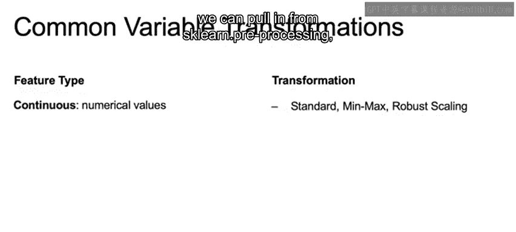

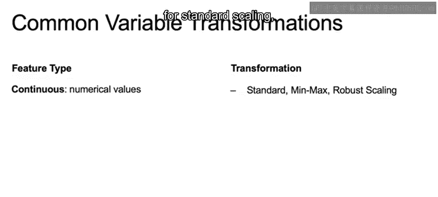

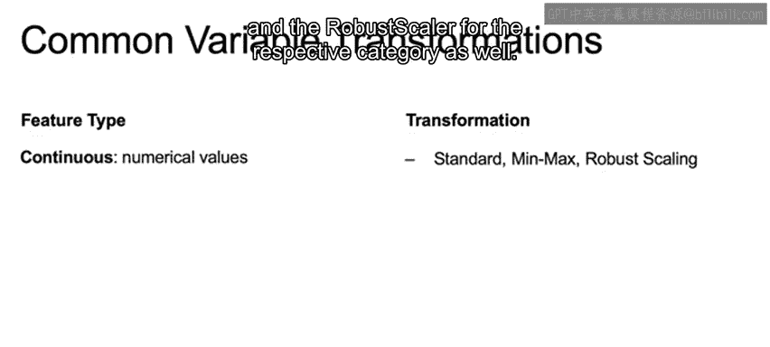

Next， we have nominal or categorical data that's unordered， such as true or false。

 it could be also red， blue or green。

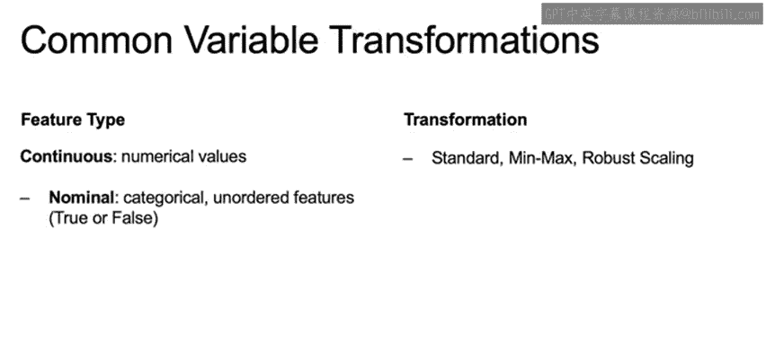

And for that， we're even going to want to use binary if there's only two features or one hot encoding if there's multiple different values within that feature。

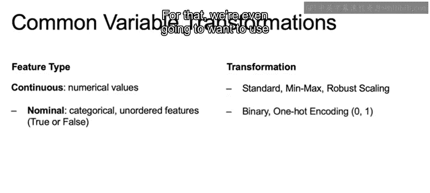

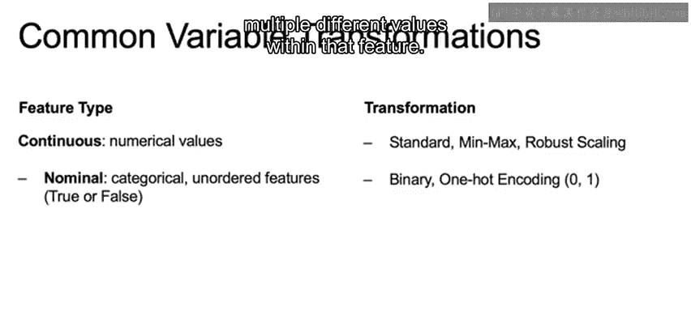

So some functions to be aware of， the label encoder。

 label by Nier and one hott encoder will work similarly from SKLn。

 as well will the get dummies from pandas， where that will also allow you to come up with one hot encoding of zeros and ones creating multiple columns from a single column。

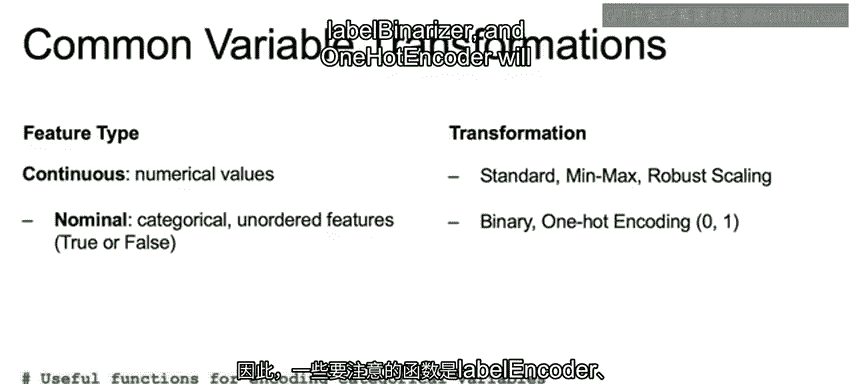

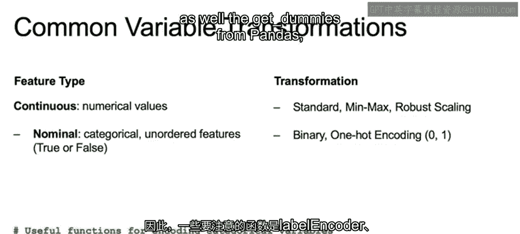

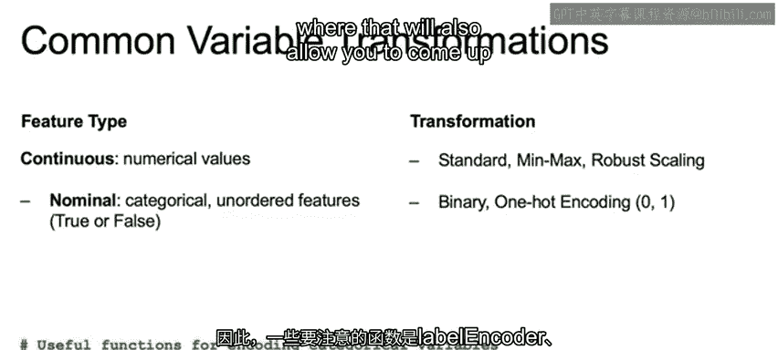

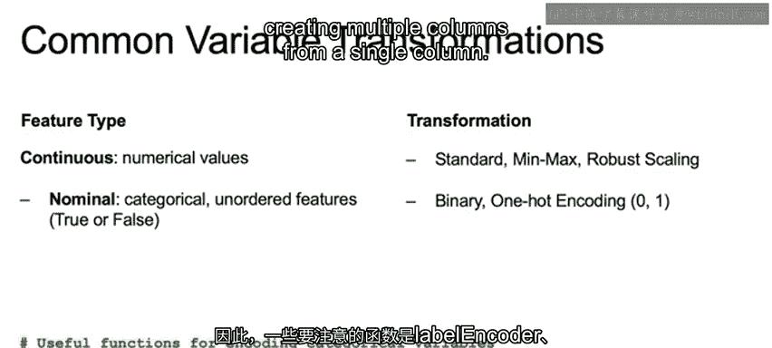

And then finally， we can work with ordinal data that'll be categorical data where there may be some ordering with the features。

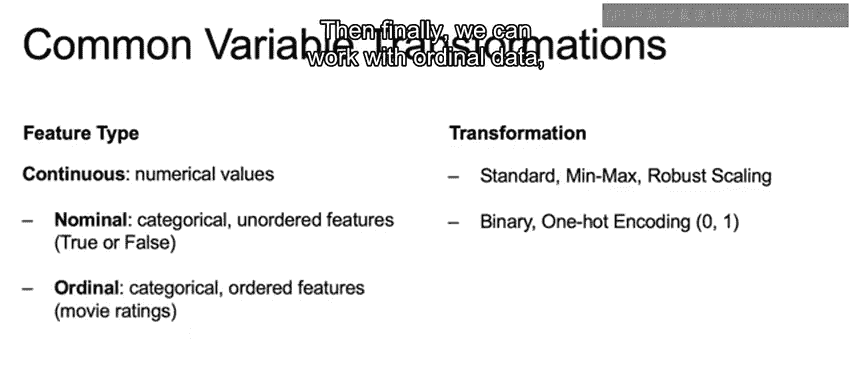

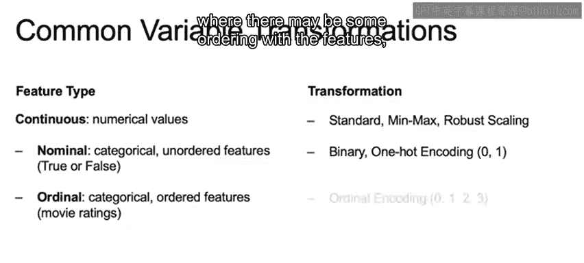

And we may want to encode that with 1，2， and 3， with three representing the highest and one。

 the lowest。

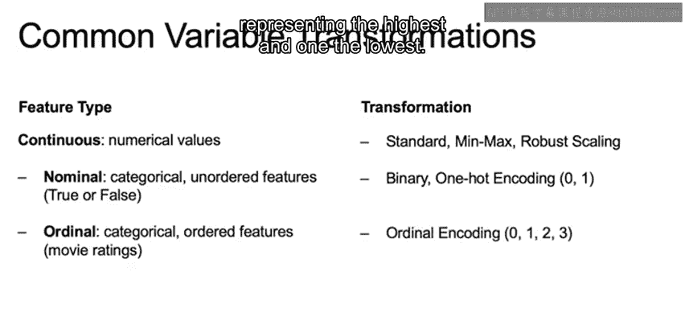

And some useful function for encoding ordinal variables will be the Dt vectorizer where you can take you'd have to identify each one of your different values and the number you want it to take。

 or the ordinal encoder will you have to pass in the names of each of the values in the correct order so that it will keep hold of the ordering that you'd like it to show with your transformed variable。

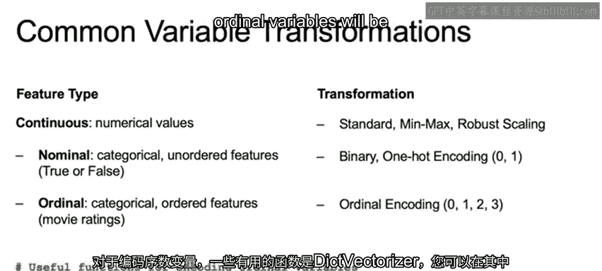

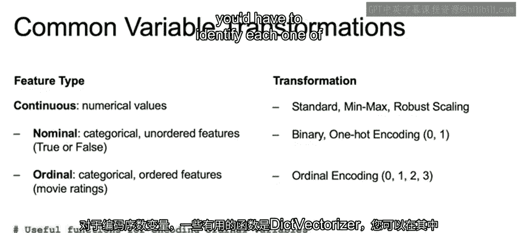

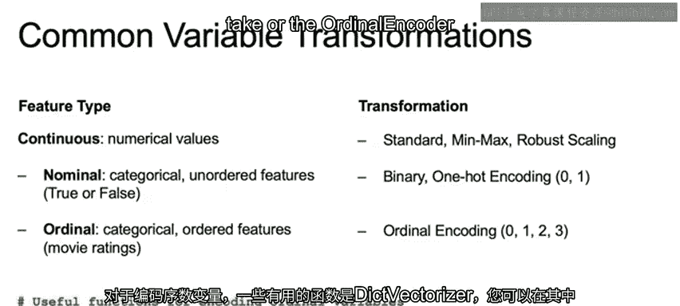

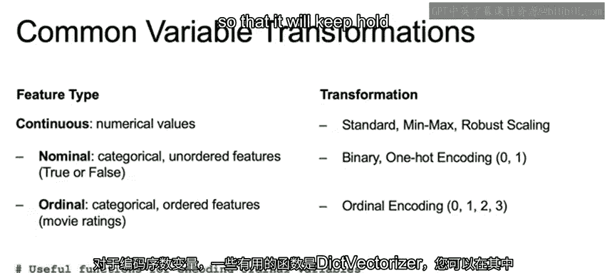

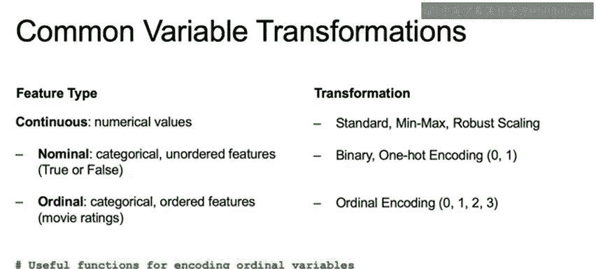

Let's recap what we went over in this section。 In this section。

 we covered feature engineering and variable transformations。 If you recall。

 we went over the linear regression example and saw how we can use a polynomial transformation。

 as well as a log transformation in order to ensure we have that linear relationship that's necessary。

We talked about feature encoding and how we can use one hot encoding for categorical or nominal data or ordinal encoding for ordered categorical data and bring that in as a numerical value。

And then finally， we talked about feature scaling and discussed our different options for standardization and normalization and gained a visual for the importance of ensuring that they were on the same scale。

Now let's take what we learned and apply it in a Jupyter notebook， I'll see you there。

