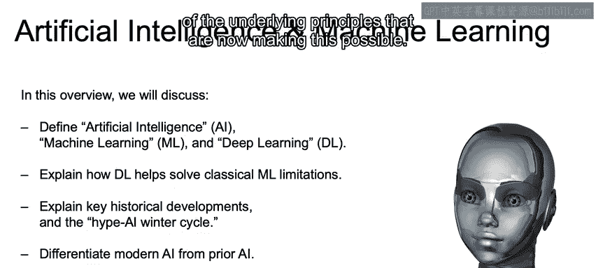
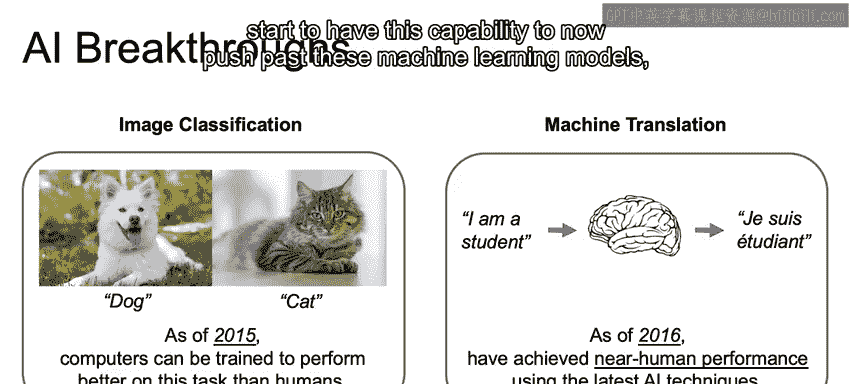
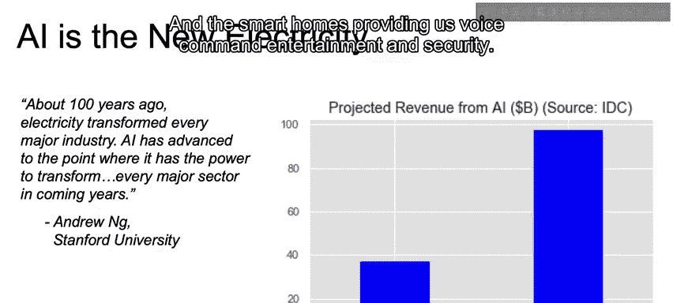
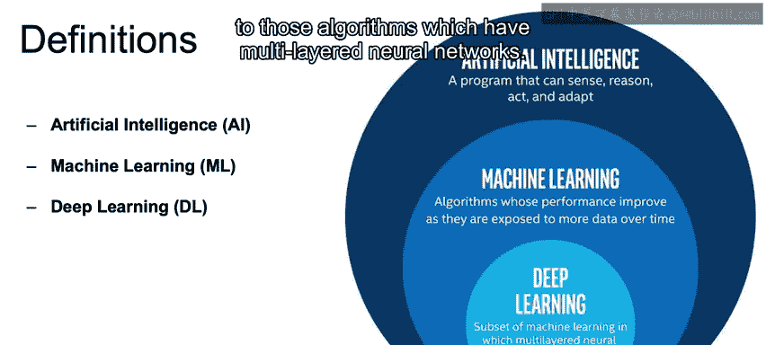
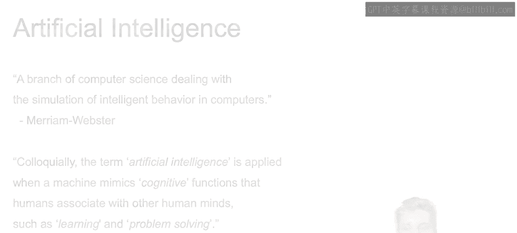

# IBM《机器学习（数据探索、监督学习的回归和分类）｜machine learning》中英字幕 - P2：1_人工智能和机器学习概述.zh_en - GPT中英字幕课程资源 - BV1xM4m1D7kY

Welcome， everybody。 Very excited to have you here。 In this section。

 we will begin to introduce to you both artificial intelligence and machine learning。😊。

In this overview， we will discuss how to properly define what the precise definitions are for artificial intelligence。

 machine learning and deep learning， and how to differentiate between the three。

One hint I want you to know off the bat is that deep learning will be a subset of machine learning。

 which in turn will be a subset of artificial intelligence。

We will explain how deep learning has now taken a step past many of the limitations of classical machine learning techniques and help us enter a new era of artificial intelligence。

Now， getting to that era required many ups and downs。

 and we will talk through the history of the rise and fall of investments and excitements around artificial intelligence that eventually led to today's AI boom。

With that in mind， we will discuss how the current state of artificial intelligence and the trajectory of today's advancements differentiates from the advancements we saw in the AI of past。

We'll then walk through some sample applications of AI in the real world。

 which by the end of this course， you should have a strong understanding of the underlying principles that are now making this possible。

Now， to understand the depth of where artificial intelligence has brought us in recent history。

 two of the biggest breakthroughs， which we will continue to touch on as we go through the history of artificial intelligence are an image processing and machine translation。

To understand image classification， imagine we are given this task to identify which one of these pictures is a dog。

And then which one of these pictures is a cat？And going back to 2015。

 computers have been able to do a better job of classifying such images into categories than humans。

For machine translation， our goal is to take a phrase or sentence in one language。

 such as I am a student， and then give the translation in another language。

 keeping in mind all the intricacies of word ordering and proper phasing of that other language。

 which we have here in French and incredible work is being done so that machines can translate to near human performance。

Now these were very tough problems for classical machine learning models， for images。

 it was hard to identify useful features， and then for natural language processing， translations are。

 as we discussed， not as simple as just going word by word。

 but keeping into account the word ordering in the proper phasing and the common use within different languages。

Now， advancements in deep learning， as well as innovations in the realms of data storage and processing power have given us this ability to step up and start to have this capability to now push past these machine learning models。

 these classic machine learning model barriers。

So the impact and the potential future impact of AI is enormous。 It is not an understatement。

 What we see here that AI will have a similar impact on every major industry in the same fashion that electricity once stayed 100 years ago。

Now this here is a quote by Andrew Ng。One of the leaders in the field of artificial intelligence。

 He has been at Stanford。 He cofounded Coursera and currently manages deep learning AI。

 and he has given talks discussing in depth。 The above， which can be found on YouTube。

 And we can think of the major breakthroughs of the last two slides to point to some of those major breakthroughs。

 But we must also think about how heavily artificial intelligence is impacting advertising with targeted marketing。

 brick and mortar stores with supply chain optimization， self driving cars within transportation。

 and the smart homes providing us voice command entertainment and security。

So as I mentioned earlier， deep learning is a subset of machine learning and machine learning is a subset of artificial intelligence。

If we look at the definitions we have written out here。

 we see that artificial intelligence is any program that can sense， reason and act and adapt。

 It is essentially a machine taking any form of intelligent behavior。

Machine learning is a subset of that where it's able to replicate intelligent behavior。

But the machine will learn as more data is exposed to it。And then finally。

 deep learning is a subset of machine learning， meaning it will also improve as it's exposed to more data。

 but now specifically to those algorithms which have multi layered neural networks。

So let's dive a little bit deeper into what we mean by artificial intelligence。

Miriam Webster Dictionary defines it as a branch of computer science dealing with the simulation of intelligent behavior in computers。

 so very similar to what we just mentioned， any means of simulating intelligent behavior。

Here we have Wikipedia definition taking it a step further。

 colliquially the term artificial intelligence is applied when a machine mimics cognitive functions that humans associate with other human minds。

 such as learning and problem solving。When we use the term artificial intelligence in our day to day。

 we see a very similar definition to what we have here in the idea that intelligence is defined as human intelligence。

This has its roots in the historical coining of the term artificial intelligence and ties to the term question。

 which we'll discuss as we dive into the history of artificial intelligence。

 just to make clear what would be an example of artificial intelligence that doesn't necessarily fall under our subsets of machine learning and deep learning。

 that would be something like a rule based system where it doesn't learn as more data comes in。

 And with that in mind， we will now dive in in the next section into machine learning and deep learning and what each of those mean。

😊。

