# IBM《机器学习（数据探索、监督学习的回归和分类）｜machine learning》中英字幕 - P33：32_估计和推断概述.zh_en - GPT中英字幕课程资源 - BV1xM4m1D7kY

In this section， we'll move to learning some basic statistical concepts that will be imperative for your journey in machine learning。

 as well as data driven decision making。So what are our learning goals for this section in this section。

 we're going to cover what to keep in mind when we're discussing estimation versus inference and statistics。

We're going to discuss the differences between parametric and non parametric approaches to modeling。

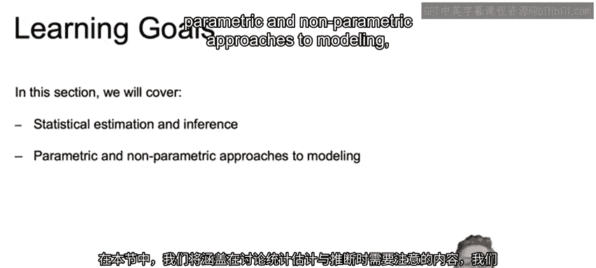

We'll discuss the different common statistical distributions that we will see in the real world。

And then finally， we'll introduce the difference between frequententists and Bayesian statistics。

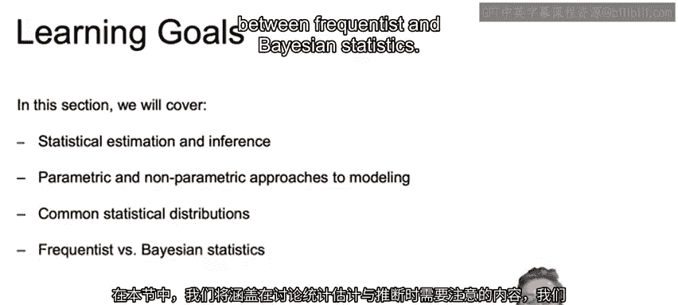

So starting off with estimation versus inference， when we talk about estimation。

 essentially what we want to keep in mind here is that an estimate is just going to give us an estimate of a certain parameter。

 such as the mean from our sample data。So in order to calculate the mean。

 we just take the sum of all of our values in a certain column and divide by the number of values that are there to get the average value。

Now estimation is only a part when we talk about statistical inference。

When performing statistical inference， we're trying to understand the underlying distribution of the population。

 including our estimates。Of the mean， as well as other parameters。

 such as the standard error of the underlying properties， of the population that we're sampling from。

And。In order to get the standard error， we would use something like the equation that we see here。

 where we just have the estimate of the mean and subtract every value from that and then see what is going to be the average distance that we are from our estimate of the mean。

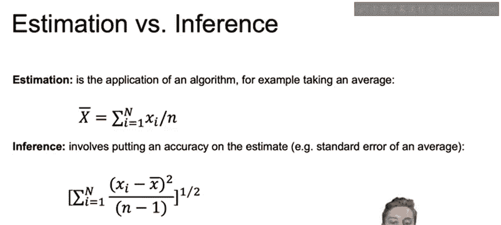

Now， machine learning and what we defined as statistical inference are very similar。

 We'll see the degree to which much of what we learn throughout this course and what we use is actually intertwined and built from the foundations of statistics that are replied before we even had the computing power that we have today。

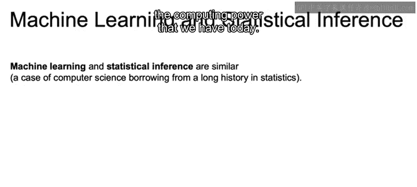

In both machine learning and statistical inference。

 we're using some sample data in order to infer qualities of the actual underlying population distribution in the real world。

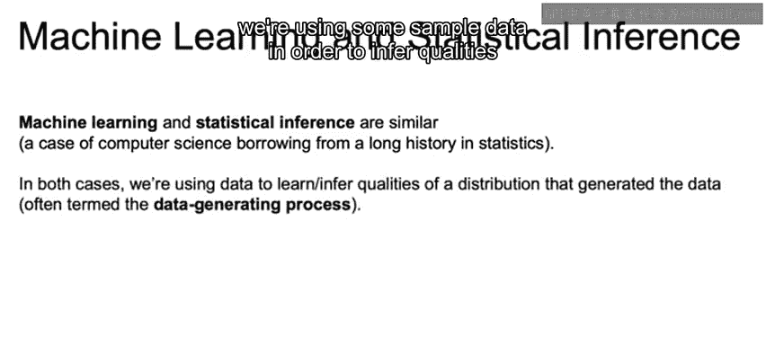

And the models that would have generated that data。And when we say here our data generating process。

 we can think of the linear model as an example of a data generating process representing the actual joint distribution between Rx and Y variable。

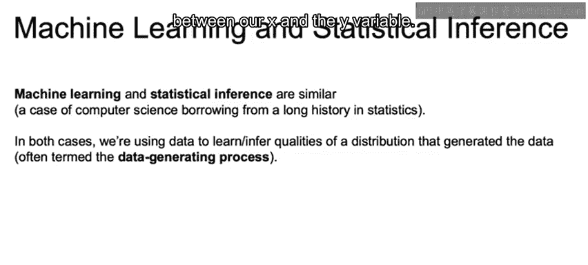

We may care either about the entire distribution when doing machine learning or just some features of our distribution。

 such as just getting the point estimate of our meanme， for example。

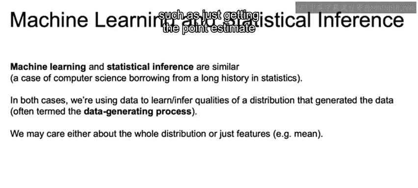

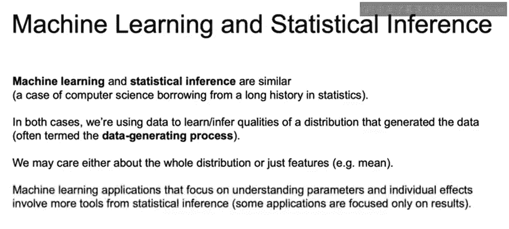

And machine learning that focuses on understanding the underlying parameters and individual effects of all of our parameters required tools pulled from statistical inference。

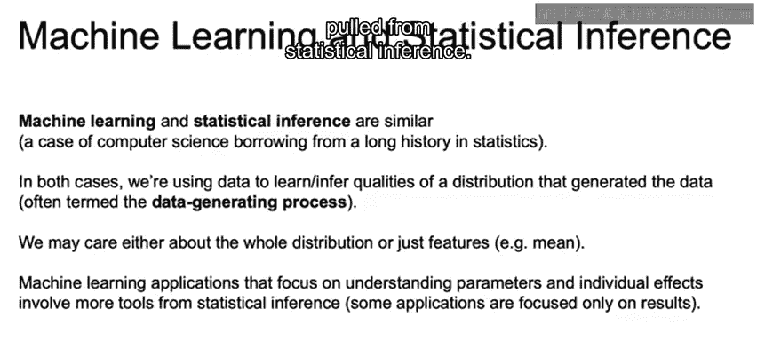

On the other hand， some machine learning models tend to only mildly focus on all of these different parameters。

 all the underlying parameters of our distribution。

 and just focus instead on prediction results or just those estimates。

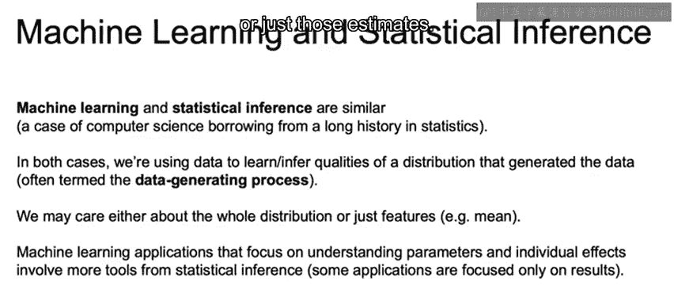

Now， I want to introduce a business example that we'll use throughout to help bring context to what we've learned so far and what we'll learn throughout this course。

 The example that we're going to be using is an example of looking at customer churn。

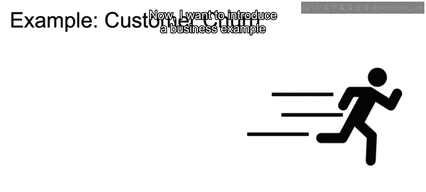

What do we mean by that data related to churn will include a target variable for whether or not a customer has left the company。

 so obviously we don't want for our customers to be leaving the company so we want a lower churn rate。

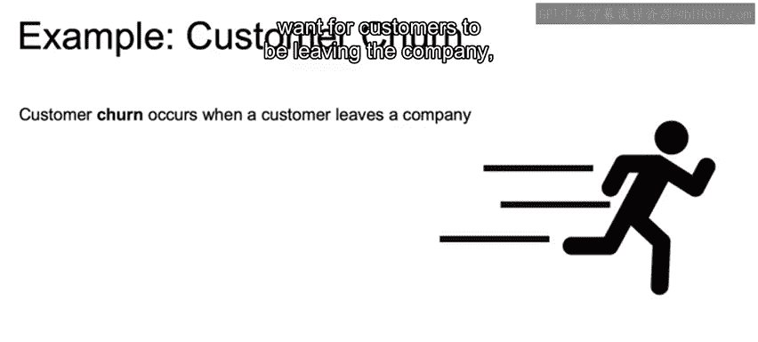

Data related to churn may include the target variable for whether or not a certain customer is left。

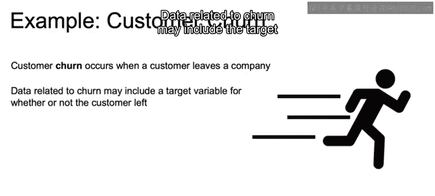

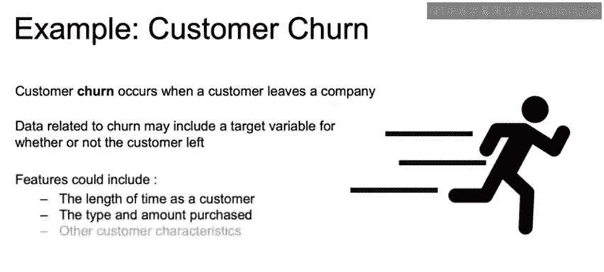

It will also include features to help us make that prediction about whether a future customer leave。

 such as the length of time that we've had that customer as a customer。

 the type and amount of purchases that customer has made。

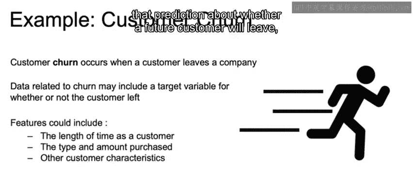

And other customer characteristics such as age， location， and so on。

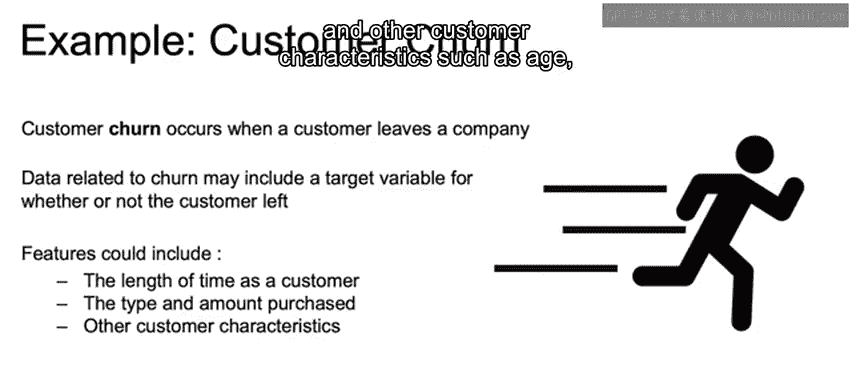

And churn prediction is often approached by predicting a score for individuals that estimates the probability the customer will leave or not leave。

 So。99 means they're very likely to leave。01 means we're probably going to hold on to that customer。

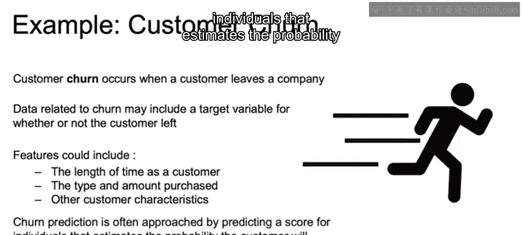

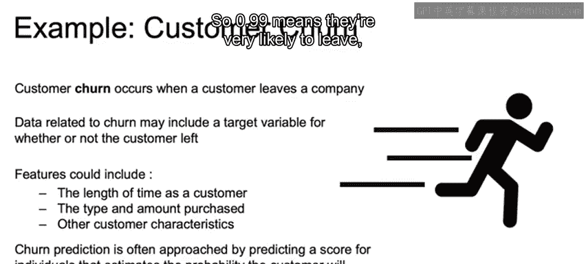

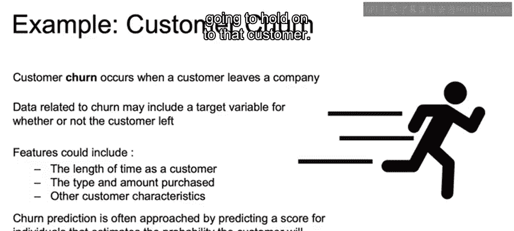

So we can estimate when we talk about estimation here versus inference。

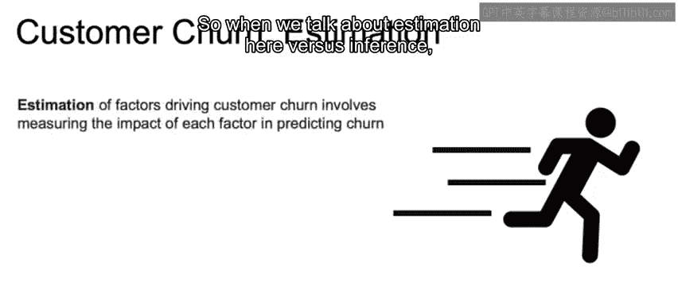

We can estimate the impact of each feature。

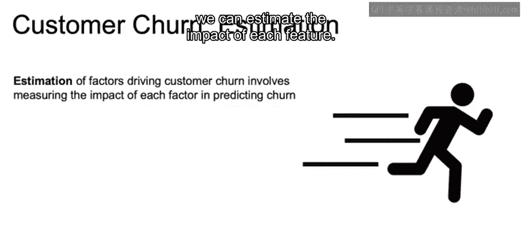

Think for every additional year someone has been a customer， that being the feature。

 they are 20% less likely to churn， so we're giving an estimate for the value of each additional year。

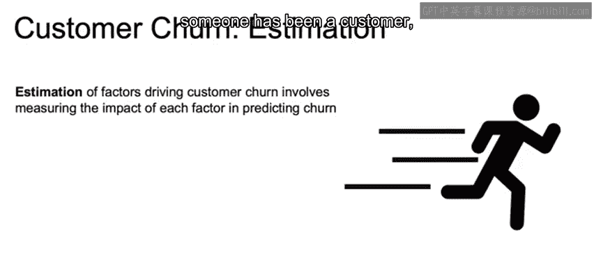

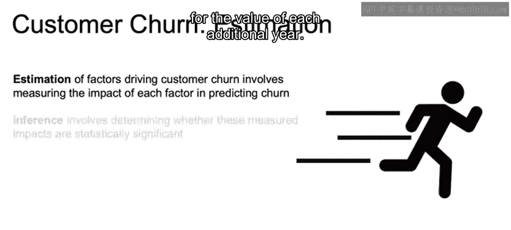

When we talk about inference， we'd be expanding it to getting the interval as well。

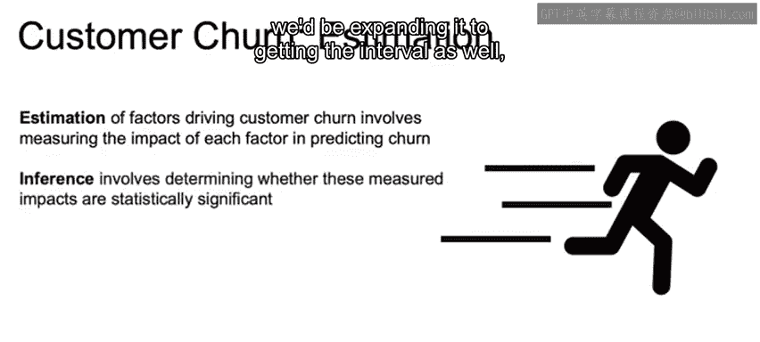

So we get the statistical significance of the estimate， so for example。

 using what we just said rather than just a 20% less likely to churn。

 we can have a 95% confidence interval on that estimate。

 saying that the effect is either between 19% and 21%。

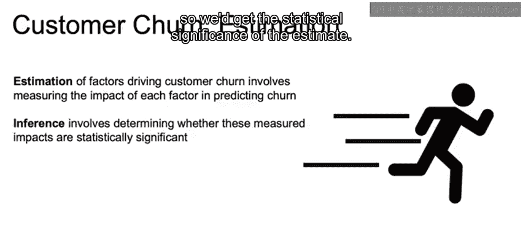

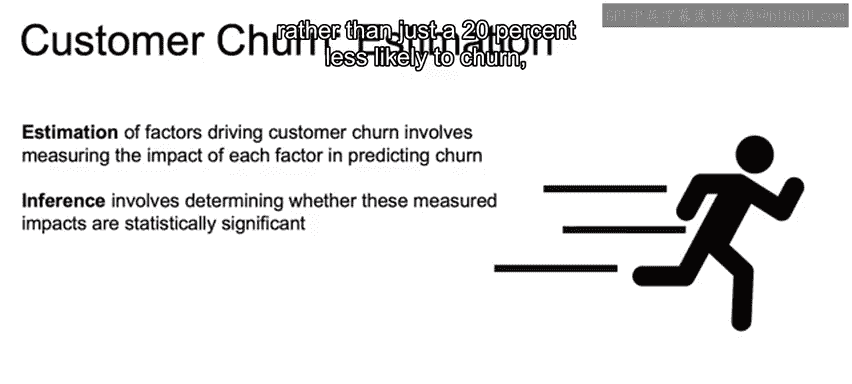

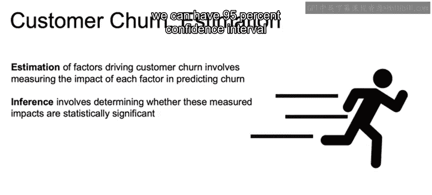

So then we'd be fairly confident that each additional year that we've had a customer。

 they are going to be 19， between 19 and 21， meaning 20% is a good estimate of how much less likely they are to churn。

 or on the other hand， the 95% confidence interval can be between negative 10 and 50%。

 meaning each additional year or're very uncertain if it's 20%。

 That's a point estimate for all we know it could actually have a negative effect。

 or it could have a much stronger positive effect。 We just don't have the statistical significance that we do if we're thinking about somewhere between 19 and 21%。

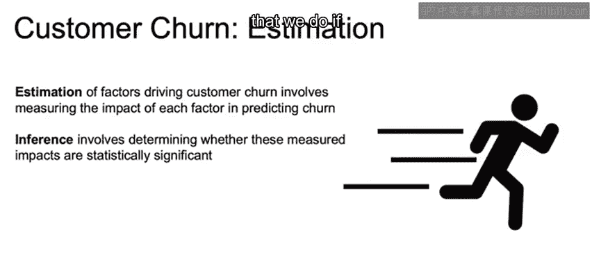