# IBM《机器学习（数据探索、监督学习的回归和分类）｜machine learning》中英字幕 - P34：33_估计和推断示例.zh_en - GPT中英字幕课程资源 - BV1xM4m1D7kY

So let's look at some actual customer churn data。

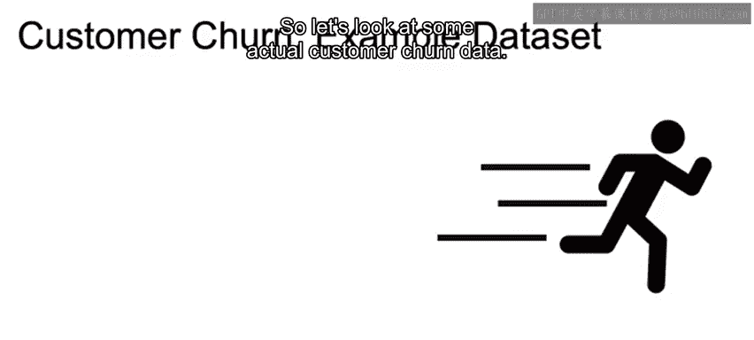

We're going to use the Telco customer churn data set from IBM Cgnos Analys。

 and that's going to represent customer characteristics and churn outcomes for a fictional telecommunications term。

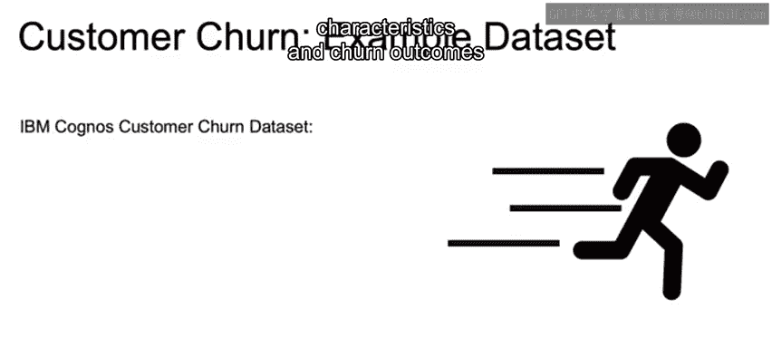

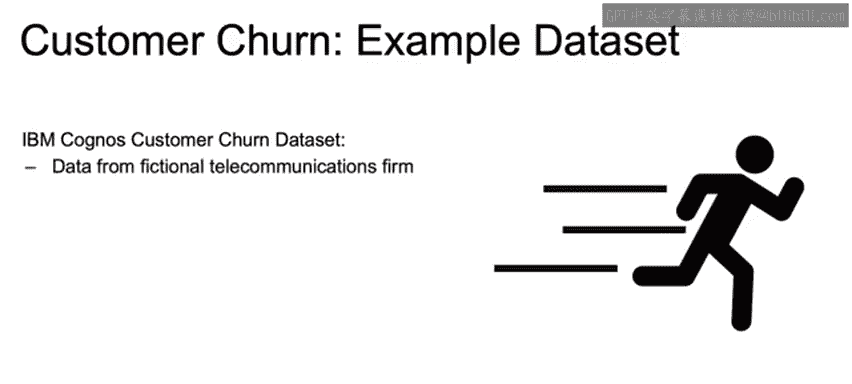

It will include account type， customer characteristics， revenue per customer。

 that customer satisfaction score， and an estimate of that customer's lifetime value in regards to customer lifetime value being the purchase amounts over the entire time that we have that customer。

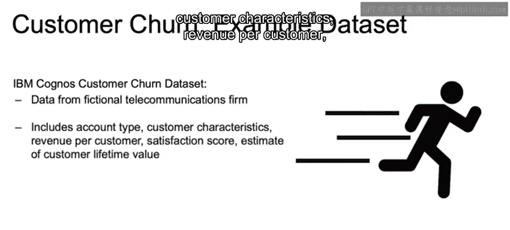

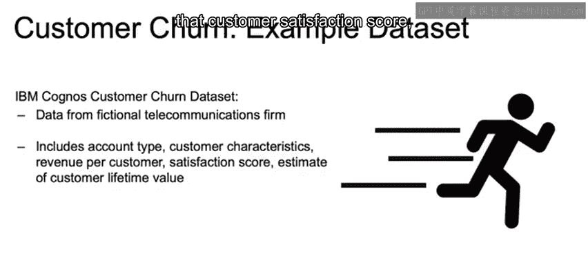

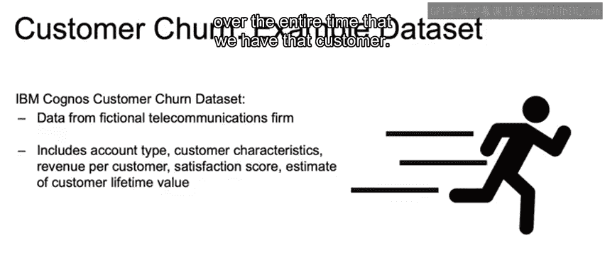

They'll also include information on whether the customer has churned or not。

 as well as some categories of churn you can think of。

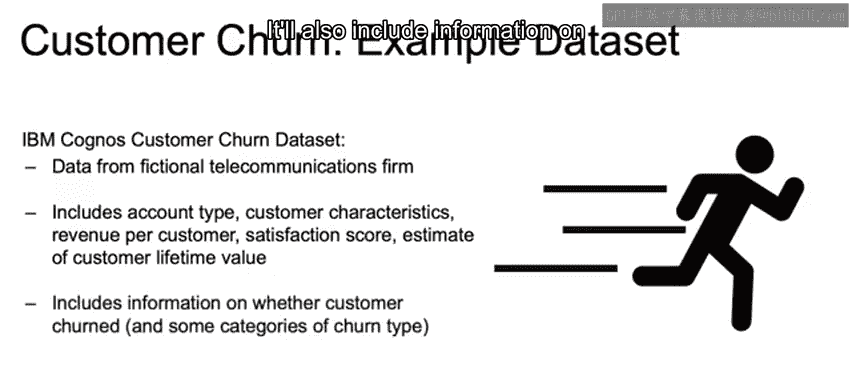

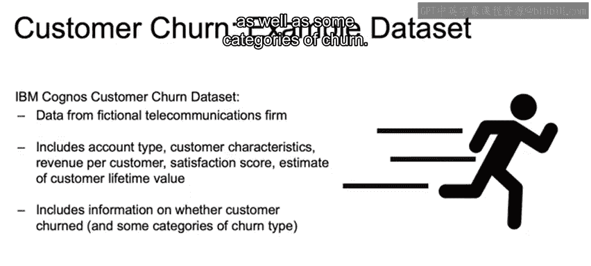

Different churn types such as actively canceling versus just not renewing their subscription。

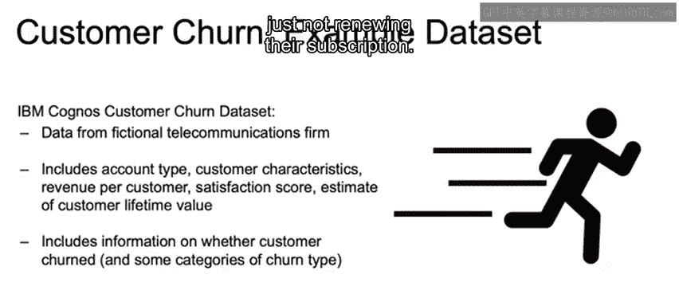

Our data for the phone subsample， this is for a phone subscription。

 is contained in a pandas data frame assigned to the variable DF foam。

 so keep that in mind as we go through the examples as we walk through some EDA in the next couple of slides。

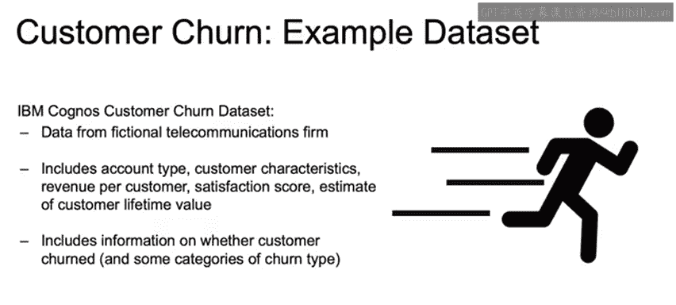

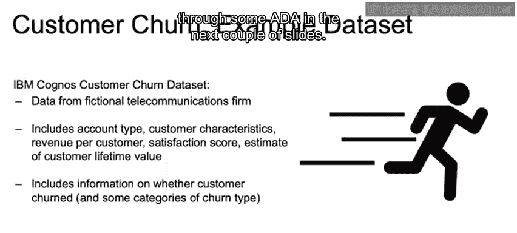

So we're going to start off by creating a bar plot here we're setting the y variable equal to our turn value。

 so how likely are they to churn， and we're going to look at that according to their different payment types。

 so x equals payment and the data that we're going to bring in is from this pans data frame DF phone。

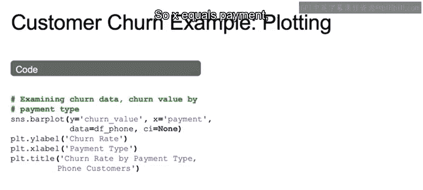

And we don't。 we're not going to add on a conference interval， which we can to our bar plots。

 So we see here that people that use credit cards are much less likely to churn than those that are using bank withdrawal payments or mail check。

So we see that extra piece of information looking at this bar plot that we have here to the right。

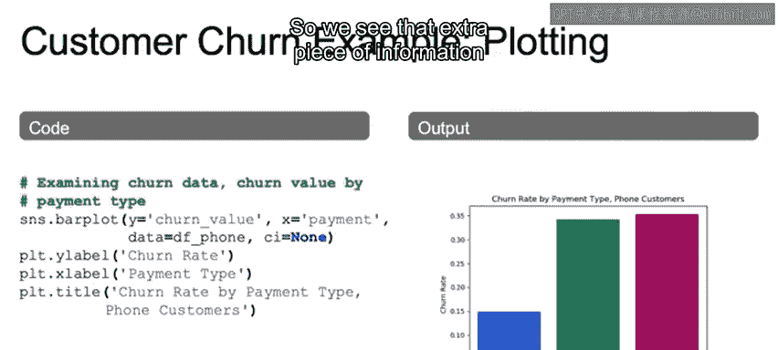

We can also look at churn value by the number of months here， we're using Pd dot cut。

 whenever we are creating a barpl， we want our x axis to be categorical variables。

 So we're going to create a categorical variable using Pd dot cut and cutting it into five equal length bins。

 So we see here to the right that we have values between around 0 and 15 then 15 and 30。

 so on and so forth。 And we can see that those that our。

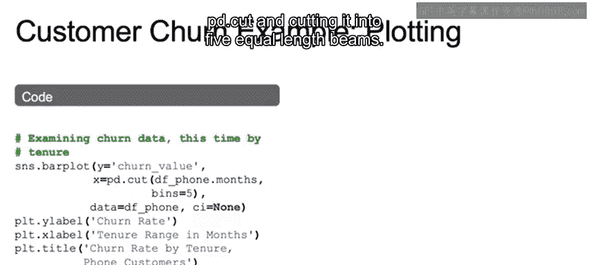

On for much less time are obviously much more likely to churn compared to those that have been a customer for a longer period of time。

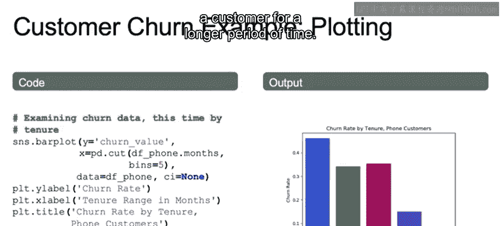

We can also pull out our pair plot， which was introduced earlier。

 We're going to create a pair plot here。 just looking at the months that we have selected here。

 the features that we have selected here， such as the amount of months we've had them as a customer gigamitetes use per month。

 The total revenue brought in by that customer， as well as that CTv。

 which is the customer lifetime value， and then obviously we have the churn value as well。

 So you're run the pair plot to see the relationship between each one of these variables。

 And then we're also going to split that up。 We see that Q equals churn value。

 We're going to split it by whether or not they churn one would be equal to them churn0 equal to them not churn。

 So we see the difference graphs that we have here。

 blue being that they did not churn one being one in green being that they did churn and we see the different relationships between each variable as well as the distribution of each one and a lot of these distributions should make sense。

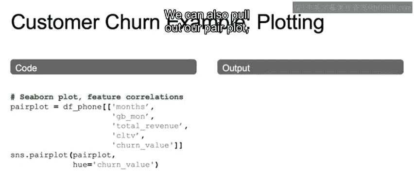

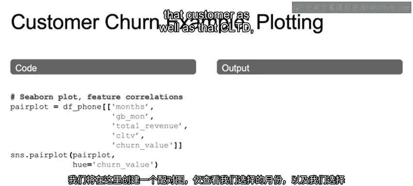

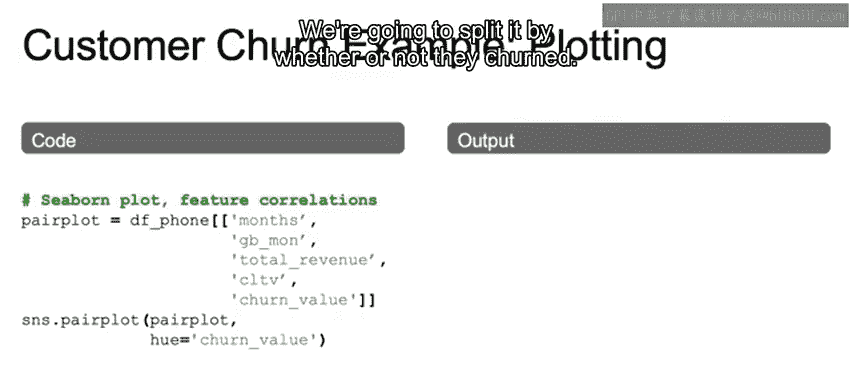

Like we said， when we have the tenure in months， we have them much more likely to churn。

 as we see with the green values versus not likely to churn as we see in the blue values in the top left corner。

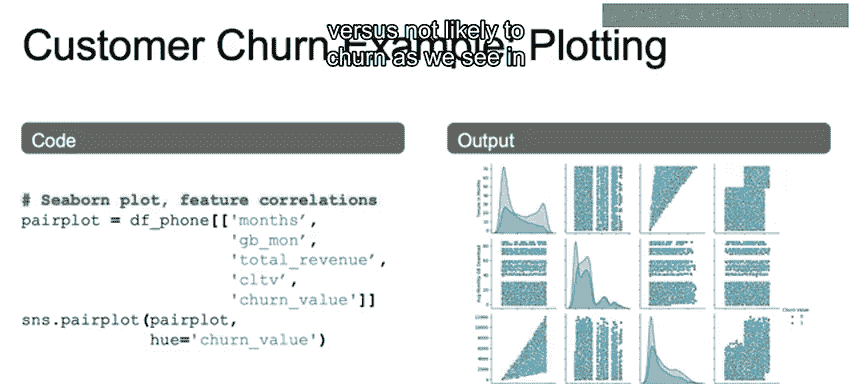

Also going to look at the hex bin plot that we introduced earlier。

 So we're going to use the joint plot and we want to see the labels are going to be months versus monthly。

 And what that is is just 10 year in months versus the monthly charge。 So we want to see if。

If they're charged more， are they more likely to stay。

 or maybe we have those more expensive customers are， you know less or more likely to stay。

 So we're able to see the distribution of the breakdown of the tenure and months on the top of our plot。

 we can also see the distribution of the monthly charge on the right side of our plot。

And our hex bins are going to show us。 We see the densities on the top right corner。

 which says that there's more people that have a longer ten year months。

 as well as a higher monthly charge。But we also see on the other end of the spectrum that people that monthly that have a lower 1 year months also have a higher monthly charge than the average。

 and then we see in between those two values a lot less density。

That concludes our portion here on the E DA on the customer churn example。 In the next lecture。

 we're going to start talking about parametric versus non parametric statistics。 I'll see there。

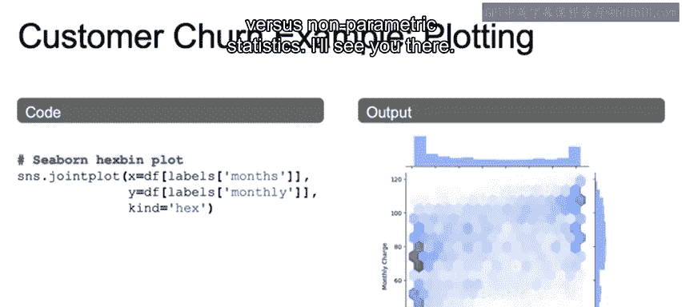

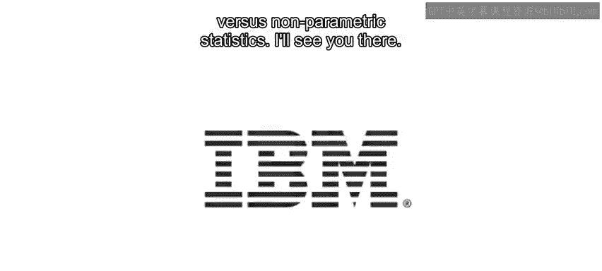