# IBM《机器学习（数据探索、监督学习的回归和分类）｜machine learning》中英字幕 - P35：34_估计和推断：参数与非参数.zh_en - GPT中英字幕课程资源 - BV1xM4m1D7kY

Okay， let's talk about parametric versus non parametric If statistical inference is about finding the underlying data generating process of our data。

 then the statistical model is going to be a set of the possible distributions or even regressions that that data can take。

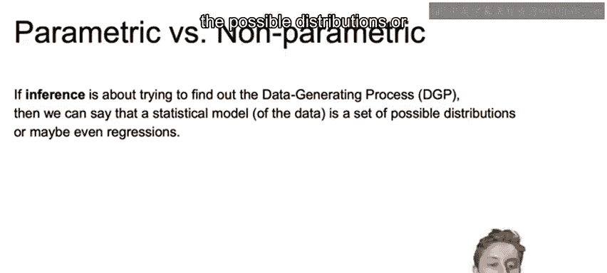

Now， a parametric model is a particular type of statistical model。

What differentiates a parametric model， some of the major characteristics are that a parametric model is constrained to a finite number of parameters。

And that'll rely on some strict assumptions made about the distributions from which that data is pulled。

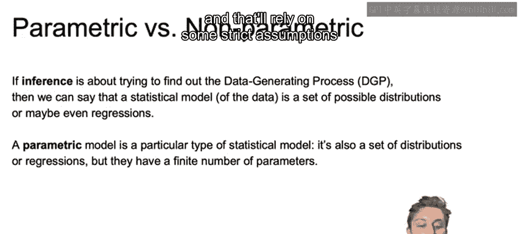

Now， non parametric models， on the other hand， will mean that our inference will not rely on as many assumptions。

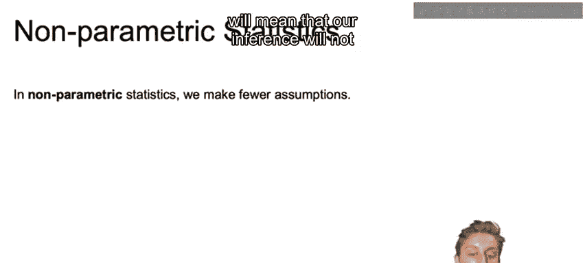

Such as it will not have to rely on the data being pulled from a particular distribution， right。

 it'll be a distribution free inference。Now this doesn't mean that we don't know anything though we will be using insight from the data that we have available。

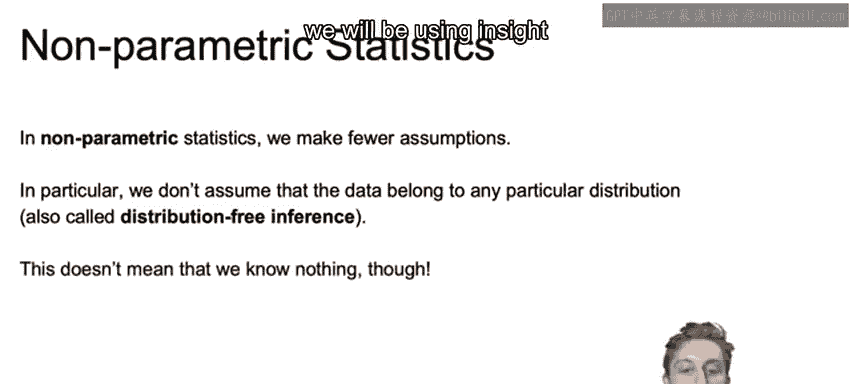

So starting with nonparmetric statistics， an example of a nonparmetric inference is creating a distribution of the data using a histogram。

 so you decide the CDF or the cumulative distribution function as to the probability of where a certain value will fall according to the actual data。

 so you're not assuming a normal distribution or exponential distribution which we'll discuss later。

 but a distribution defined by the actual data that you've pulled from your sample。

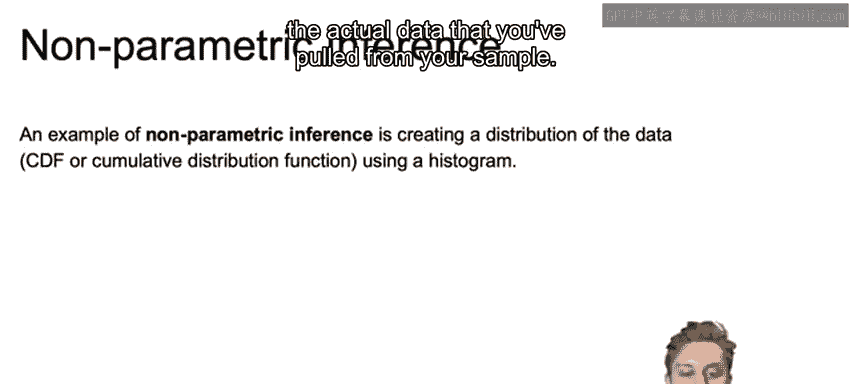

And in this case， we wouldn't be specifying any of the parameters that we need for， let's say。

 a normal distribution。

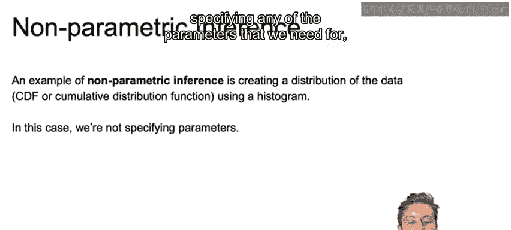

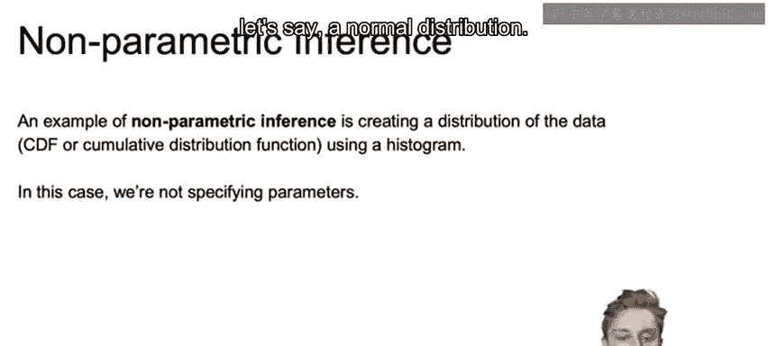

Now， just as a reminder， a parametric model is a particular type of statistical model where they will have a finite number of parameters。

 so again think here with ordin least squares with our linear models。

Where what we saw is that we had to predefine the number of coefficients。

 according to the features or transformed features that we were working with。

 And we had to assume also a linear distribution。 So that's going to be parametric and having the constraints。

That are that come along with it。 So sometimes those will be a bit easier and quicker to solve。

 but on the other hand， they're going to be constrained compared to nonparmetric models。

 which won't have similar constraints。

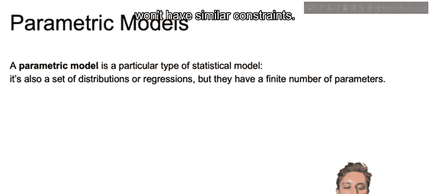

Okay， let's look at a particular parametric model， namely the normal distribution。

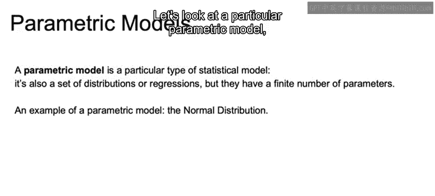

We see that there is a set equation for the normal distribution。

 and it's going to depend on a set number of parameters， namely the mean and the standard deviation。

 and that's essentially going to be the parameters that will define what our normal distribution actually look like with the assumption that we are using the normal distribution。

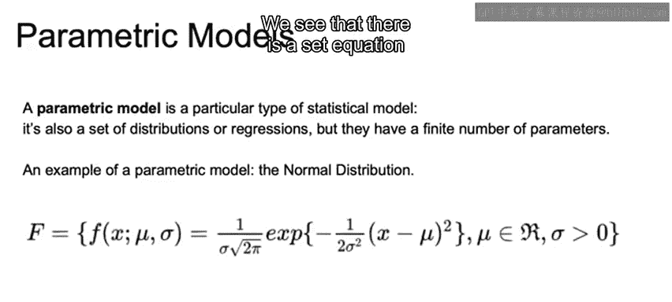

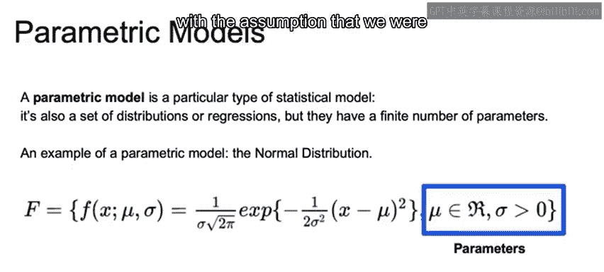

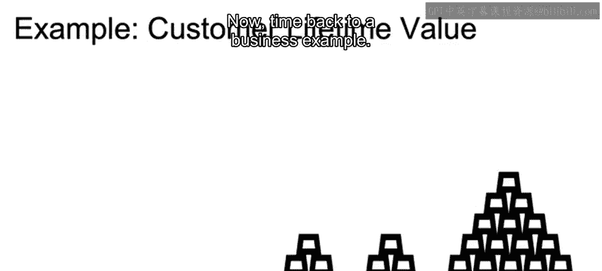

Now， tying back to a business example。Customer lifetime value is going to be an estimate of the customer's value to the company over time。

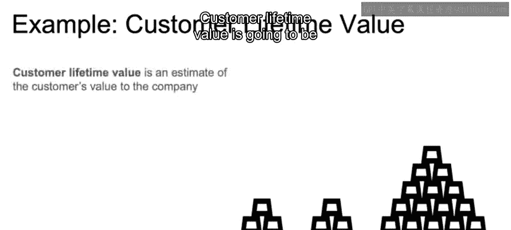

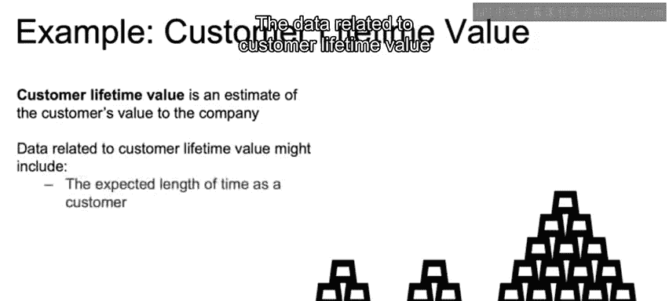

The data related to customer lifetime value will probably include something along the lines of the expected length of time that the person will be there as a customer。

 as well as the expected amount that that person spends over that allotted time。

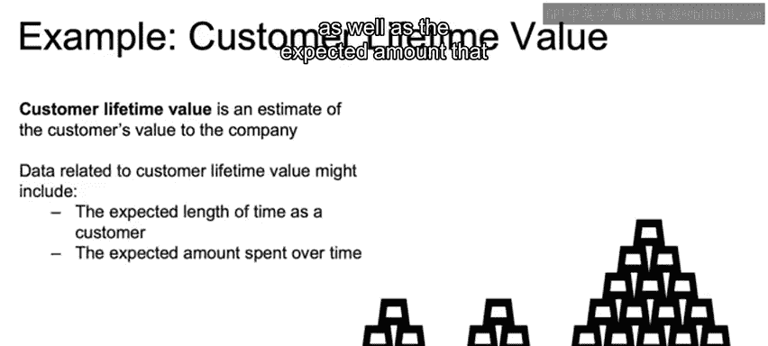

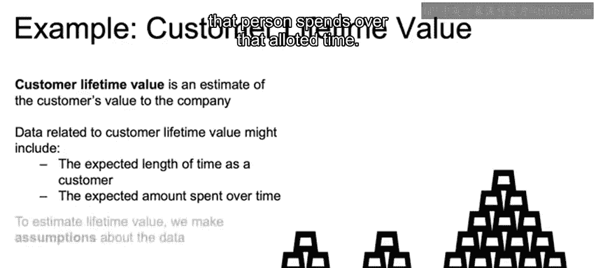

So to estimate lifetime value， we need to make assumptions about the data。

 namely how long do we think a customer is going to last。

 as well as how much do we think they will spend over time？

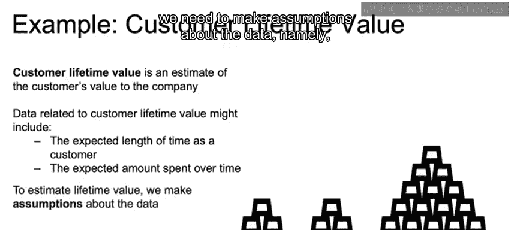

And these assumptions can be parametric， so assume a specific distribution。

 whether that's linear over time or some type of decrease over time or nonparmetric。

 where if we're doing nonparmetric statistics， we'll be relying much more heavily on the data and we'll need a lot more data in order to come to a conclusion。

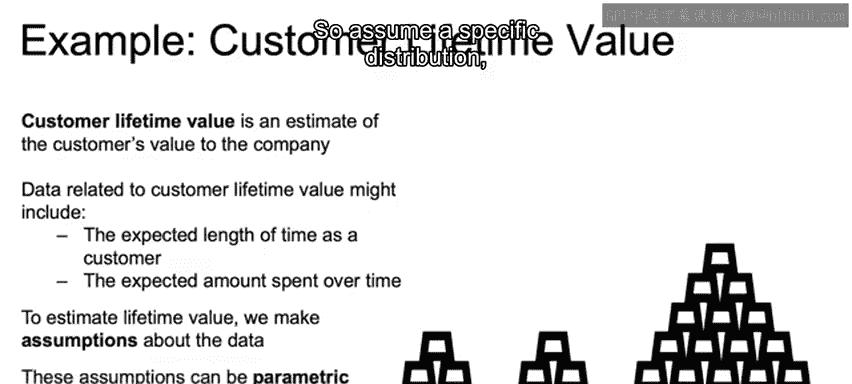

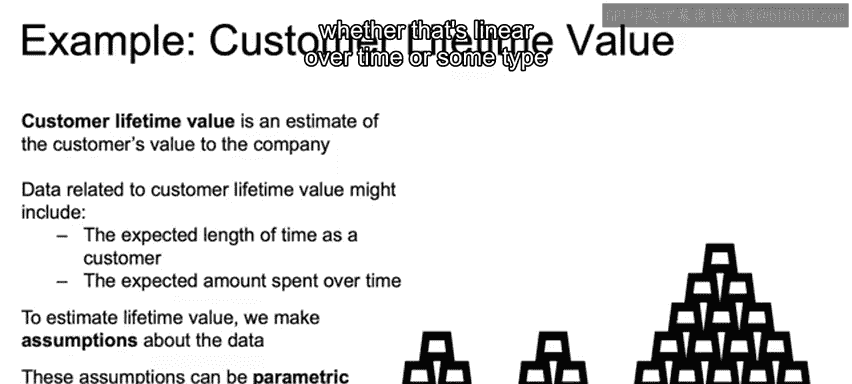

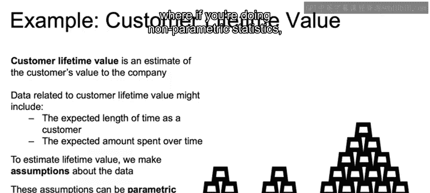

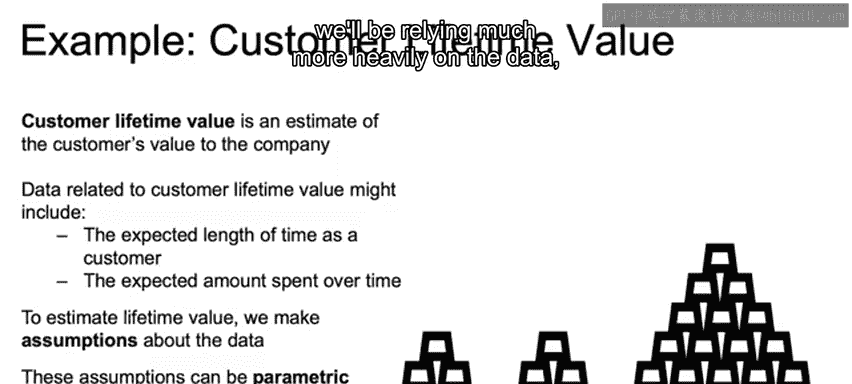

Now， when we're doing parametric modeling。The most common way of estimating parameters in a parametric model is through the maximum likelihood estimate。

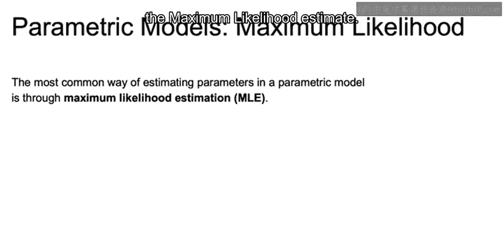

The likelihood function is related to probability and is a function of the parameters of the model。

 So for the normal distribution， those parameters were the mean and the standard deviation。

The idea being here that our likelihood function is going to be a function of the parameters。

To make this clear， think about the likelihood function as taking all of your data and saying。

 what is the most likely。Value for the mean and the most likely value for the standard deviation。

 given the sample data that we see。 So for the population。

 what is the most likely parameters given our sample。

 That's going to be your maximum likelihood estimate。

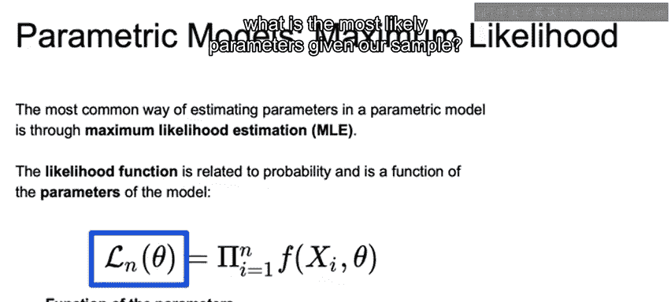

And then we choose the value。Of each of those parameters。

 that's going to maximize that likelihood function。

 That's going to maximize what is most likely to occur， given the data that we have。

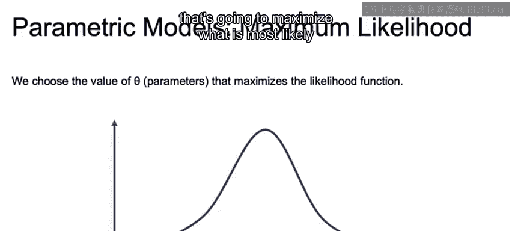