# IBM《机器学习（数据探索、监督学习的回归和分类）｜machine learning》中英字幕 - P38：37_假设检验简介.zh_en - GPT中英字幕课程资源 - BV1xM4m1D7kY

In this section， we're going to introduce the concept of hypothesis testing。

Our learning goals for this section will be two。Go over what hypothesis testing is。

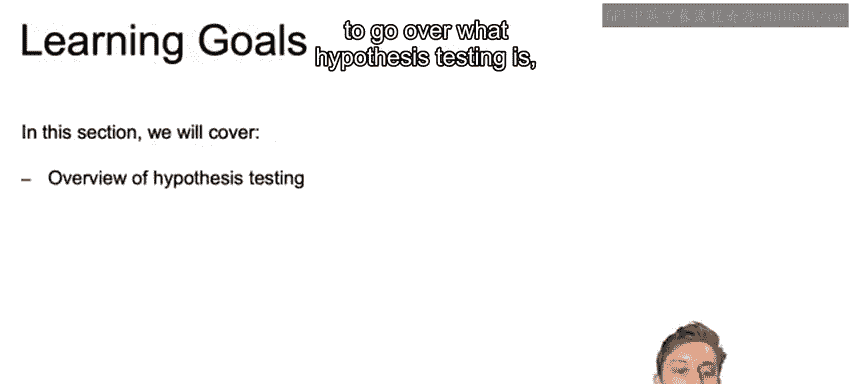

Discuss the Bayesian approach to hypothesis testing。

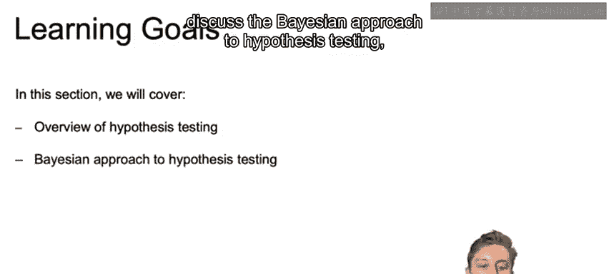

And then begin to motivate this with an example using coin flips。

 which you'll see towards the end of this section。

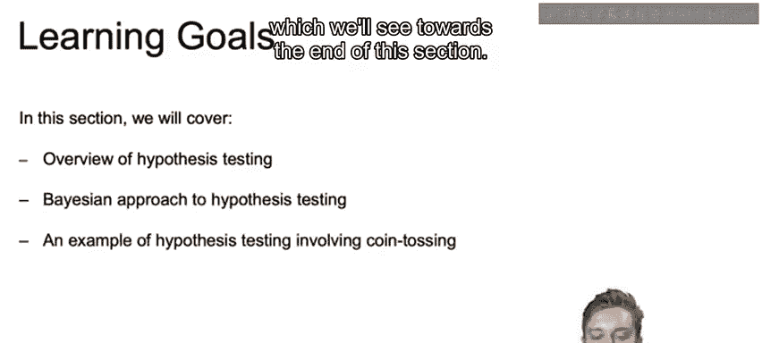

So a hypothesis is a statement about a population parameter。

 such as the mean of our Poson distribution in our estimate of the number of people that will come into the line for our grocery store example in the next hour。

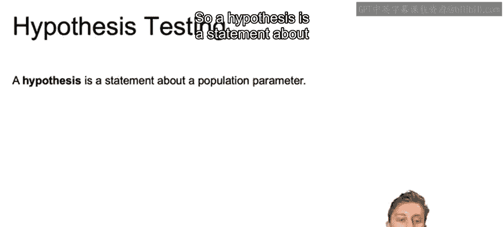

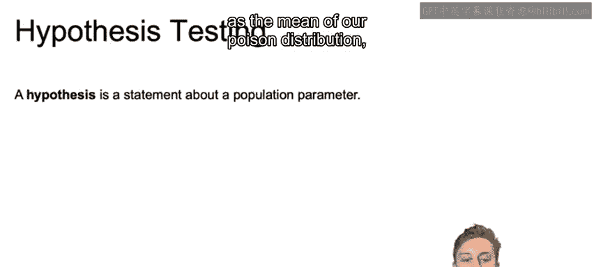

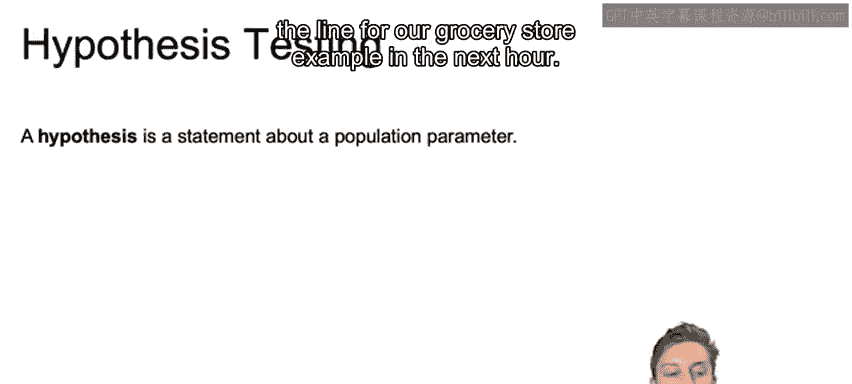

We create two hypotheses， we start off with a null hypothesis and an alternative hypothesis。

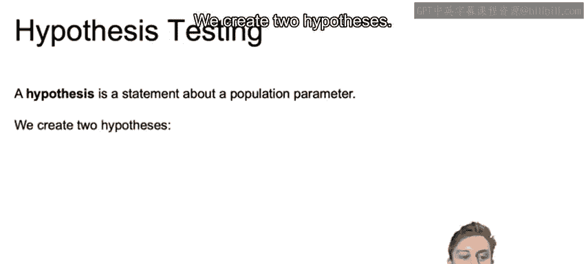

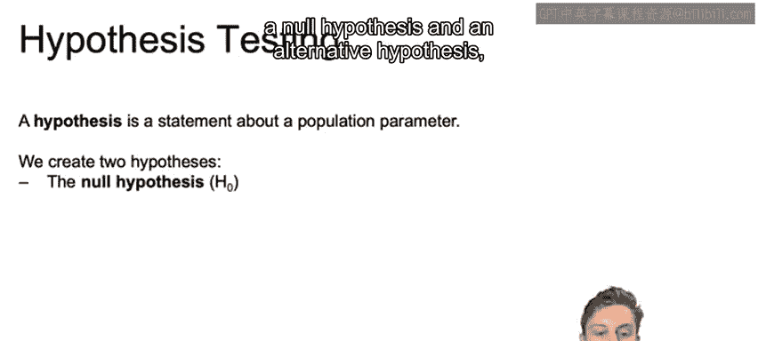

And we decide which one to call the null， depending on how the problem is set up。

 So an example would be that we get an average of five people coming in per hour and the alternative may be being greater than five。

 so any number greater than five would be the alternative with just five being the null。

 or it could be a specific amounts of people such as five being the null and 8 being the alternative。

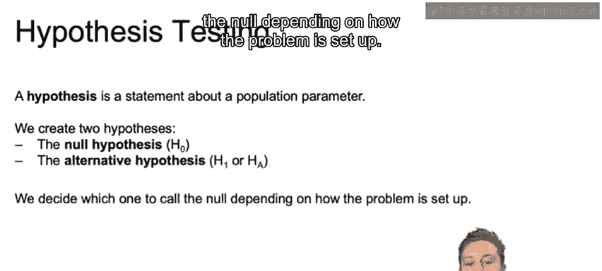

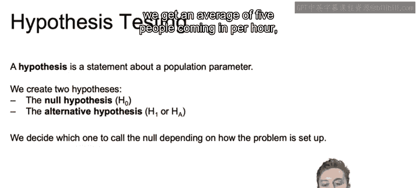

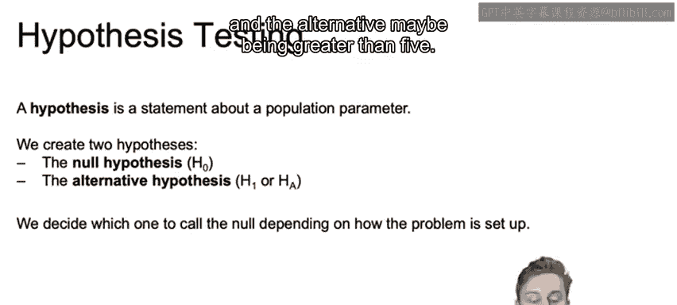

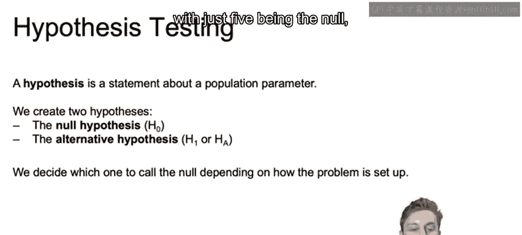

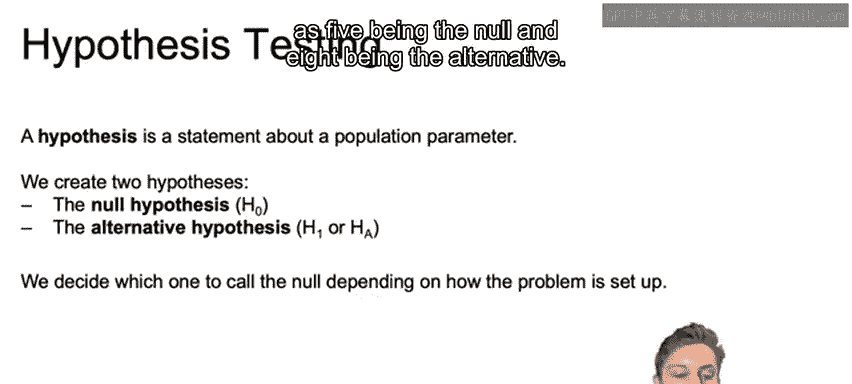

Now， if one of those values is less specific， for example。

 such as greater than five or not equal to5， that will usually be the alternative。

 whereas the null will be the specific value。

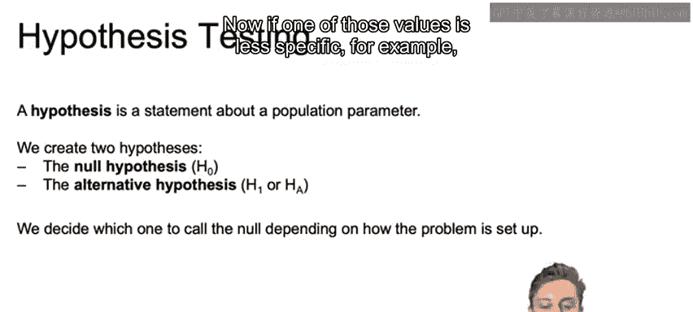

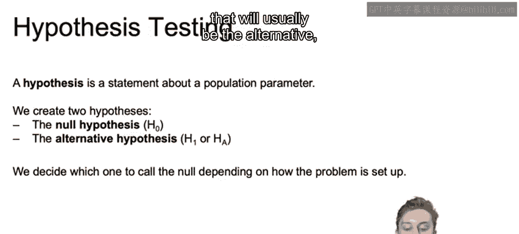

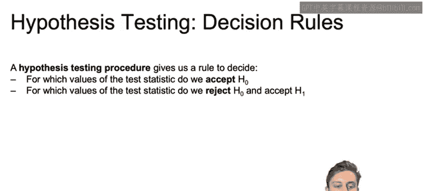

So given the data from the sample we use， we then use a hypothesis testing procedure to decide whether we're going to accept the null hypothesis or reject the null and accept the alternative。

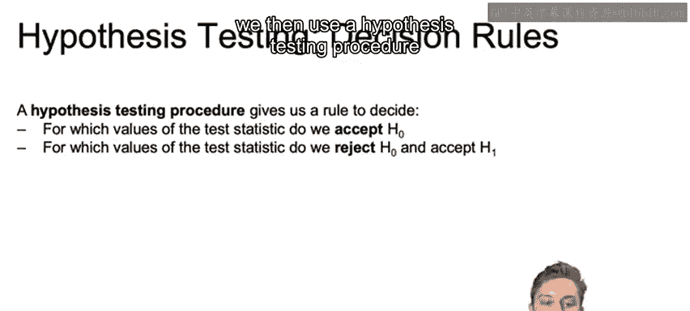

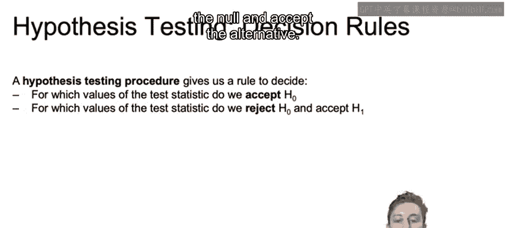

Now it's often said that you can reject the null， but never accept the alternative。

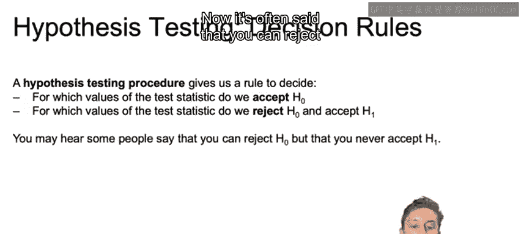

Here we're just saying for practical purposes， when moving forward with your project。

 you'll be taking the path that the alternative is true depending on your test statistic。

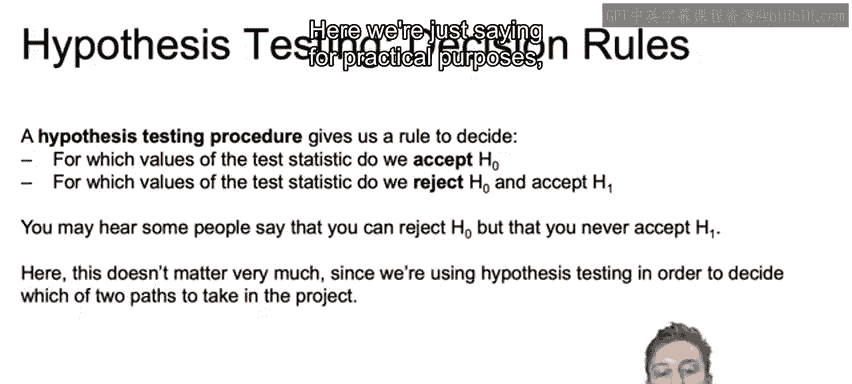

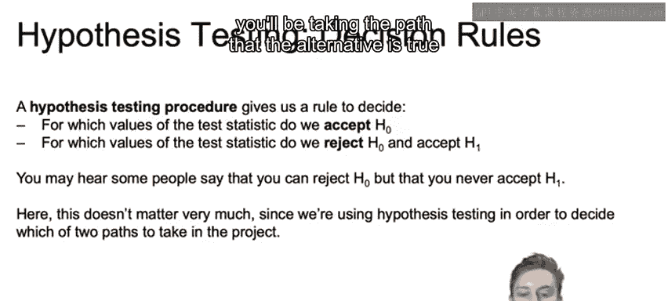

Now， in the Bayesian interpretation， we won't get a decision boundary。

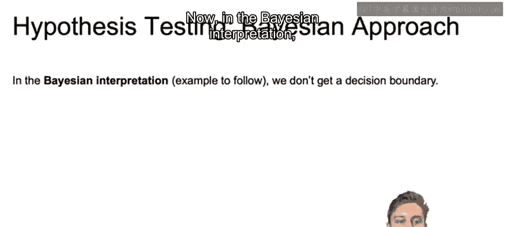

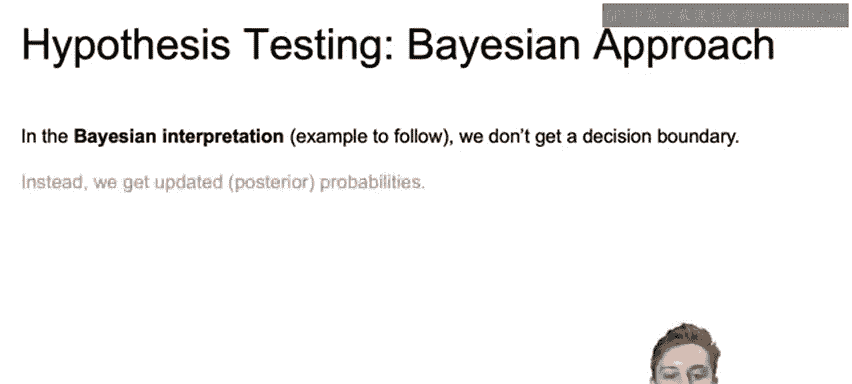

Rather， we'll get posterior probabilities of the null and the alternative hypotheses and see which one is more likely。

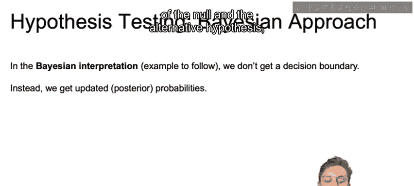