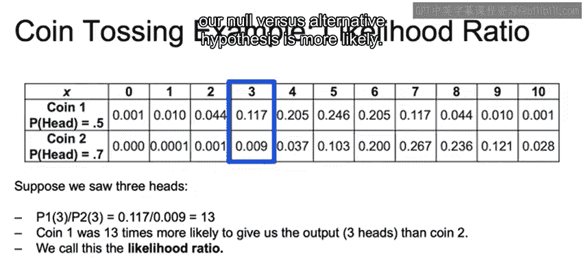

# IBM《机器学习（数据探索、监督学习的回归和分类）｜machine learning》中英字幕 - P39：38_假设检验示例.zh_en - GPT中英字幕课程资源 - BV1xM4m1D7kY

So let's look at an example to make this clear， we're going to look at a coin tossing example and imagine you have two coins。

Coin 1 has a 70% probability of coming up heads， and coin 2 has a 50，50 chance of coming up heads。

So we want to pick one without looking between these two。

Toss that coin 10 times and see how many times heads comes up。

And then given the number of heads that come up， you will say which one is more likely between the two coins。

 which one were we more likely to have picked？Is it the 5050 coin or the one that has 70% probability of coming up heads？

So given what we know about coins one and2 and their probabilities。

 we can make a table of the probability of seeing a certain amount of heads out of our ten0 tosses。

So here we see coin 1 with a probability of heads being 0。5 and coin 2。

 with the probability of heads being 0。7， and we can see through the chart that as we get closer to so lower numbers are going to be much more likely to be the 5050 coin as we get to higher values in terms of the number of heads that show up。

 it'll be much more likely that we have the 0。7 biased coin in terms of a higher probability of coming up as heads。

And now we can calculate the likelihood ratio based on the number of heads we see when we toss this unidentified coin。

So let's imagine that we saw three heads。And we see the probability of coming up with three heads out of our 10 tosses。

 given our coin is either have a 50， 50 chance of landing heads or a 70， 30 chance of landing heads。

The probability of three heads given coin 1 is 0。117 versus the probability for  three heads。

 given that we have coin 2 is much less likely at 0。009。 Thus。

 we had that coin 1 was 13 times more likely to give us the output of three heads than coin 2。

And we call this ratio the likelihood ratio， the ratio of which one of our null versus alternative hypothesis is more likely。

