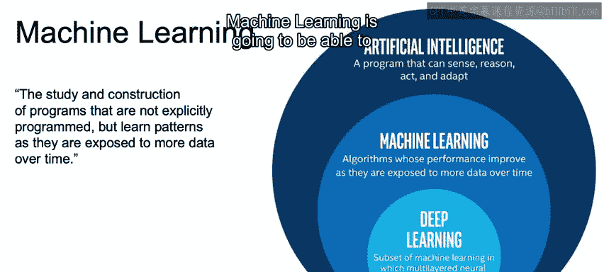
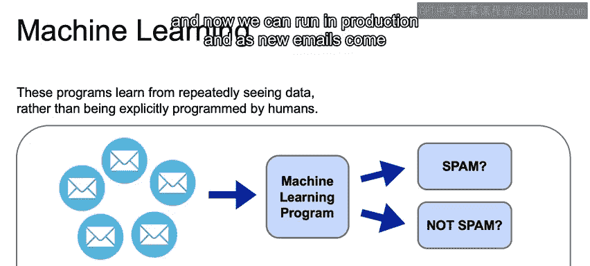
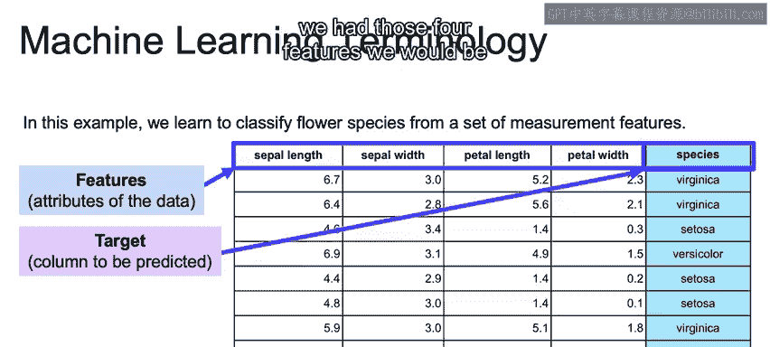
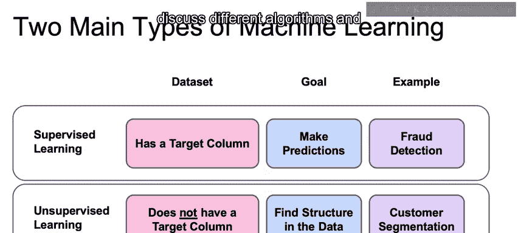
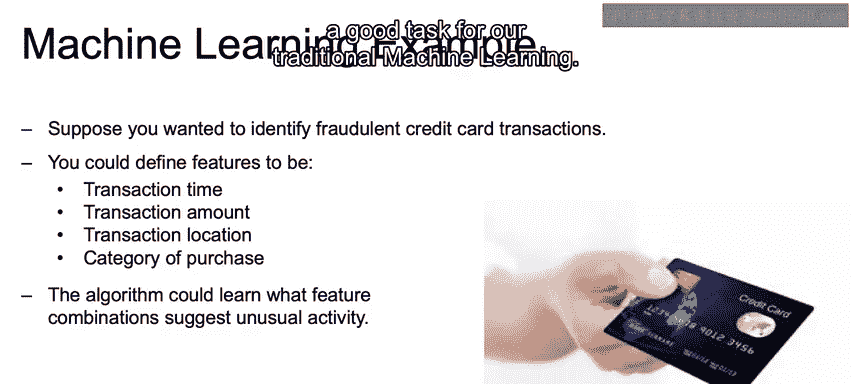
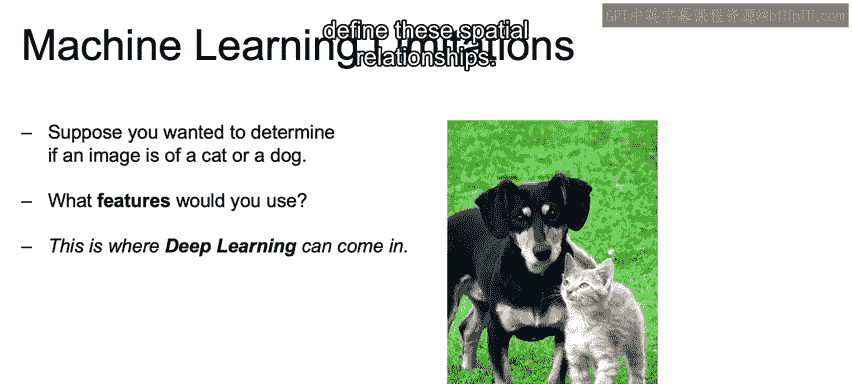
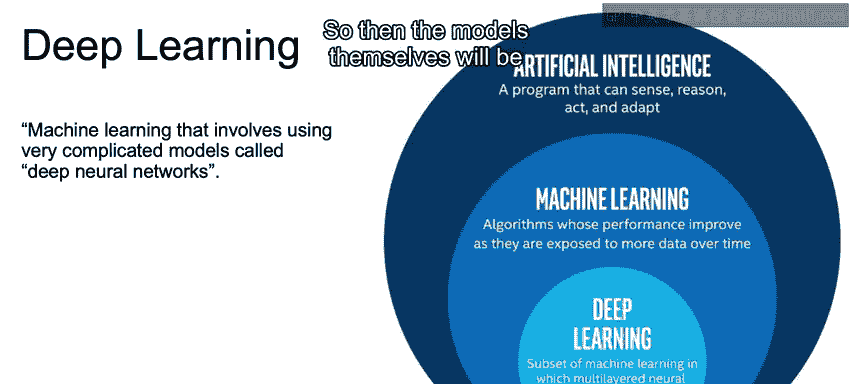
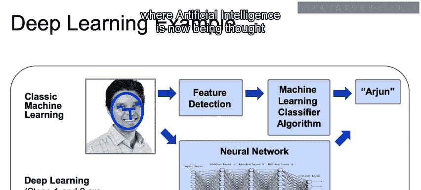

# IBM《机器学习（数据探索、监督学习的回归和分类）｜machine learning》中英字幕 - P3：2_机器学习和深度学习.zh_en - GPT中英字幕课程资源 - BV1xM4m1D7kY

Let's dive into what we mean by machine learning。Machine learning is the study and construction of programs that are not explicitly programmed。

 but rather learn patterns as they are exposed to more data over time。So as we saw earlier。

 machine learning is going to be a subset of artificial intelligence。

 it's going to be a subset that's going to learn from observing data， the more data。

 the better the algorithm is able to learn the underlying patterns I do want to note that the performance of these algorithms will plateau so there will be a sense of diminishing returns after a certain amount of data but in general the idea is going to be that as we gain more data。

 machine learning is going to be able to better understand the underlying patterns。

So these programs learn from repeatedly leasing data rather than being explicitly programmed by humans。

 so it's not going to be a set of rules programmed by humans in order to make a decision。

So as an example， let's say what we're working with。

Trying to decide whether emails are spam or not spam。

 we would start off with a data set where we have a bunch of emails that are going to be labeled spam versus not spam。

These emails will be pre processed and fed through a machine learning algorithm that learns the patterns for spam versus not spam。

 and the more emails it has to learn underlying patterns the better the model is going to get。

Once the machine algorithm is trained， we can then use it to predict as new emails are coming in。

 so we trained on this label data set and now we can run in production and as new emails come in。

 we can predict spam versus not spam。

So we're going to use this simple data here just to highlight what features are and what a target is。

 features and target are going to be in important terms for us to understand。

 so don't get distracted by the data itself as the main purpose of this slide is just to help define these terms This IIS data is a popular data often use to introduce basic concepts in machine learning。

 but we will move to more realistic complex data sets as we work through the course。

So the iris here is going to be a flower that comes in three species， as you see here， Virginiaica。

 sattosa and Versa color， and that's going to be the target that we're trying to predict。

So our data set here contains four features， sepel length and sepel width。

 pedal length and pedal width， and those are going to be the features we will use to make our prediction。

And then again， as mentioned before， the target variable is going to be the column that we're trying to predict。

 and the idea is to use the four features， sepple length， sple width。

 pedal length and pedal width in order to predict the species。

 and then moving forward if we had those four features。

 we would be able to predict the species without the label。

So in general， there are two types of machine learning。

 there are supervised learning and unsupervised learning。

Let's first go over the type of data sets that each is going to need。For supervised learning。

 we will have a target column or labels similar to what we just saw with the email spam and Iis Fer classification examples。

And then for unsupervised learning， on the other hand。

 we will not have a target column and how this comes into play will make more sense in just a second。

So let's discuss the goals of each supervised and unsupervised learning。

The goal for supervised learning is going to be able to predict that label。

 is it spam or is it not spam， is it versa coloror or another one of the different flower species？

For unsupervised learning， the goal is going to be to find an underlying structure of the data without any labels。

And this will be clear with our examples。An example of supervised learning is fraud detection。

 we may have a large data set where we have labels of either this transaction is fraud and this transaction is not fraud。

 we would learn from all the features related to fraud detection and be able to predict as new credit card transactions come in whether those are fraud or not fraud。

For unsupervised learning， an example would be customer segmentation。 And for this。

 you can think about customer segmentation to find similar groupings within your data for marketing campaign。

 you have this ecommerce-commerce data and you want to separate them out into groups in order to target them accordingly for unsupervised learning There's going to be no right or wrong answer。

 So the user will need to test different models and see which results tend to make the most sense。

 and we will get into this。 We have an entire lecture or we discuss different algorithms and techniques proud to accomplish this task。

So suppose you wanted to identify fraudulent credit card transactions。

 detecting fraud is going to be a common machine learning problem。

 you can define your features to be transaction time， transaction amounts， transaction location。

 category of purchase。And combining all of these features together。

 we should be able to predict in the future with transaction time， the amount。

 location and the category of purchase， whether there' is unusual activity and whether this transaction is fraud versus not fraud。

 and generally speaking， this structured data with intuitive features are going to be a good task for our traditional machine learning。

Now， defining features in an image on the other hand。

 is a much more difficult and involved task and has been a defining issue of the limitations of our traditional machine learning techniques that deep learning has now done a good job of addressing。

So suppose you want to determine if an image is a cat or a dog。So what feature should we use？

For images， the data is taken as numerical data to reference the coloring of each individual pixel within our image。

 so a pixel then could be used as a feature， so we saw the features before in our data。

 but if you imagine even a small image will have 256 by 256 pixels， which will come out to over 65。

000 pixels， 65，000 pixels means 65，000 features which is a huge amount of features to be working with。

Another issue is that using each pixel as an individual。

 you lose the spatial relationship to the pixels around it。 In other words。

 the information of a pixel makes sense relative to its surrounding pixels。

 So you have the different pixels that make up the nose。

 perhaps or the different pixels that make up the eyes and then separating that out。

 according to where they are in relation to the face so on and so forth。😊。

And this is where deep learning can come in deep learning techniques will give you the capability to learn these features on its own and combine these pixels to define these spatial relationships。

So let's briefly dive into what deep learning is， deep learning is going to be machine learning that involves using very complicated models called deep neural networks as discussed。

 this is like I just said， going to be a subset of machine learning。

So then the models themselves will be able to determine the best representation of our original data。

In classic machine learning， humans have to come up with these features。

 and this will allow us to solve complex problems such as what we just saw with the image classification。

Deep learning is the cutting edge and is where most of machine learning research is focused。

 it has blown away the performance of other algorithms when you're dealing with larger data sets。

But it is very important to note that you'll often be working with smaller data sets and standard machine learning algorithms will often perform significantly better than working with deep learning techniques。

Also， if the data is changing a lot over time and you don't have a steady data set。Again。

 machine learning will probably do a better job of actually being able to have better performance over time。

So let's briefly discuss some differences between the classic machine learning techniques and deep learning。

So as discussed in the classical machine learning model。

 we are going to have to define these features ourselves a priority before we feed the data to our actual model。

Sort of determine the features that make up the nose， the eyes， so on and so forth。

We can then use the features and include them into in a machine learning algorithm。

 And if a data scientist is lucky， they may be able to guess good features。

 but this is really challenging to do well。 And then they can use that to predict that this is a picture of Arum。

Now， deep learning will combine this two step process。

The neural network receives these pixels of an image as an input。

 the neural network learns how to extract these features that are meaningful from the image by combining them together in different complex combinations now these features may not always make much sense when we try to interpret them in these intermediate layers。

But ideally， they will first highlight edges and then combine those edges to make up shapes like nose。

 eyes， lips。But whether or not the intermediate steps are interpretable。

 they can be very useful for completing texts， such as image classification and coming up with the intermediate feature engineering steps and then eventually predicting ourju。

Now that's the end of this section in the next section we will start to go through the history of artificial intelligence and gain insights as to how we got to this point in history。

 where artificial intelligence is now being thought of as the new electricity。

