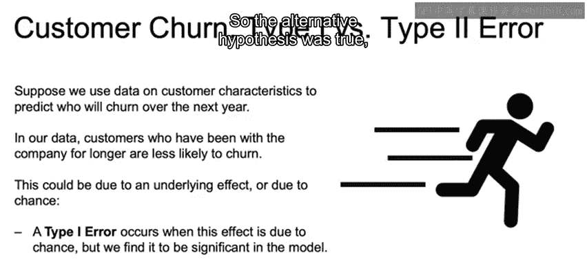

# IBM《机器学习（数据探索、监督学习的回归和分类）｜machine learning》中英字幕 - P41：40_第一类错误与第二类错误.zh_en - GPT中英字幕课程资源 - BV1xM4m1D7kY

In this section， we're going to talk about type 1 and type 2 errors。

 as well as going through some examples of hypothesis testing in the workplace。

So now we're going to further discuss hypothesis testing。

The learning goals for this section will be first to discuss type 1 and type 2 errors。

 as well as other terminology revolving round hypothesis tests。

And we'll go over some examples of hypothesis tests using some business examples in practice。

So the Neman Pearson paradigm is going to be a non-basin paradigm。

 and the main idea that we want to keep in mind here is just looking at what a type1 error is and what a type 2 error is。

Before getting into it。Let's think of an example。 So we're going to imagine we're tossing a coin。

 And our null hypothesis is that we are working with a fair coin。 So it's a 50。

50 probability thatll land heads。And the alternative hypothesis is that it is not a fair coin。

 So the alternative is just that it's not 50，50 heads。So a type one error in this case。

Is going to be incorrectly rejecting the null。 So this would mean we are indeed working with a fair coin。

 but we make the error given our sample data that we should decide to reject the null that it is a fair coin。

A type 2 error on the other hand is going to incorrectly accept the null。

 So this would mean we are working with a bias coin， but instead。

 accept that we are working with a fair coin， given our data or fail to reject that it is a fair coin given our data。

Then here we have the power of a test， and that's going to be one minus the probability of a type2 error。

So ideally， the probability of incorrectly accepting the null。

 right one minus the probability of incorrectly accepting the null。

 so this is the probability that we reject the null hypothesis， given that the null is indeed false。

So correctly saying that we should not accept that we have a fair coin when we reject the null。

Now this will greatly depend on what point given our sample data， we decide to reject the null。

If we rejectject the null， no matter what。The data shows we will end up with a high powered test。

But are very likely to end up with a lot of type 1 errors。 Now。

 if we make it very difficult to reject the null， on the other hand。

 we are more likely to fail to reject the null and will have a less powerful test。

So let's go back to a reminder of our customer churn example that we were working with earlier。

Customer churn occurs when a customer leaves a company。And obviously that's going to be a bad thing。

 data related to churn may include a target variable of whether or not that customer left。

And the features that we can use in order to predict this target variable would be features such as the length of time we have had them as a customer。

 the type and amount that customer has purchased over time。

And other customer characteristics such as the age， their location， and so on。

Andsure prediction is often approached by predicting the score for individuals where that score is going to estimate the probability that the customer will leave or stay。

So let's relate this to type 1 versus type 2 error。

Suppose we use the data on customer characteristics to predict who will churn over the next year。

And let's say our scenario that the alternative hypothesis is that customers that have been with the customer for greater than two years will not churn。

 so that's going to be our alternative hypothesis。And our no hypothesis would be this being due to chance。

 So there no underlying effect。 It's just due to chance that the customer churned。

A type 1 error would mean that the effect is indeed due to chance， which was our no hypothesis。

 that is due to chance。 but we determine that those that have had been here for greater than two years are indeed less likely to churn。

So we take the alternative， so we incorrectly reject the null hypothesis and say that the alternative hypothesis is true。

The alternative there being that staying longer for two years will affect churnern when in reality again。

 the no hypothesis was true that was just due to chance。

Now the type 2 error would mean that we decide， given our data that the churn will happen due just a chance。

 so we fail to reject the null that there's actually no effect of the amount of time we've had them as a customer when in reality there is an effect and being with the company for two years or longer indeed means you are less likely to churn。

So the alternative hypothesis was true， but we failed to reject the null。

 and that's our type 2 error in our business example。

