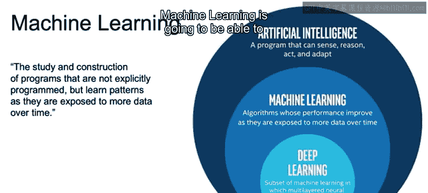
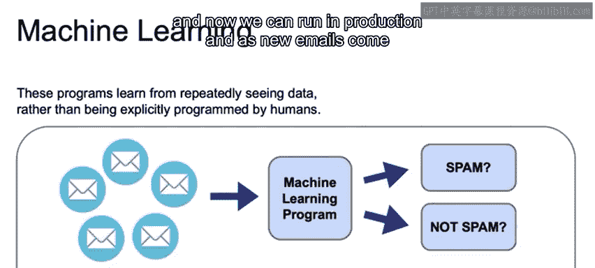
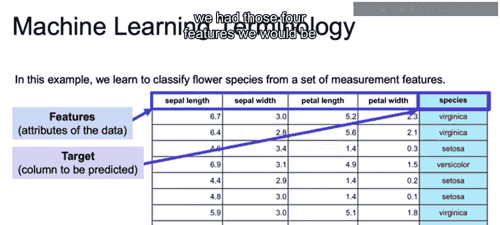
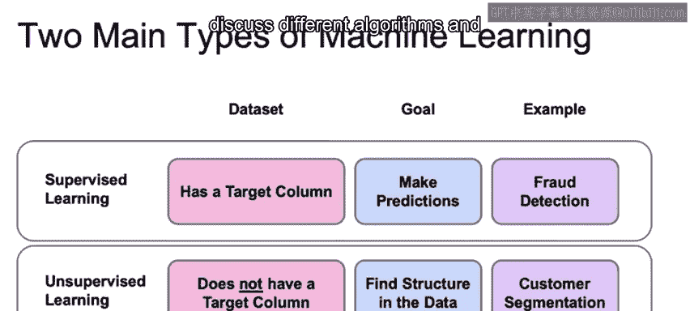
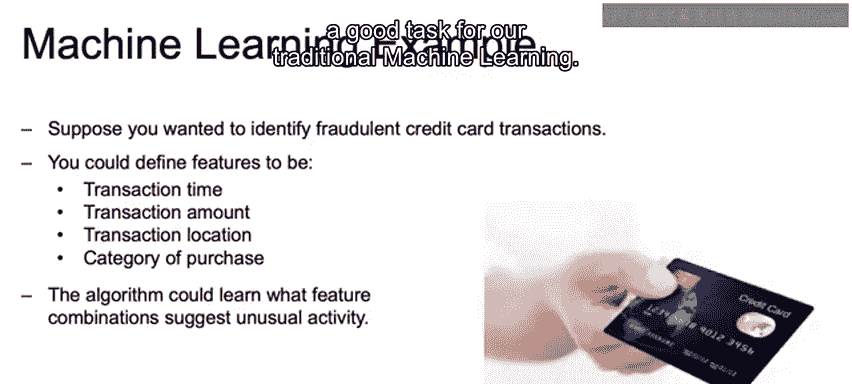

# IBM《机器学习（数据探索、监督学习的回归和分类）｜machine learning》中英字幕 - P4：3_机器学习和深度学习第1部分.zh_en - GPT中英字幕课程资源 - BV1xM4m1D7kY

Let's dive into what we mean by machine learning。Machine learning is the study and construction of programs that are not explicitly programmed。

 but rather learn patterns as they are exposed to more data over time。So as we saw earlier。

 machine learning is going to be a subset of artificial intelligence。

 It's going to be a subset that's going to learn from observing data。 The more data。

 the better the algorithm is able to learn the underlying patterns。

 I do want to note that the performance of these algorithms will plateau so there will be a sense of diminishing returns after a certain amount of data。

 but in general the idea is going to be that as we gain more data。

 machine learning is going to be able to better understand the underlying patterns。

So these programs learn from repeatedly data rather than being explicitly programmed by humans。

 so it's not going to be a set of rules programmed by humans in order to make a decision。

So as an example， let's say we're working with。Trying to decide whether emails are spam or not spam。

 we would start off with a data set where we have a bunch of emails that are going to be labeled spam versus not spam。

These emails will be pre processed and fed through a machine learning algorithm that learns the patterns for spam versus not spam。

 and the more emails it has to learn underlying patterns， the better the model is going to get。

Once the machine algorithm is trained， we can then use it to predict as new emails are coming in。

 so we trained on this label data set and now we can run in production and as new emails come in。

 we can predict spam versus not spam。

So we're going to use this simple data here just to highlight what features are and what a target is。

 features and target are going to be in important terms for us to understand。

 so don't get distracted by the data itself as the main purpose of this slide is just to help define these terms This IIS data is a popular data often use to introduce basic concepts in machine learning but we will move to more realistic complex data sets as you work through the course。

So the iris here is going to be a flower that comes in three species， as you see here， Virginiaica。

 sattosa and Versa color， and that's going to be the target that we're trying to predict。

So our data set here contains four features， sepel length and sepel width。

 pedal length and pedal width。 And those are going to be the features we will use to make our prediction。

And then again， as mentioned before， the target variable is going to be the column that we're trying to predict。

 and the idea is to use the four features， sepple length， sple width。

 pedal length and pedal width in order to predict the species。

 and then moving forward if we had those four features。

 we would be able to predict the species without the label。

So in general， there are two types of machine learning。

 there are supervised learning and unsupervised learning。

Let's first go over the type of data sets that each is going to need。For supervised learning。

 we will have a target column or labels similar to what we just saw with the email spam and Iis Fer classificationification examples。

And then for unsupervised learning， on the other hand。

 we will not have a target column and how this comes into play will make more sense in just a second。

So let's discuss the goals of each supervised and unsupervised learning。

The goal for supervised learning is going to be able to predict that label。

 is it spam or is it not spam， I it versa coloror or another one of the different flower species。

For unsupervised learning， the goal is going to be to find an underlying structure of the data without any labels。

And this will be clear with our examples。An example of supervised learning is fraud detection。

 we may have a large data set where we have labels of either this transaction is fraud and this transaction is not fraud。

 we would learn from all the features related to fraud detection and be able to predict as new credit card transactions come in whether those are fraud or not fraud。

For unsupervised learning， an example would be customer segmentation。 And for this。

 you can think about customer segmentation to find similar groupings within your data for marketing campaign。

 you have this e-commerce data and you want to separate them out into groups in order to target them accordingly for unsupervised learning。

There's going to be no right or wrong answer， so the user will need to test different models and see which results tend to make the most sense。

 and we will get get into this we have an entire lecture or we discuss different algorithms and techniques proud to accomplish this task。

So suppose you wanted to identify fraudulent credit card transactions。

 detecting fraud is going to be a common machine learning problem。

 you can define your features to be transaction time， transaction amounts， transaction location。

 category of purchase。And combining all of these features together。

 we should be able to predict in the future with transaction time， the amount。

 location and the category of purchase， whether there's unusual activity and whether this transaction is fraud versus not fraud and generally speaking。

 this structured data with intuitive features are going to be a good task for our traditional machine learning。

