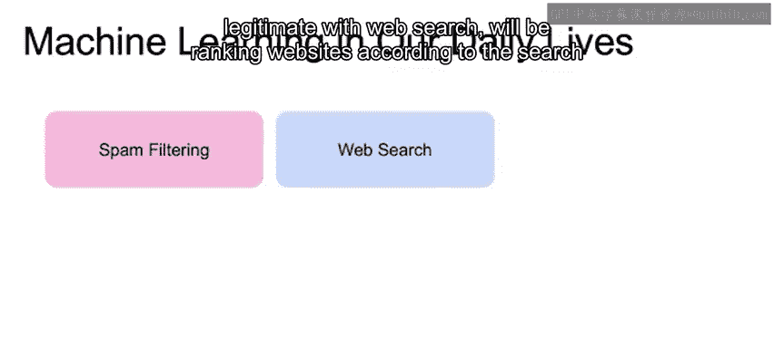
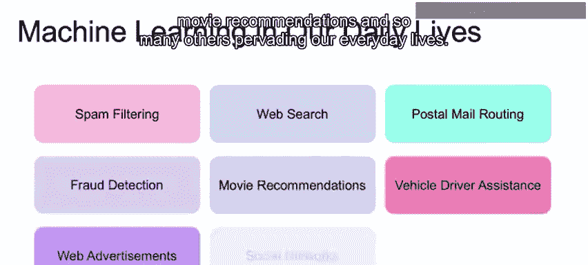
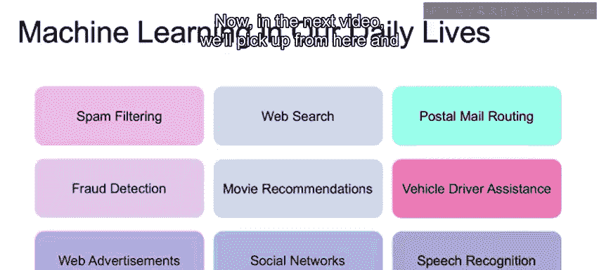
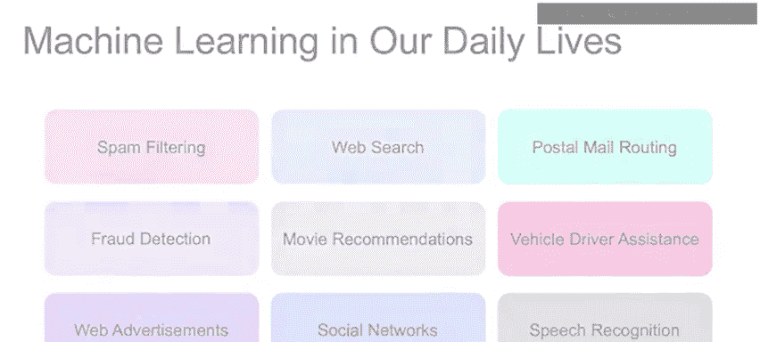

# IBM《机器学习（数据探索、监督学习的回归和分类）｜machine learning》中英字幕 - P50：1_监督机器学习简介：机器学习类型第1部分.zh_en - GPT中英字幕课程资源 - BV1xM4m1D7kY

Let's get started on our journey with an introduction into supervised machine learning。

Machine learning allows computers to learn from data with traditional statistical modeling。

 we often know a good deal about the underlying process。Thus。

 we can choose a model of analysis that closely approximates that underlying process and use this to develop a predictive model。

With machine learning on the other hand， we often know less about the underlying process。

 or it's simply too complicated to express instead we learn or we approximate the equation from the data。

Function approximation enables future values to be predicted using the machine learning model。

So define。To define machine learning， let's start with the broader category of artificial intelligence。

 so we're going to take a step back。Here in the table produced by Russell Norviig in their book。

 Artrificial Intelligence， a Modern App， we have four cadrants that all describe a subset of how we think about artificial intelligence。

The rows are going to represent the dichotomy between machines being able to think and machines being able to act。

And the columns are going to represent the dichotomy between machines trying to replicate human behavior versus machines replicating rational behavior。

And as we will see in the upcoming slide in more detail。

 the focus of machine learning will be honing in more on the thought processes， that talk bro。

 and whether we are trying to think specifically in regards to humanly or rationally。

 will depend on our hoped for outcome， for example， with marketing。

 we want to see how humans will react to certain campaigns， whereas with。

 say supply chain optimization， we want to come up with the most rational means of producing and delivering products。

Now even honing in on that top row， we only have some extremely slippery ideas to be working off of。

We see here words such as thinking， minds， decision making， perceiving， reasoning。

 what precisely does this all mean to us let's narrow this down to one idea that's actually highlighted as well。

Learning。This will be the route from which we will be able to make decisions， solve problems。

 perceive， reason， and act accordingly。Thus， machine learning will fall cleanly into this subset of artificial intelligence defined as when our machine is able to learn。

What about a model， what do we mean by a model？A model is a small thing that captures a larger thing。

Now you're saying， okay， so what？A good model is going to omit unimportant details while retaining what's important。

So here we have a map which is going to be a model that represents a much larger reality。

In other words， the underlying territory。In choosing the right representation or model。

 we always reduce the amount of information covered。

But we need to do so in a way that preserves the features or relationships that we're interested in。

And a good model is able to do both， capture the important relationships。

 and also reduce the complexity of a real world phenomenon enough for us to be able to take it in and understand and represent that real world。

In our graph， we have the relationships between country borders and the different bodies of water。

But we avoid city boundaries and large landmarks。Ensuring that we just make clear the boundaries to define the relationships that we find important。

So how has machine learning come into play in our daily lives。

 we discussed this earlier with spam filtering， classifying emails of spam or legitimate。

 with web search， we'll be ranking websites according to the search query so that we are now able to find the sites that we are looking for。

It optimizes the route in which we send our mail。Frad detection， movie recommendations。

 and so many others pervading our everyday lives。 And there's no stopping of this anytime soon。

Now in the next video， we'll pick up from here and talk about how machine learning works under the hood。

Thank you。

