# IBM《机器学习（数据探索、监督学习的回归和分类）｜machine learning》中英字幕 - P53：4_监督机器学习第2部分.zh_en - GPT中英字幕课程资源 - BV1xM4m1D7kY

So in this course， we're going to be examining the housing data set as an example。

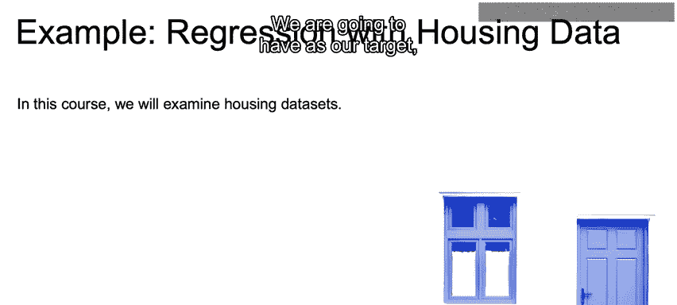

We are going to have as our target， the price of our housing。

 and our features will include characteristics about the house and area。

 such as the quality of the house， the location of the house， the number of floors and so on。

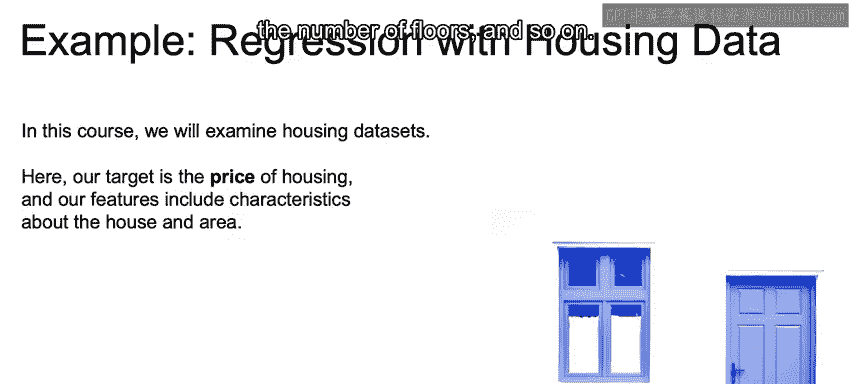

So suppose that we're going to be fitting our model。

 same as we saw before in our machine learning framework。

 where our prediction is just a function of some parameters as well as our input。

 and that will be based on data that we have from housing sales and Aes Iowa。

 and we're able to obtain certain estimates of our parameters。

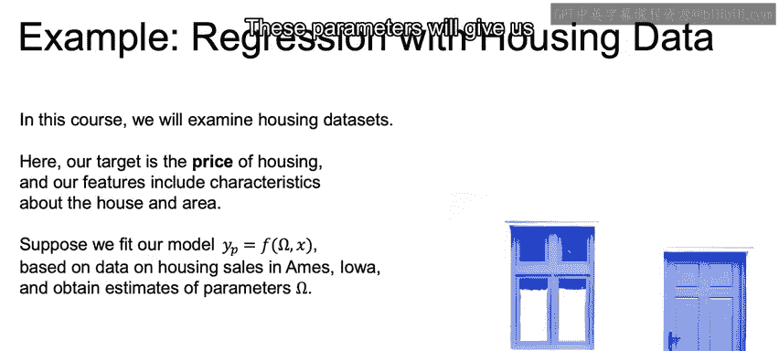

These parameters will give us the interpretability of what factors are affecting housing pricing。

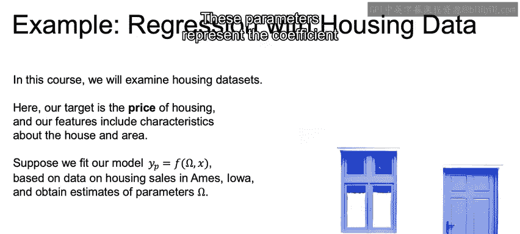

And these parameters represent the coefficient relating to each one of the different features of x。

And their relationship with the expected target values。

And we can use these parameters to learn feature importance。

 which is how important a given feature is to our prediction。

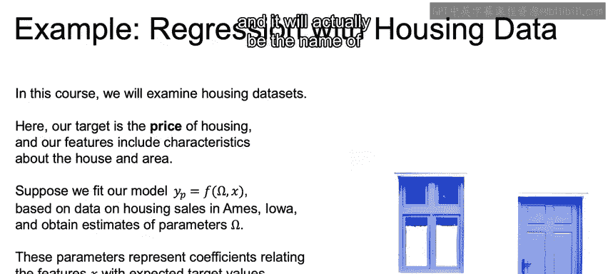

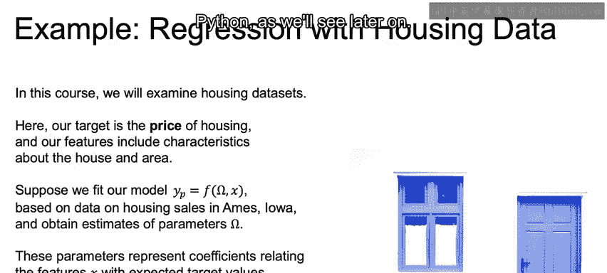

And this will be a term used throughout and will actually be the name of some attributes you can pull out for a given trained model in Python。

 as we'll see later on。

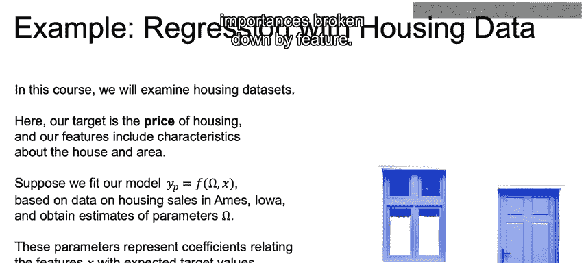

So we're looking at a graph of all the different feature importance broken down by feature。

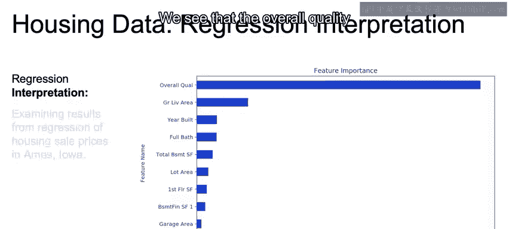

And this is， again， from the regression of our housing sales price in Ames， Iowa。

So which features are most important， we see that the overall quality of the house has very large effects。

 the grade living area， that's just going to be the number of floors has a little bit less year builds more recent versus less recent。

Construction times。And how big of a feature importance does not necessarily mean that it's a positive。

 It could be a negative。 So if the crime rate， for example。

 that could have a really high feature importance。It's really important in terms of determining what the actual pricing of that house is。

So it could be large， but it could be large in the negative direction。

 so we just take the absolute value to figure out which one。

 which one of these features is most important， whether it's positive or negative effect。

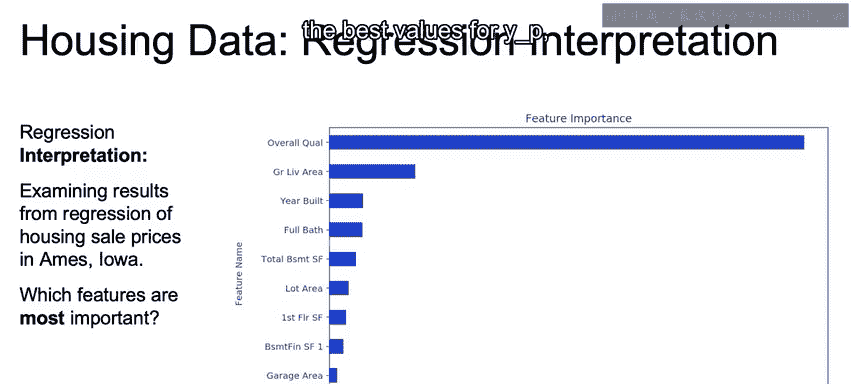

Now again， we're using our function to。

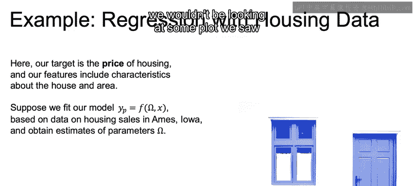

Use our features to come up with a model to predict housing prices。

 So let's say our primary aim now is prediction。Rather than interpretation。

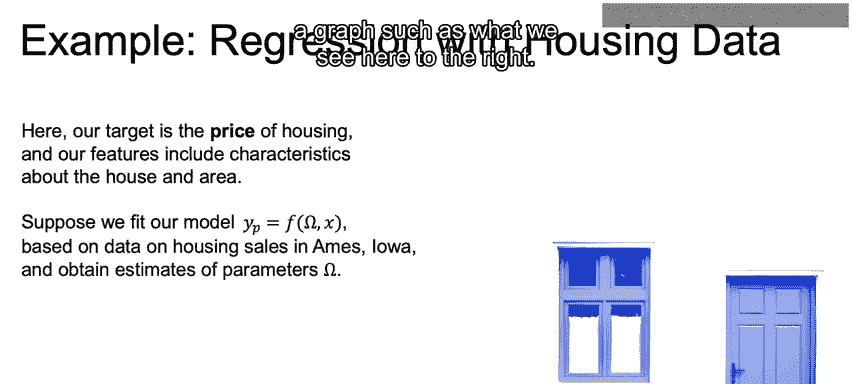

Then our focus is more on generating the best values for YP our prediction。

 and after fitting the model， we wouldn't be looking at some clot like we saw before with the importance of different features。

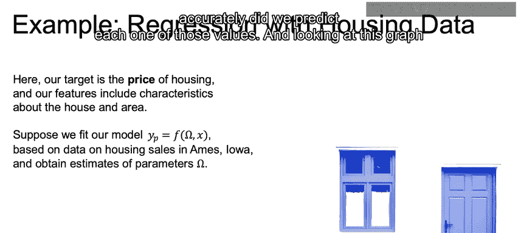

But rather， with this focus of generating the best value of YP。

 we'd be looking at a graph such as what we see here to the right。

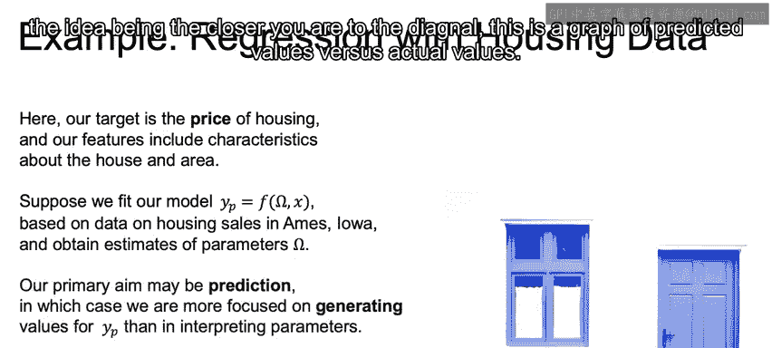

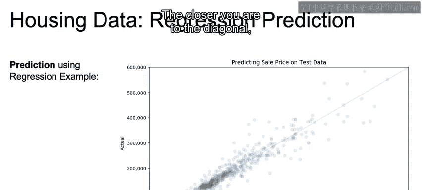

We use the characteristics to predict our unknown sales prices and our focus is just on how accurately did we predict each one of those values。

And looking at this graph， the idea being the closer you are to the diagonal。

 this is a graph of predicted values versus actual values， the closer you are to the diagonal。

 the more accurate your prediction is， and then those that are further away means that we may have gotten it more wrong for those values and this graph is just going to tell us the prediction versus the actual values without any focus on interpretability。

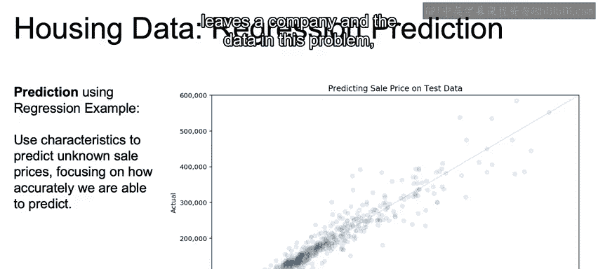

So so far， the examples that we've gone through have all been regression problems where the outcome variable is a numerical output。

 right the price of the housing。Now let's switch to a classification problem and go back to our customer churn example。

We recall that customer churn occurs when a customer leaves a company。

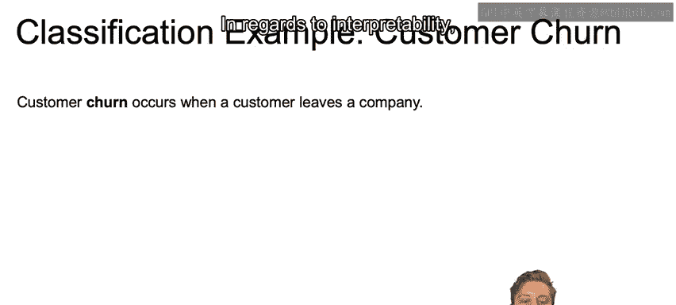

And the data in this problem will refer to a target variable for whether or not the customer left。

 as well as information on customer characteristics such as subscription costs， time as customer。

 and so on。

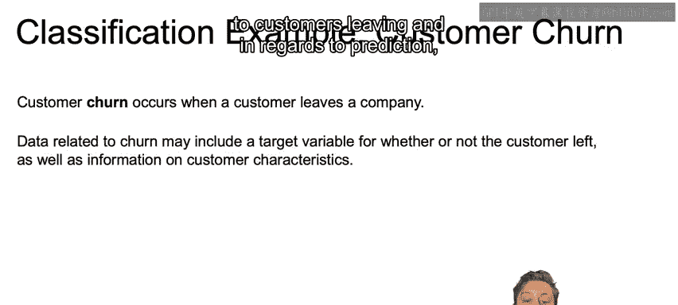

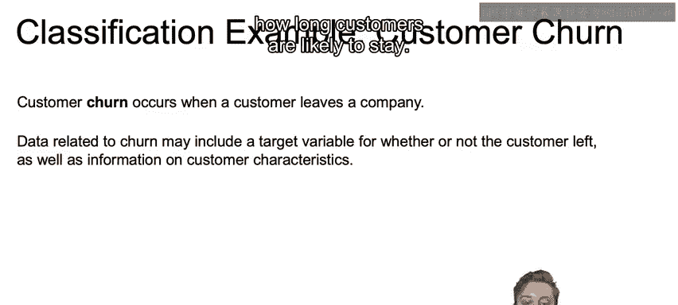

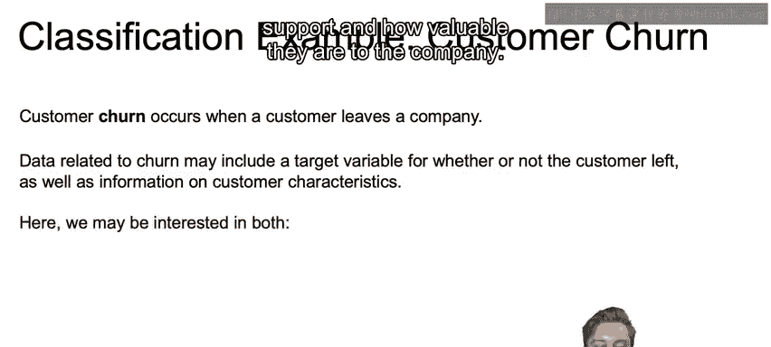

And here we may be interested in both interpretability and prediction。

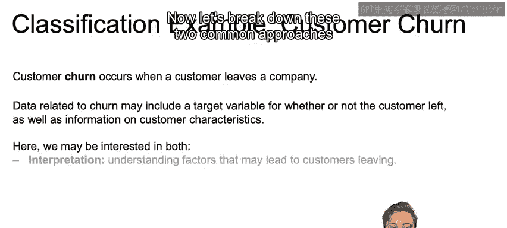

In regards to interpretability， we may want to understand the underlying factors that may lead to customers leaving。

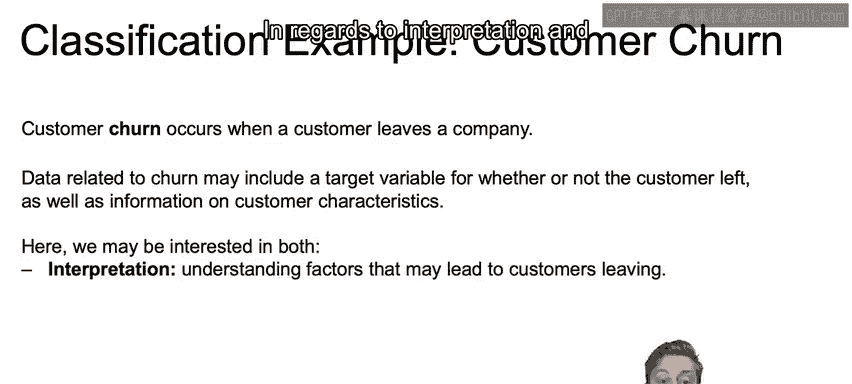

And in regards to prediction， we may want to estimate how long customers are likely to stay。

 and that can help us understand how many we need to support and how valuable they are to the company。

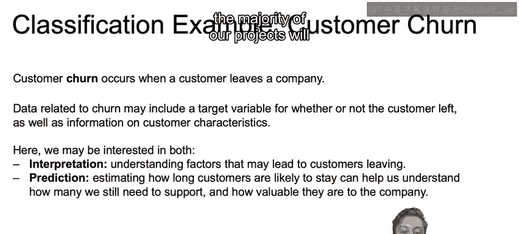

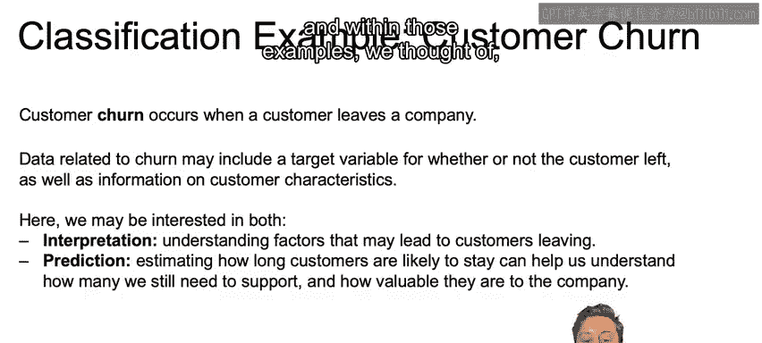

Now let's break down these two common approaches and how we would think of them in practice。

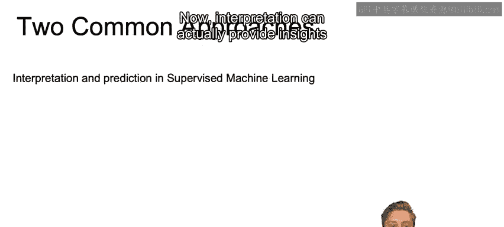

So in regards to interpretation and prediction within supervised machine learning。

The majority of our projects will actually call for a balance。

 so we walked through all of those examples and within those examples we thought of。

 you know I'd actually want prediction when we were talking about interpretability and for interpretability。

 we'd probably want a certain level of prediction。

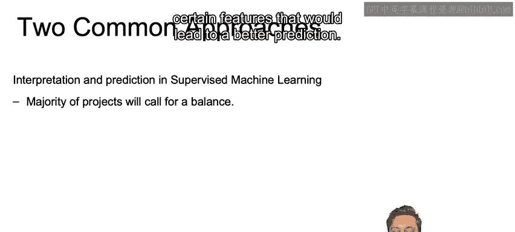

Now， interpretation can actually provide insights into improving our prediction and vice versa。

 if you think about if we were to look at the interpretability and to look at the different features。

 we may be able to see how to adjust the model to highlight certain features。

 drop certain features or combine certain features that would lead to a better prediction。

And on other hands， if you have a better prediction。

 you may also be more confident about the different feature importance given the interpretability that you have。

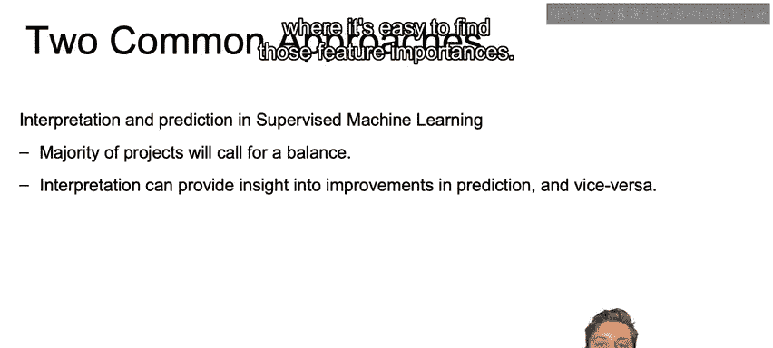

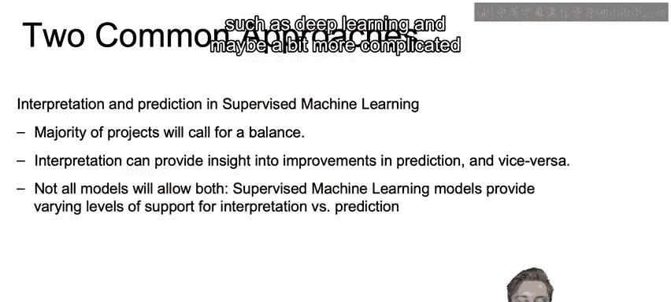

Now not all models will allow for both supervised machine learning models provide varying levels of support for interpretation versus prediction。

 as we discussed， if you think about an example such as simple linear regression。

 that's going to be a highly interpretable model where it's easy to find those feature importance。

 whereas when we move to something more complex， such as deep learning。

 it may be a bit more complicated to understand under the hood。

 the importance of each one of your features。

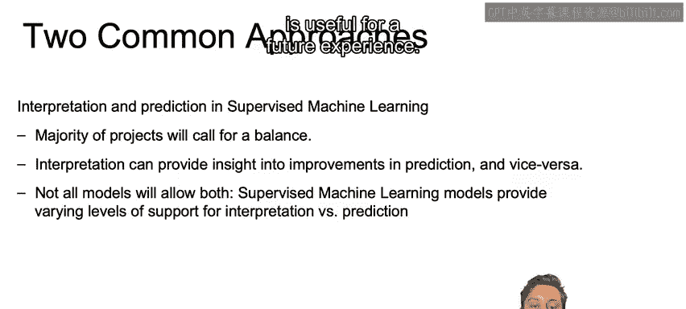

Now machine learning is again， just a subset of artificial intelligence。

 and it's a subset that focuses on model building to support a goal of interpretation and or prediction。

Our machine learning algorithms will use past experience to build a model that is useful for future experience。

 right when you look at past customer churn data in order to predict as these new customers coming in。

 how long they will stay， whether or not they will stay。And it's going to follow that general form。

 this equation that we've went over， our prediction Yp is equal to some function of our parameters that we will learn。

 as well as our input value X。

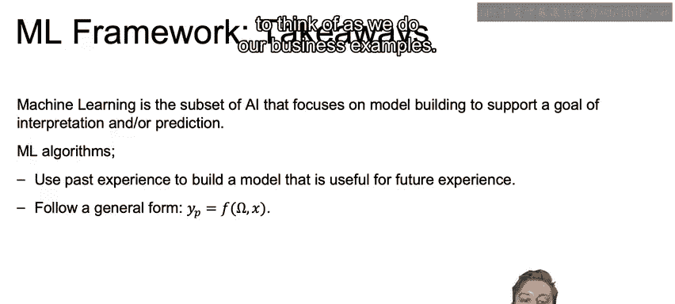

Now to recap what we've learned throughout this section。

Machine learning objectives， we had to think about the trade off between interpretation and prediction and the balance that we will have to think of as we do our business examples。

We walk through different examples of machine learning applications with bringing interpretation and prediction to both our housing data set。

 as well as our churn example。And then we close that with a quick recap and some final takeaways for our machine learning framework。

I will'll continue in the next section on our supervised machine learning。

 talking about classification， risk regression， and I look forward to seeing you there， thank you。

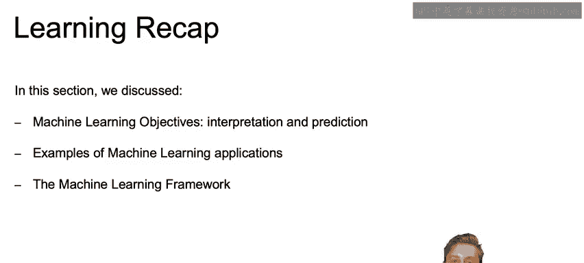

