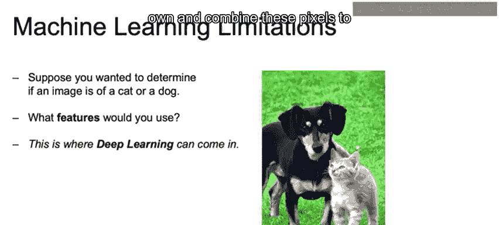
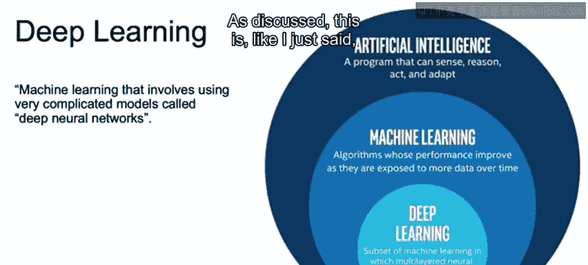
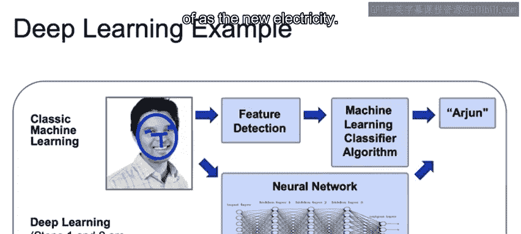

# IBM《机器学习（数据探索、监督学习的回归和分类）｜machine learning》中英字幕 - P5：4_机器学习和深度学习第2部分.zh_en - GPT中英字幕课程资源 - BV1xM4m1D7kY

Now， defining features in an image， on the other hand。

 is a much more difficult and involved task and has been a defining issue of the limitations of our traditional machine learning techniques that deep learning has now done a good job of addressing。

So suppose you want to determine if an image is a cat or a dog。So what feature should we use？

For images， the data is taken as numerical data to reference the coloring of each individual pixel within our image。

 so a pixel then could be used as a feature， so we saw the features before in our data。

 but if you imagine even a small image will have 256 by 256 pixels， which will come out to over 65。

000 pixels， 65，000 pixels mean 65，000 features which is a huge amount of features to be working with。

Another issue is that using each pixel as an individual。

 you lose the spatial relationship to the pixels around it。 In other words。

 the information of a pixel makes sense relative to its surrounding pixels。

 So you have the different pixels that make up the nose。

 perhaps or the different pixels that make up the eyes and then separating that out。

 according to where they are in relation to the face， so on and so forth。😊。

And this is where deep learning can come in deep learning techniques will give you the capability to learn these features on its own and combine these pixels to define these spatial relationships。

So let's briefly dive into what deep learning is， deep learning is going to be machine learning that involves using very complicated models called deep neural networks as discussed。

 this is like I just said， going to be a subset of machine learning。

So then the models themselves will be able to determine the best representation of our original data。

In classic machine learning， humans have to come up with these features。

 and this will allow us to solve complex problems such as what we just saw with the image classification。

Deep learning is the cutting edge and is where most of machine learning research is focused。

 it has blown away the performance of other algorithms when you're dealing with larger data sets。

But it is very important to note that you'll often be working with smaller data sets and standard machine learning algorithms will often perform significantly better than working with deep learning techniques。

Also， if the data is changing a lot over time and you don't have a steady data set。Again。

 machine learning will probably do a better job of actually being able to have better performance over time。

So let's briefly discuss some differences between the classic machine learning techniques and deep learning。

So as discussed in the classical machine learning model。

 we are going to have to define these features ourselves a priority before we feed the data to our actual model。

Sort of determining the features that make up the nose， the eyes， so on and so forth。

We can then use the features and include them in a machine learning algorithm。

 and if a data scientist is lucky， they may be able to guess good features。

 but this is really challenging to do well， and then they can use that to predict that this is a picture of Arn。

Now， deep learning will combine this two step process。

The neural network receives these pixels of an image as an input。

 The neural network learns how to extract these features that are meaningful from the image by combining them together in different complex combinations。

 Now， these features may not always make much sense when we try to interpret them in these intermediate layers。

😊，But ideally， they will first highlight edges and then combine those edges to make up shapes like nose。

 eyes， lips。But whether or not the intermediate steps are interpretable。

 they can be very useful for completing taskss， such as image classification and coming up with the intermediate feature engineering steps and then eventually predicting our Z。

Now， that's the end of this section。 In the next section。

 we will start to go through the history of artificial intelligence and gain insights as to how we got to this point in history。

 where artificial intelligence is now being thought of as the new electricity。

