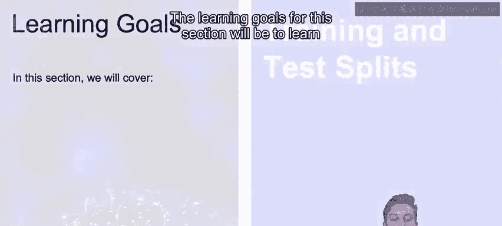
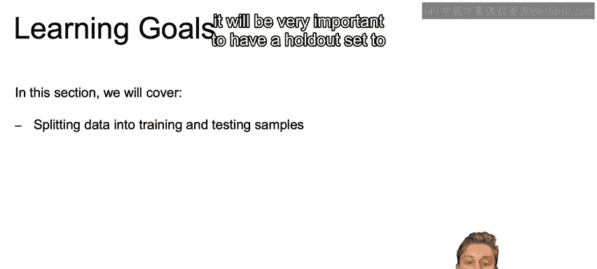
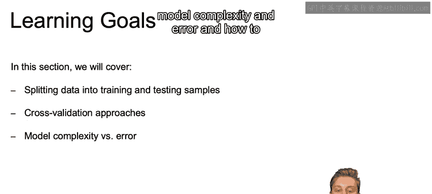
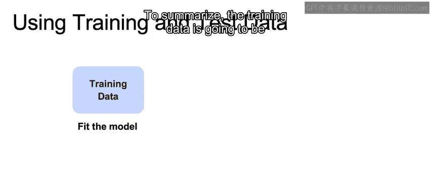
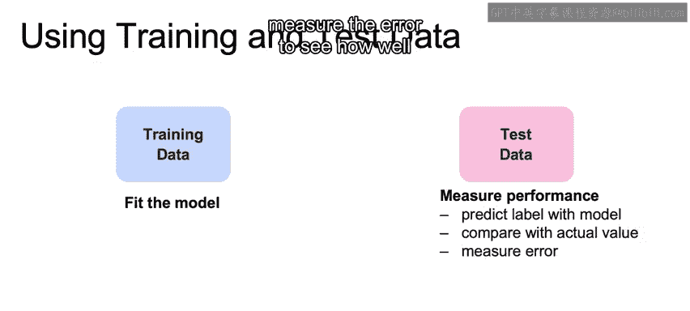
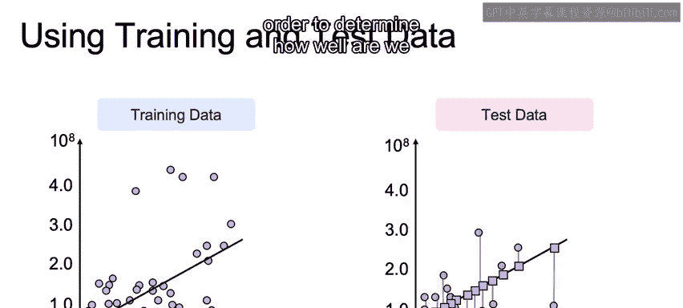

# IBM《机器学习（数据探索、监督学习的回归和分类）｜machine learning》中英字幕 - P60：11_训练集和测试集分割第1部分.zh_en - GPT中英字幕课程资源 - BV1xM4m1D7kY

In this section， we will cover the idea of splitting your data into different train and test sets and how that will allow you to crossvalate your models and have a better idea of how they'll actually perform out in the real world。

Now the learning goals for this section will be to learn to split our data into training and testing samples。

 as we saw briefly in the notebook it will be very important to have a holdout set to see how well our model will perform on unseen data。

We'll then talk about cross validation approaches and some ways to expand this notion of train and test so that you can train and test on multiple different sets。

And then finally， we'll talk about model complexity versus error。

 and we'll talk about the important relationship between model complexity and error and how to find that appropriate balance。

So let's say that what we see here is some historical training set that we have available to us。

As we mentioned earlier， briefly， we can actually use our model to fit perfectly to the data and get 100% accuracy。

So for example， we can say that any movie that ran exactly 146 minutes。

 this will be our model will make around a $424 million， which is our first row。

 and every movie that ran for $129 minutes exactly made around 409 million。

And then once we remove this outcome variable to see how well our model performed。

We can predict gross revenue exactly using the model that's just matching them one to one。

But we would probably do a very poor job of modeling movie revenue for unseen data。

So it won't generalize well。And our problem is that we cannot ever see how our model would perform on unseen data if we train on our entire data set。

So what would be a solution？We can split up our data set。

We take one portion and we call that our training data。

 and we use that to actually learn the optimal parameters given our label data。

And then we have a separate set that we hold out as if it was unseen data。

 we remove the labels and take that learned model and see how well we would be able to perform。

On unseen data， and for this test data， because it's actually pulled from our historical data set。

 we can see how well we performed given the Learns model from the training data。

So this will ensure that the model generalizes well to new situations。

I would like to highlight that you always want to make sure that your splits are independent from one another。

 often parts of your test data can end up leaking into the training data。

 so that is not really unseen data。And we would actually learn to that test data。

 and there's actually a term for this data leakage that you want to be aware of。

 so ensure that these are independent of one another。So to summarize。

 the training data is going to be used to fit the actual model and learn the parameters。

Then using this model， we can predict results on our test data。

 we would predict either the label or the numerical value using our model。

 compare that with the actual value because we have that since its historical data。

 and then depending on what our error metric is， measure the error to see how well we performed on unseen data。

So let's look at an actual scenario。Here we have split data into training and test sets。

And we'll be performing linear regression， that is we're going to fit a line that explains our training set as we see here to the left。

And we're going to perform regression on that training data and determine which parameters will give you the best fit to our training data。

The next thing we do are we going to predict the value for each point in our test data set。

Using our previously determined parameters from our training data set。

 and that's going to be all of these purple values that we see here on the right side。

So how did these predictions do？We can measure it by the lines that measure the distance from the actual value to these predicted values on the line。

In order to determine how well are we doing on this unseen data。

