# IBM《机器学习（数据探索、监督学习的回归和分类）｜machine learning》中英字幕 - P65：16_训练集和测试集分割实验（选修部分）第4部分.zh_en - GPT中英字幕课程资源 - BV1xM4m1D7kY

Welcome back here we will close out the notebook starting with question number five all we ask here is for the original data set。

 scale the values using one of the following standard Scalar or Min Macac Scalar。

And then compare the error calculated on the test set。

Now we want to make sure whenever we do our scaling that we do fit transform。

 right the fit transform method that's available to us only on the training set。

 and then call transform using our fit from the training data。

 we just call transform on the test data， we don't recall that fit transform on our test set。

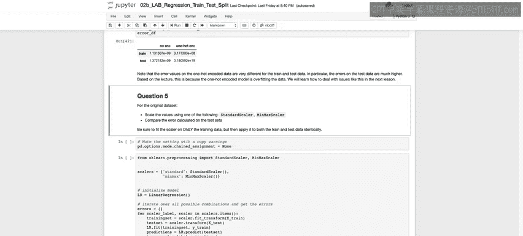

So the first thing that we're going to want to do is we're going to want to import our standard Scalar as well as our Min Mac Scalar。

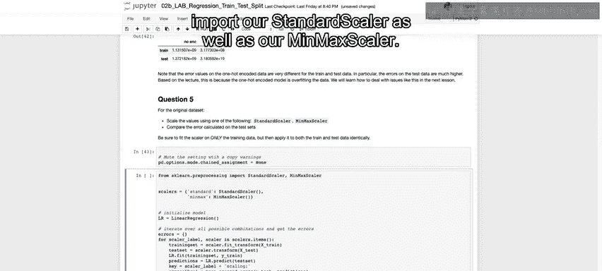

We're going to set a dictionary equal to standard for the key and then the standard Scalar。

 men Max for the key， and then the men Max Scalar。

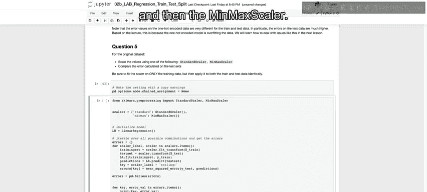

I'm going to initiate each one of those。

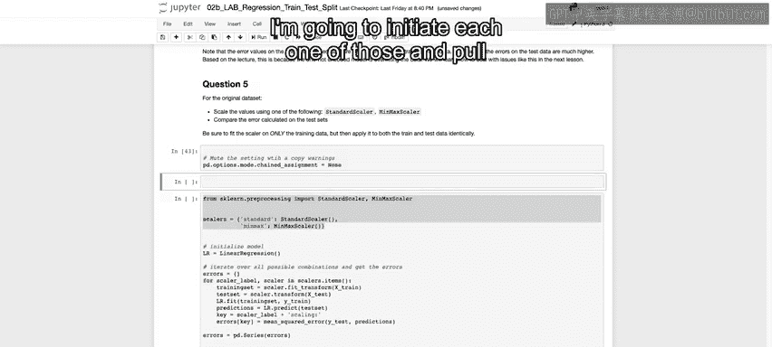

And pull out Scalar dot items as just a reminder of how the dot itemss functionality works。

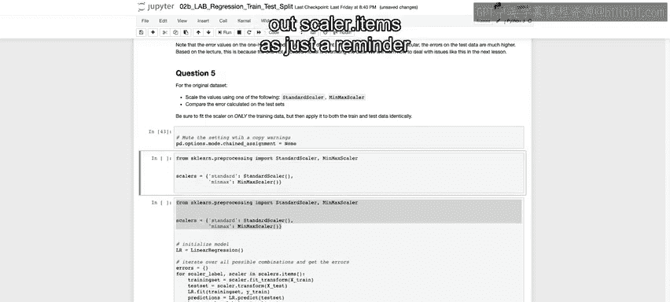

We now have our dictionary tuples where the tus are going to be。First value key。

 second value is going to be the。

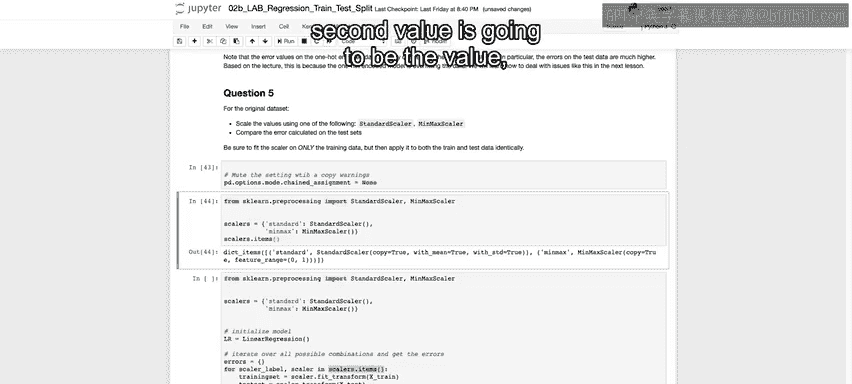

Value and that's just going to be standard and standard scalar。

 so this scalar label is going to point to this key standard and this scalar variable is going to point to our scalar object。

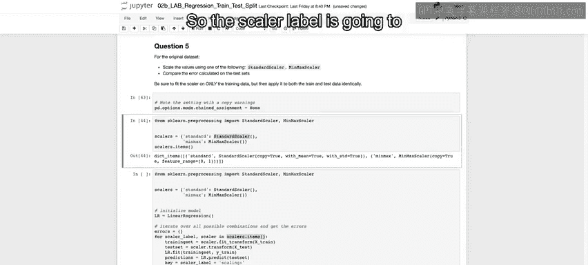

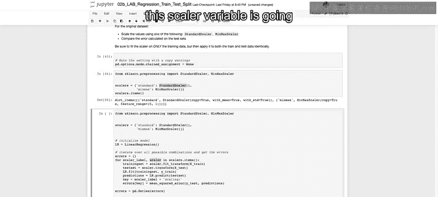

So we run our for loop。We're going to set our training set equal to the fit transform of our x train。

Again， using the scalar， we're going to be using the scalarrs the second value。

 which is just the value data from our dictionary。

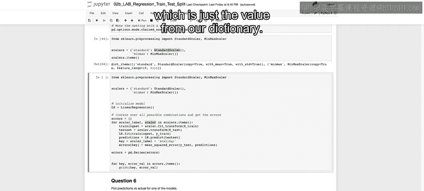

So we fit transform our Xtrain to get our training set。

 and then we just run transform to get our new test set。

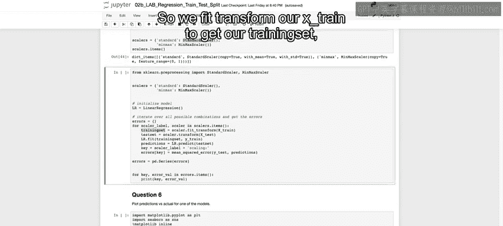

We run LR linear regression was initiated up here and we fit it to our training set。

 which has been transformed with our Y train， we don't have to do any transformation there。

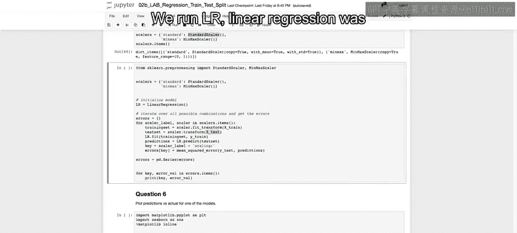

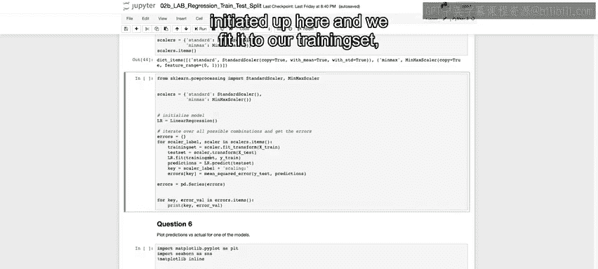

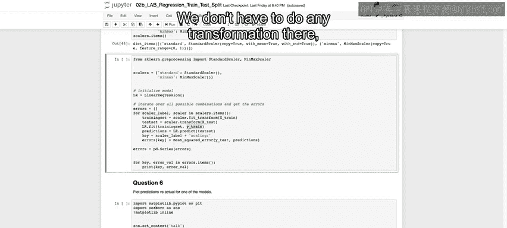

And then we get our predictions on our test sets， just calling Lr。tpredict。

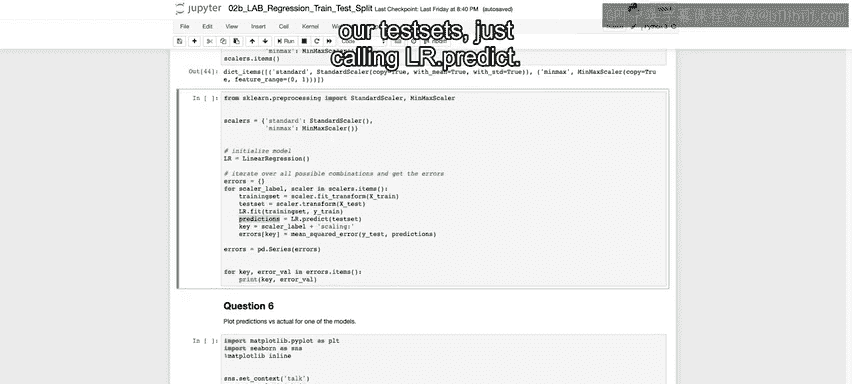

We're going to create a variable called key， which will just be the Scalar label。

 which is standard or min Max， and then add on the string scaling。

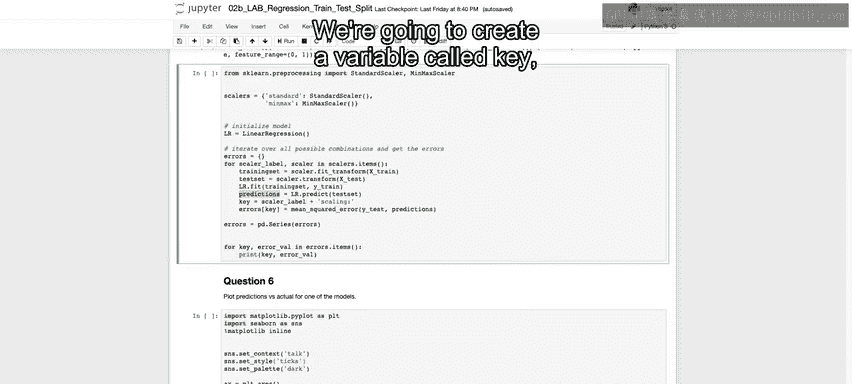

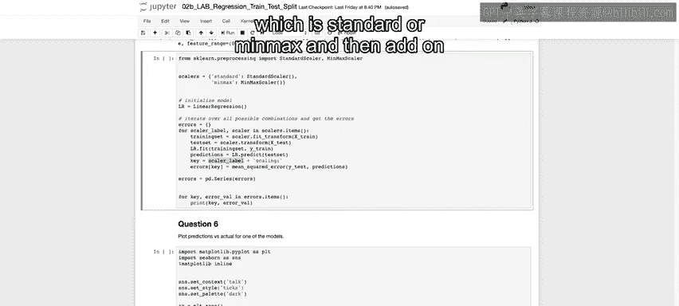

And then we're going to set errors， right， that's our dictionary that we initiated up here。

 errors key。Using this key is equal to the mean squared error on y tests and R predictions。

And then we're just going to create a series out of that， so then we're going to have。

 as we did before， an index for each one of our values。

 and then we're just going to print them all out four key errorbe and As dot items。

 again getting that tuple， print out our new keys， as well as our error values。

 which will just be these mean squared error values。

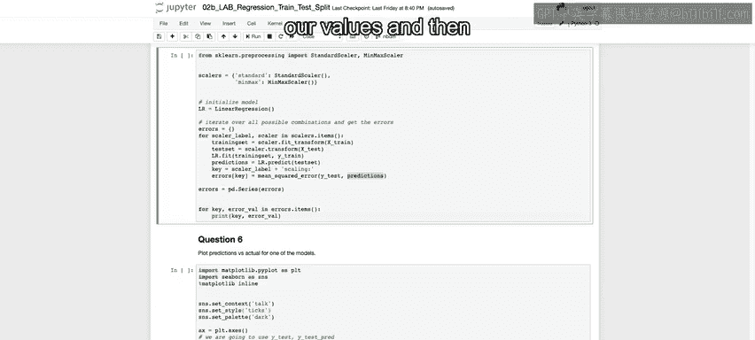

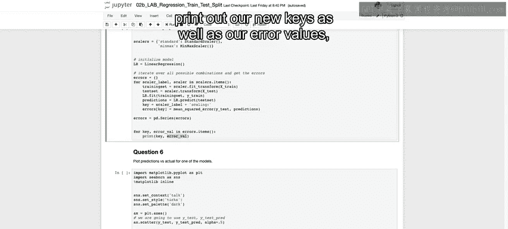

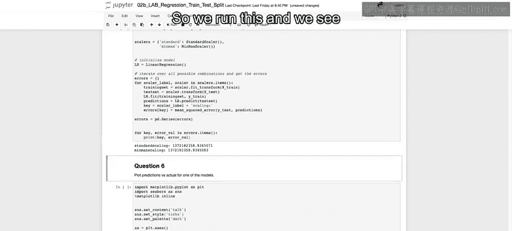

So we run this and we see that we get the same error for each。And if we look back to AirDF。

 that's going to be the same value that we got here for the test set。

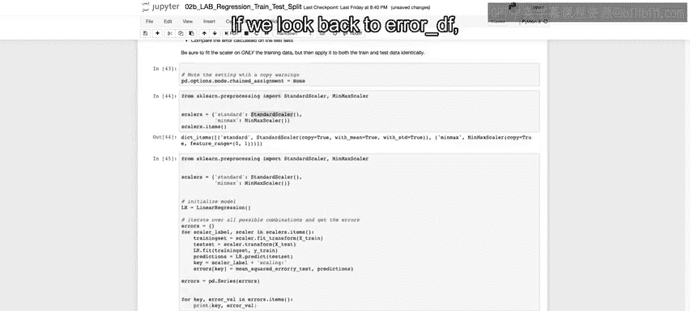

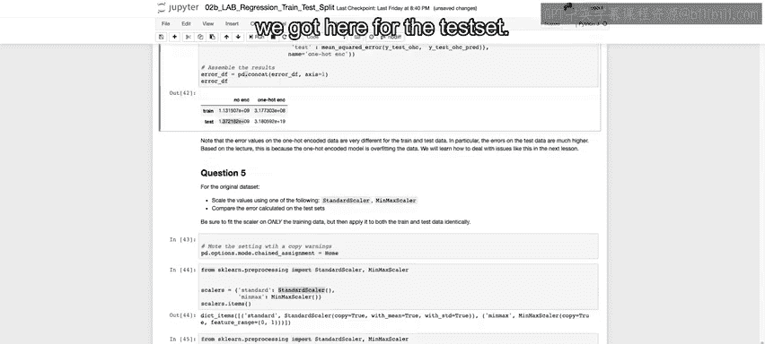

The idea being that。Most of the time when you're working with linear regressiong。

 scaling won't actually affect the outcome， won't affect your prediction。

 this doesn't hold true once we talk about ridge and lasso regression， which we'll see in just a bit。

 but we see that it won't have an effect when you just do it on plain linear regression。

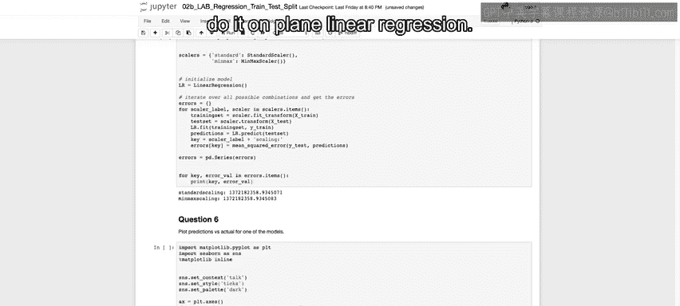

Finally， we just want to plot the predictions versus actuals for one of our models。

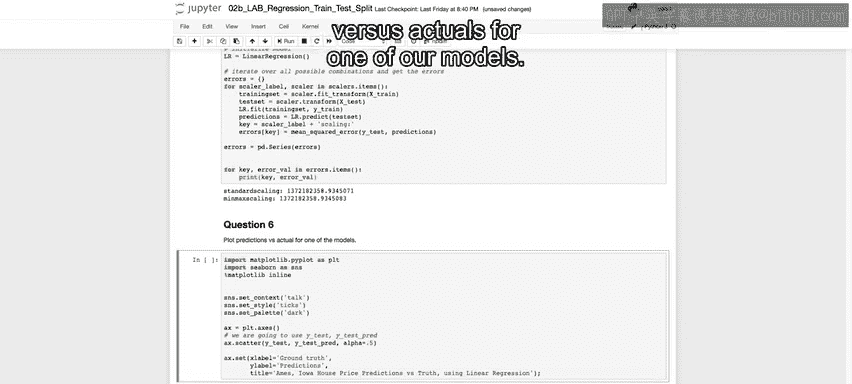

We're going to call。SNS， all of these sets， set context， set style and set palette。

 are just different ways to ensure that your seaborn context and this will work for your matte plot lid plots as well。

 while all print out in some clean style defined by each one of these。Context style and palette。

 We're going to initiate our PLT do axes So our bounding box。

 and we're just going to call a do scatter on our Y test and Y test pre， which will be defined。

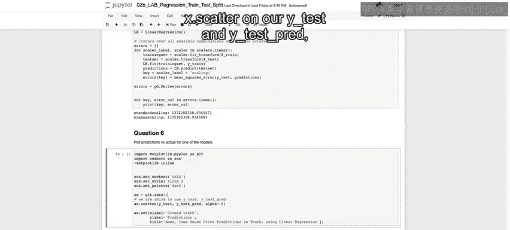

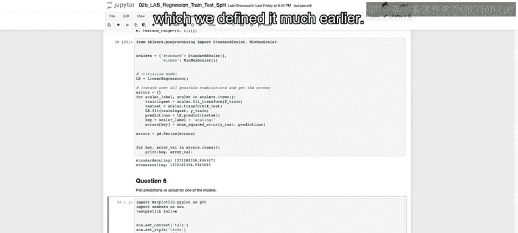

We defined it much earlier。 We have Y test pre all the way up here。

 But I'm just going to look at both the plot versus the predictions。

 the point being here just to look at this plot。 So it's a scatter plot of our actual outcome variables versus our predicted outcome variables。

 If we got it exactly right。 They should all be on one diagonal。 Alpha equals 0。

5 just ensures that it's a bit transparent。 Each one of our scatter points。

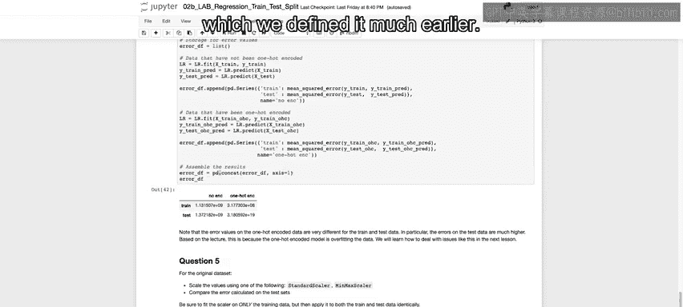

And then we're going to set difference options， our X label， our Y label， and our title。

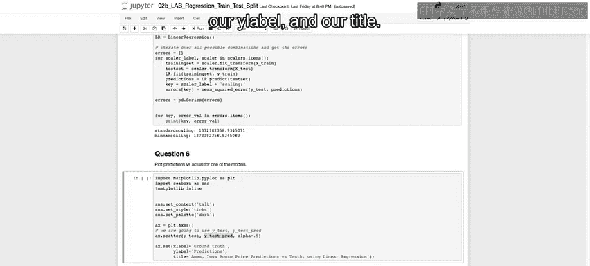

We run this。And we see each one of our predictions is very close in regards to that diagonal line。

 which would tell us that we did a fairly good job of predicting。

 whereas when they're kind of far off， as we see in the top left and a bit all the way to the right。

 then we were a little bit off on those predictions。

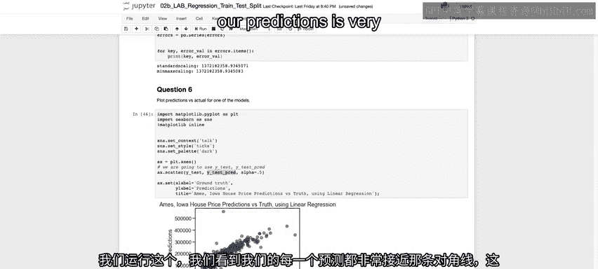

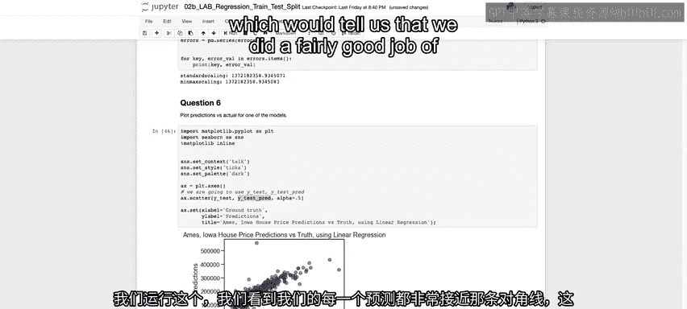

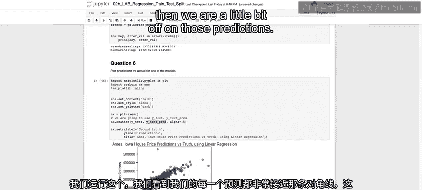

That closes out this notebook and I look forward to seeing you back at lecture， Thank you。

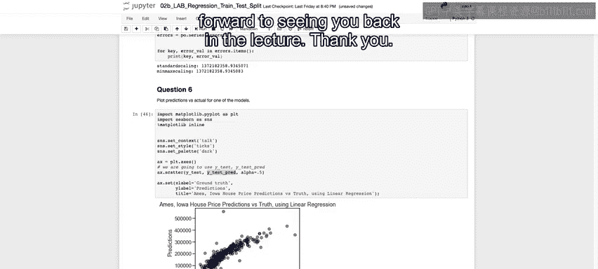

