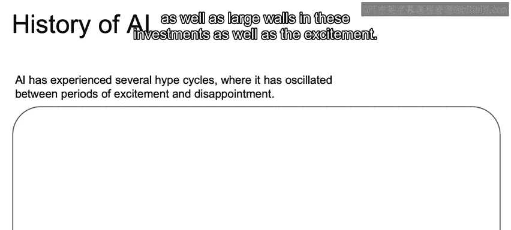
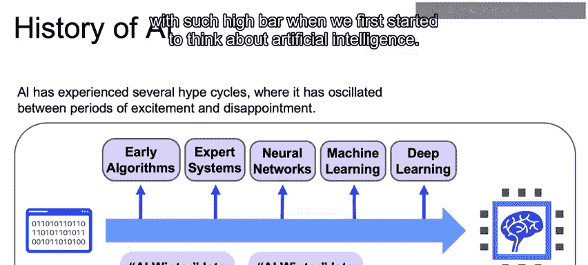
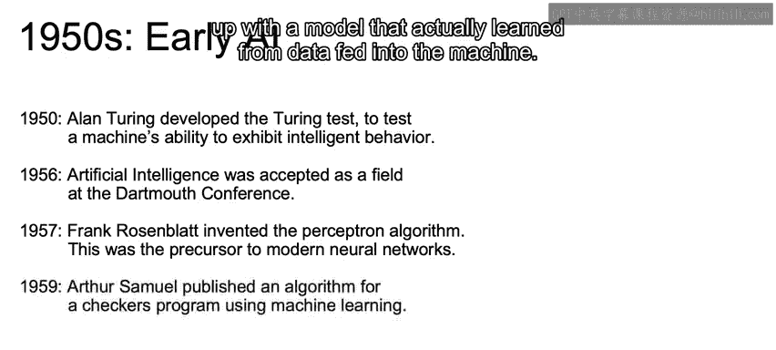
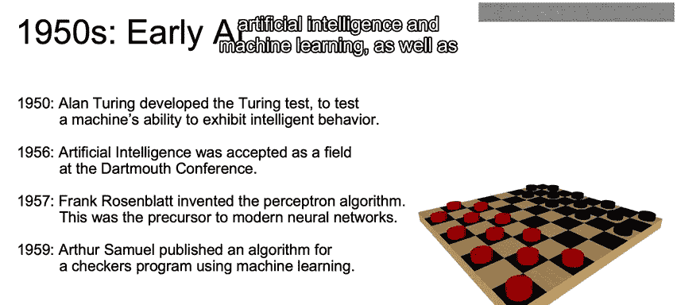
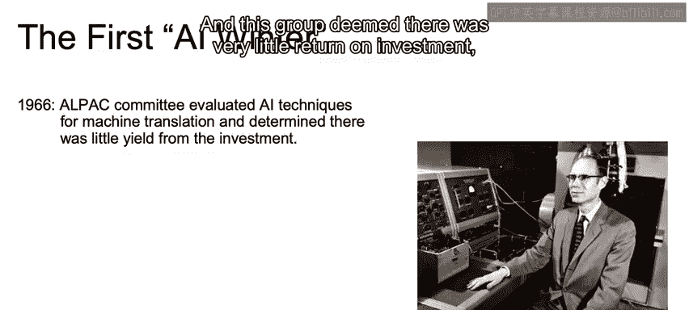
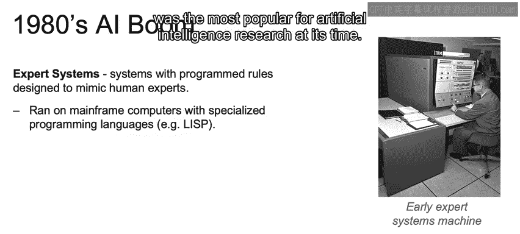
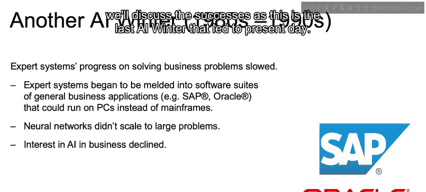

# IBM《机器学习（数据探索、监督学习的回归和分类）｜machine learning》中英字幕 - P6：5_AI的历史.zh_en - GPT中英字幕课程资源 - BV1xM4m1D7kY

Let's dive into the history of artificial intelligence。

 see how we got to this exciting point in history that we're at today。

So AI has gone through several cycles where there have been both significant amounts of investments and excitements。

 as well as large lu in these investments， as well as the excitement。

So going from earlier algorithms and the initial excitement as a term artificial intelligence was officially coined。

 and the first investments and promise began to be discussed on a larger scale in the 1950s。😊。

We then， in the 1960s and 1970s， hit our first AI winter as yields failed to live up to the promise of the initial expectations。

Then in the 1980s， AI got its second boom as businesses found it possible to utilize rule based algorithms called Exper systems to aid in decision making。

Along with that， many theoretical breakthroughs introduced the promise behind neural networks。

But then， as promised， we had another AI winter in the late 80s and into the 90s。

 another failure to be able to leverage the promise of the expert systems and neural networks and practical applications led to another decrease in investments。

Then in the late 90s and early 200s， machine learning proved to be successful in many tasks such as speech recognition。

 Googles search algorithm， and many others。And then finally， fast forwarding to today。

 there were major breakthroughs in deep learning， proving to be able to overcome many of the historical practical limitations of the initial neural networks。

 and they began to outperform classical machine learning techniques and many complex big data problems such as image classification and machine translation。

 So we see this up and down and then finally hear this excitement around deep learning as able to accomplish all these tests that were once set with such high bar when we first start to think about artificial intelligence。

😊。

So let's。Go all the way back to the beginning in 1950。

 Alan Touring developed the Turing tests to test a machine's ability to exhibit intelligent behavior。

Alllan Turing's test has served as a foundational threshold for artificial intelligence。

The idea being， will a computer ever be able to sufficiently imitate a human to the point where a suspicious judge cannot tell the difference between human and machine？

So then in 1956， artificial intelligence was accepted as a field at the Dartmouth Conference。

 This Dartmouth conference was where the term artificial intelligence was actually first coined with this conference。

 researchers from various fields excably agreed that artificial intelligence that is the simulation of intelligence behavior in computers was indeed achievable。

😊，In 1957， Frank Rosenbablatt invented the Perron algorithm。

 which is the precursor to our modern neural networks。

And it generated a ton of excitement in the field as it showed how one can come up with a model that actually learned from data fed into the machine。

And then in 1959， Arthur Samuel published an algorithm for a Checkers program。

 which was intelligently built according to the limitations of computation at the time， obviously。

 to learn from the current state of the board and the positions it had seen in the past to come up with the next move。

And Arthur Samuel is well regarded for popularizing the term machine learning。

So we see here in the 50s the advent of these key terms that we' have discussed。

 artificial intelligence and machine learning。

As well as the precursor to deep learning in Frank Rosenblattt's Perceptron algorithm。

As promised following this excitement， we face our first AI winter during the Cold War。

 machine translation， specifically between Russian and English。

 was one of the major goals in artificial intelligence。In 1966。

 a committee was formed as seven scientists put in place by the US government specifically to assess the progress of machine translation。

 and this group deemed there was very little return on investment dealing a major blow to the hype around artificial intelligence。

Then in 1969， Marvin Minsky's work identified major limitations to Rosenblatt's perceptron algorithm dealing yet another blow to artificial intelligence。

And then in 1973， the highly regarded British applied mathematician， James Lighthill。

 published a report highlighting how discoveries and research。

Have fallen well short of the high hopes laid out over the past few decades。

 leading to governments cutting back much of their funding in artificial intelligence research。

These major public reports led to large cuts in government funding for AI research leading to our first AI winter。

Then as discussed， we have our winter Then we have our next boom In the 1980s。

 Exp systems became all the rage。 These systems were built with programmed rules designed to mimic human experts。

 The idea being to hard code the machines with facts and rules。

 representing expert knowledge of different subjects。

These programs ran on powerful main fan computers using specialized programming languages such as Lisp。

 which is one of the oldest high level languages and was the most popular for artificial intelligence research at its time。

These expert systems gained huge popularity， and AI infiltrated the business world at a large scale for the first time here in the 1980s。

And then on another note， another significant event in the history of AI during this time was Gerey hintinton and others published works explaining the back propagation algorithm。

 possibly the most important algorithm for deep learning。

 which allowed for multi layer networks to better update its parameters using the data given This drove huge excitement in the fact that researchers could now theoretically learn complex multilayer models that can actually learn from new data。

😊，And then we hit our next AI winter in the 80s and 90s。

 Exper systems progress on solving business problems slowed。

 major reasons being their inability to learn。 Also， they were finicky。

 They could make terrible mistakes when they received abnormal inputs。

Expert systems began to be melded into software suites of general business applications that could run on PCcs instead of mainframes。

 So the investment in large mainframe computers subsided as much of their capabilities were incorporated into these regular desktops。

Neurural networks didn't scale to large problems。The back propagation algorithm that generates so much excitement faced many problems with implementation of problems with large data sets and large networks。

And then with these in mind， the excitement behind utilizing artificial intelligence for business once again subsided。

So we'll take a break here before our next video and in our next video we'll discuss the successes as this is a last AI winter that led to present day。

