# IBM《机器学习（数据探索、监督学习的回归和分类）｜machine learning》中英字幕 - P74：25_偏差-方差权衡第2部分.zh_en - GPT中英字幕课程资源 - BV1xM4m1D7kY

Now let's talk about the trade off between bias and variance。

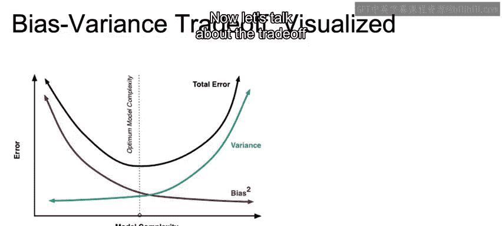

So a summary of this bias variance tradeoff will start off with the idea that model adjustments that decrease bias will often increase variance and vice versa。

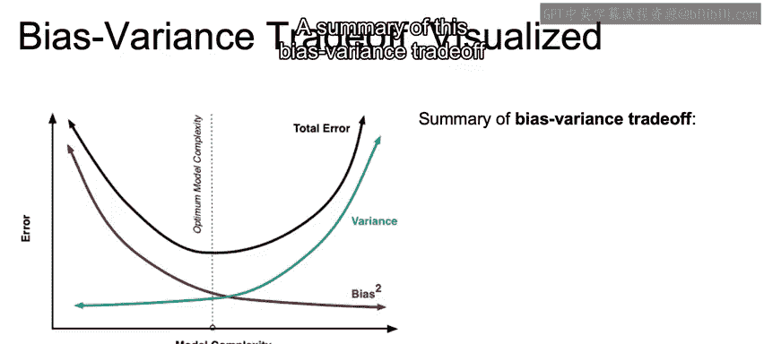

We are biased to a very simple model。Or we can have high variances or high sensitivity due to an overly complex model。

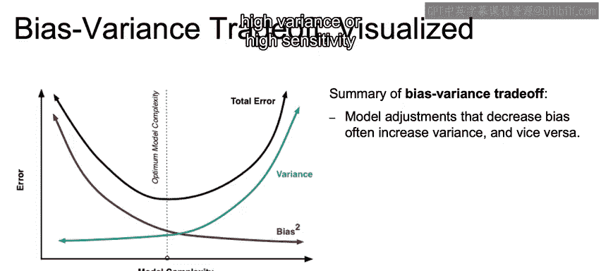

Therefore， this biased variance trade off is analogous to the complexity trade off again。

 as we see here in the graph。We can assume a high bias is going to lead to too simple of a model。

And high variance is going to lead to too complex of a model。

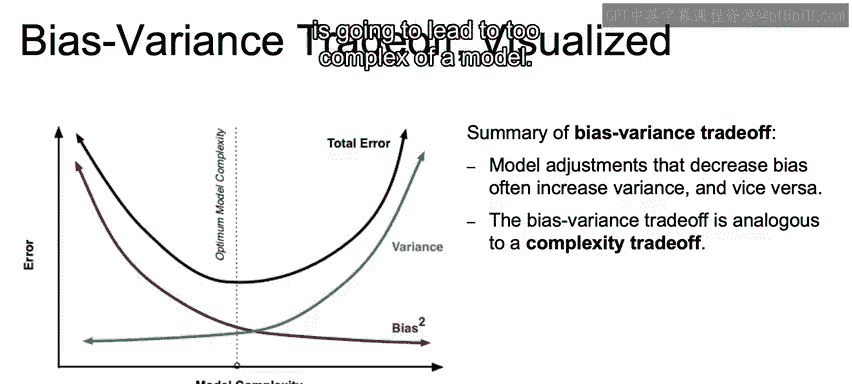

Now， finding the best model means choosing that right level of complexity。

 as we discuss with cross validation in order to look at a holdout set in order to see。

 are we underfitting， are we overfitting or did we get it just right？

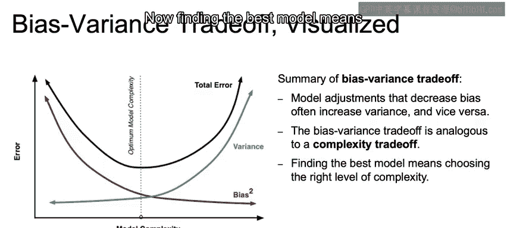

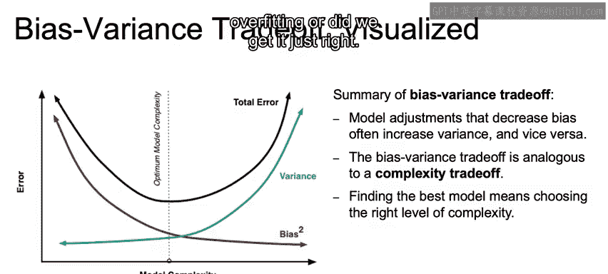

So we want a model that's elaborate enough to not under the underlying relationship。

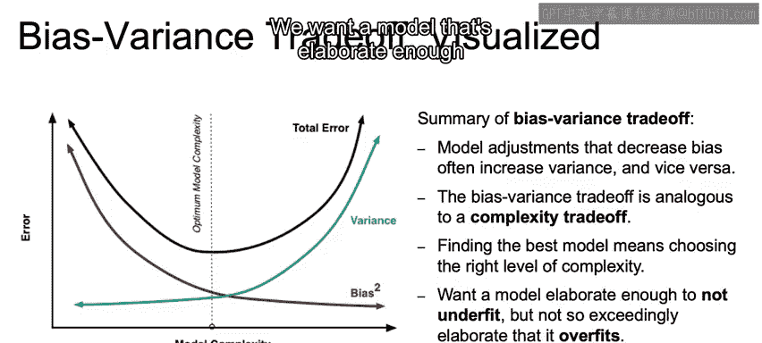

But not so exceedingly elaborate that it ends up overfitting。

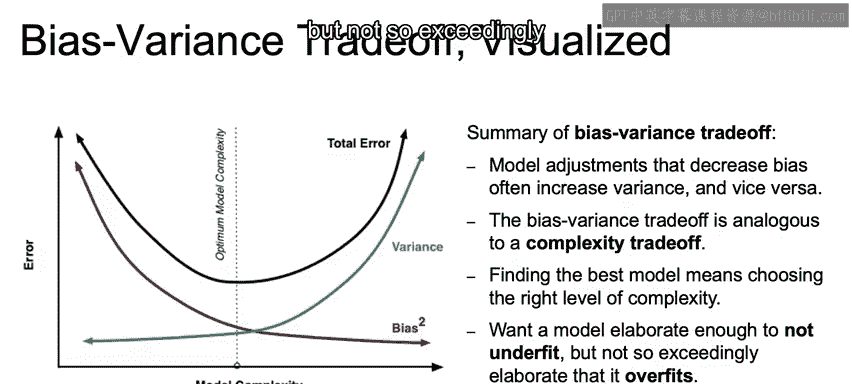

So we search for a model that is going to be able to describe that feature target relationship。

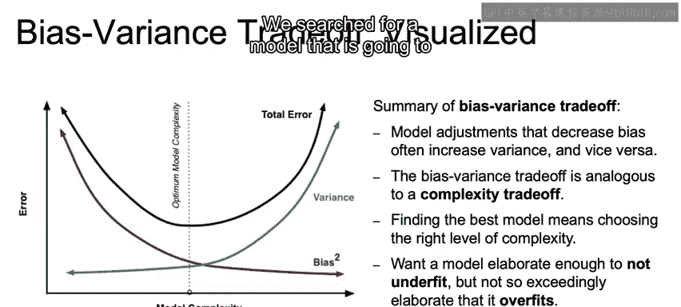

But not so elaborate that it fits to spurious patterns or patterns that shouldn't be measured as we saw with the polynomial degree 15 model。

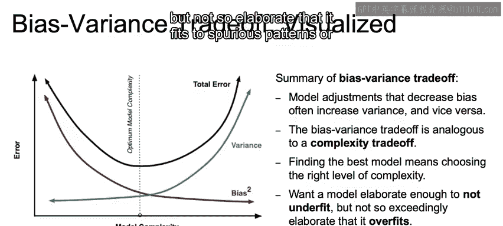

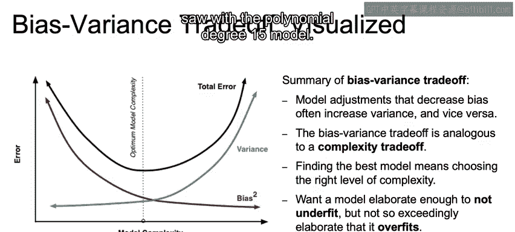

Now bring this back to our polynomial example， the higher the degree of a polynomial regression。

 the more complex that model is， so that's going to be higher polynomial means lower bias。

 higher variances。

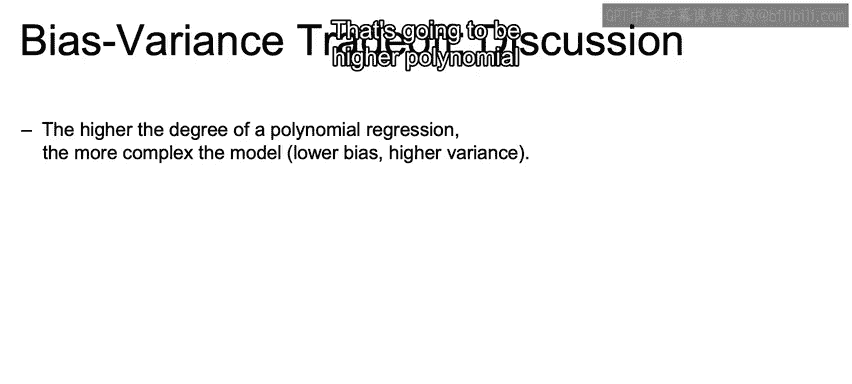

At lower degrees， we noticed that we saw visual signs of bias。

 predictions are too rigid to capture the curve pattern in the data。

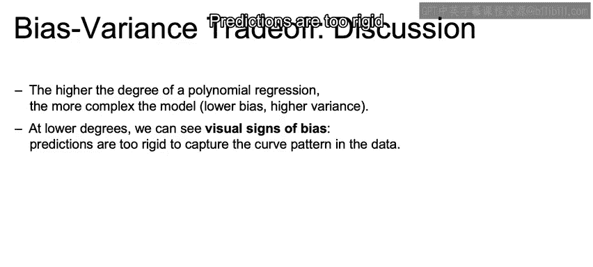

At higher degrees， we able to see visual signs of variance。

 predictions were fluctuating wildly because of the model's high sensitivity。

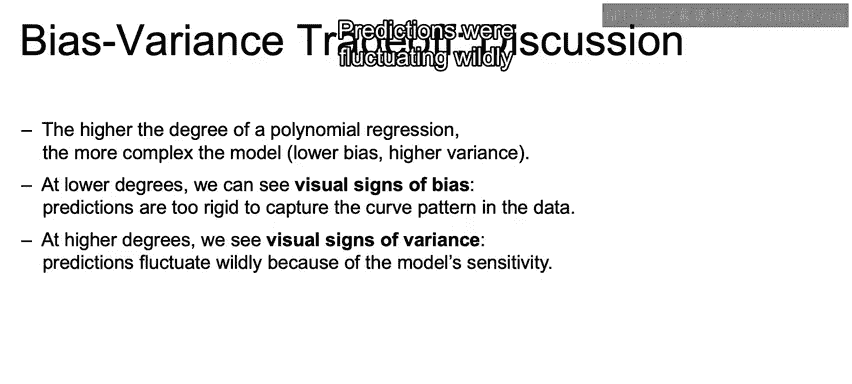

And again， the goal is to find the right degree such that the model has sufficient complexity to describe that underlying pattern without overfitting。

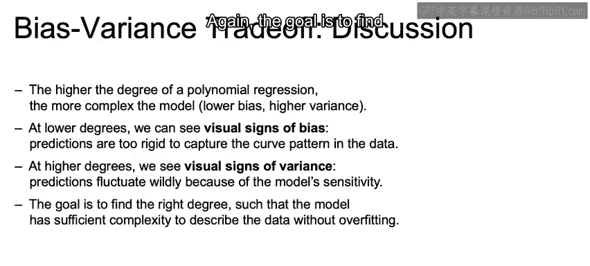

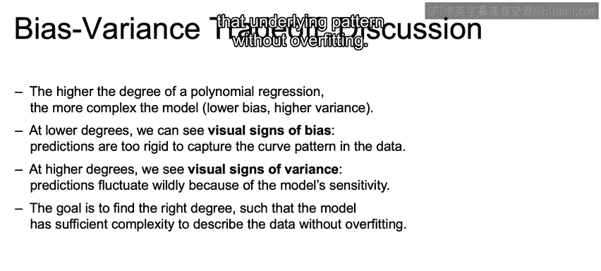

So looking back at our polynomial degree 1，4 and 15 and thinking about that bias variance trade off。

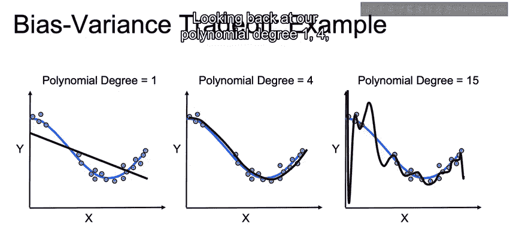

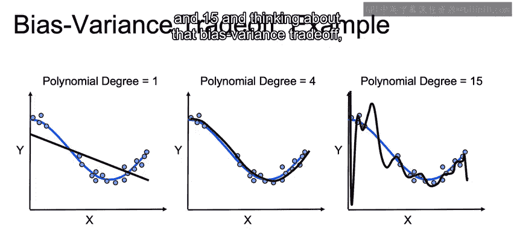

All the way out to the left， we have high bias or bias to a very simple model。

 but we have low variances。

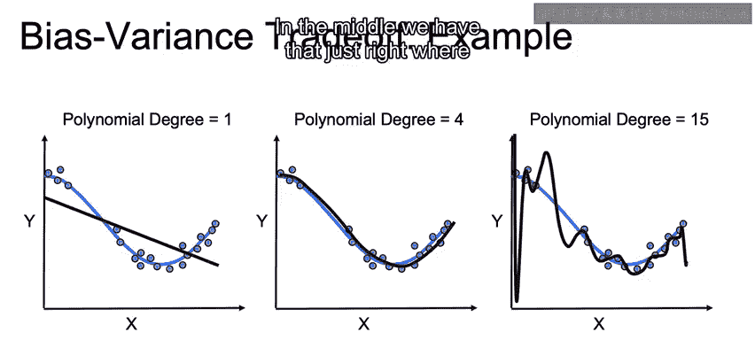

In the middle we have that just right where it's not too rigid of a model。

 but it also doesn't overfit to spurious correlations。And then finally， all the way out to the right。

 we have this very low bias。It's fitting to the model exactly， it doesn't have this rigid model。

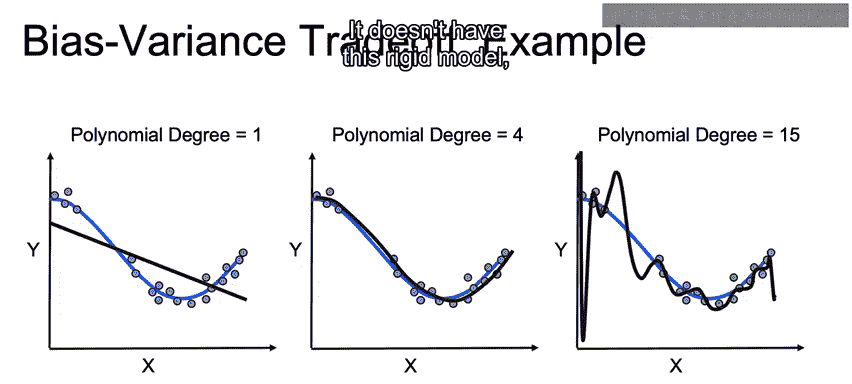

But it has very high variances in that it'll overfi。

 you can jump back and forth as you move along the X axis。

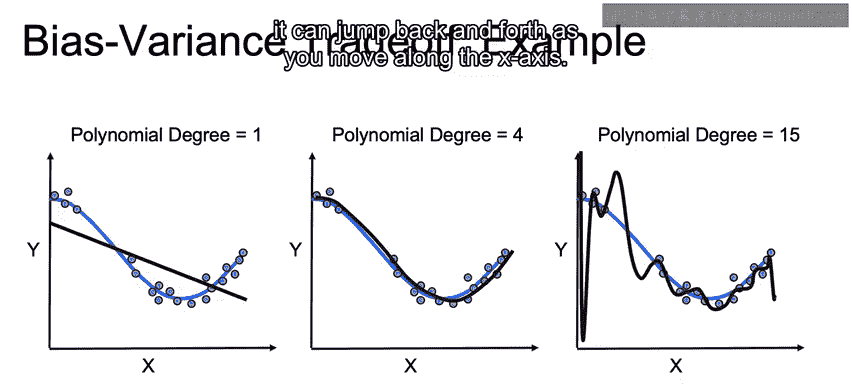

So let's recap what we learned here in this section we started off with the reminder of complexity versus error in order to dive into bias andvariance。

We then discuss bias and variance of a model with bias representing a model that is rigid and unable to properly model the relationship of X and Y。

 whereas variances represents models that tend to have high sensitivity given minor changes in our input variables。

We discuss different sources of model error， how a simple model can be too rigid and not have enough complexity to describe the underlying model and high variance or fitting too well and fitting to that random noise of our data would be the other side of that spectrum。

And with that， we also highlighted that for all models。

 we'll have to accept some level of error due to this random noise。And then finally。

 we discuss the bias variance trade off and how it relates to this relationship between complexity and error。

The next section we'll start providing some techniques to ensure that if we have too complex of an error。

 how we can bring down that complexity using something called regularization I look forward to seeing you there。

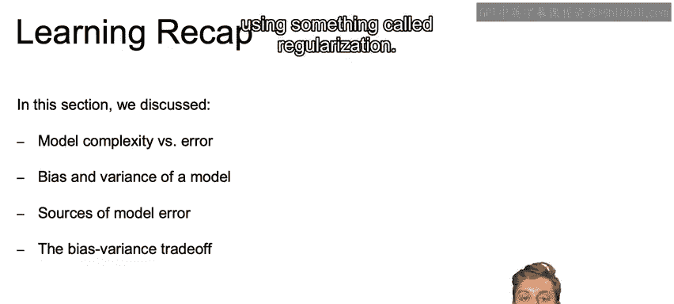

