# IBM《机器学习（数据探索、监督学习的回归和分类）｜machine learning》中英字幕 - P79：30_弹性网络.zh_en - GPT中英字幕课程资源 - BV1xM4m1D7kY

Now I want to get into elastic net by first thinking about the question。

 how are we going to choose between our different models？

As before， if our goal is going to be prediction accuracy。

 we can use validation to give us a means of figuring out which models and which hyperparameters are optimal on our holdouts。

 so how well will each one of our models actually generalize to new data。

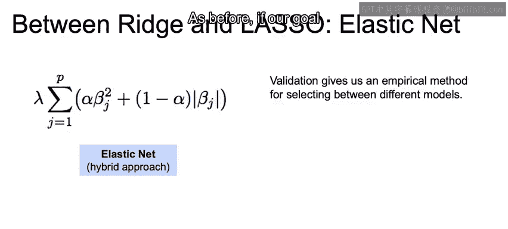

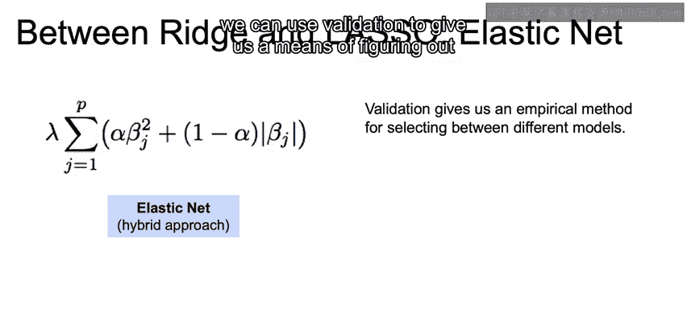

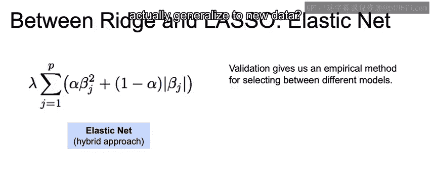

If our goal is interpretability， Lasso has this extra bonus of eliminating features that are not as important。

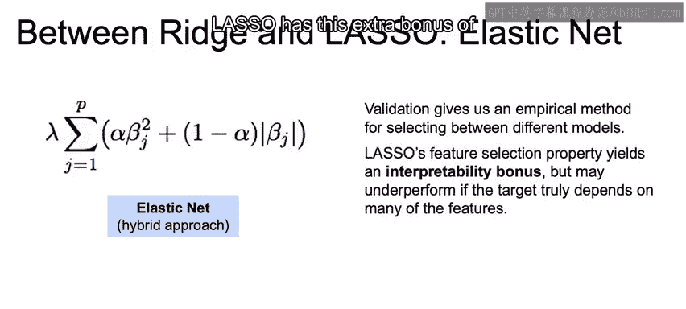

Of course we also must be cautious on the other hand。

 as our model may truly depend on many of the features。

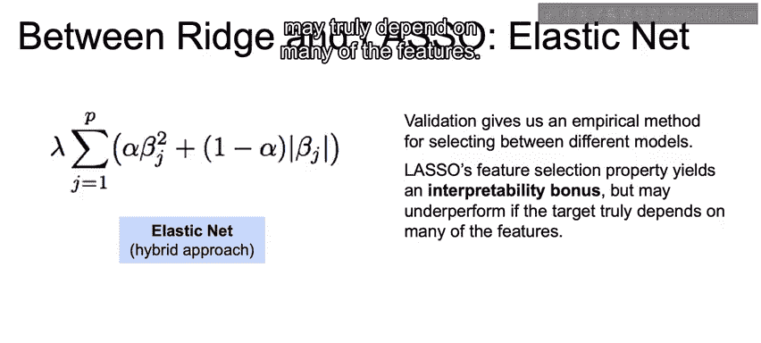

Also， if timing is a priority， we should also highlight that again。

 the ridge regression will be more computationally efficient。

 so things to keep in mind when deciding between ridge and Lasso。

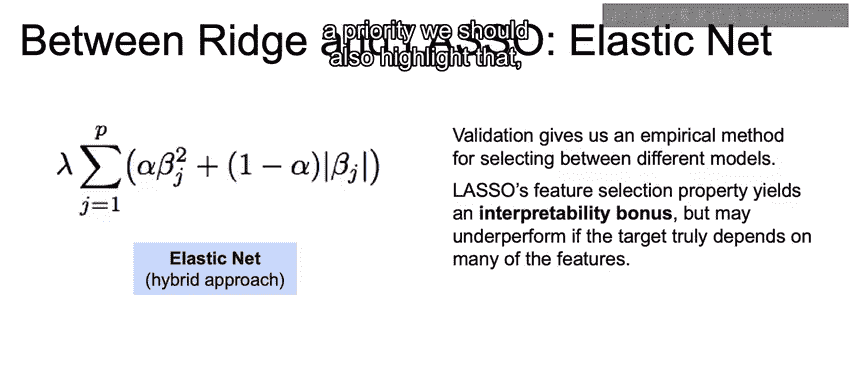

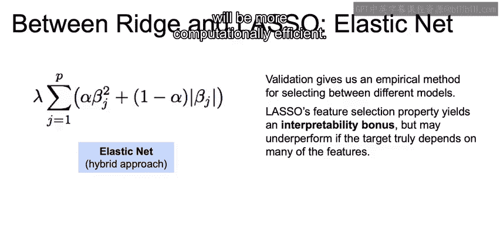

Which one is going to do better on a holdout set？

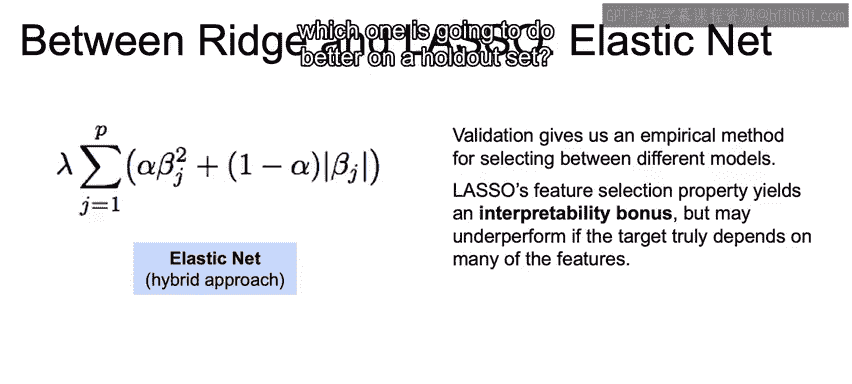

Which one is going to give you higher interpretability with Laso being able to？

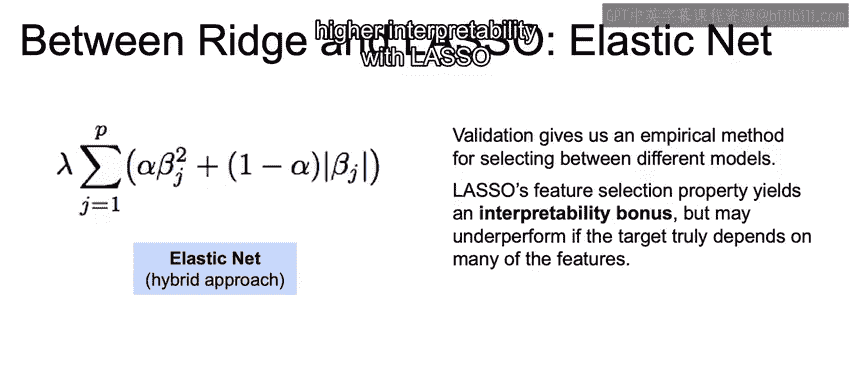

Get rid of many of the coefficients。 And then finally， with the ridge。

 we're able to come up with a more computationally efficient algorithm。 And also。

 you may want to penalize certain weights even higher， which the。

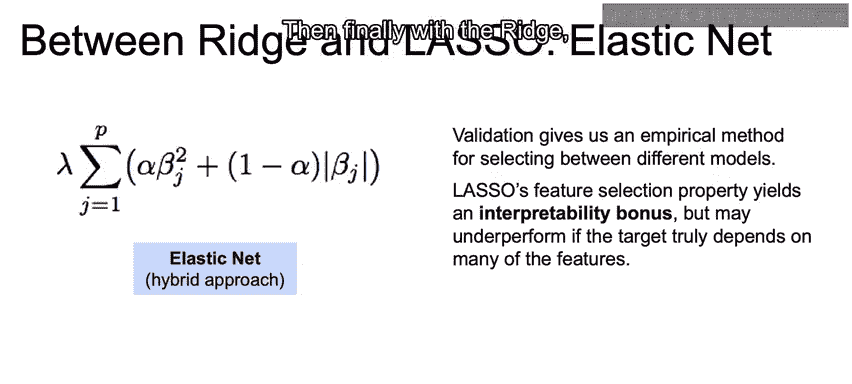

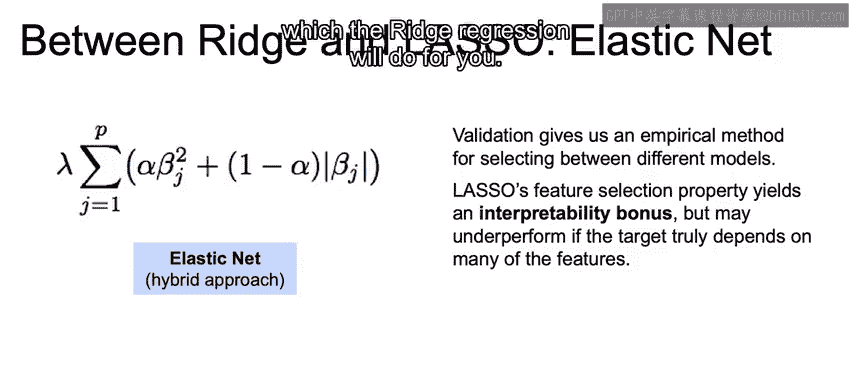

Rich regression will do for you。Now elastic net， as we see here in the formula。

 is a means of coming up with a hybrid approach between Ridge and Lasso。

 the idea here being that you have your lambmbda all the way out here to the left。

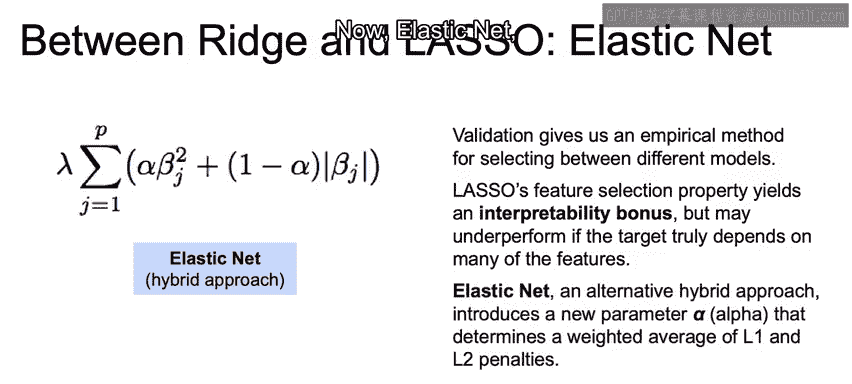

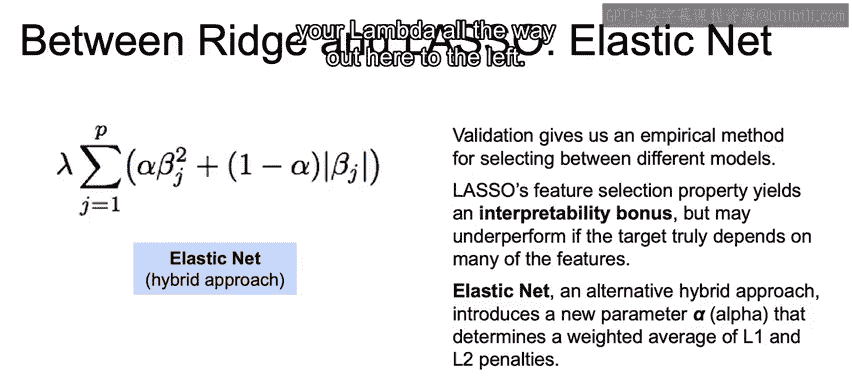

Decide the portion you want to penalize higher coefficients in general。

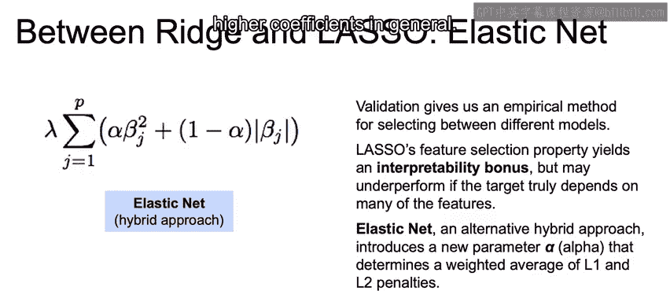

And then the alpha value that we see will represent the percentage that you attribute to the L2 and L1 weights to the ridge and regression weights。

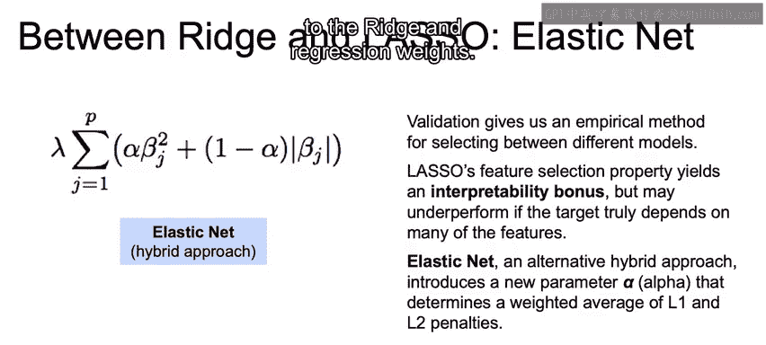

Thus， we're introducing a third hybrid option besides Ridge and Lasso， which again。

 we should optimize using this cross validation method that we saw earlier to find these optimal hyperparameters。

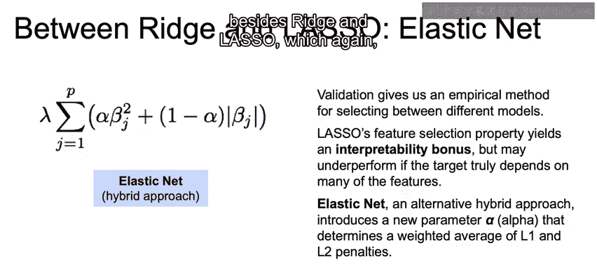

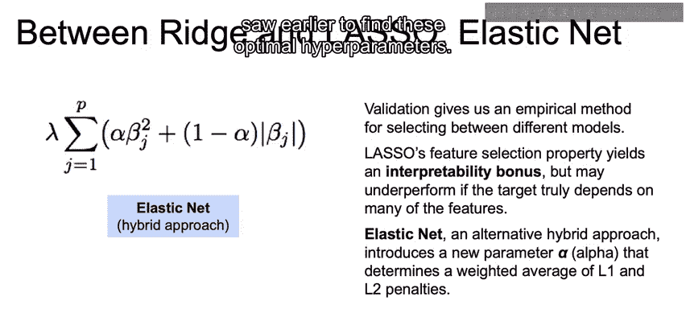

So elasticasticnet again is going to be a mixture of Rige and lassso The idea is can we get the best of both worlds？

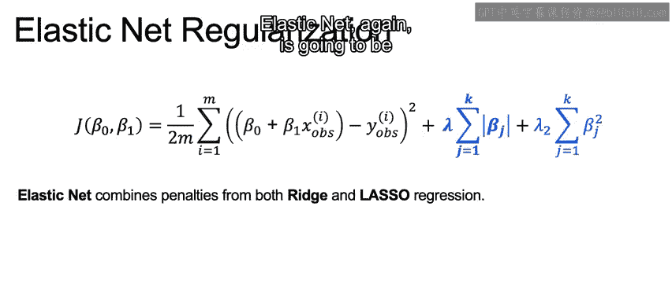

And this mixture is going to be determined by here we have it written as lambda 1 and lambda 2。

 but again this is going to be some lambda value， which is going to give you the weight for how much you're going to penalize higher coefficients and then how much do you want to attribute that lambda to either the absolute value of the coefficients or the square of those coefficients。

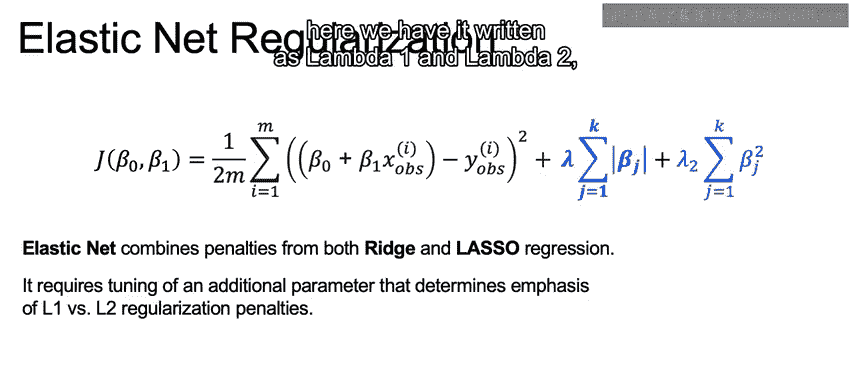

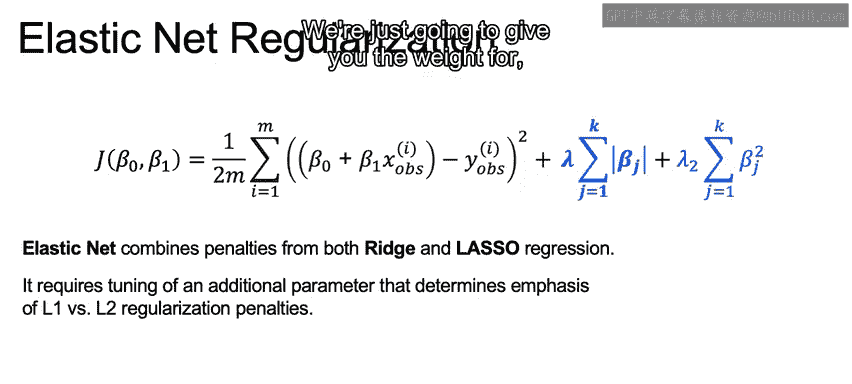

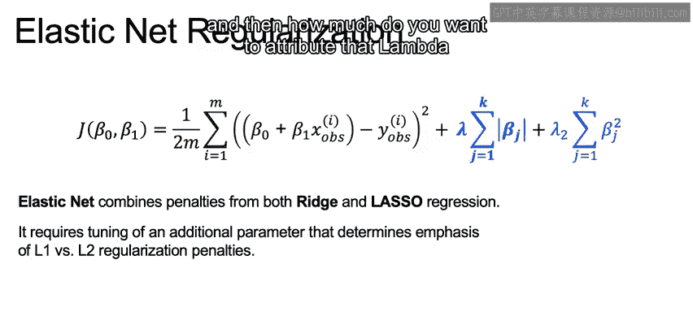

And the resulting effects of using the elastic net will be assuming that you choose the correct lambmbdas will be the same where we have either underfitting。

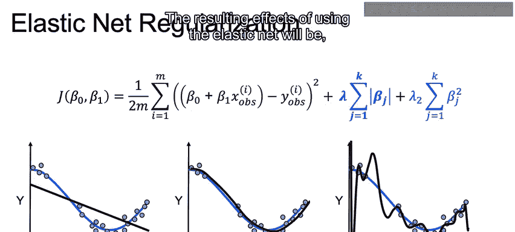

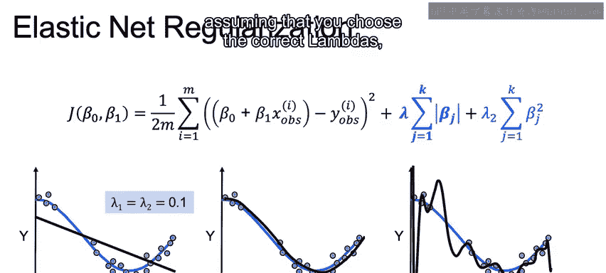

Perfectly fitting or overfitting our underlying model。

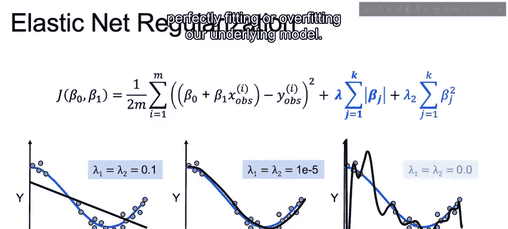

And the goal here， or what we see here is that the two lambda values are equal。

 these obviously can be different depending which one you want to attribute more weight to。

 whether you want to attribute more weight to the square of the coefficients。

 the absolute value of the coefficients again with Lassso if you have more weight towards the absolute value。

 you'll be more likely to remove some of your coefficients， if you use the ridge。

 then you'll be more likely to penalize higher weights。

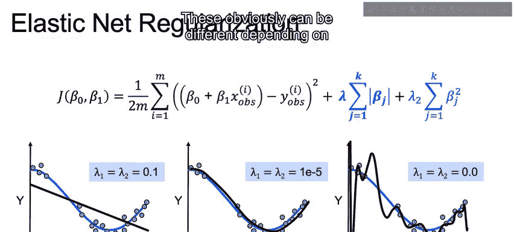

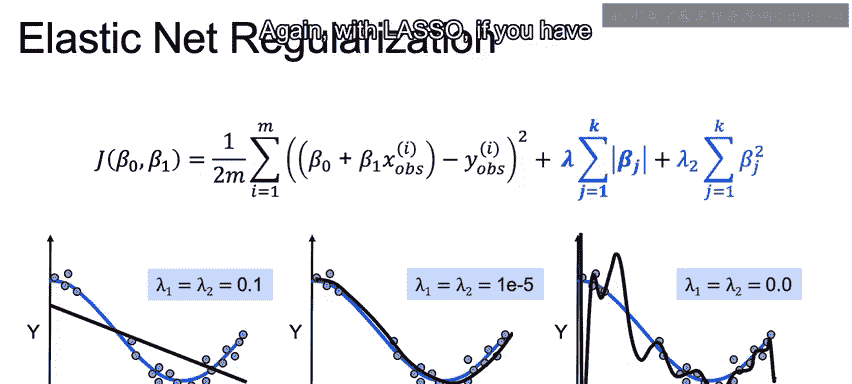

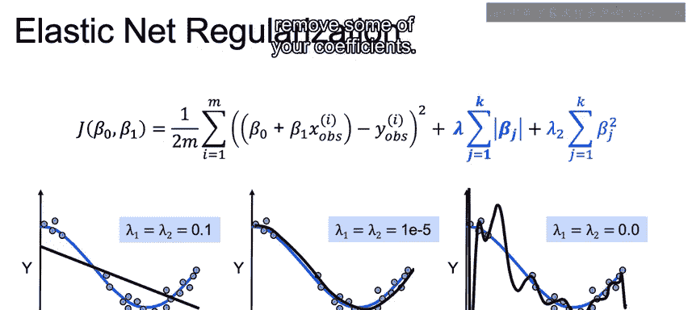

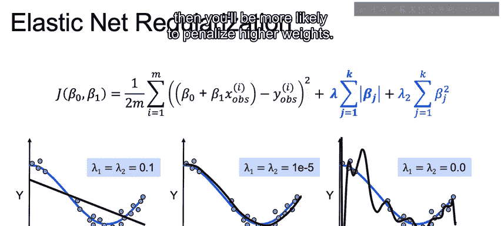