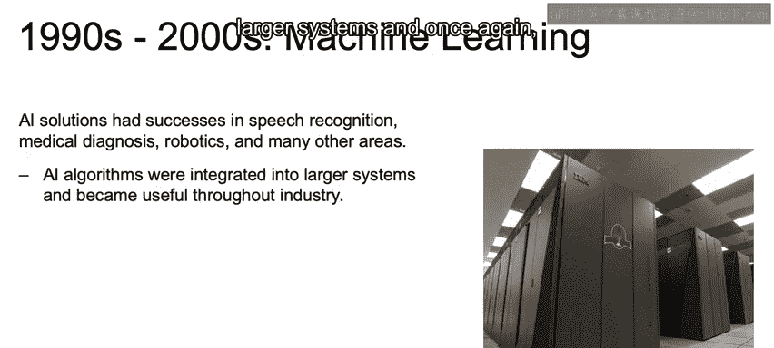
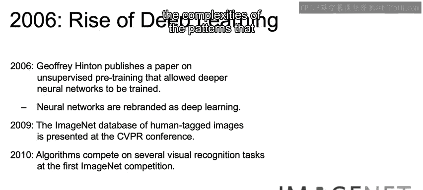
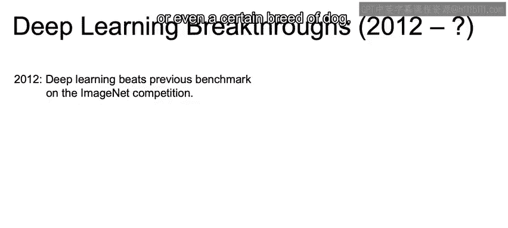
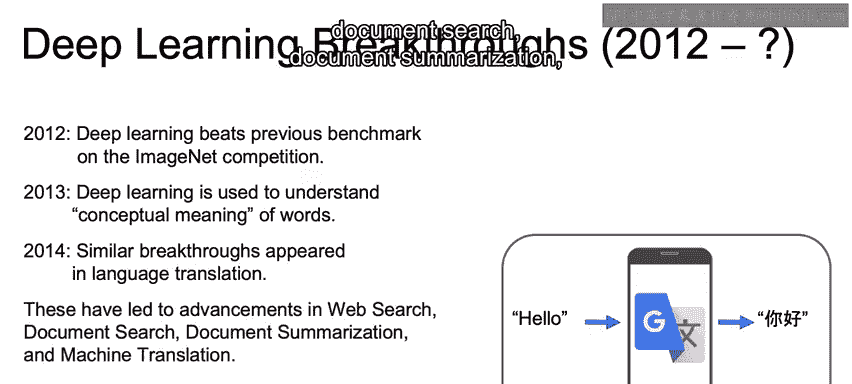
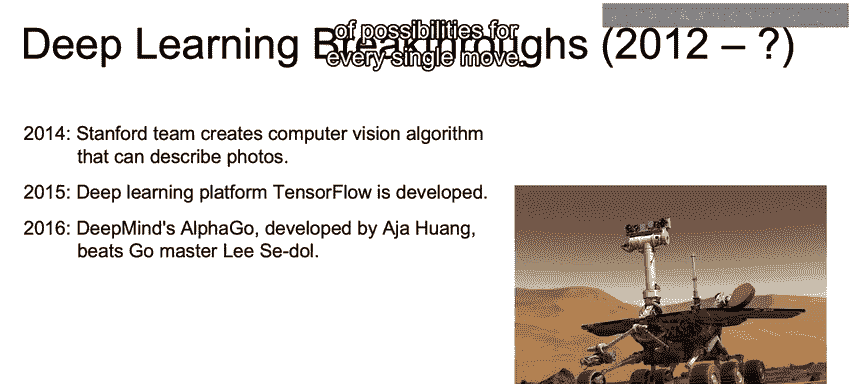

# IBM《机器学习（数据探索、监督学习的回归和分类）｜machine learning》中英字幕 - P7：6_机器学习和深度学习的历史.zh_en - GPT中英字幕课程资源 - BV1xM4m1D7kY

So hopefully you are all on pins and needles wondering what's going to happen next in the history of artificial intelligence。

So now we're in the 90s and 2000s and AI solutions using classical machine learning techniques began to take off。

 and AI solutions had successes in speech recognition， medical diagnosis， robotics。

 and many other areas。AI algorithms were integrated into larger systems and once again became useful throughout industry。

In 1996， Deep Blue accomplished the major feat of being the first machine to defeat a world champion chess player。

 so you can imagine the hype and excitement as a machine is able to beat the human in chess for the first time。

😊，Also， Google revolutionized the search engine space with its Page ranknk algorithm to display search results。

 and if you're curious， I would say look up that page rank algorithm。

 it's a great start if you're interested in network algorithms。In 2006。

 the previous limitations of deep learning， namely exploding and vanish ingredientss。

 which we'll touch on later in the course， were overcome with algorithmic advancements such as Jeffrey Hinton's work on unsupervised pretraining。

Neural networks are rebranded as deep learning as we are able to train much deeper networks。

 networks with more layers。In 2009， the IageNet database was introduced。

 which was a groundbreaking data that provided millions and millions of labeled images which were not available before to data practitioners。

And then in 2010， algorithms compete on several visual recognition tasks at the first image net competition。

 and this greatly increased the opportunity for an algorithm to try and learn from many examples the complexities of the patterns that actually make up a cat or a dog or even a certain breed of dog。

😊。

Now， I've heard that if we thought of the ups and downs of deep learning as a movie starting with Rosenblatt's basic perception。

 then the two long winters associated with Minsky's paper on the limitations of Rosenblt's perception。

 the article introducing back propagation， and then the corresponding response highlighting the problems of the vanishing and exploding gradients。

 2012's competition would be the climax of this movie。As in 2012。

 a deep learning model using convolutional neural nets called AlexNe achieved a top five error of 15。

3%。Blowing up the competition， that was more than 10。8% points lower than the next lowest error。

So from there， the practical applications for deep learning began to take off In 2013。

 it was used to give description of the conceptual meaning of words by learning from copious amounts of written data。

In 2014， we saw similar breakthroughs in the task of machine translation。

 leveraging concepts such as recurrent neural nets。

 making what was once one of the major goals in the 60s， if you recall that was。

One of the causes of the first AI winters， an actual reality。

And these have led to advancements in web search， document search， document summarization。

 and machine translation。

In 2014， Stanford researchers elevated computer vision to another level with the ability to annotate photos with captions。

 such as baseball player throwing a ball in game， rather than just saying this is a human was able to give a bit of a story behind an actual picture。

In 2015， one of the most popular libraries， TensorFlow was built for deep learning。

 making it more powerful and accessible。In 2019， this was made even more accessible while gaining even more flexibility and power as well。

 with version 2。0 incorporating the high level library's cares， which we'll touch on later on。

In 2016， Deep Minds Alpha Go was able to defeat a go masterster。

 a game considered much more difficult than chess due to the prohibitively large number of possibilities for every single move。

In 2018， Waymo， the Self-driving car Tax Service launched by Google。

 began actually giving rides in the suburbs of Phoenix and in 2019 the IBM project debater put on a fascinating debate with a champion human debater。

 showing the ability to argue a topic listen to a human response and then give a rebuttal accordingly。

 it was fascinating to watch and would highly recommend looking into it。

 you just look up IBM project debater on YouTube。And those are just some of the major。

 many major highlights of where we are today with artificial intelligence in the next section we'll dive deeper into understanding more of what makes this era in artificial intelligence so special。

