# IBM《机器学习（数据探索、监督学习的回归和分类）｜machine learning》中英字幕 - P83：34_多项式特征和正则化演示第3部分.zh_en - GPT中英字幕课程资源 - BV1xM4m1D7kY

Welcome to part 6 of our notebook Here we're going to introduce the different regularization techniques。

 namely Ridge， Lasso and Elastic net。

If you recall starting here with the Ridge， Ridge is going to use the L2 normalization to reduce the magnitude of the coefficients。

It does so by adding extra cost to the cost function， by squaring each one of those coefficients。

And this can be helpful in situations where there is high variance。

 if you recall if there's high variance， that's high complexity and reducing the size of the coefficients will reduce the complexity and reduce our variance。

The regular functions in SKLear each to contained versions that have cross validation built in。

So what does this mean if you recall when we talked about cross validation in the cross validation notebook。

 we had this option of grid search CV， which went through many different hyperparameters for a given model。

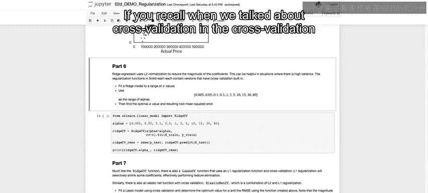

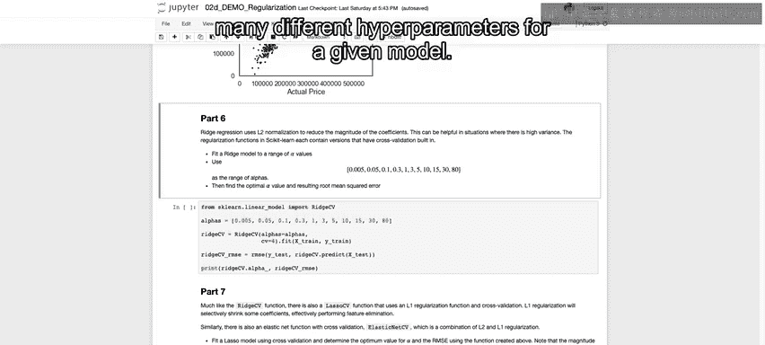

And then it also did train test split 4。 however many you want to craft validate on so we could have four splits。

5 splits and so on， and then find which one of the hyperparameter performed best on average across each one of these splits。

 So for grid search C， we have to specify what the model is。 Here。

 we are specifying it right off the bat by just calling Ridge C。

 So that's the same as grid search C with Ridge as the model that we're working with。

So from SK Learn that linearar model， we import Ridge CV。

We're then going to say what the alpha values are that we're going to loop through。

And then all we have to do is call this rich CV。We pass in for Red CV。

 the hyperparmeter that we want to loop over， which is the alphas。

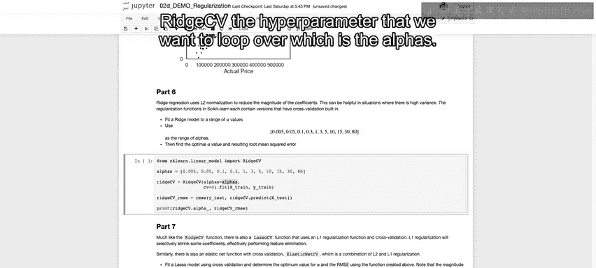

We say that we want four train and test splits。And then。

Through doing that， we are initiating our objects， we can then fit that to our training set。

 to our X train and our Y train。

And then we can use that root mean squared error that we defined earlier in the notebook to see given that fitted model to x train and Y train。

 how well is it able to predict according to the actual values for our test set。

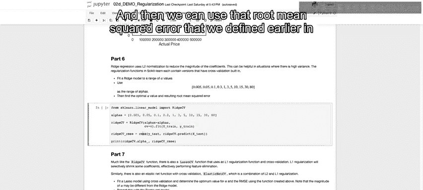

We'll then have the root mean squared error， we can also call from red CV the actual alpha value。

Wwhich is going to be one of these values which optimizes the model on each one of the holdout sets。

 so we run this and we see that 10 was the ideal alpha value and that's the root mean squared error is now 32。

205。

In part 7， much like R CV， there's also going to be Lassso CVv。

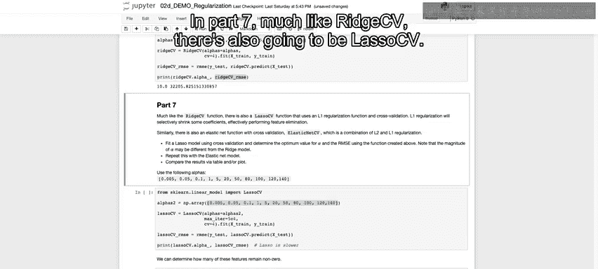

And that function is just going to use the L1 regularization function。

 as well as the cross validation that we have talked about。

If you call L1 regularization is just taking the absolute value of those coefficients。

 so again reducing those coefficients， but this time selectively shrinking some of those coefficients。

 effectively performing feature elimination。

Similarly， there's also going to be elastic net function with cross validation built in。

 and for that we just call Elastic nett CV， and this is can combine the L2 and the L1 regularization。

So what we're going to do here is fit a Laso model using cross validation and determine the opt value for alpha。

 as well as the root mean squared error for that optimal value of alpha。

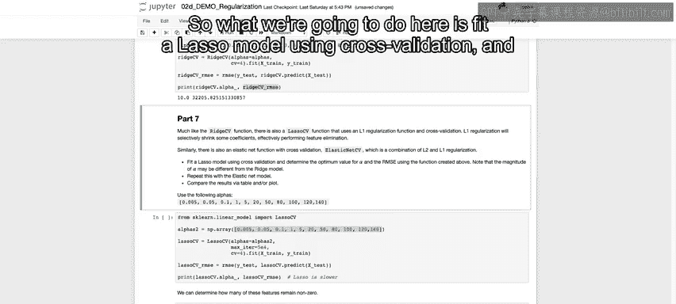

We also want to note that alpha may be different from the rid model because it's going to depend on the coefficients。

 so first it's lambda times the coefficient squared versus lambda times the absolute value of those coefficients。

 you may want to iterate through different alpha values in order to come up with optimal model。

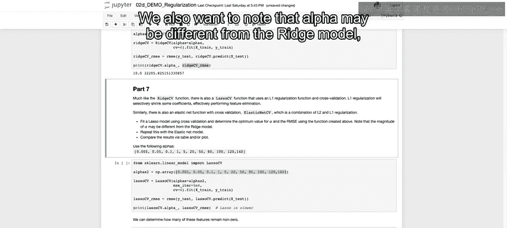

In regards to figuring out which alpha values to choose。

 I would just say use a certain number of values， see if the largest value is clearly the best every single time。

 then you need to increase it by a lot until you find a range of values where you can hone in so you keep increasing or decreasing according to whether or not you are stuck on the lowest or highest values in your list until you hone in onto a value that seems close to the optimum value。

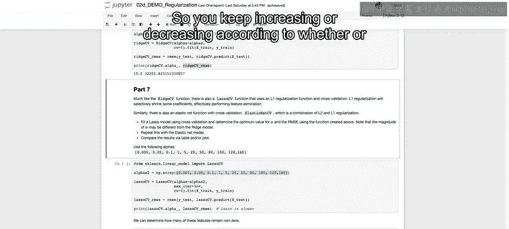

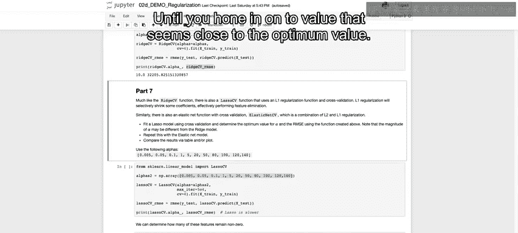

So here we're going to use the values that we see here ranging from 0。005 up to 140。

We're setting alphas 2 to that array。

We're passing that into alphas。For La OCV， we also have to say that we want some max iterations。

The reason for that。 And if you recall， and I'm actually going to run it now before I continue to explain。

 because sometimes it takes a bit to run is that under the hood Rige will actually perform a lot quicker than Lasso。

 And that's just due to the optimization method that it uses。

 Lasso was forced to use gradient descent， which may take a bit longer。

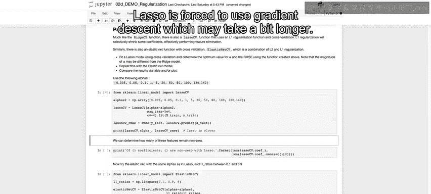

And for that reason， we have to say that we have to say how many iterations it'll take before it stops in case it doesn't hit enough iterations to the point that it's able to converge。

 This doesn't make sense yet。 Don't worry about it。

 All that matters that it'll take longer for Laso and we'll learn more about gradient descent in later courses。

So here we see it shows the value of 120， and it has an error， a root mean squared error of 37，010。

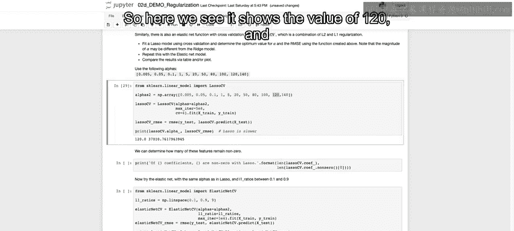

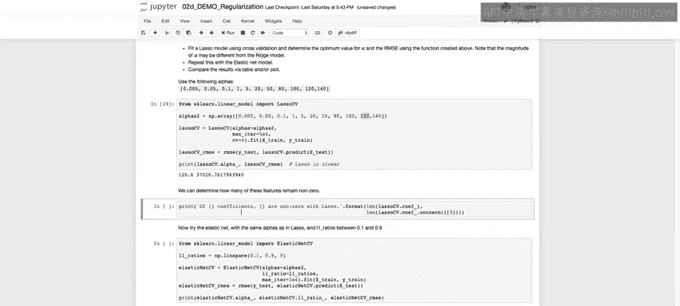

We're also going to see how many of these features is able to eliminate and we see that out of the 251 coefficients。

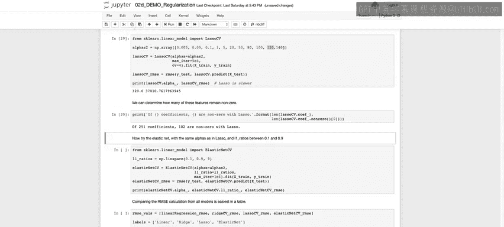

This is the total coefficients。Only 102 were non zero。

So we reduce more than half of the coefficients。Now， finally。

 we're going to perform this using elastic net。 If you recall。

 elasticastic net is going to take our landda value and attribute a portion of it to。

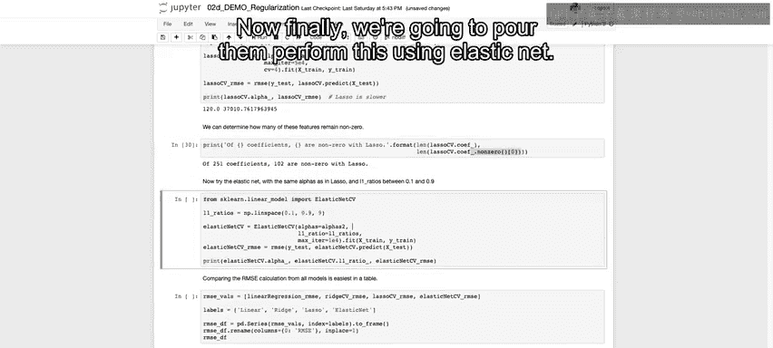

To your ridge， to your coefficient squared and a portion of it to the absolute value of your coefficients in terms of that cost function。

So here we're going to take  nine values between 0。1 and 0。

9 for that alpha value that will wait where that lambda value will fall。

So 0。1 will be a lot of weight on the ridge， whereas 0。9 will be a lot of weight on the Lasso。

We call elastic net， we pass in Als 2。

We're then going to use the L1 ratios。

That we just defined up here。So the Als 2 is what we defined up here， right。

 It's going to be these alphas。

Then we're going to use the L and ratio， so we have to iterate over many more values。

 so I'm actually going to start running this now。

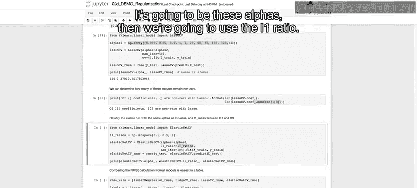

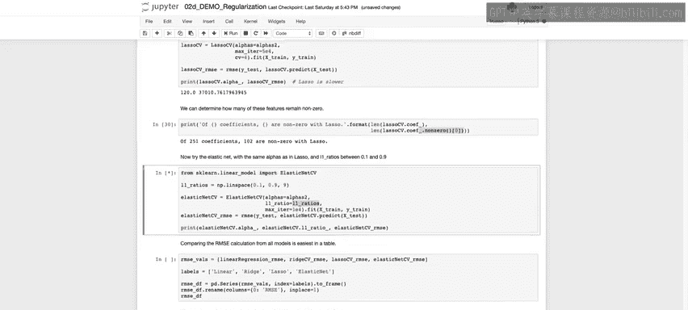

And then we're going to come up again， so this is going to fit the model。

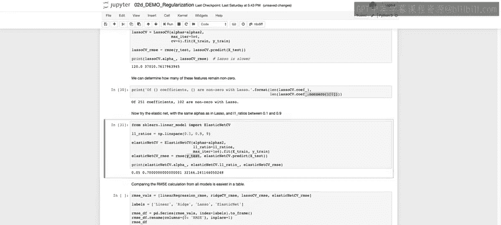

And then we can fit that to the Y test and the predicted value for elastic net。

 So elastic net was similar to what we saw with Rige and with Lassso。

 just with an extra hyperparameter of the L1 ratio。

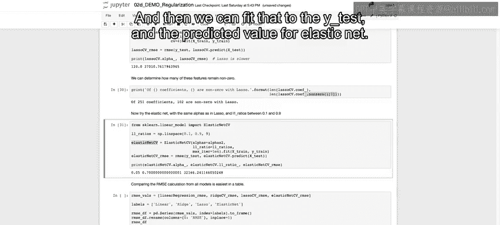

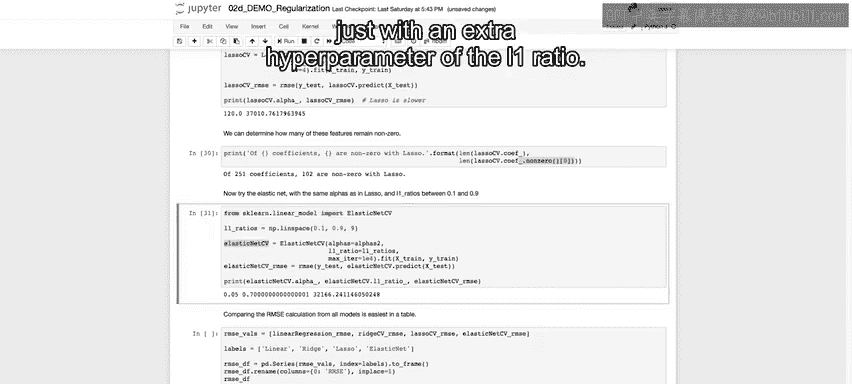

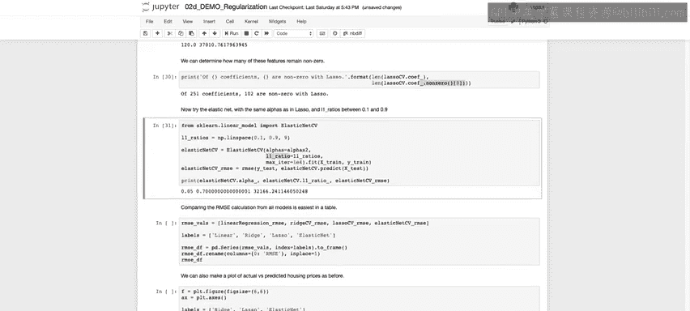

So now we're going to compare the root mean squared to error for each one of the models that we created。

 we had the linear regression， the ridge regression， the Lasso and the elastic net。

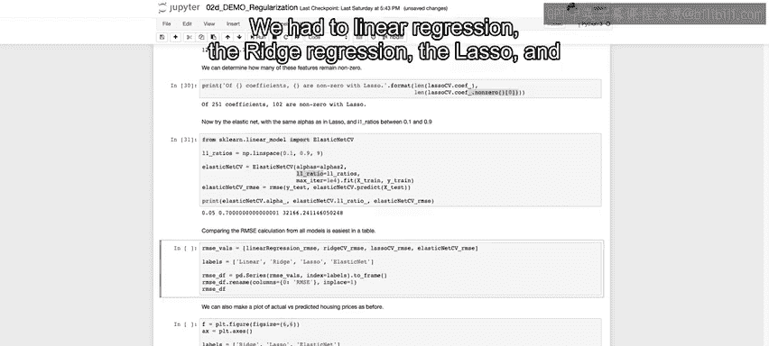

We're just going to create a series of the root mean squared error and the index is going to be these labels。

 linear， ridge， Lasso and elastic net in the correct order。

 so we're just creating a series out of this。

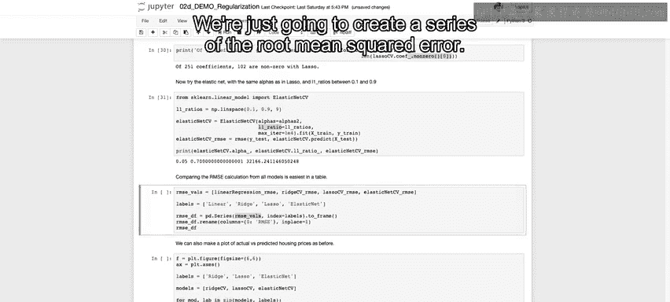

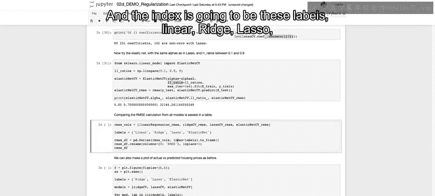

We're putting it into a data frame。And then by default。

 that data frame will have a column called zero， we're just going to rename that root mean squared error。

 and then we can see the root mean squared error for each one of our models。

 and we see that regularization drastically improved our root mean squared error。

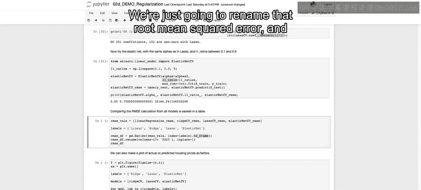

By reducing it by significant amounts。

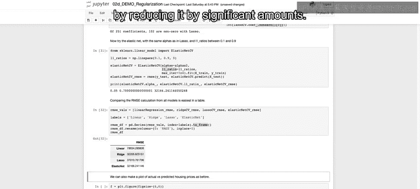

And in this case， elasticnet did slightly better than Ridge， and they both did better than Lasso。

 and that will just depend on checking the model and again， what you want to get out of the model。

 whether you want to reduce a lot of the coefficients and do feature selection。

 then you'd still want to do Lasso if you want it to run very quickly， you'd want to use Ridge。

 and if you want to find that optimal balance， you may want to use elastic net。

Finally， all we do here is similar to what we did above with linear regression。

 where we just plot the predicted values versus the actual values。

 We're just going to do it here for each one of our models。

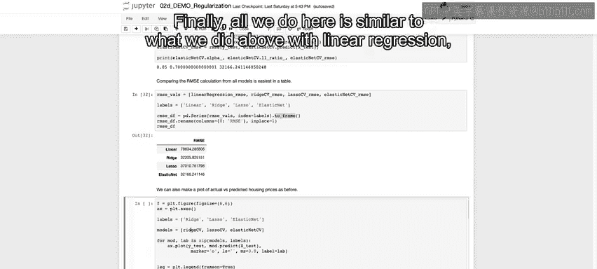

So we have our labels are equal to Rige， Lasso and elastic net， and the different models。

 These are the actual models that we created that were already fit。

 So recall that we've already fit these models。 So they're able to predict the actual values later on。

 So if we look at elastic net C。 This is equal to this elastic net C。

 which has already been fitted to the X train and Y train and has already found the optimal alphas and L1 ratios。

😊。

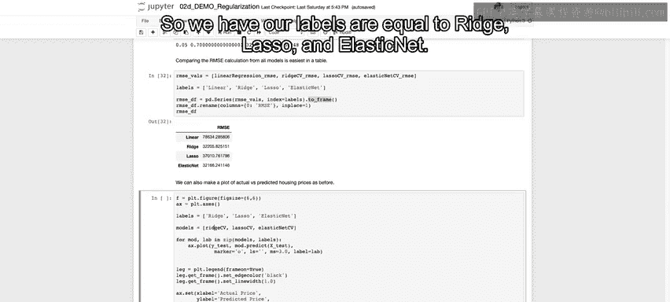

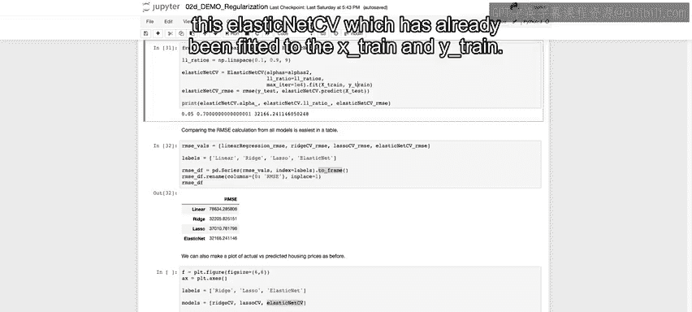

So it's going to say four mod and La in zipping these models and labels together。

 so we're zipping them together and essentially accessing them as a list of tuples where each tuple is going to be a model as well as a label。

 so we will then do a dot plot using the act that we initiated up here。

And we will plot our Y test， which is the actual value versus the predicted value。

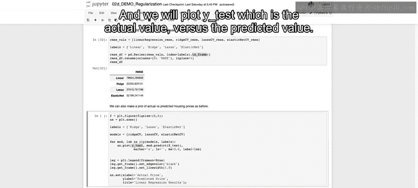

That model being first Ridge CV， then Las O CVV， then elastic nett CV。

 and we're able to label each one according to the label because we zip them together so that ridG CV is aligned with Ridge and Las O CVV with LaSso。

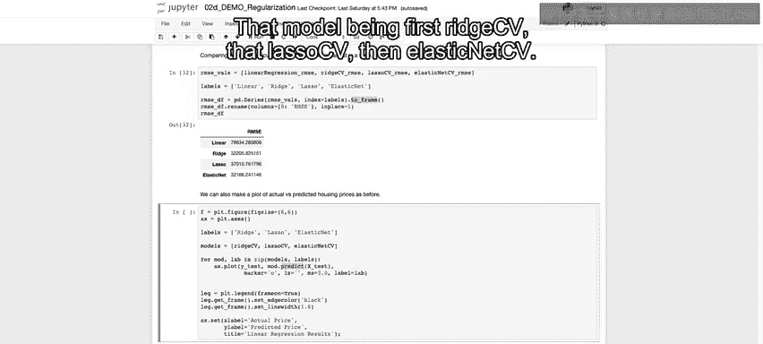

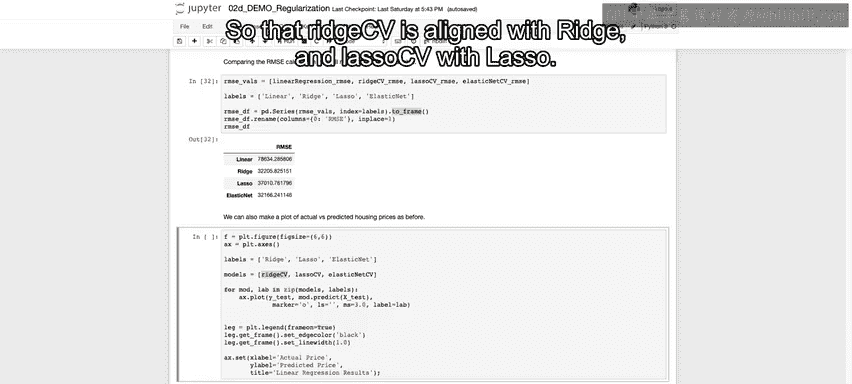

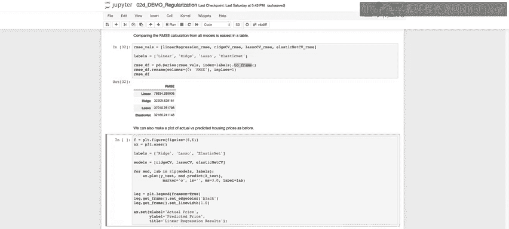

We're then going to call our legends and everything else that we've done in the past。

And we're just going to have。Our different predicted values versus the actual values plotted on the X Y graph。

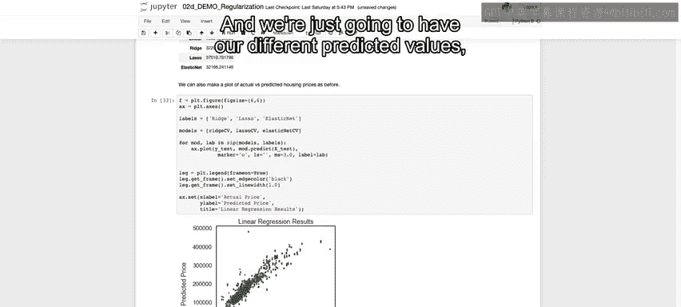

Doesn't provide much extra information here。 I would say it would be much more worth it to look at the root mean squared error in order to see how well we were able to predict using each one of these models。

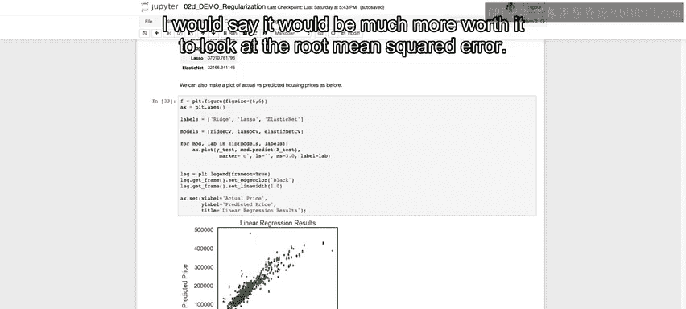

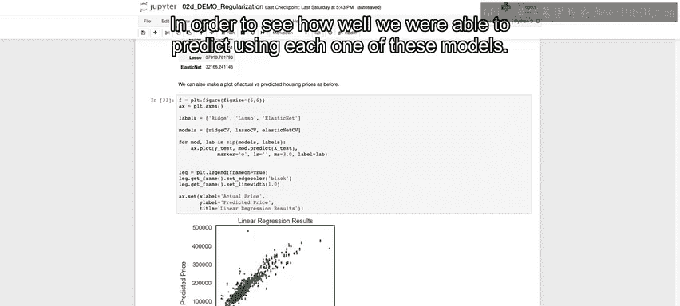

So that closes out our section in regards to our regularization demo。 After this。

 we're going to do one more lecture in regards to regularization to get a deeper insight into how it actually works。

 And then you will have some exercises to perform using regularization as well。 All right。

 I'll see you there。

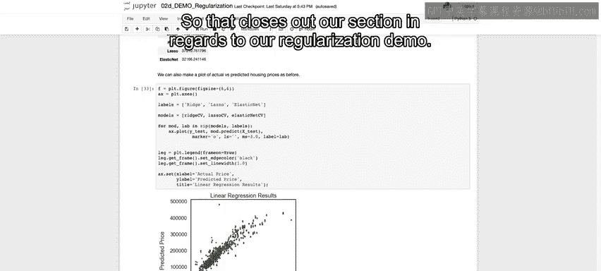

