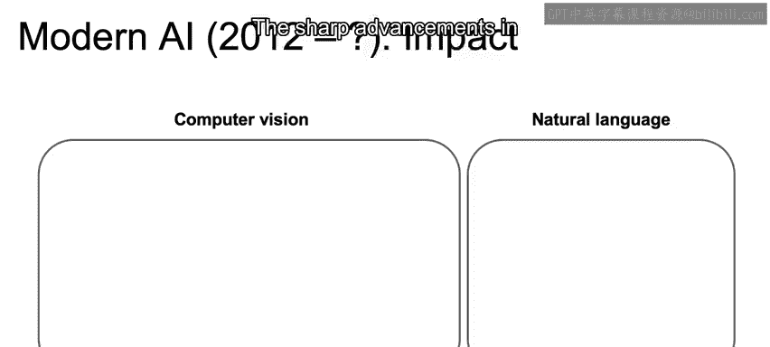
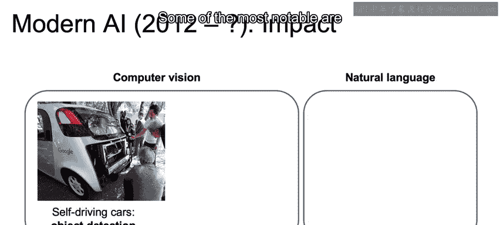
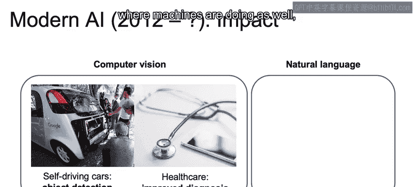
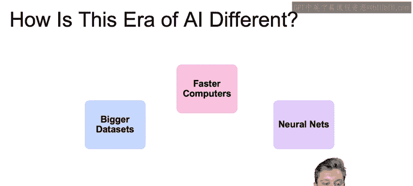
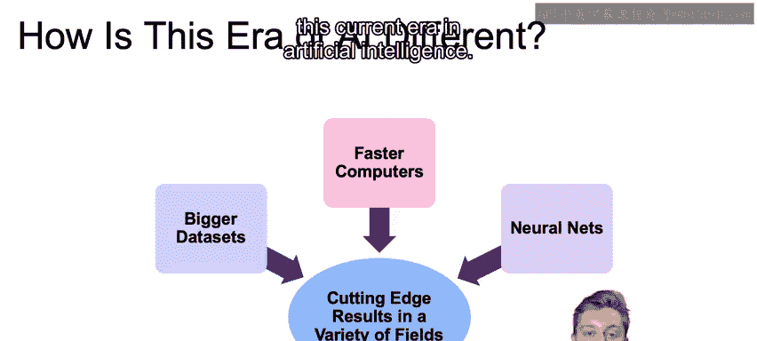
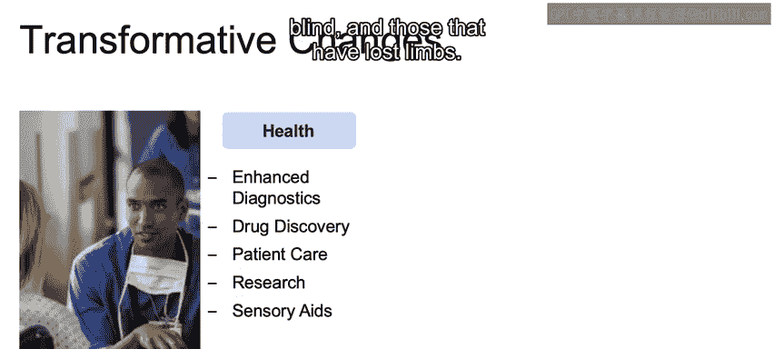
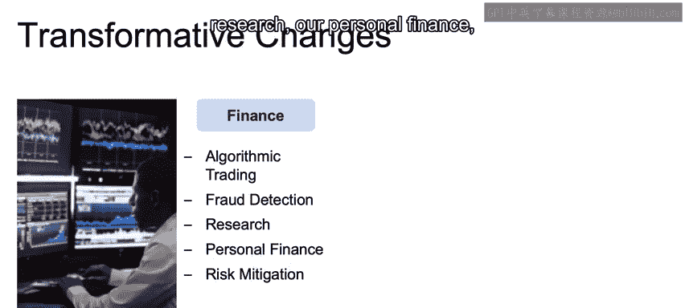
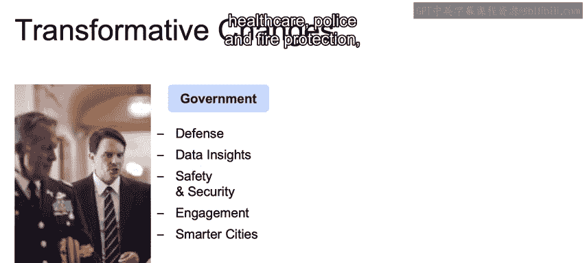
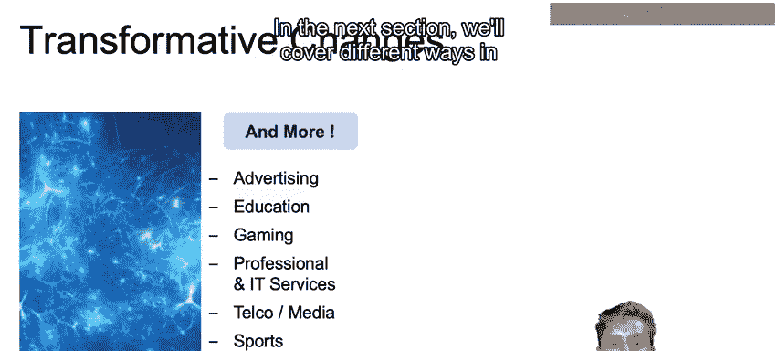

# IBM《机器学习（数据探索、监督学习的回归和分类）｜machine learning》中英字幕 - P8：7_现代AI.zh_en - GPT中英字幕课程资源 - BV1xM4m1D7kY

Now let's dive into the AI landscape of today and get a better understanding as to where we are and why this era is different。

So where are we today， two spaces where are seeing drastic growth and innovation are computer vision and natural language processing。

The sharp advancements in computer vision are impacting multiple areas， some of the most notable。

Are cars getting to the point where they can drive themselves？

And in healthcare， computer vision is now used to review different imaging modalities。

 such as X rays and MRIs to diagnose illnesses， and we are fast approaching the point where machines are doing as well。

 if not better， than the medical experts。

Similarly， natural language processing is booming with a vast improvements in ability to translate。

 determine sentiment。Cluuttering of new articles， writing papers， and many others。

Doess this era of AI different？Main factors are bigger data sets。

 We now have larger and more diverse dataset sets than ever before。

 We talked about how imagenet and how that was able to open up the opportunities to train models that need larger data sets to learn complex patterns with the cloud infrastructure now in place to store cop amounts of data for much cheaper and the plethora of new ways to capture data are now able to build larger。

 more nuanced data sets to learn underlying patterns across a multitude of fields。😊。

We have faster computers。 We now have access to powerful hardware for processing and storing data。

 The mainframe computers used to first drive the expert systems in the 80s cost about $200000 a month。

We can now get stronger and faster computers that sit on our laps。

Neural networks have finally taken off in the past decade and proven to be successful。

 And we have had constant new innovation in the area of deep learning。

 leading to practical results within an industry。😊。

And all this is leading to cutting edge results in a variety of fields。

So we can think about with our phones， how we are able to use our face to unlock our phones。

 how they recognize our voice， how it's able to look at pictures and identify pictures of us or our friends。

We have stores where we can walk in and pick things up。

 such as Amazon Go and not have to go to a check out canner。

We have our homes being powered by our voice， telling it we want music played or we want for the lights to be switched on or off。

😊，And all this is being driven by this current era in artificial intelligence。

So in the next few slides， I' would like to highlight a sample of the industries now being heavily driven by AI to hopefully hit home for whatever industry you're in and to show how AI is the new electricity being used across all industries。

So within healthcare， as discussed， AI is now used to aid in medical imaging。

 and often computers are able to diagnose as accurately or even more accurately than medical professionals。

For drug discovery， a great example is Pfizer has turned to IBM Watson to leverage machine learning to powers。

 drug discovery and search for immunooncology drugs。Patient care is being driven by AI。

 as well as AI research within the healthcare industry。

 and it has helped advance sensory aids for the deaf， blind and those that have lost limb。

In industrial， we are able to now automate factory work for efficiency and lower costs。

We have the ability to monitor for future system failures and schedule maintenance in advance。

Able to enhance and optimize agricultural production。

 and field automation is able to track our sales， inventory and delivery needs at a much quicker pace。

😊，So for finance， we have algorithmic training， fraud detection， research， our personal finance。

 risk mitigation， all being driven by AI。

For energy， it's being used to locate and extract oil and gas reserves。 We have smart grids。

 which essentially are meant to optimize electrical grid for more efficient infrastructure。

We're also able to improve overall operations within the industry。

 and we also are learning to conserve energy using artificial intelligence。Within government。

 defense and identifying threats， think about our Cold War example and where we are today。

 gaining insights for all major issues， whether they are threats from weather， pandemics。

 or simply gaining better understanding of their citizens' needs。

We have it driving safety and security as they have more access to data from both abroad and at home。

 it's able to enhance their engagement between government and citizens。

It's aided in building smarter cities to optimize things such as traffic， health care。

 police and fire protection and the distribution of energy。

Transportation， we have autonomous cars， automated trucking for deliveries。

 AI is huge in aerospace to optimize simulations， maintenance and prototyping。

 It's able to come up with optimal routes and timing for shipping。😊。

And AI is helped in the search and rescue fields with drones now being built with machine learning algorithms to help search and detect missing people in areas that may be too dangerous to initially explore by humans。

And so much more， we have personalized advertisements。Personalized education。

 able to identify what a student does and does not know and develop a personalized curricula accordingly。

Gaming is able to leverage many of the latest advances in AI to make a more human like experience for players。

 Service industries are quickly able to automate many of their responses and reduce time and manpower needed to solve many common issues。

😊，For telco and Media， we can think to how media is using AI to help consumers define the content that directly matches their interests。

In sports， advanced analytics are driving the ways in which general managers， recruitup players。

 as well as optimizing ticket pricing and other business operations。

So we see the extent to which AI is infiltrating all industries and why this era of AI is different than any other。

In the next section， we'll cover different ways in which AI is applied to our everyday lives。

