# IBM《机器学习（数据探索、监督学习的回归和分类）｜machine learning》中英字幕 - P90：1_什么是分类简介.zh_en - GPT中英字幕课程资源 - BV1xM4m1D7kY

Let's start off here with a discussion of what a classification problem is and begin to discuss how we can leverage machine learning to solve such problems。

So let's go over the learning goals for this video in this video we're going to discuss a very common split in regards to supervised learning and that's a split between regression and classification。

We'll talk about what data and methods we need to actually perform classification。

And then we'll have a brief overview of models commonly used for classification。

 which will go over in depth throughout this course。

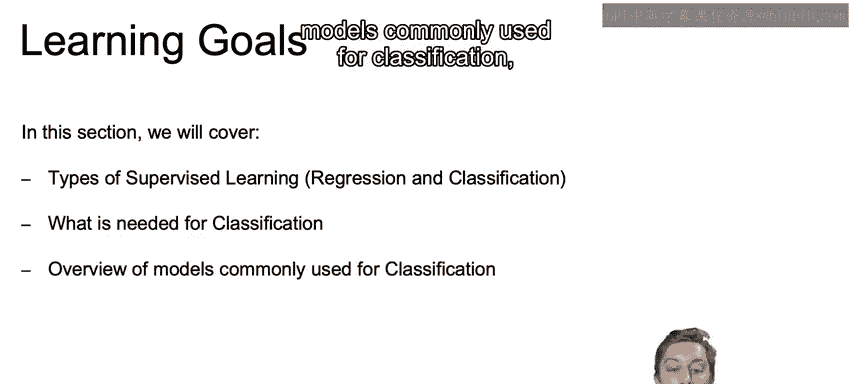

So now let's talk about a classic split in regards to supervised learning。

 Supervised learning is commonly divided into two types。

 depending on what kind of data we want to model in regression problems。

 the outcome is a continuous number。 So use regression for business problems that need you to predict or explain how much。

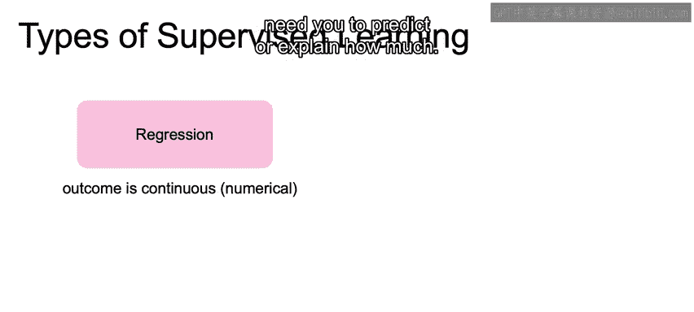

If we have categories that we're trying to predict， on the other hand。

 that is we have classes that we want to predict， then it's a classification problem。

 and we'll use classification for business problems that need you to predict if an outcome will occur or not or to explain why a certain outcome occurred。

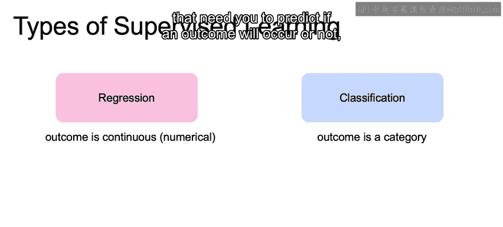

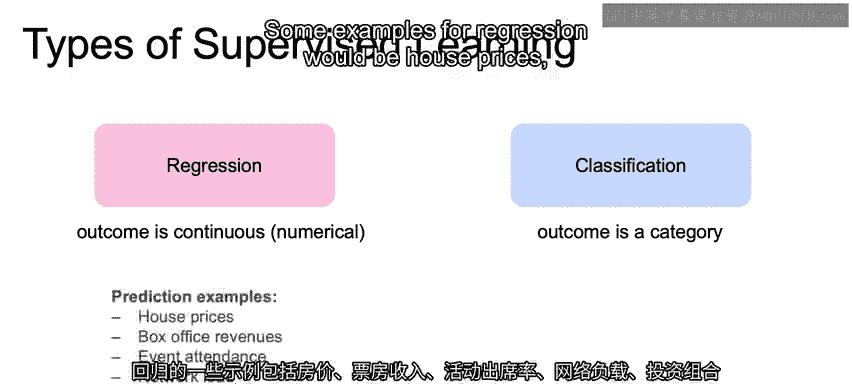

Some examples for aggression would be house prices， box office revenues， event attendance。

 network load， portfolio losses， and we can even think back to some of the examples we've already gone over in previous courses in regards to using linearg for house prices or for box office revenue and we're trying to predict given our features how much of each of these will occur。

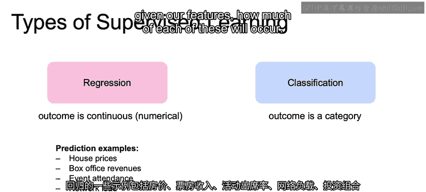

On the other hand， when we're talking about classification will detect fraudulent transactions so fraud or not customer churn whether or not they will churn in regards to event attendance and network load here。

 we would be predicting whether or not it passes a certain threshold。

 so true or false whether it passes certain threshold and then alone default whether or not they would default on a loan。

Just to point out what we have here is yes or no examples or binary examples with classification。

 there can be three outcomes or four outcomes as long as we're predicting a specific class compared to regression where it'll be how much。

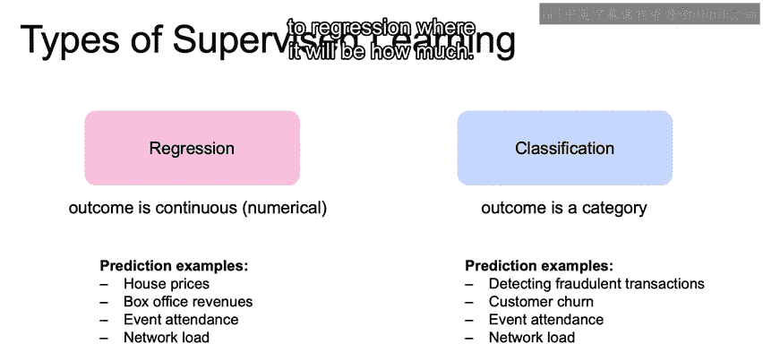

So let's briefly examine what exactly classification is。

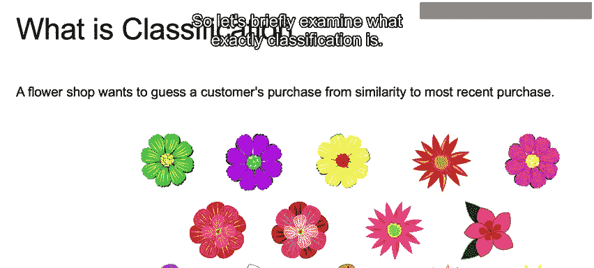

Let's say we're running a flower shop。And these are the types of flowers we are selling。

And I have historical data on all my customers， specifically which flowers they have previously bought。

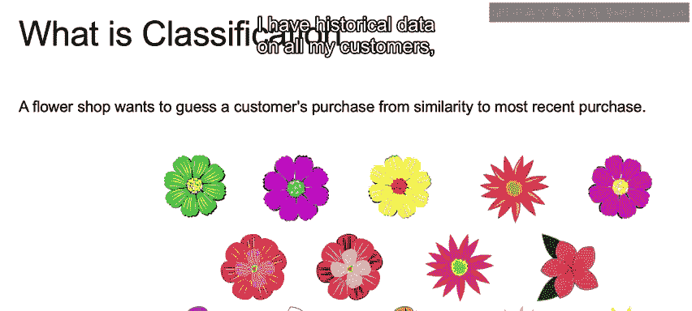

And let's assume that I was very certain that their next purchase of flowers would be similar to their most recent purchase。

 which we see here on the left。

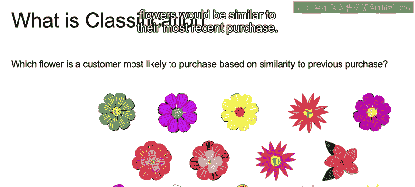

And we're going to use similarity to this recent purchase。

 the flower here on the left in order to determine what their next flower will be。

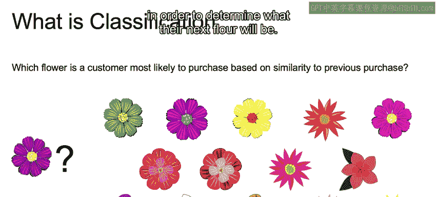

So other flowers that we have available is this one that we have pointing to on the right。

 and this flower is similar in color， but perhaps not in petals。

We then have this flower that has similar petals， but the coloration on the petals is not quite the same design。

And then finally， we'd say that this flower is likely the most similar based on both its color and its petals。

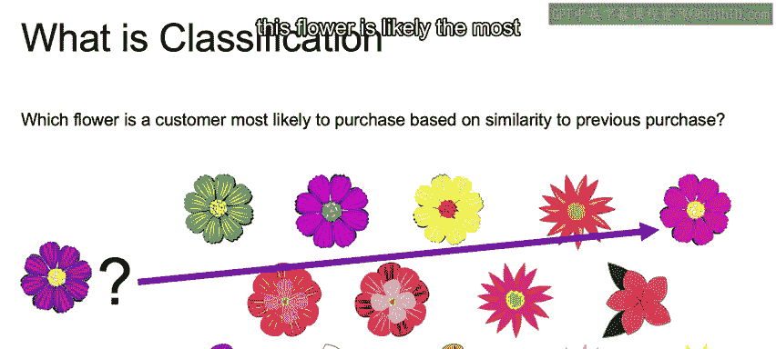

So what exactly is needed for classification in order to classify a new example with unknown label。

 we would learn using our known examples。We' then need to represent the examples in a feature space。

 which can be quantified。 So in our flower example。

 we may represent a customer's most recent flower purchase with， again， talking about feature space。

 the pal type， the color of the petals， and recall with such features。

 how we take labels and colors and eventually quantify them in the methods that we learned in past courses such as using one hot encoding。

😊。

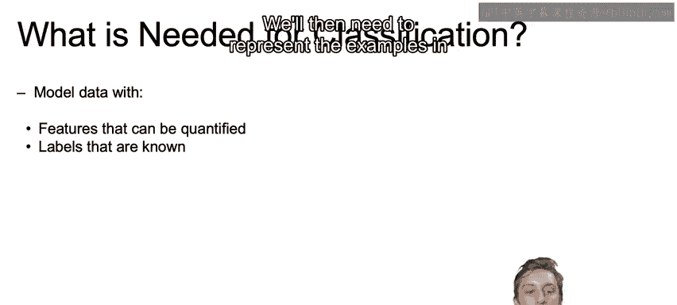

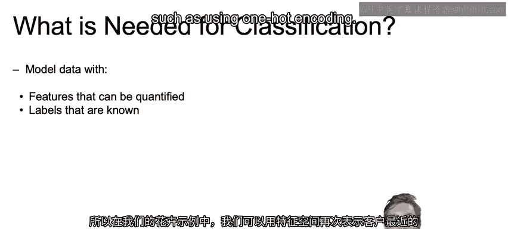

We need to know the labels belong to each one of these examples。

 so what is the actual purchase given the pedal type， the color of the petals， etc。

In our flower example， this is the data of which flower each previous customer actually bought。

And then we need a way to measure the similarity between the past purchases and the new purchase that we're trying to predict。

 so that's going to be the machine learning algorithms that's going to help us identify that similarity metric and choose which one is most similar to past purchases。

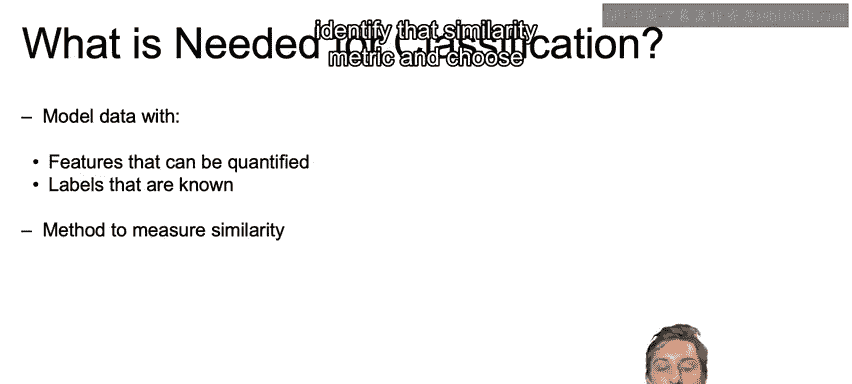

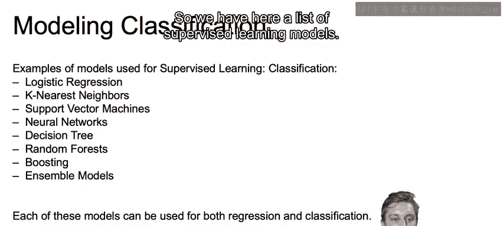

So we have here a list of supervised learning models and note that these models are not inherently regression or classification。

They can and will be used for both， but we'll start here by highlighting how each is used for classification tasks in practice。

Logistic regression will extend linear regression， which we've learned for classification problems。

Can nearest neighbors is a nonlinear and simplistic approach to categorizing。

 according to the similarity of past examples nearest to the feature space of the label we're trying to predict。

Support vector machinesch is a powerful linear classifier。

 which will leverage something called the kernel trick to allow for complex decision boundaries。

Neural networks， which will be assessed later on when we get to that course on deep learning。

 is a model that combines nonlinear and linear intermediate steps to come up with a complex decision boundary。

Decision trees will use intermediate decision boundaries that are nonlinear to come up with a more complex final decision boundary。

 and then random forests boosting and ensemble methods will build off of decision trees and other classifiers to show how we can leverage multiple classifiers to help reduce both variance and bias in a final model。

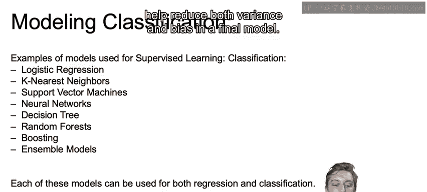

So to recap in this section， we discussed the two types of supervised learning。

 we had regression predicting how much and classification predicting which class。

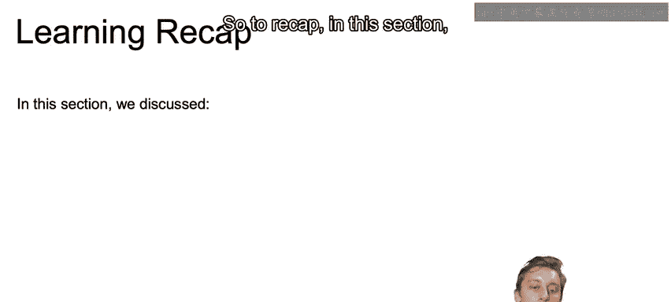

We discussed what is needed for classification， namely a means of quantifying the past and measuring similarity of our features to the features of our unlabeled data。

And finally， we had a brief overview of models commonly used in classification。With that。

 we close out this video and the next one will get started on our first classification model。

 logistic regression。

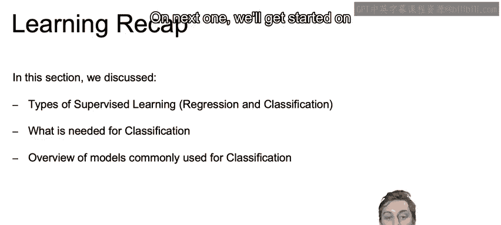

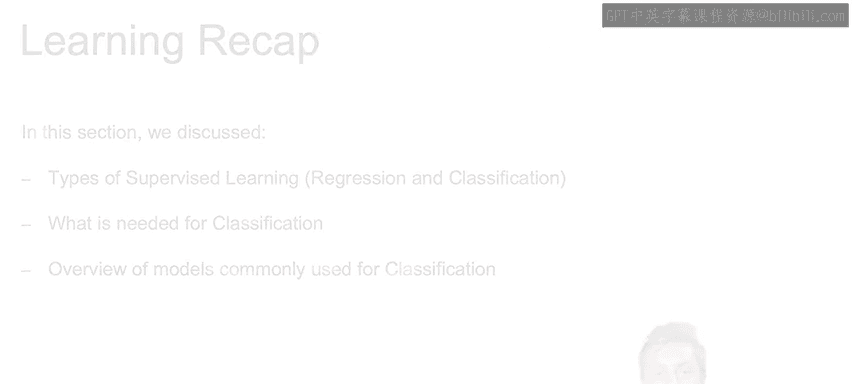