# IBM《机器学习（数据探索、监督学习的回归和分类）｜machine learning》中英字幕 - P91：2_逻辑回归简介.zh_en - GPT中英字幕课程资源 - BV1xM4m1D7kY

Let's start off with our first classification algorithm， logistic regression。So in this section。

 our learning goals will be to introduce logistic regression as a classification algorithm。

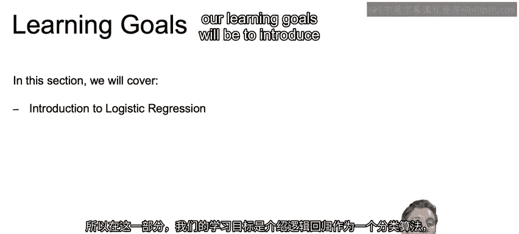

Discuss linear regressiong as an example for classification and how it can actually be used versus how logistic regression helps correct what linear regression may get wrong when we trying to do classification。

 as well as touching on the relationship between the two。

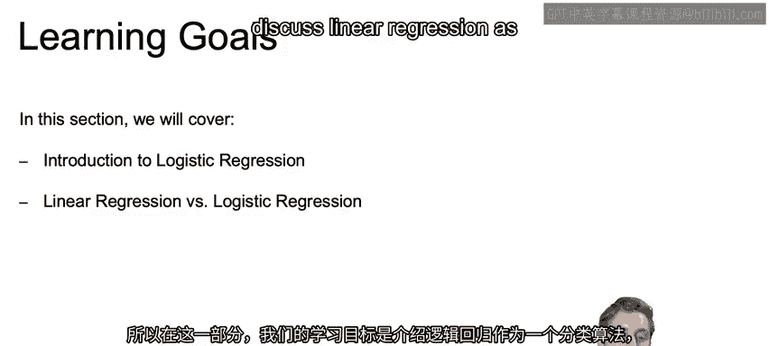

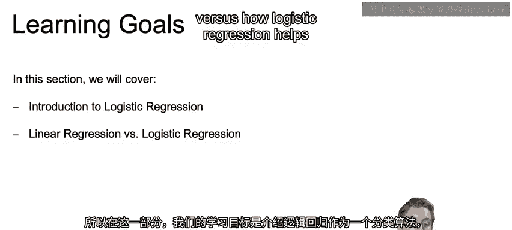

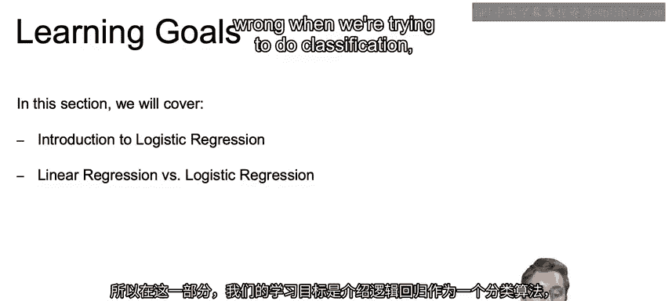

And then we'll show how we can use logistic regression for an example in order to actually perform classification。

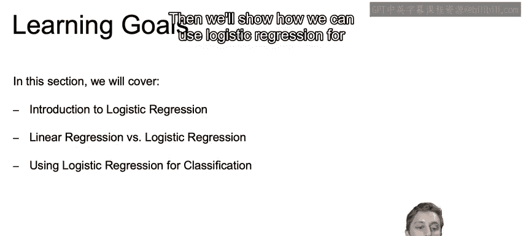

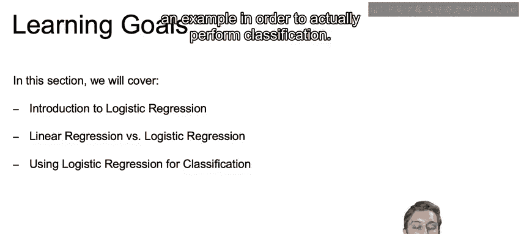

So we're going to start our discussion on logistic regression with an example here we are reintroducing the customer churn example from telecom。

 where customer churn is a function of the amount of usage in minutes here。

 So here there's going to be one feature， the usage in minutes and a binary outcome。

 either they churned or they did not churn。

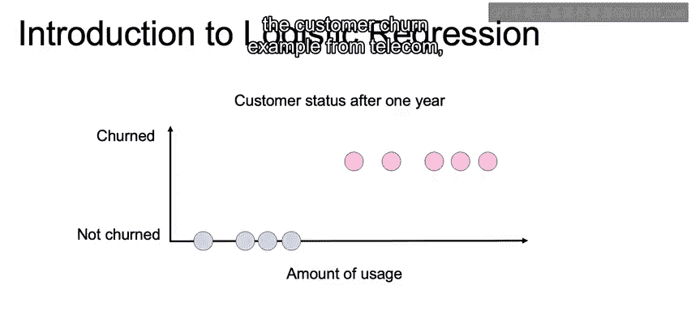

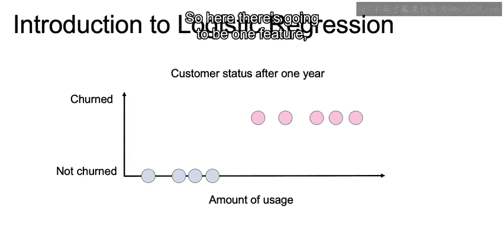

Later， we'll add another feature， data usage and another outcome canceled versus went to a competitor。

 but we'll save that for a bit later on。

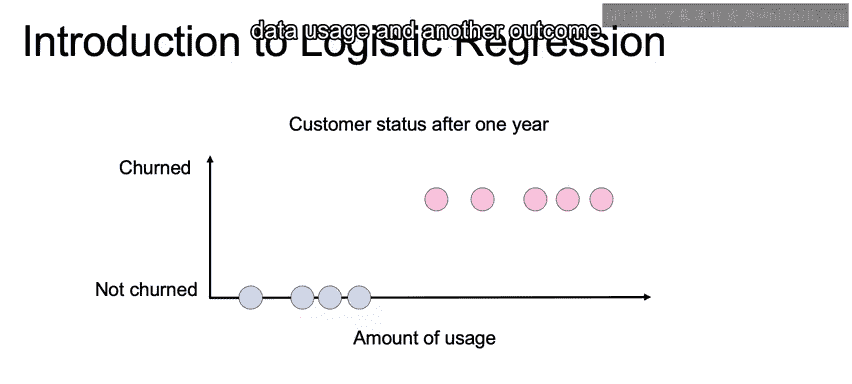

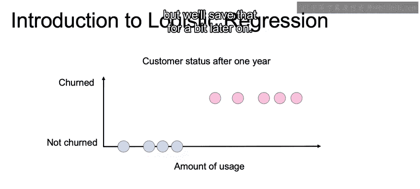

We can treat a binary classification problem as a actual regression problem as follows。

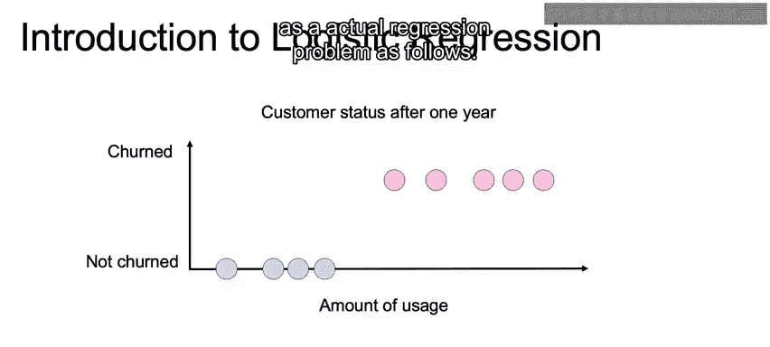

First we encode the classes one and zero， where one is going to be those top values， zero。

 those bottom values， and then we can fit a line that best fit， we can fit a regression algorithm。

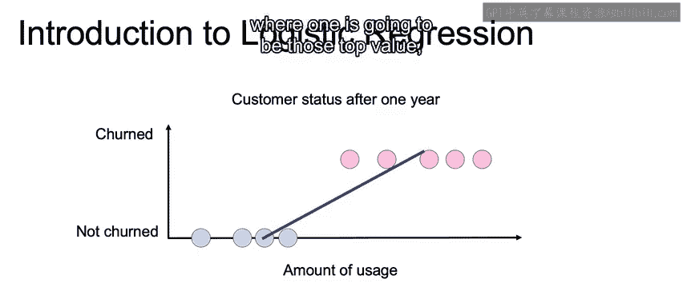

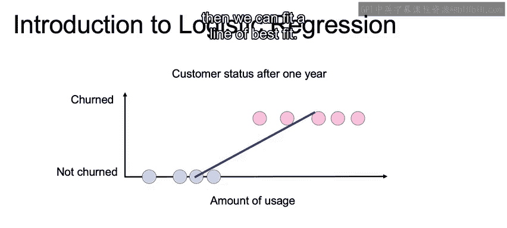

When a new unlabeled record comes in and we want to guess the value using the Russian algorithm。

 we pass in those values into our algorithm with our predicted coefficients。

 and if that value is greater than 0。5 then we predict one， that they did churn， if it's less than 0。

5 then we predict 0 that they did not churn。

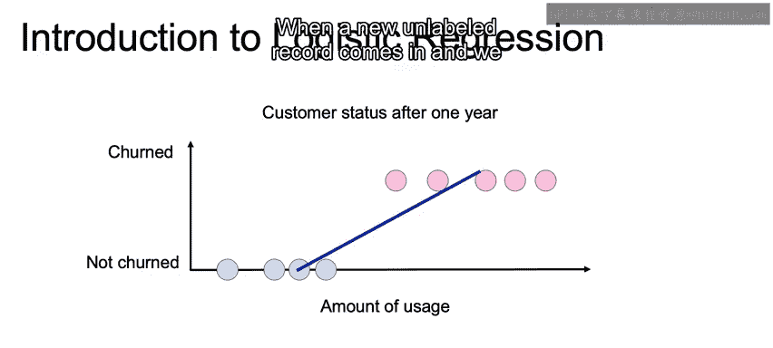

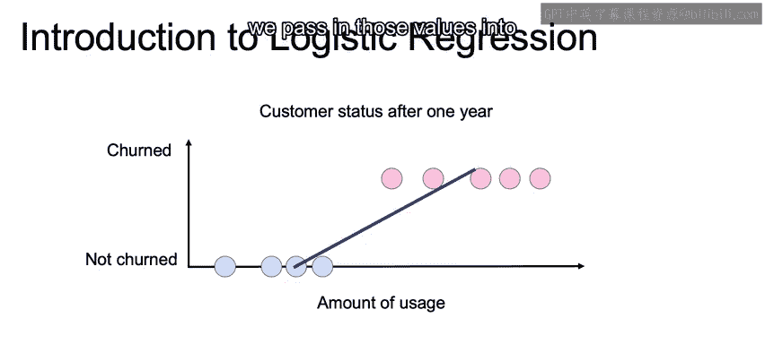

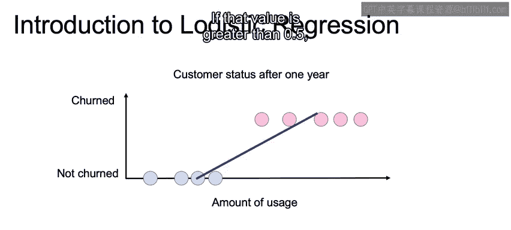

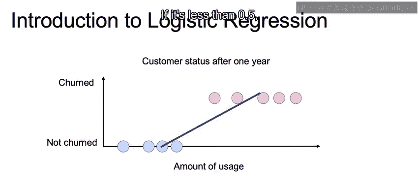

But what if our data looks like this， and when I say like this compared to before。

 notice that the OLS line is now heavily slanted much more so than before。

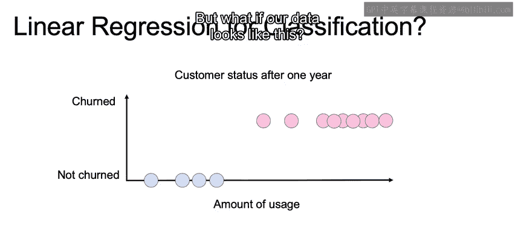

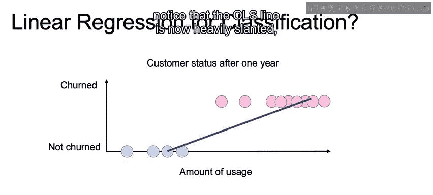

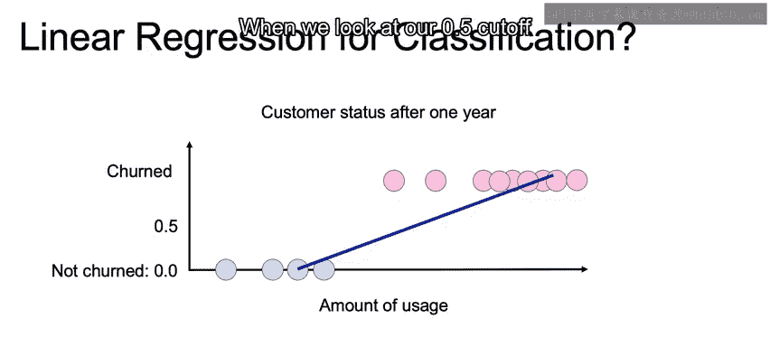

And when we look at our 0。5 cutoff and where it lands on that line。

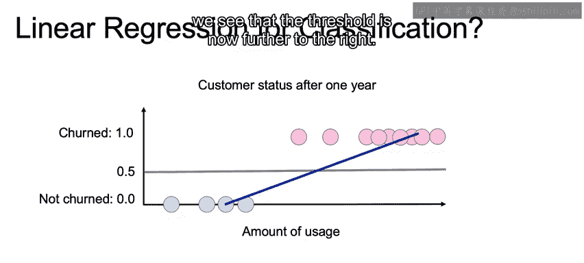

We see that the threshold is now further to the right。 Y equals 0。5 is further to the right。

 And we know that if our model is greater than 0。5， we predict churn。 If the model is less than 0。5。

 we predict that they did not churn。

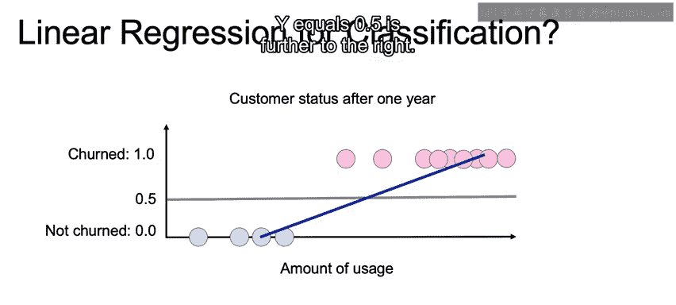

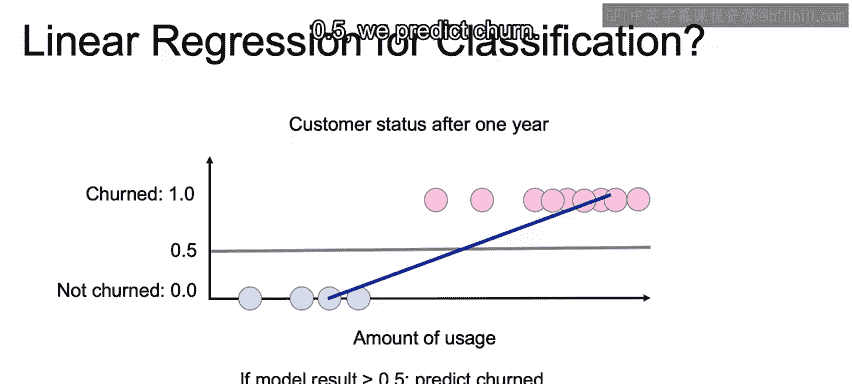

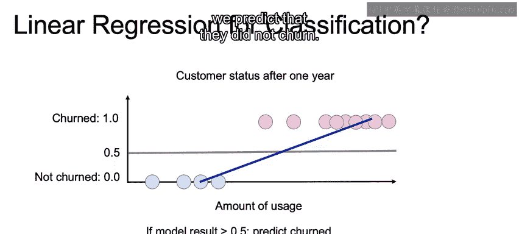

So we are predicting here because of the being skewed off to the right， false outcomes。

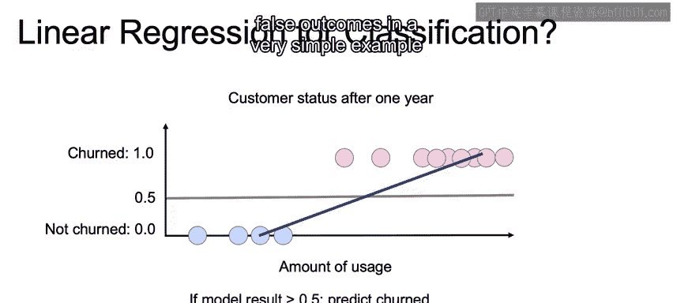

And a very simple example where the boundary between zero and1 is visually obvious。

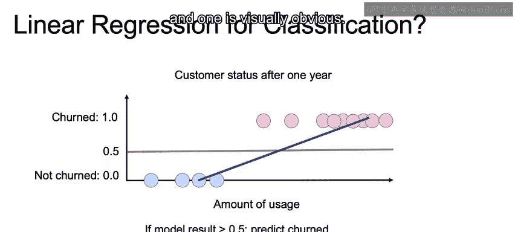

So as we see at the leftmost values on the top that were predicted as zero when they should have been one。

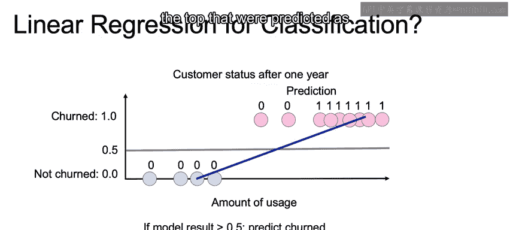

This is being skewed because of the regression algorithm trying to fit， given that 0。5 threshold。

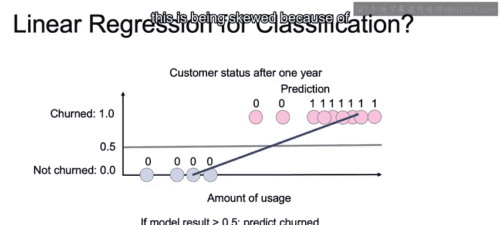

So we need a way to weight the samples that are far away much lower than the ones that are closer to our threshold in our objective function。

 and this is where the famous logistic function comes into play。

 which we'll discuss in our next video。

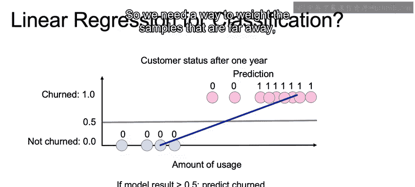

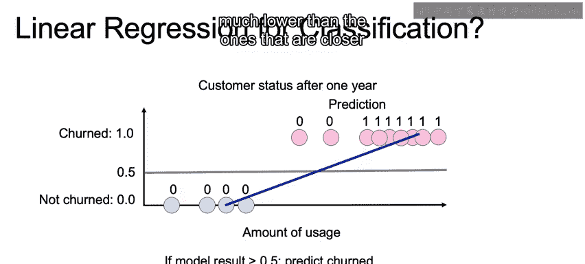

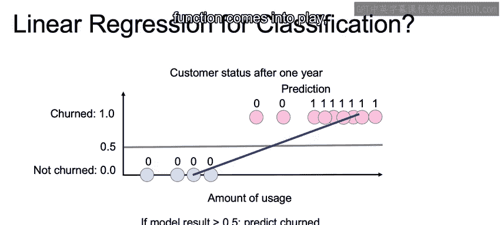

