# IBM《机器学习（数据探索、监督学习的回归和分类）｜machine learning》中英字幕 - P93：4_多类逻辑回归.zh_en - GPT中英字幕课程资源 - BV1xM4m1D7kY

And we can use this classifier or more generally any binary classification in a multi class classification scenario as well。

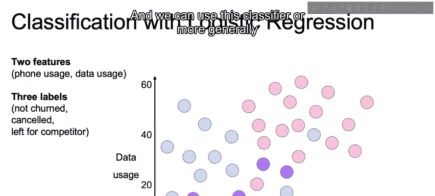

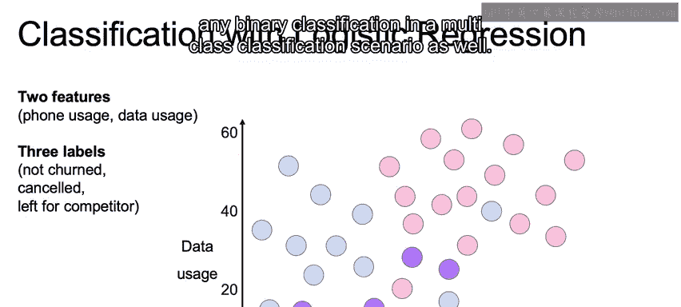

We see here that we now have a third grouping， so rather than churned and not churned。

 we are predicting between the labels not churned， canceled and left for a competitor。

 and one technique to accomplish this multiclass classification is a method called one versus all。

 so how does this work？

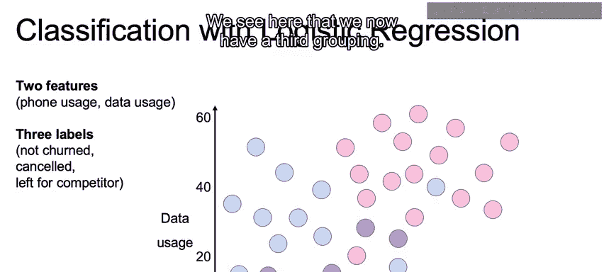

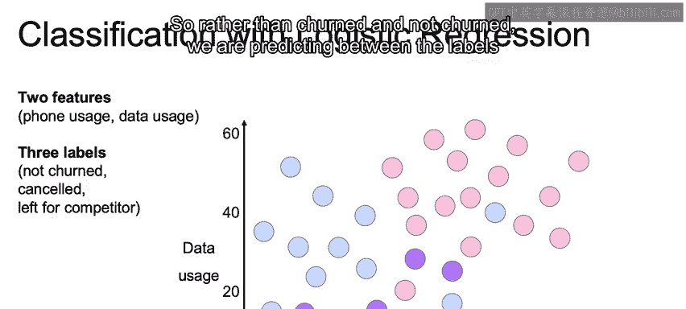

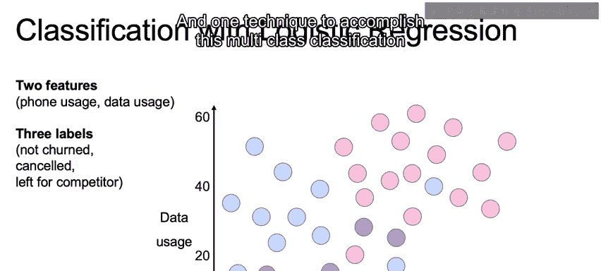

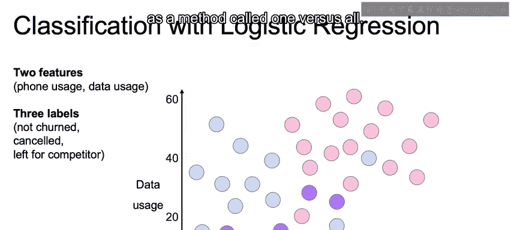

With one versus all， we you take one class， say not churned and that's going to be our blue dots here。

 and declare that all else is going to be our other class here the other is going to be the churned class as well as the canceled class and we can fit a logistic regression。

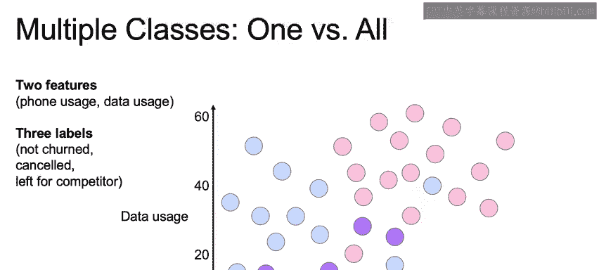

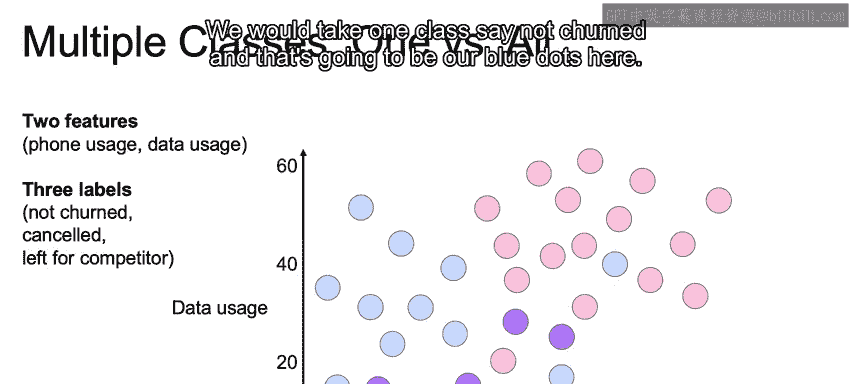

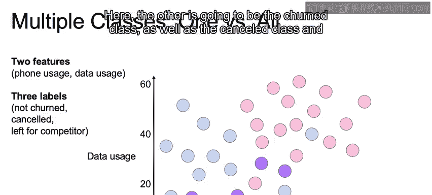

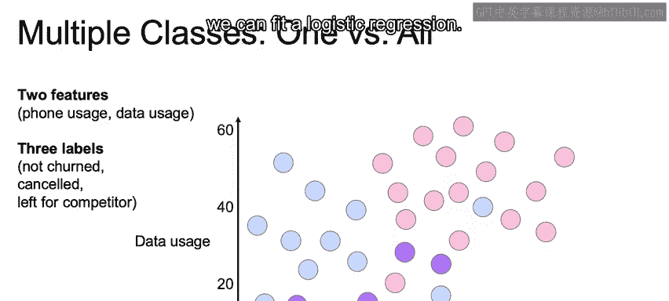

We then have our logistic regression that we see here on the left that's going to define that decision boundary between most likely to have churned versus all other。

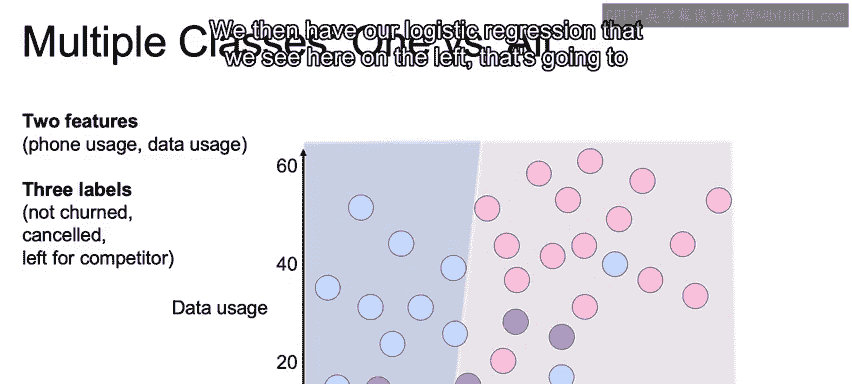

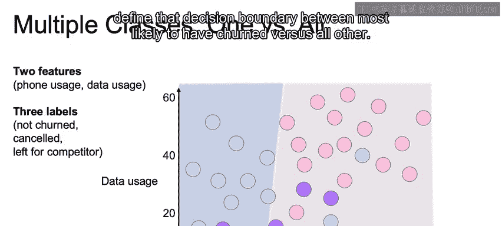

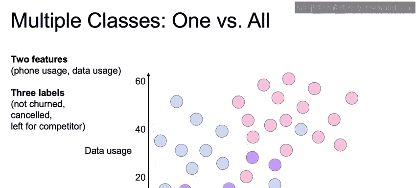

We then do it again for all our other classes， with each class we're going to be estimating the binary logistic regression versus all other classes。

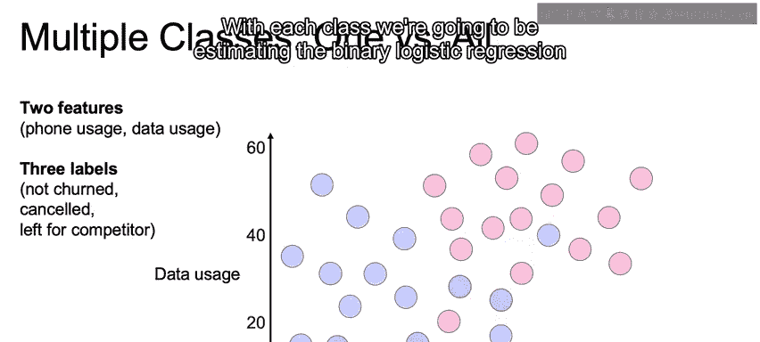

So we see here， let's say that's canceled versus not canceled。

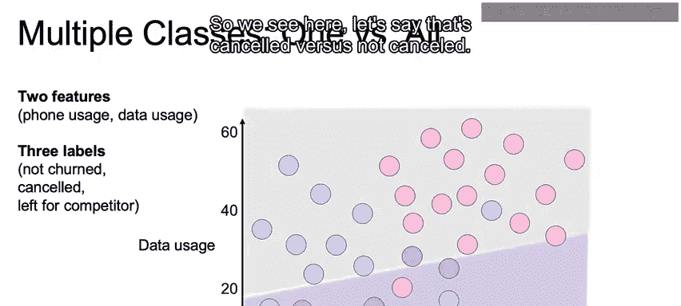

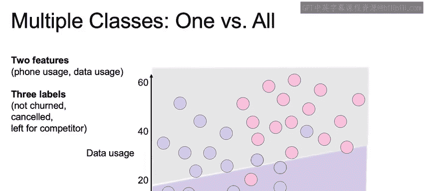

And then the same we're going to do that was for the purple labels。

 we can do the same for our red labels， so the red labels being at the end left for competitor versus all else。

 so we have each one of our three different classes where we found the logistic regression of one versus the rest。

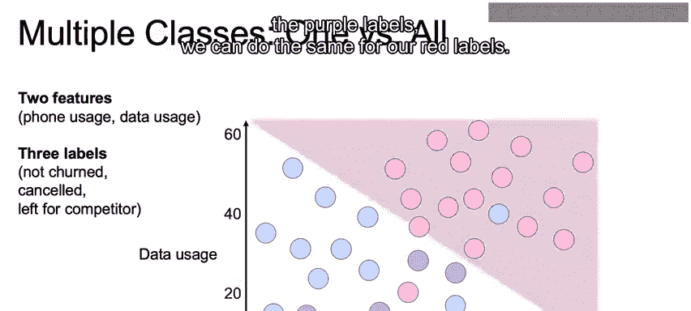

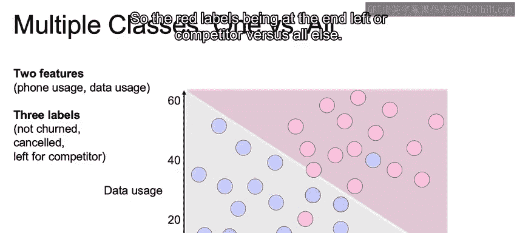

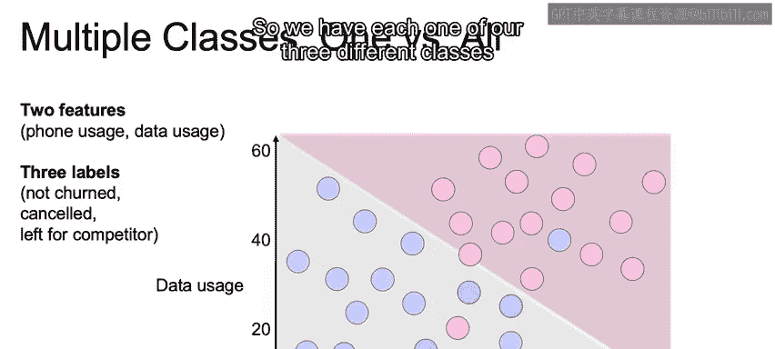

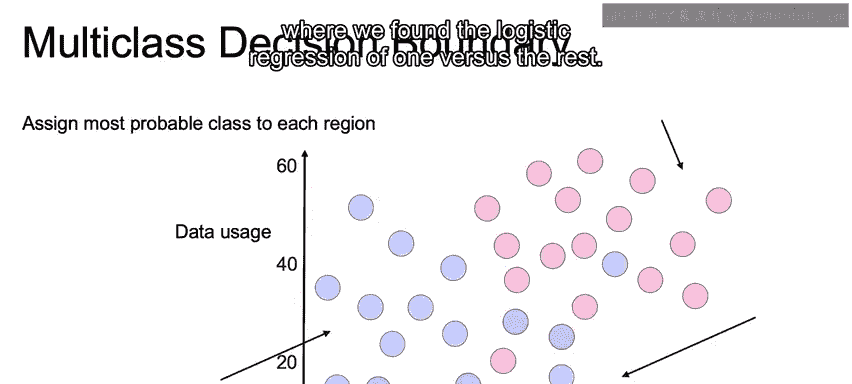

And we end up with three logistic regression models， splitting out three probabilities。

 one for each class。

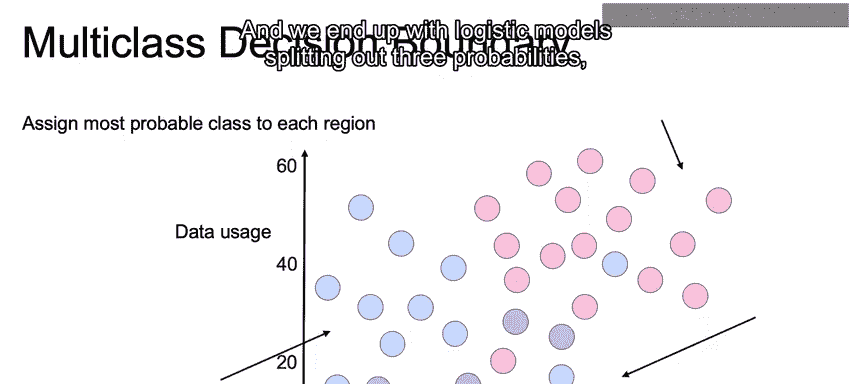

And the estimated category is going to be the class with the highest estimated probability for each one of those one versus all。

 and we end up with these three separate decision boundaries。

 given the highest given probability for each one of our separate three logistic regression problems。

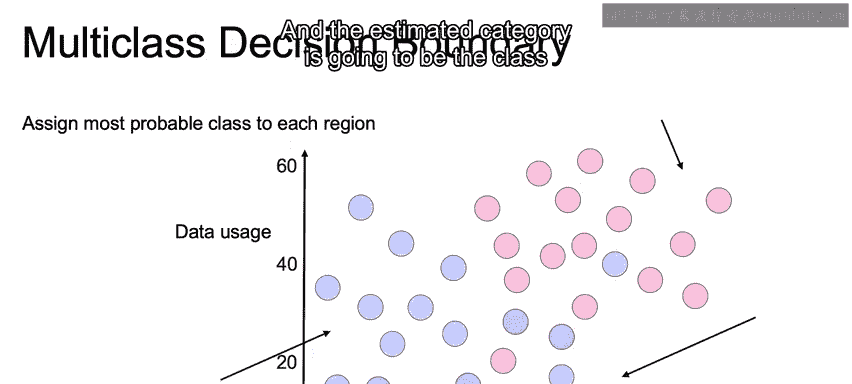

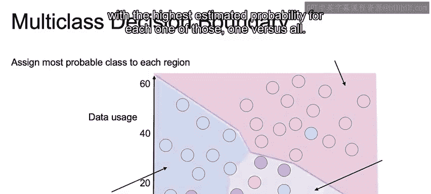

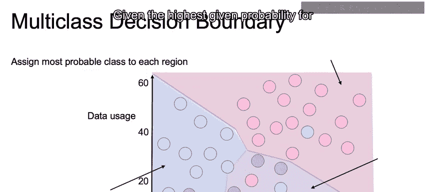

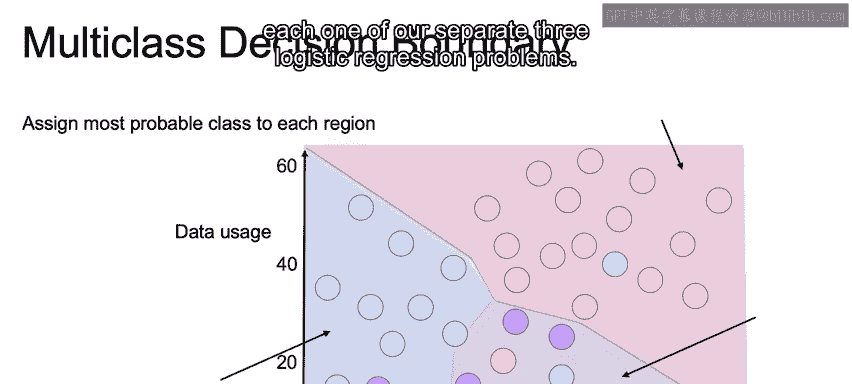

So there we see left for a competitor in the blue， not churned is going to be our pink here。

 and then churned is going to be our purple values that we have here on the right。

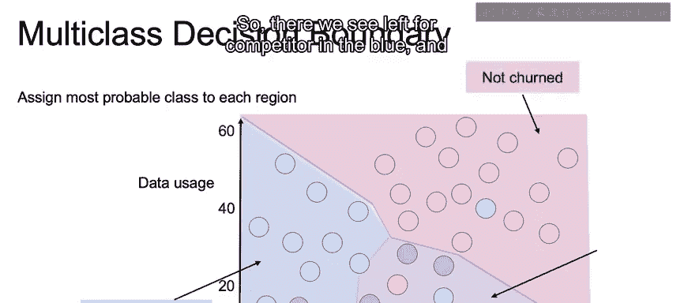

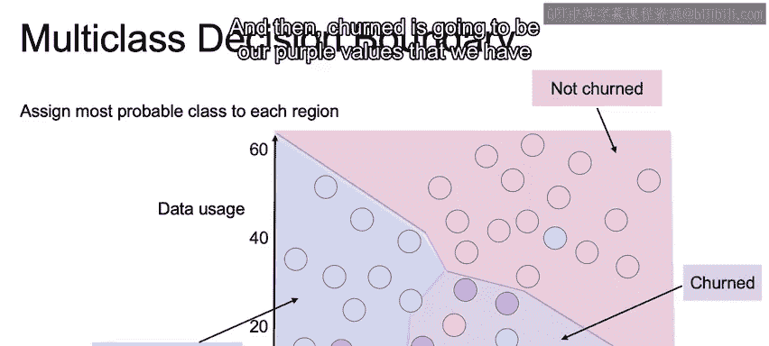