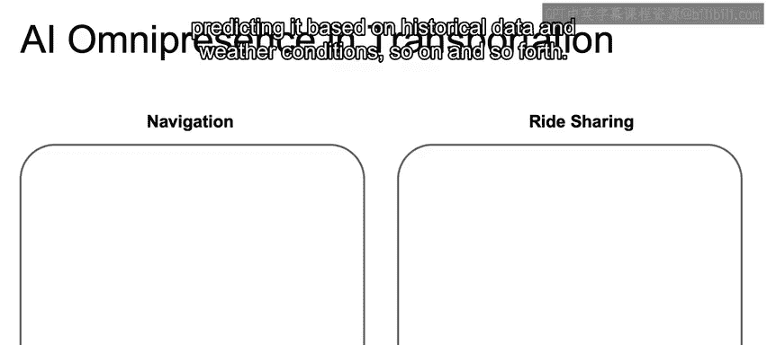
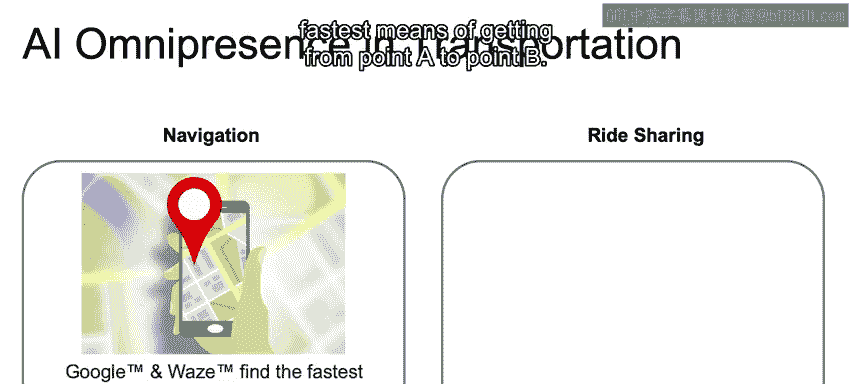
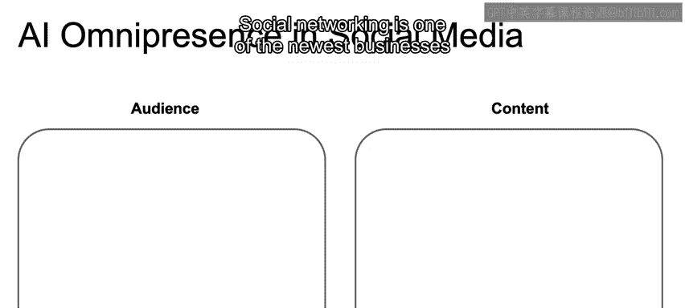
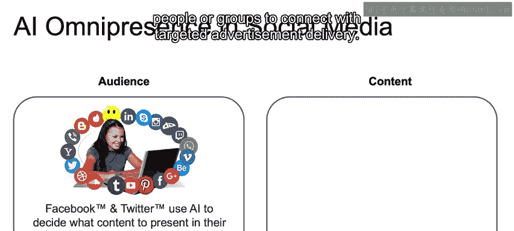
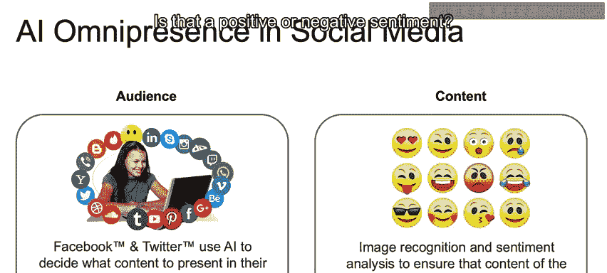
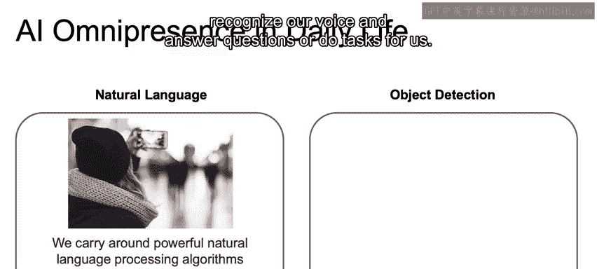
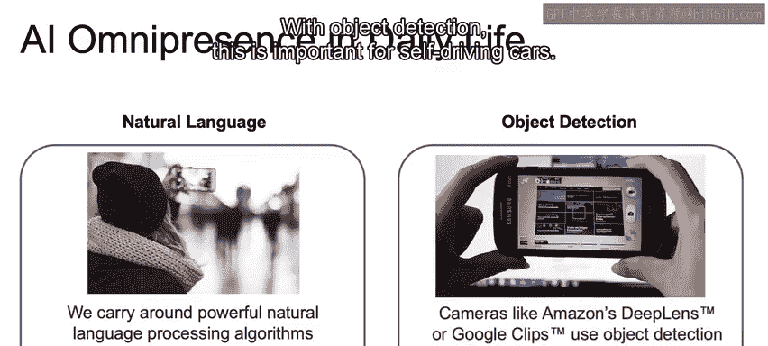
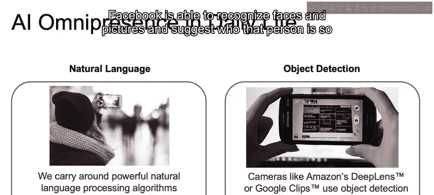
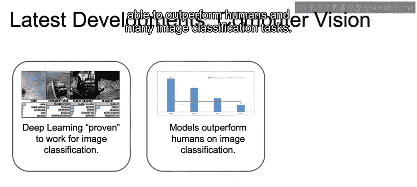
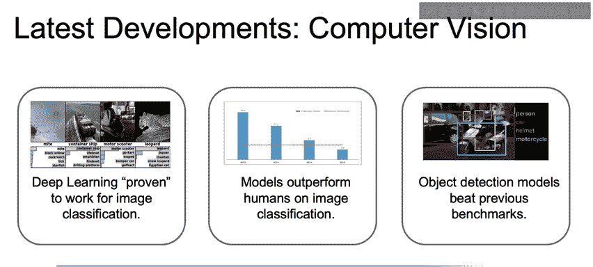

# IBM《机器学习（数据探索、监督学习的回归和分类）｜machine learning》中英字幕 - P9：8_应用.zh_en - GPT中英字幕课程资源 - BV1xM4m1D7kY

Now， let's briefly highlight the agreed to which artificial intelligence is already present in our day to day lives。

Let's think about artificial intelligence in regards to our personal transportation。

So figuring out the shortest distance between two points is a classic problem since before the introduction of artificial intelligence。

And today we also add the complexity of knowing traffic information or predicting it based on historical data and weather conditions。

 so on and so forth。

Google and wayss have been able to incorporate all these factors to constantly improve their algorithm for fastest means of getting from point A to point B。

For ride sharinging， Uber and Lyft is able to price their rides according to supply and demand instead of a flat rate。

 and the supply and demand can be updated in real time using artificial intelligence techniques。

We see artificial intelligence in the booming social media industry。

Social networking is one of the newest businesses that is exploring artificial intelligence。

Artificial intelligence can now identify content relevant to an individual recommendations for people or groups to connect with targeted advertisement delivery。

We also see。Image recognition and sentiment analysis to ensure that the content is appropriate mood。

That we want to be served。 Artificial intelligence has been successful at identifying the sentiment of content。

 such as。The review of a restaurant is that a positive or negative sentiment。

We have in our daily life。If we think about natural language processing。

 today we have products like Siri on our phones or Alexa and our homes that can recognize our voice and answer questions or do tasks for us。

With object detection， this is important for self driving cars。

 Facebook is able to recognize faces and pictures and suggest who that person is so photos can be easily shared with friends。

😊。

And with computer vision， and we talked about this pretty thoroughly throughout。

 we saw how deep learning has proven to work for image classification。

 able to outperform humans and many image classification tasks。

And today we see it doing live detection， which is going to be very important as we try to roll out self driving cars。

And moving into the future， how we can use this for things such as。

Abandoned baggage detection we can automatically detect when baggage has been left unattended。

 and the can potentially save lives。And this system's going to rely on cutting edge object detection ran in real time。

 so we see how this is able to actually be applied in real time using artificial intelligence。

Now that closes our discussion of the history of artificial intelligence leading to how AI is being leveraged in the modern day。

In the next video， we will introduce common machine learning workflow as well as vocabulary to prepare you for the next course。

