# IBM《生成式AI用于人力资源｜Generative AI for Human Resources (HR) Professionals》中英字幕 - P12：11_音视频生成工具.zh_en - GPT中英字幕课程资源 - BV1Ese3zvEf4

Welcome to tools for audio and video generation。 After watching this video。

 you'll be able to describe how generative AI audio and video tools create impactful media content。

 Explain the key capabilities of generative AI audio and video tools。

 Exp generative AI's ability to reimagine virtual worlds。

 Market US estimates that the generative AI music market valued at 229 million in 2022 will register a high CAGR of 28。

6% to reach 2660 million by 2032。 generative AI music is created using generative AI audio capabilities。

 Over the past few years。 These capabilities are helping companies and individuals Novice or experienced。

 simplify their processes to bring their complicated visions to life。 Think about this。

 Suppose you've been putting off starting your podcast or adding some sound effects to your remixes。

 In that case， you'll love with generative AI audio。😊。

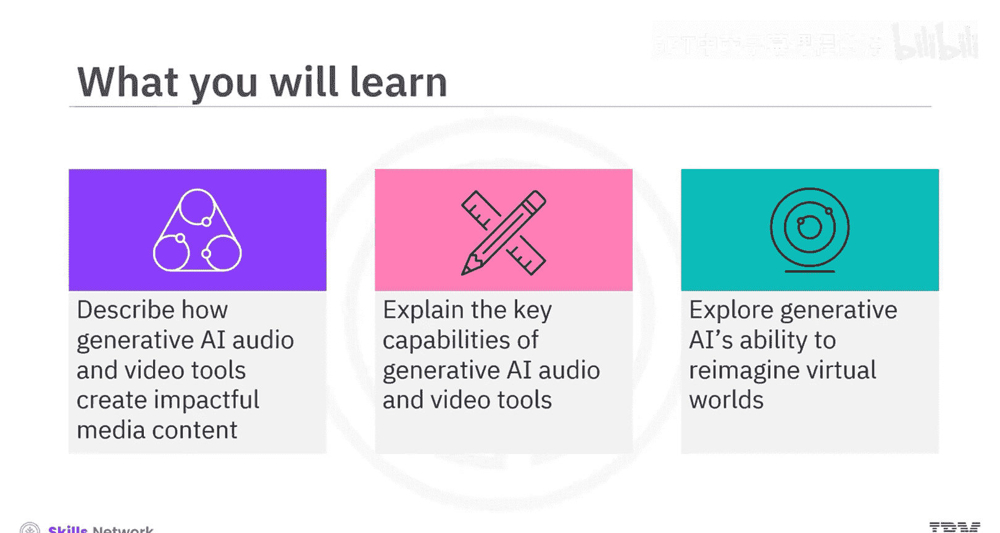

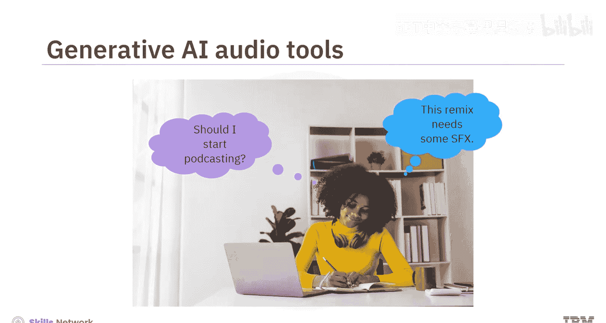

Tools can do for you。 They come in three categories， speech generation tools。

 music creation tools and tools that enhance audio quality。

 Sp generation tools are mostly text to speech or TtS tools that convert text into audio while read aloud technology is not new。

 generative AI architecture has upgraded how this technology works。

 Deep learning algorithms are repeatedly trained on vast data sets of human speech。

 This allows them to break down and efficiently replicate vocal characteristics such as pronunciation。

 speed， emotion and intonation。 As a result， generative AI TtS tools create more accurate natural sounding speech。

 which is especially helpful to those who struggle with visual impairment。

 language barriers and other reading disabilities。 On the fun side。

 these tools can help you listen to essays， feedback and notes。

 which might be easier than reading them。 They can also help you communicate better。

 What if you wish to narrate your presentation in a standout manner。 You could log into L OvoO。😊。

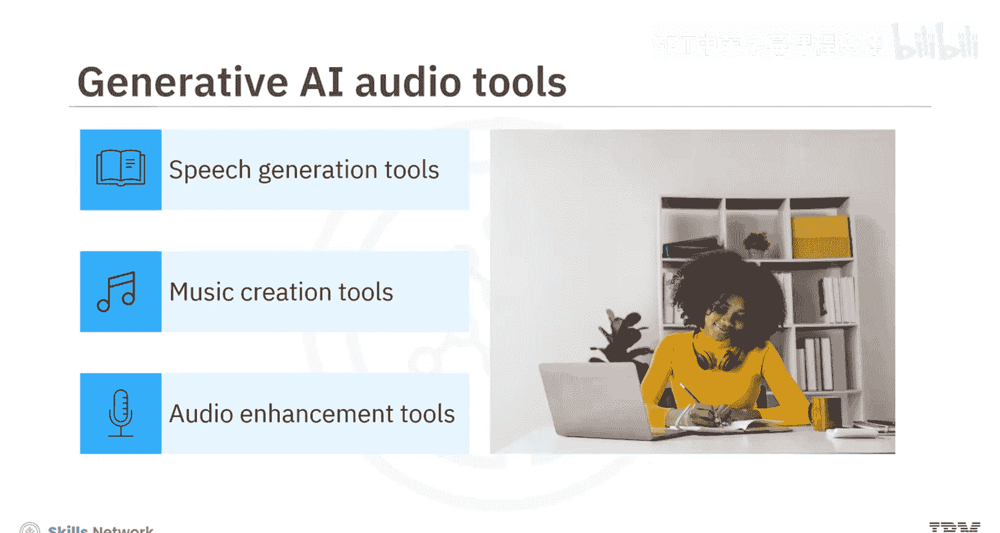

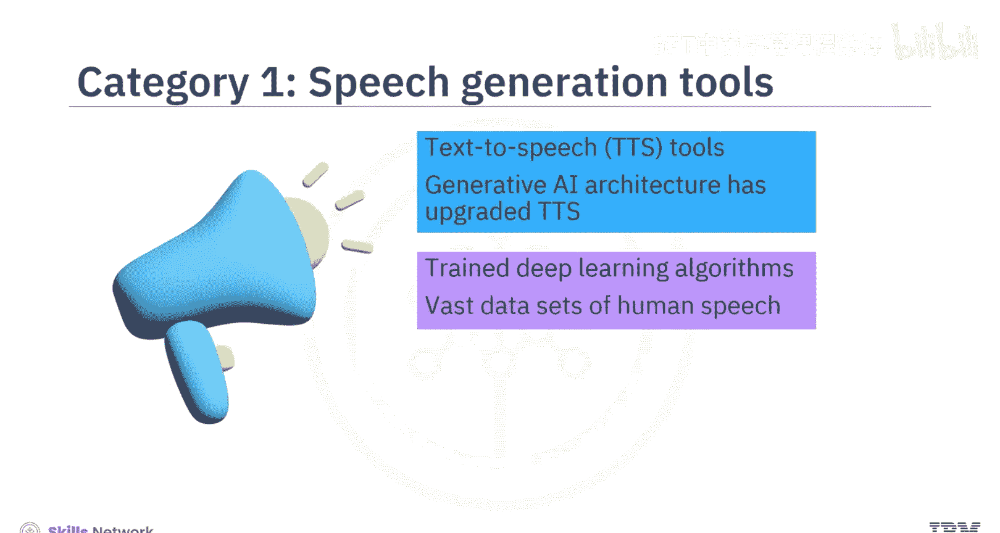

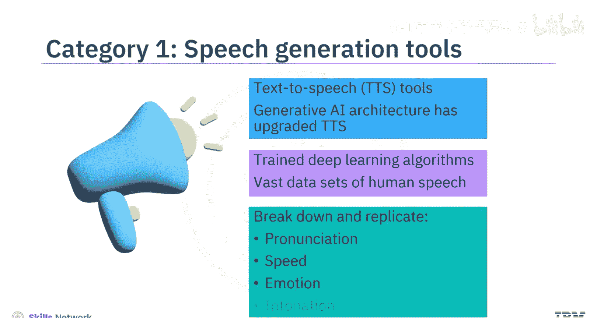

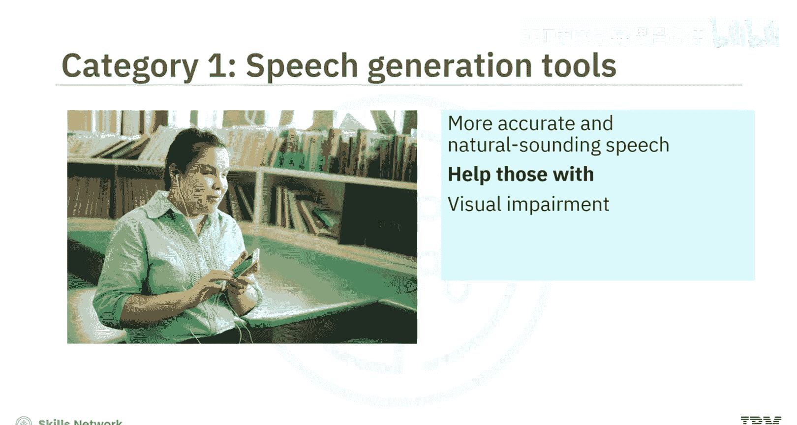

Cynthsia， Merrf。aiI， or listener and choose from vast libraries of AI voices， languages or emotions。

 you could even create a unique voice or clone your voice。

Some tools will also let you edit your vocal tracks， pronunciation。

 tone and speed to create a professionally sounding final product。 What about music。

 Let's say one sunny afternoon， the amateur musician in you is feeling motivated。

 You could try metata's audio craft， the generative AI tool pre traineded on sound effects and 20000 hours of metata owned or licensed music。

😊。

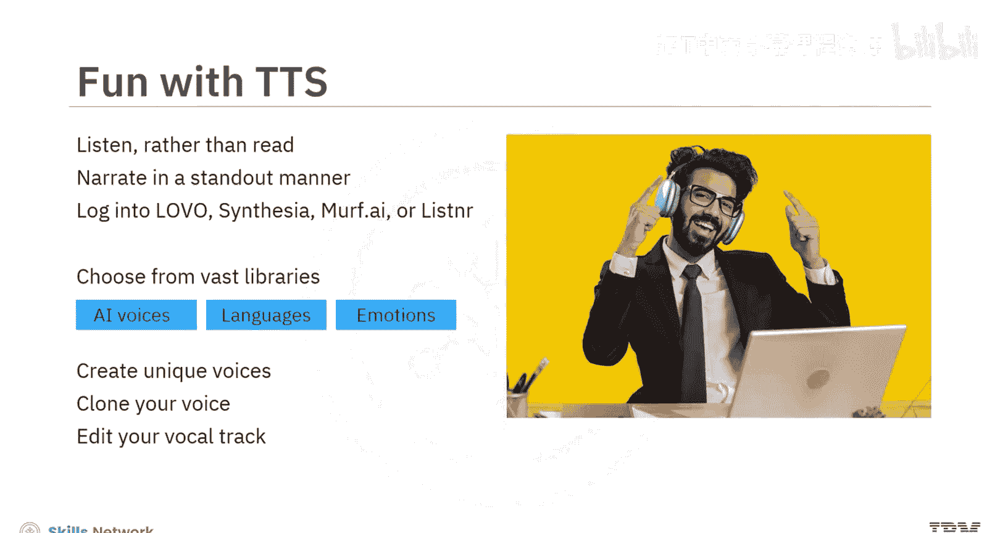

There's also shutterstocks， amper music， AI V soundful。

 Google's magenta and the G 4 powered wave tool。 These tools let you choose from extensive music banks's different music genres。

 instrumental styles and melodies All you need to do is enter a text prompt based on your request。

 the tool write short melodies or rifffts suggest or add instruments compose a new song or create a soundtrack for your next YouTube where Instagram video。

 generative AI can also help you mix， master and publish your final musical output on popular streaming platforms。

 You can even use audio enhancing tools。 These are pretrain to identify specific sounds and can add fun sounds to your audio or remove unwanted ones。

 For example， Descript can help you remove background noise。

 enhance low quality recordings and add the desired sound effects。

 Auto AI cleans your files of unwanted noise。 Many music generation tools also possess audio editing and enhancement capabilities。

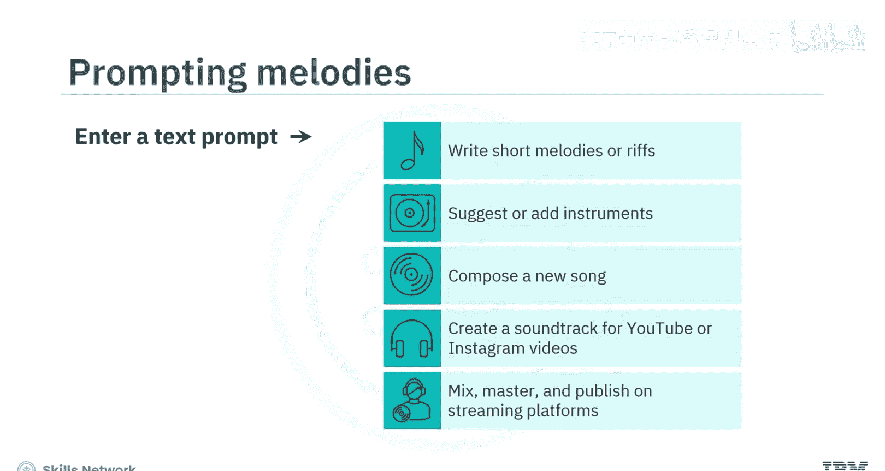

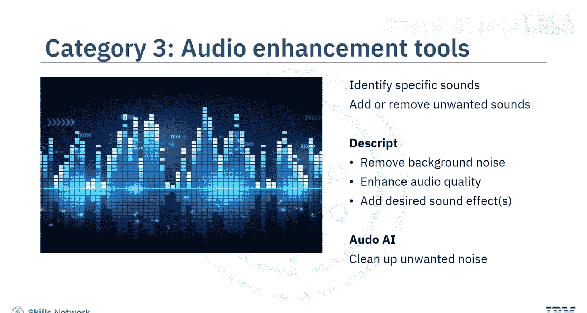

， some projects need more than eclectic sound effects in 2022。

 runway AI used generative AI capabilities to produce the Oscar winning movie everything everywhere all at once。

 Even if you're not making big cinema。 you can use generative AI video tools in your everyday life。

 Let's say you're making a documentary on the lack of trees in your city。

 You could log into runway's Gen1 tool， which transforms existing video clips into different styles or use runway's Gen2 tool to create a video using text image or video inputs。

Alternatively， you can use the E US video toolkit or the synthesia app。

 These tools will allow you to upload photos。 If you don't have any used text prompts to generate the images you need。

 Additionally， you can use these tools to record an aration， enhance your audio。

 convert your video file format and publish your video。 Synthesia。

 even allows you to create custom avatars to increase your brand recall。

 generative AI can enhance your virtual world。

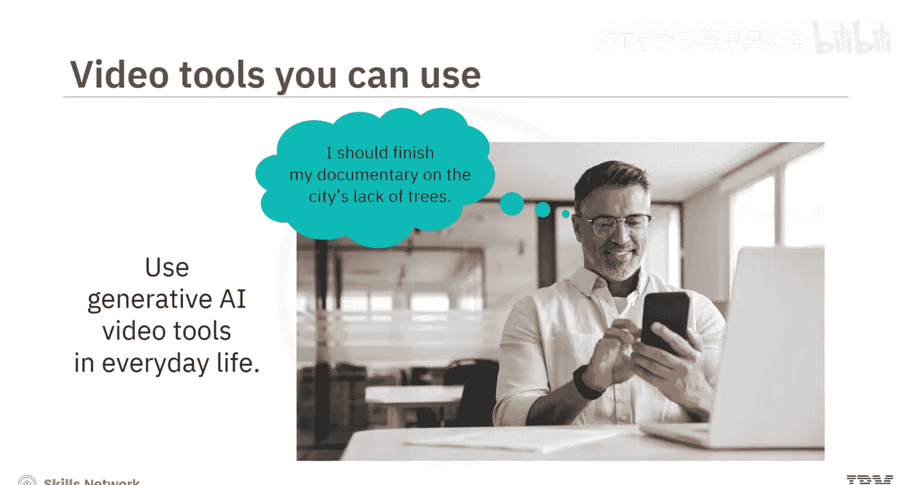

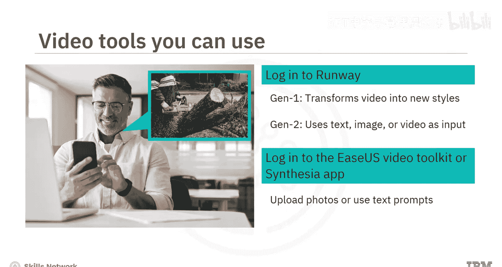

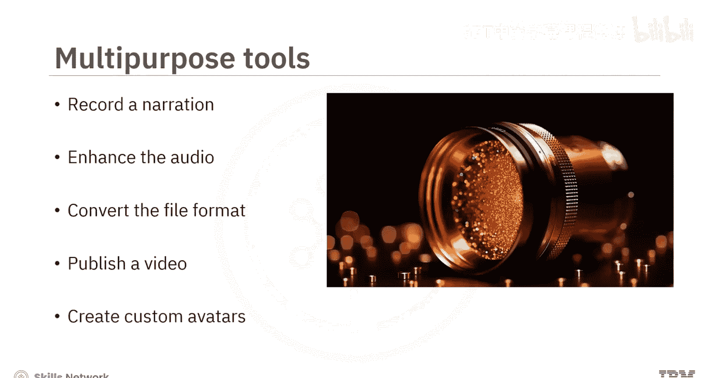

ExYou can create unique imaginative virtual worlds with hybrid characteristics and exotic landscapes。

 generative models can also respond in real time， improving the accuracy of simulations。

 Metaverse platforms employ generative AI to create a more personalized and engaging user experience。

 Gaing metaverses allow you to rapidly generate 3D objects and even create avatars fitted with specific personality traits that reflect in their expressions。

 behaviors， Con and decisions。 The sandbox， for example。

 is a metaverse where users can instantly build， own and market their games globally。

 scenario AI helps create and connect customized mobile gaming assets。 In this video。

 you learned how generative AI audio and video tools can make an impact。 with a simple text prompt。

 You can produce human sounding speech in multiple languages。

 Record songs add sound effects or remove unwanted noise。 P。😊。

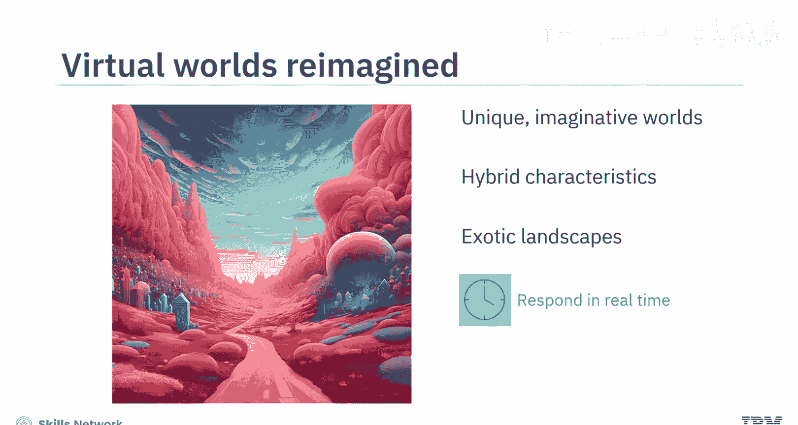

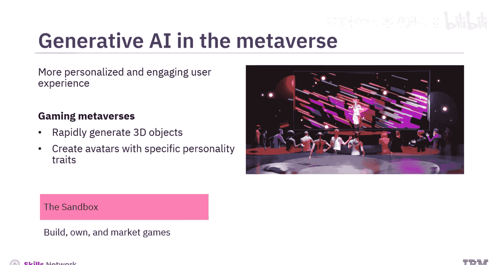

Videos and animations build enhanced and exotic virtual worlds。

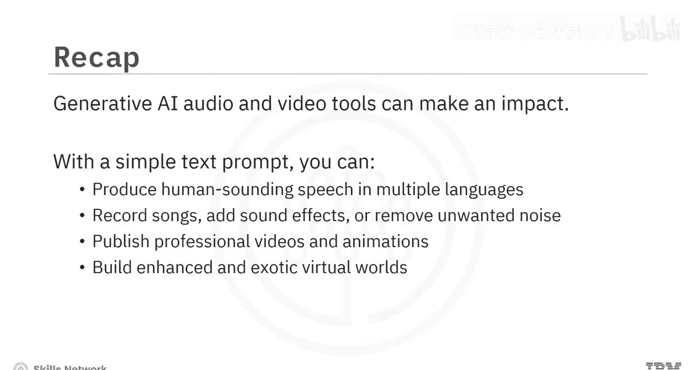