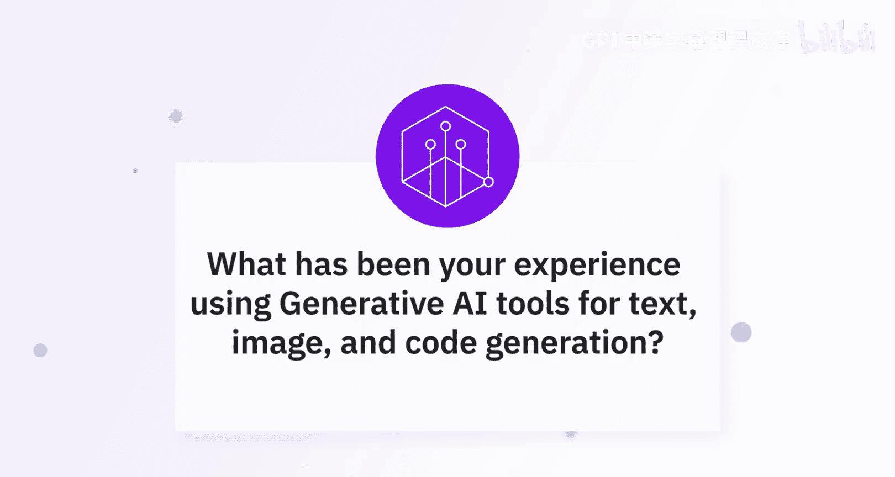
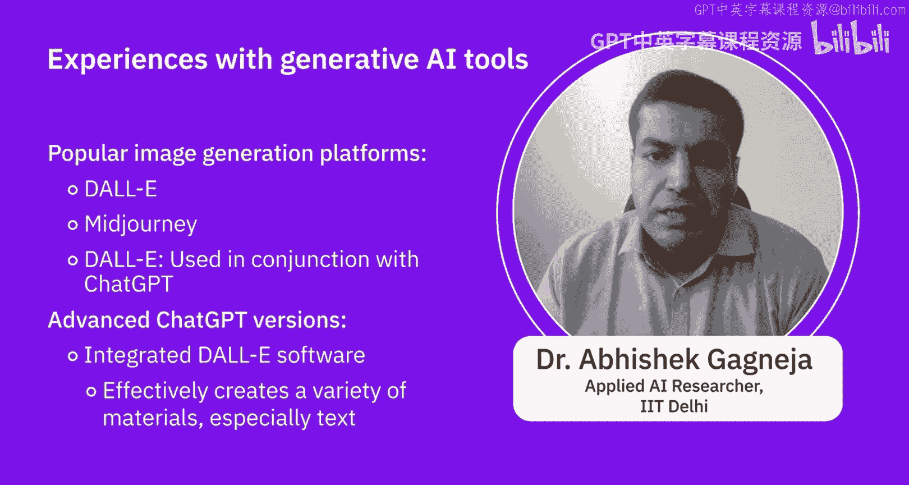
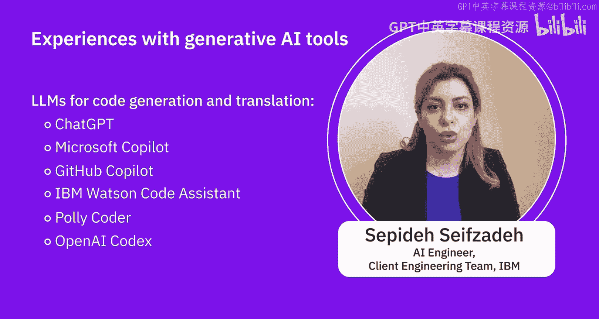
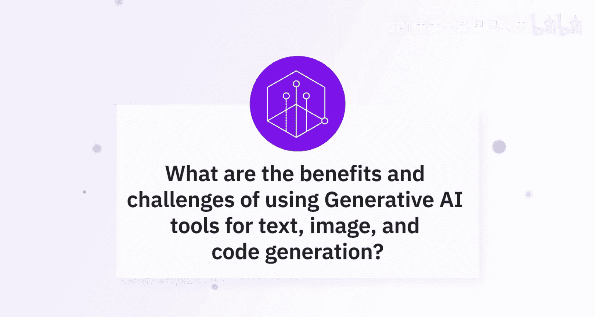

# IBM《生成式AI用于人力资源｜Generative AI for Human Resources (HR) Professionals》中英字幕 - P14：13_专家观点：生成式AI工具的有效运用.zh_en - GPT中英字幕课程资源 - BV1Ese3zvEf4

Hello and welcome to this expert viewpoints video。😊，First。

 let's listen to AI professionals share their personal experiences with generative AI tools for creating text。

 images， and code。

So I've actually been dabbling quite a bit in all of the different types of generative AI from text generation。

 code generation， image， video， music， 3D files， so on and so forth。

 and one thing which is quite clear to me， at least at this point in time。

 is that the text generation， the code generation is probably the best in terms of getting what you want。

On your first attempt， not only have these models been tweaked a little bit more it feels。

 but there's more out there in the world on how to you create your prompts and craft them in such a way to get a really good output back。

There is no one large language model that can tackle all different generative AI use cases。

 so for any given task there is a number of large language models that can be considered and used。

Either provided by open source community or some of the organizations that has the capacity to train the model and also there is a concept of fine tuning。

 so you can always consider using a large language model and fine tu towards your data or customer data without huge computation resource or needing a huge amount of data。

GPT3 based charge GPT models， Google bard are very popular text generation platforms they're also capable of code generation。

 however Github Copit is a little bit better in terms of code generation。

So some of the examples that were also mentioned for text generation。

 usually chat GT or bard are used， also cop that AI Jasper phrase IO and MScopi。

 for visual aspects we have three categories， image generation video generation and design generation for image generation and Dolly is one of the most popular one。

 stable diffusions and from the platform perspective， mid journey is one of the most popular ones。

In terms of image generation， the popular ones are the tally and。Mid journey， etctera。

 but specifically Dli can be used in conjunction with charge GT。

 I think the advanced versions of chargeGT are coming with integrated daies。

And these are popular choices， these are good enough for creating any kind of material that you require。

 specifically test text。

Chat GPT was one of the common ones， again， Microsoft Copit， GitHub Copilot， IBM Vtson called Asant。

 Po codeder， open AI codeX are some of the large language models that are specifically used for this particular use case。

Next， let's explore a few benefits and challenges associated with using generative AI tools。

The benefits are there because they can help you create a good baseline which can be used to develop your content of course you can't really just rely on those technologies because you know all of that content that is created has limitations。

When you go to the more niche areas like especially music or 3D files。

 3D models those are generally a little bit harder to get what you want。

 they take a lot longer to actually generate your results and it just needs a little bit more trial and error at least at this point in time I definitely foresee things getting easier better and also importantly more multimodal where you have a single interface that can do all of the different types and kind of joins it to one in a seamless experience but for now I would just say try everything you can even if you're not interested in it because in the future it might end up being quite useful。

😊。

。

