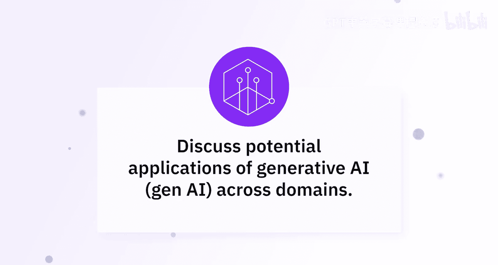
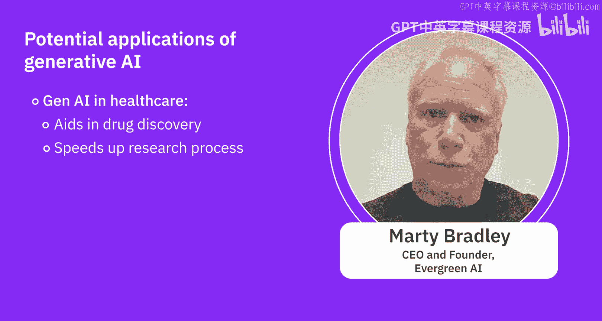
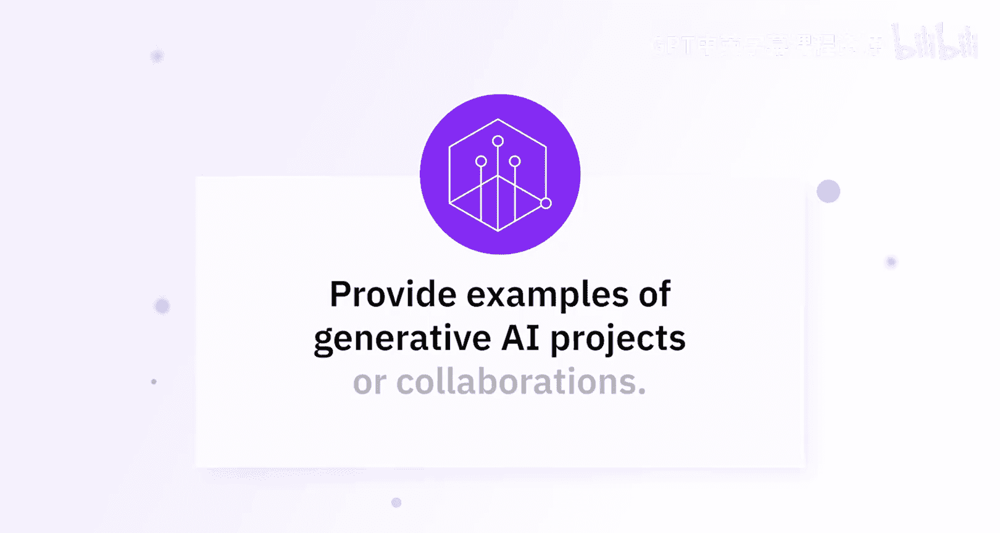
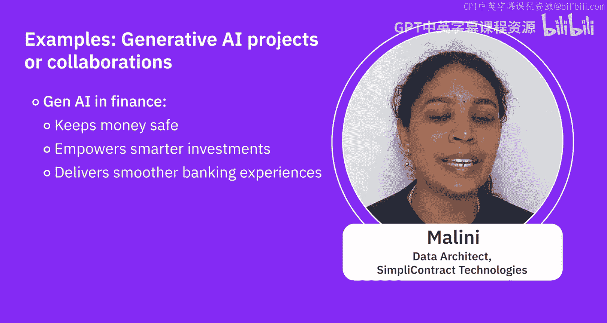

# IBM《生成式AI用于人力资源｜Generative AI for Human Resources (HR) Professionals》中英字幕 - P15：14_专家观点：跨领域生成式AI应用探索.zh_en - GPT中英字幕课程资源 - BV1Ese3zvEf4

Hello and welcome to this expertert Viewpoints video。

 Let's hear from experts as they discuss the potential applications of generative AI across domains。

😊。

Generative AI has potential applications in pretty much every single industry。

 but I focus on education， so let's do a little deep dive into that so we've actually at Skill Network have already started implementing generative AI in a few different places。

And not only do we have a tool now that marks assignments and quizzes。

 but it can actually give feedback when the learner gets something wrong。

 and this pretty much comes for free with generative AI， we just simply have a prompt that says。

 grade this with the following rubric， and if there's anything wrong。

 give us a paragraph of text to help the learner learn from their mistakes。

Let's talk about generative AI and how it's changing the world of finance。 First off。

 it's like a deactor， spotting any sneaky business in transactions to prevent fraud then it helps traders makes more choices by analyzing loads of data about how the market works plus it powers those friendly chatbos you see online helping customers with questions and transactions。

Some of the applications of generative AI， as described in the course are including followings but not limited to IT and DevOs。

 healthcare and medical， industry finance and HR marketing and entertainment。

 specifically if we want to talk about healthcare and medical industry。

 there are so many advancements that is provided by generative AI， such as medical image generation。

 so by creating synthetic image data， it empowers us to build and train and validate stronger machine learning models for using medical images。

 it can also help us with drug discovery。In pharmaceutical industry。

 there is a popular aspect of use of geneative AI in terms of generating personalized medicine care。

 so generative AI is being used to create amino acid patterns and protein patterns and genome patterns。

 particularly harvesting such information create personalized medicine care for the relative symptoms。

 so the idea is that the whole。Concept of creating better and unknown patterns from the data and from the information available has been made a little bit more easier with Geneative VI。

Generative AI has transformative potential in health domain。

 but aids in drug discovery by generating molecular structures with desired properties。

 significantly speeding up the research process。

Next， can you provide examples of notable generative AI projects or collaborations？

Two successful an example of projects in the field， one of them is Deepmind。

 which enables us to predict a 3D structure of protein using their amino acid sequences and the other one using the AI empowered image analysis could help to detect the breast cancer more efficiently and help the diagnostic process by using GNs to generate synthetic data and we use those generated images to build more stronger convolution neural networks which help us to more accurately detect breast cancer。

And help our patients。In silio Mediine used generative AI to identify new drug candidates。

 accelerating the initial discovery phase Additionally。

 it assists in medical imaging by enhancing image resolution and detecting anomalies。

 which improves the diagnostic accuracy， notable projects include Navidia's collaboration with King's College in London。

 where AI models were used to create synthetic brain MRI scans for training radiologists without privacy concerns。

Notably we have a personal tutor called TI， it's our personal teaching assistant who helps you answer pretty much whatever you want to know you get stuck in a lab。

 don't know how to continue， get an error message simply take that error message。

 give it to our generative AI assistant named TI and they'll help you solve the problem whether it's giving you a bug in your code。

 giving you ideas on how to fix it so on and so forth。

 this makes it much more of a twoway street where you can ask questions and get help without having to go to a message board and wait days or weeks to get answers。

Moreover， by having this personal tutor helping you all along the way。

 you're able to get reviews and to mark the stuff that you do and this is actually quite useful for us because we have some courses that have thousands。

 tens of thousands or even more learners subscribe and it's just impossible for us with you know a limited number of instructors and TAs to be marking so many assignments so generative AI really helps fill that gap。

Big names like JP Morgan and Goldman Sachs are already using this generative AI。

 JP Morgan's coin uses to understand legal documents in the flash， saving time and money。

 Goldman Sachs uses it to predict market movements are their traders and edge。

 So generative AI is transforming finance and this is just the beginning。 get ready for the future。

 where your money is safer your investments are smarter and your banking experiences smoother than ever before。

。

