# IBM《生成式AI用于人力资源｜Generative AI for Human Resources (HR) Professionals》中英字幕 - P1：0_课程介绍.zh_en - GPT中英字幕课程资源 - BV1Ese3zvEf4

Let's get started with an introduction to generative AI。

 Imagine a world in which AI is going to make us work more productively。

 live longer and have cleaner energy。

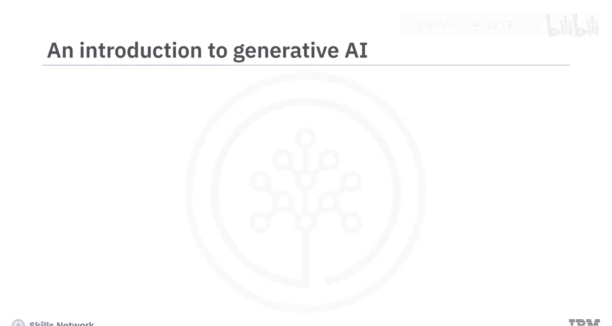

Well， that world is already here。 generative AI has made a big impact on the way we go through life。

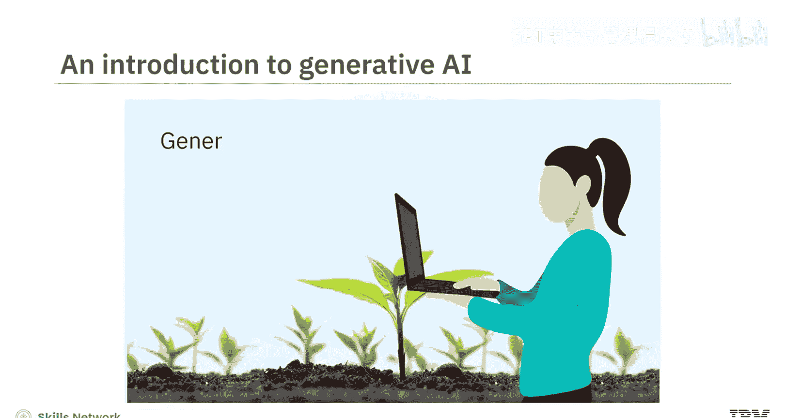

Generative AI models can mimic human thinking and creativity to create novel content and perform complex tasks。

 just like you and me。

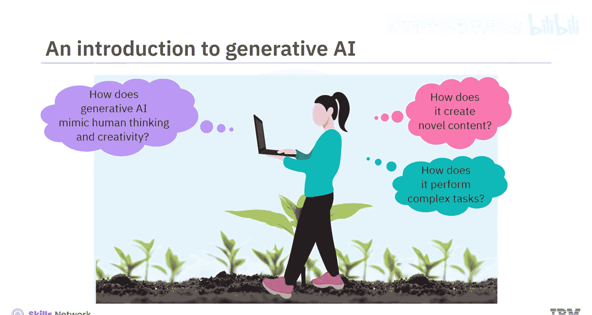

Organizations can leverage generative AI to become more productive and profitable。

 Individuals can use generative AI tools to increase their efficiency。

 Add tangible value to their work。 Save money and maximize their brand value。

 If you're not there yet， this course is for you。 Inviting all professionals， enthusiasts。

 Ps and students with a genuine interest in the rapidly developing field of generative AI。

Regardless of your background or experience。 This is a course for everyone。

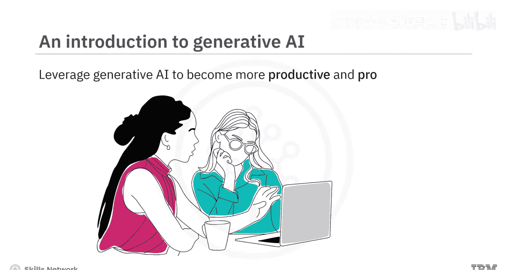

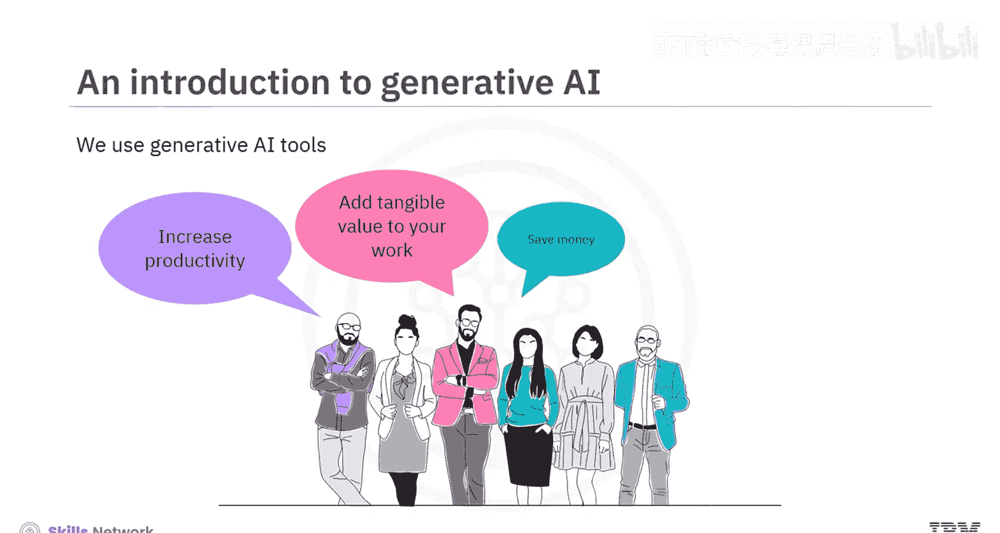

This course is designed to give you a solid understanding of the capabilities。

 applications and common models and tools of generative AI。 By the end of this course。

 you'll be able to describe the capabilities of generative AI and its use cases in the real world。

 identify the applications of generative AI in different sectors and industries and explore common generative AI models and tools。

 As this is a focused course comprising three modules。

 You're expected to spend one to two hours to complete each module。 In module 1 of the course。

 you'll learn about the core concepts of generative AI view use cases of how it is applied across different domains and understand its capabilities for gene text。

 I， code， audio and video In module 2， you'll discover how different sectors and industries such as information technology。

 entertainment， education， finance and healthcare care leverage generative AI。

 further in this module， you'll learn about the capabilities and features of common models and tools for generating text。

😊。

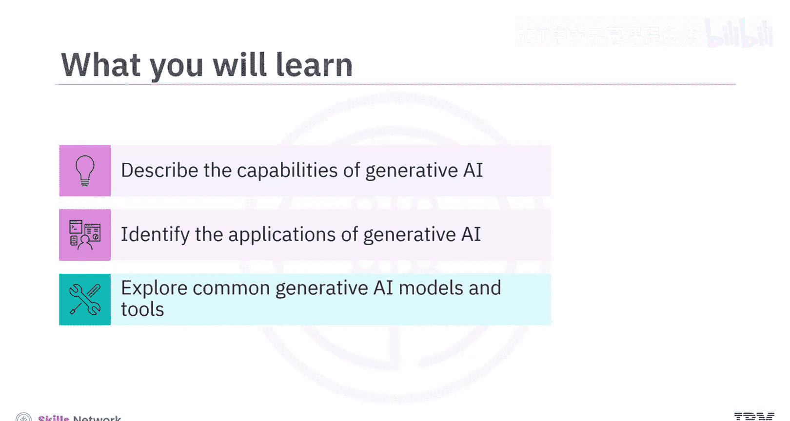

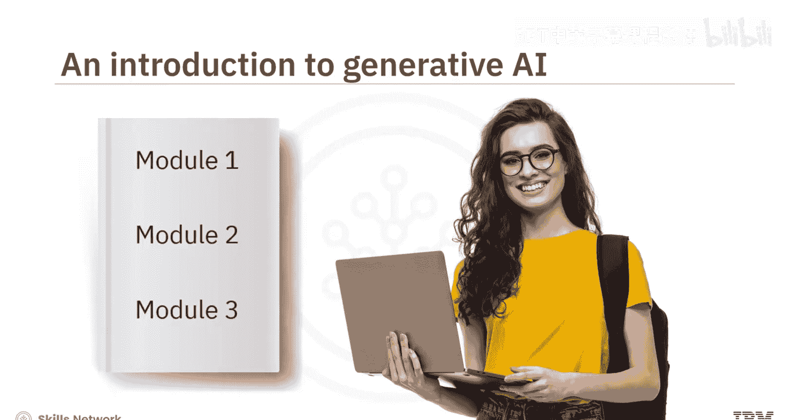

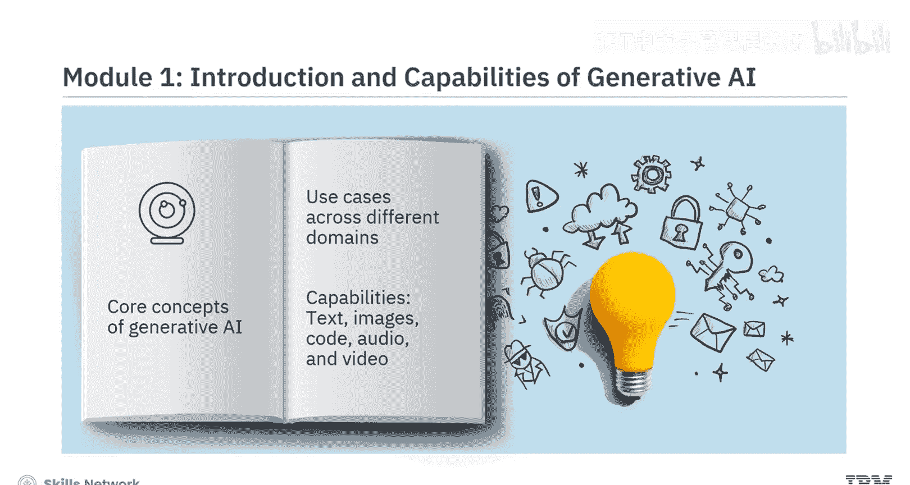

Images， code， audio and video， such as chat GT， Dolly and synynthesia。

Module 3 requests your participation in a final project and presents a graded quiz to test your understanding of course concepts。

 You can also visit the course glossary and receive guidance on the next steps in your learning journey。

 The course is curated with the mix of concept videos and supporting readings。

 Watch all the videos to capture the full potential of the learning material。

 You'll enjoy handson labs and a final project that demonstrates the common use cases of generative AI across multiple domains。

 There are practice quizzes at the end of each lesson to help you reinforce your learning At the end of the course。

 you'll also attempt a graded quiz。 The course also offers discussion forums to connect with the course staff and interact with your peers。

 Most interestingly， through the expert viewpoint videos。

 You'll hear from experienced practitioners who will share their perspectives on different aspects of generative AI。

 Why， don't you stand by。 As generative AI strengthens the creative expression and professional capabilities of individuals。

 Or and communities across the world。 This course presents an opportunity。😊。

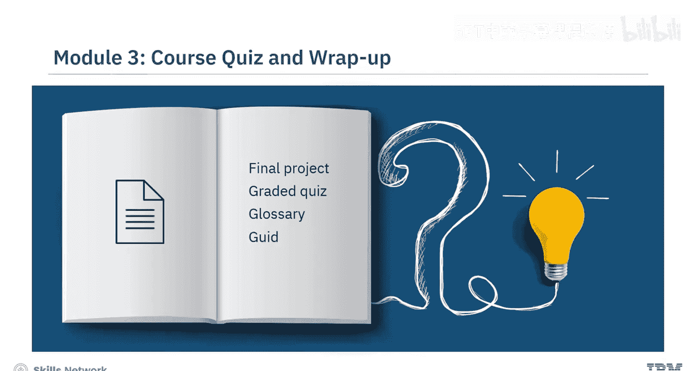

For you to create new experiences。

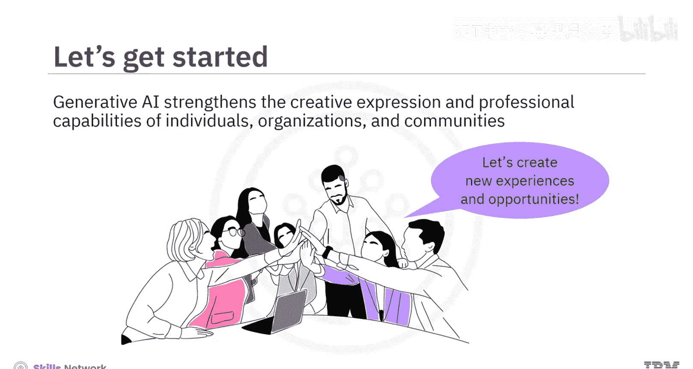

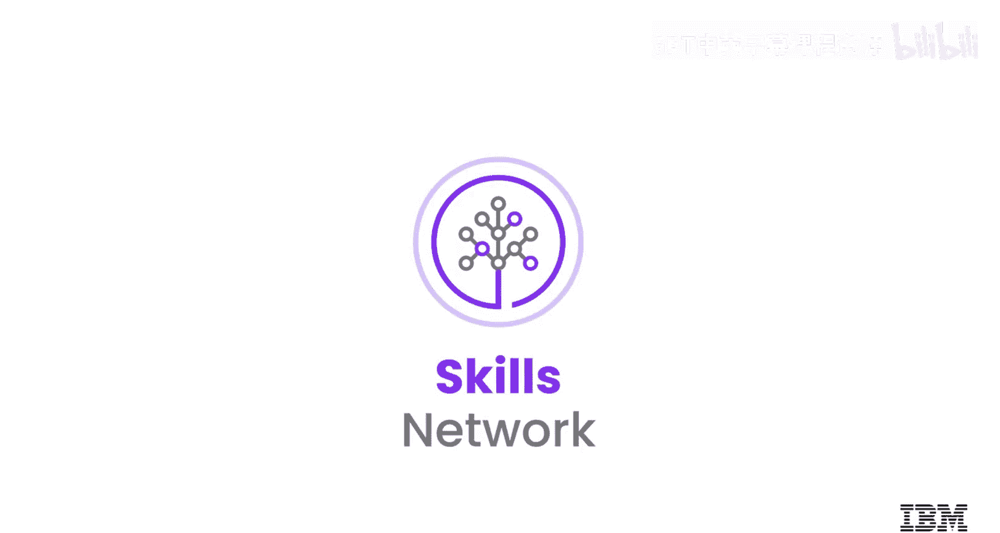