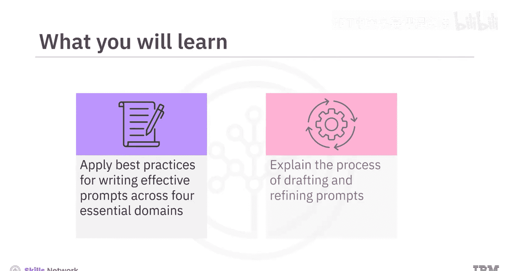
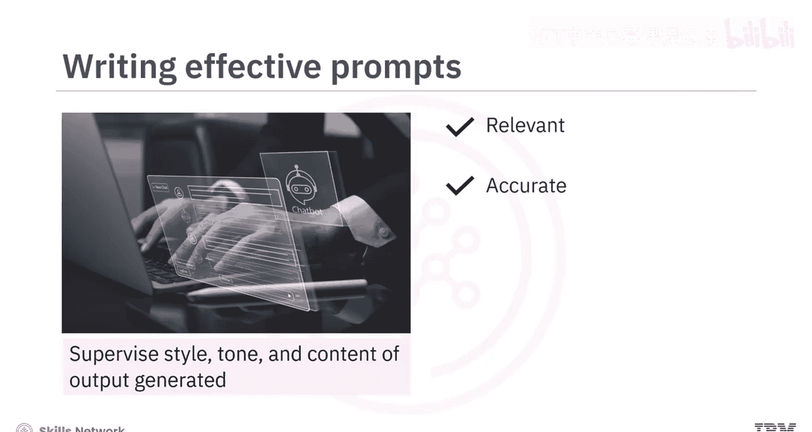
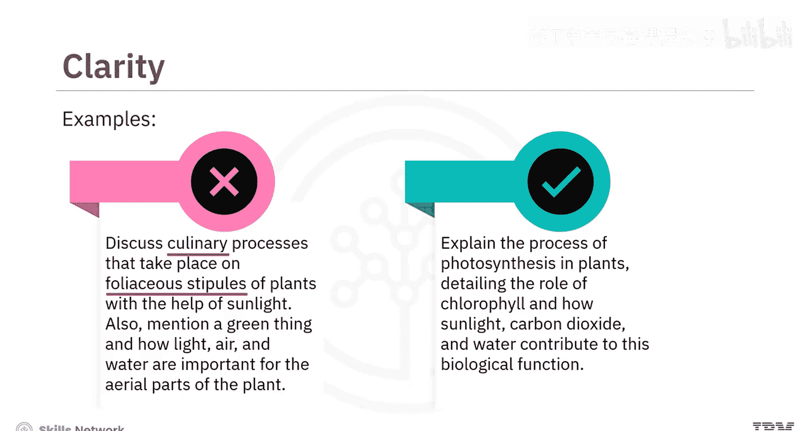
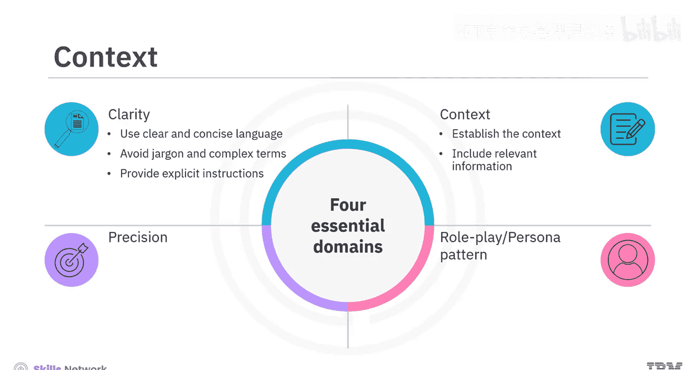
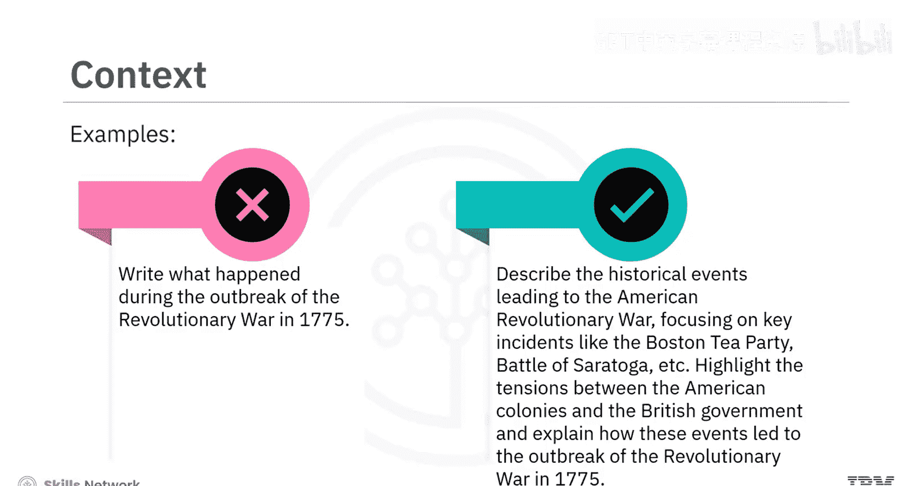
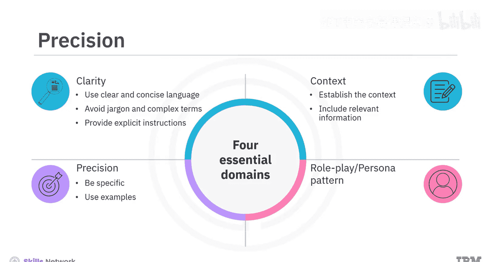
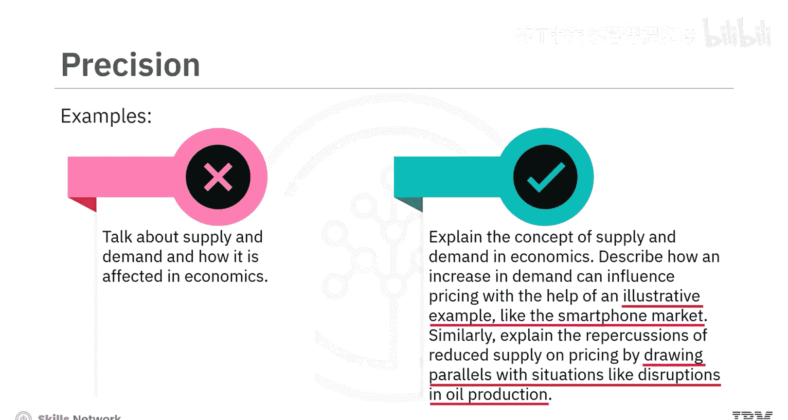
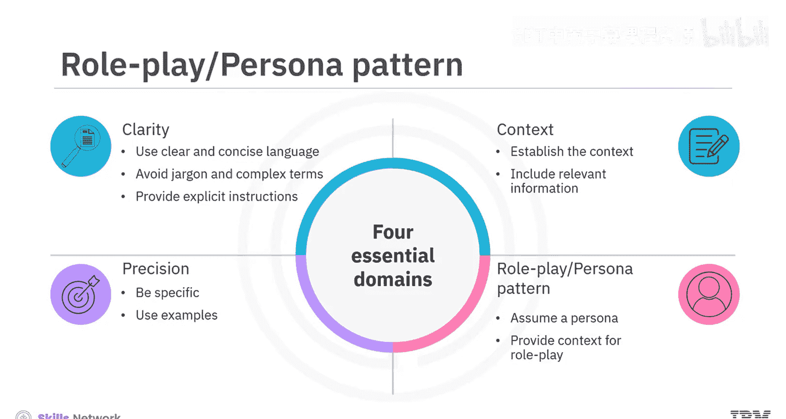
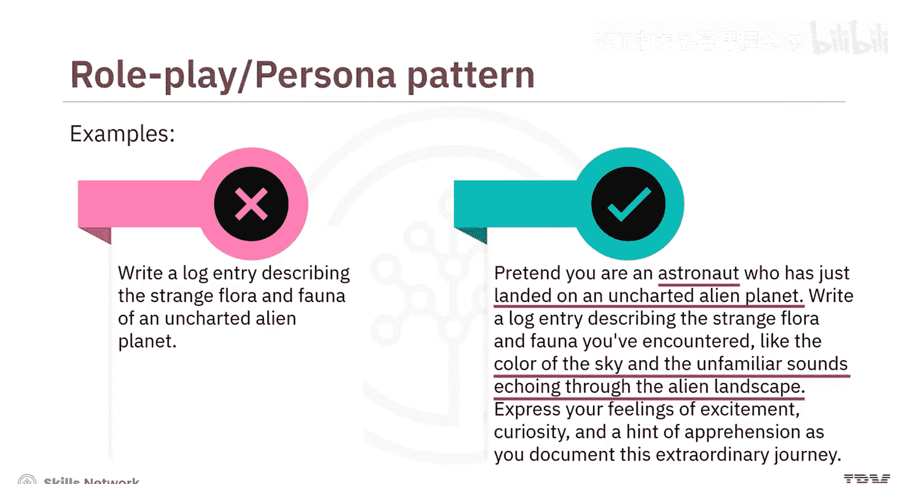
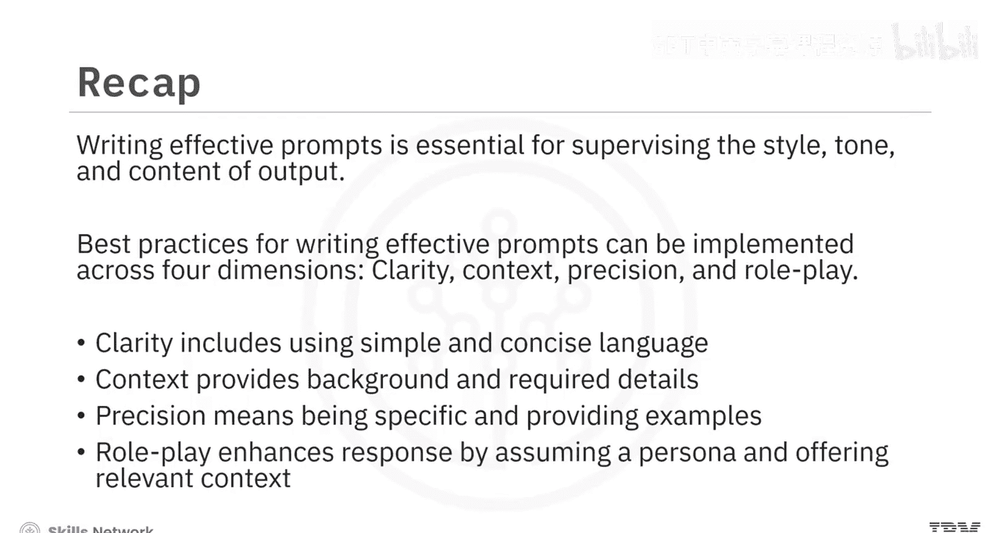

# IBM《生成式AI用于人力资源｜Generative AI for Human Resources (HR) Professionals》中英字幕 - P20：3_提示词创建最佳实践.zh_en - GPT中英字幕课程资源 - BV1Ese3zvEf4

Welcome to Best practiceses for prompt creation After watching this video。

 you will learn to apply the best practices for creating effective prompts and explain the process of drafting and refining prompts through various examples。

Writing effective prompts is crucial for utilizing the full potential of generative AI models to produce relevant and accurate responses by applying the best practices for creating effective prompts。

 you can supervise the style， tone and content of the output generated。

 You can apply the best practices for crafting effective prompts across four essential dimensions。

 clarityity， context， precisionion and role play or persona pattern。

Let's explore each of these aspects individually to have clarity in your prompt。

 to keep the following points in mind。 S and straightforward language can convey instructions easily。

 So write prompts that are unambiguous and easy to comprehend。

 Special terminologies can potentially puzzle the model or the users。

 So write prompts using simple terms that can be understood by a broad range of audiences。

 Vague prompts could lead to responses that do not align with your intentions。 Therefore。

 you must provide a clear description of the task that the model must perform。

Let's understand this through an example。 Disccus culinary processes that take place on fullyacious stipules of plants with the help of sunlight。

 Also mention a green thing in how light air and water are important for aerial parts of the plant。

 This prompt has much ambiguity。 No word does it explicitly mention the process you want to discuss。

 The prompt contains complex terminologies， which make it difficult to comprehend。

 It's also vague and does not clearly describe the task at hand。To ensure clarity。

 you can rewrite this prompt as explain the process of photosynthesis in plants。

 detailing the role of chlorophyll and how sunlight。

 carbon dioxide and water contribute to this biological function。 The revised prompt has simple。

 clear and concise language and explicitly states that you want to discuss the process of photosynthesis in plants。

Moving on to the next essential dimension， which is the context。

 context always helps the model understand the situation or the subject。

 This could involve giving a brief introduction or explanation of the circumstances in which the response is required。

 relevant information or specific details like people， places。

 events or concepts help guide the understanding of the model。

 So it's important to incorporate such details while writing prompts。

For example， the prompt right what happened during the outbreak of the Revolutionary War in 1775 does not contain adequate context and specific details to guide the understanding of the model。

To establish the right context and include the relevant information。

 you can rewrite this prompt as describe the historical events leading to the American Revolutionary War。

 focusing on key incidents like the Boston Tea Party， Battle of Saratoga and so on。

 Highlight the tensions between the American colonies and the British government and explain how these events LED to the outbreak of the Revolutionary War in 1775。

Another important dimension for creating effective prompts is precision Precision helps outline your request and the prompt If you're searching for a particular kind of response。

 express that with clarity， examplesles incorporated within your prompts can help the model understand what kind of response you're looking for and directed its thought process。

For example， in the prompt talk about supply and demand and how it is affected in economics。

 there's no precise outline of a particular kind of response and no examples。To ensure precision。

 you can rewrite this prompt as explain the concept of supply and demand and economics。

 describe how an increase in demand can influence pricing with the help of an illustrative example。

 like the smartphone market， similarly explain the repercussions of reduced supply on pricing by drawing parallels with situations like disruptions in oil production。

This prompt clearly expresses that you want to explain a concept with the help of examples。

Finally， let's discuss the last dimension， which is role play or persona pattern。

 prompts written from the perspective of a specific character or persona can help the model generate responses aligned with that perspective。

Essential contextual details enable the model to effectively assume a particular role。

 so if you're requesting the model to reply from the standpoint of a historical figure。

 a fictional character or a specific profession， then provide contextual details Let's look at this example here write a log entry describing the strange flora and fauna of an uncharted alien planet This prompt will simply give scientific details about the alien planet and will not explain its answer from the perspective of a professional。

You can rewrite the prompt as， pretend you are an astronaut who has just landed on an uncharted alien planet。

Write a log entry describing the strange flora and fauna you've encountered。

 like the color of the sky and the unfamiliar sounds echoing through the alien landscape。

 Express your feelings of excitement， curiosity and a hint of apprehension as you document this extraordinary journey。

 In this example， you explicitly gave contextual details and assumed yourself to be an astronaut。

 So this prompt will generate a response aligned with the perspective of an astronaut。😊。

In this video you learn that writing effective prompts for generative AI models is essential for supervising the style。

 tone and content of the output Best practices for writing effective prompts can be implemented across four dimensions。

 clarityity context， precisionion and roleplay Claity includes using simple and concise language context provides background and require details precisionciion means being specific and providing examples。

 and roleplay can enhance responses by assuming a persona and offering relevant context。

 These practices can be adapted to specific needs for optimal results。

。

