# IBM《生成式AI用于人力资源｜Generative AI for Human Resources (HR) Professionals》中英字幕 - P21：4_常用提示词工程工具.zh_en - GPT中英字幕课程资源 - BV1Ese3zvEf4

Welcome to Common prompt engineering tools。 After watching this video。

 you'll be able to describe the common functionalities of prompt engineering tools and explain the capabilities of a few common tools for prompt engineering。

 Promp engineering is the process of designing accurate and contextually appropriate prompts to interact with generative AI models to generate relevant and accurate outputs to aid you with this process。

 you have diverse prompt engineering tools。 Prompt engineering tools provide various features and functionalities to optimize the creation of prompts for desired outcomes。

 These tools are specifically useful for users who may not be proficient with natural language processing or NLP techniques。

 but want to achieve specific outcomes when using generative AI models。

 Let's explore the common functionalities offered by diverse prompt engineering tools。 Firstly。

 several tools for prompt engineering offer suggestions for prompts based on a given input or the desired output。

😊。

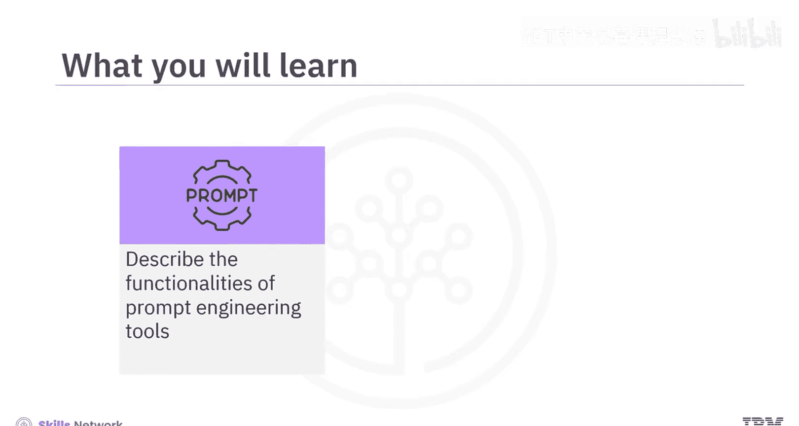

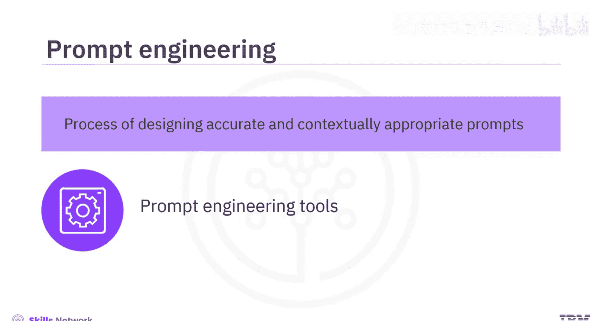

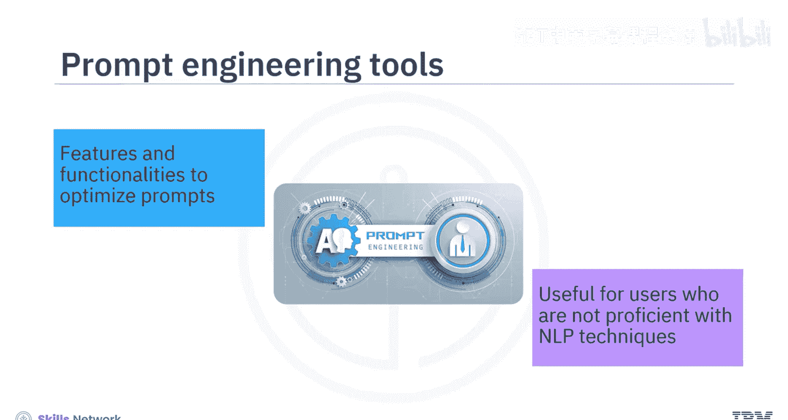

Next， these tools can suggest how to structure prompts for better contextual communication。

 They help craft prompts that provide the necessary context for the model to understand the user's intent。

 You can iteratively refine prompts based on the initial responses from a tool to find the most effective prompt prompt engineering tools might offer features to help mitigate bias and the response of a generative AI model。

 They can guide how to craft prompts to reduce the likelihood of bias or inappropriate outputs。

 These tools can help create prompts relevant to specific domains such as legal。

 medical or technical。 Some prompt engineering tools offer libraries of predefined prompts for various use cases that can be customized for specific needs。

 Moving forward， let's explore a few common tools for prompt engineering。

 Let's start with IBM Watsson X do AI。 a platform of integrated tools to train， tune。

 deploy and manage foundation models easily。 The platform includes the prompt lab tool that enables users to experiment with prompts based on different foundation models and build prompts based on their needs to help。

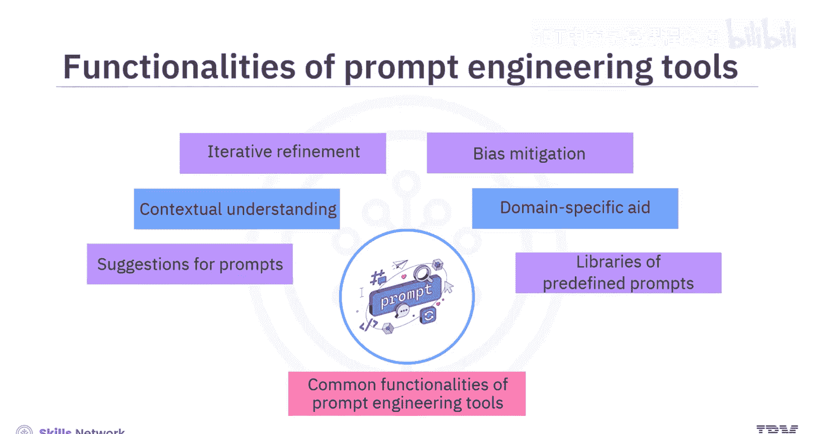

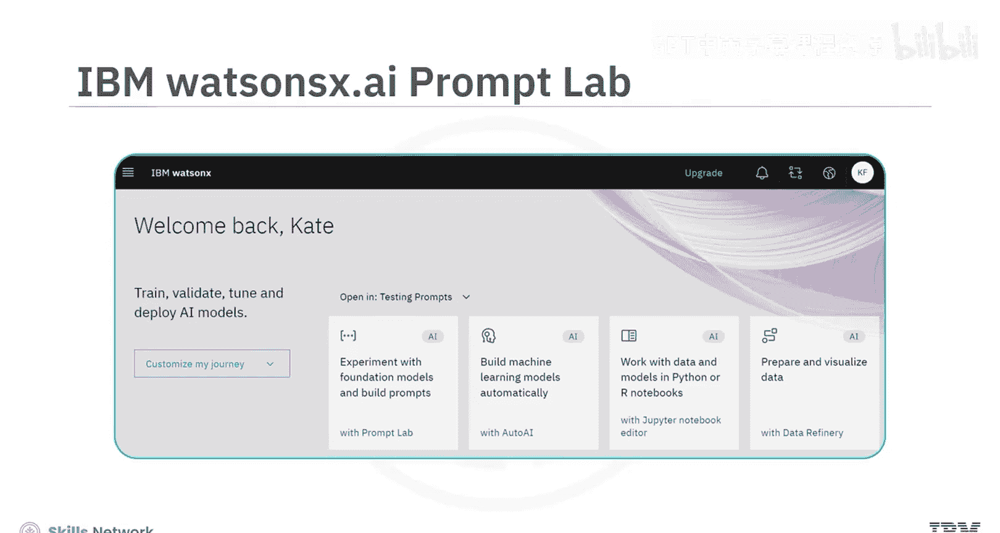

You get started， Pro lab provides sample prompts for different use cases， including summarization。

 classification， generation and extraction to create prompt specific to your needs。

 you can train a model by adding instructions and examples to show the model how to respond to the input Moving further。

 Let's learn about spellbook and integrated development environment or I by scale AI with spellbook。

 you can build applications based on a language model or LLM and experiment with prompts for various use cases including text generation。

 text extraction， classification， Que answering， auto completion and summarization for prompt engineering spell book includes a prompt editor that enables you to edit and test prompts you can use prompt templates to leverage structured prompts for generating text。

 You can also access pre-built prompts as examples。 Another tool for prompt engineering is dust。

 It provides a web user interface for writing prompts and chaining them together。

 You can manage different versions of chain prompts。 It also provides a custom coding language。

Set of standard blocks for processing the outputs provided by the LLms Dus also supports API integration to integrate other models and services。

 Another tool for effective prompt engineering is prompt perfect。

 which can be used to optimize prompts for different LLms or text to image models。

 It supports common text models such as G Cla stable Lm and Lama an image models such as dolly and stable diffusion。

 for writing or optimizing a prompt。 you first need to select the relevant model for which you want to optimize the prompt。

 Different models have different optimizing strategies。

 You can also select the add ons related to preview quality language and moderation When you write a prompt。

 you can experiment with the autocomplete feature that provide suggestions as you type you can further optimize the written prompt here。

 you can see an example that reveals the original prompt written by a user and the corresponding optimize prompt generated by prompt perfect for a further level of opt。

 you can optimize and refine the prompt step by step in the streamline mode。

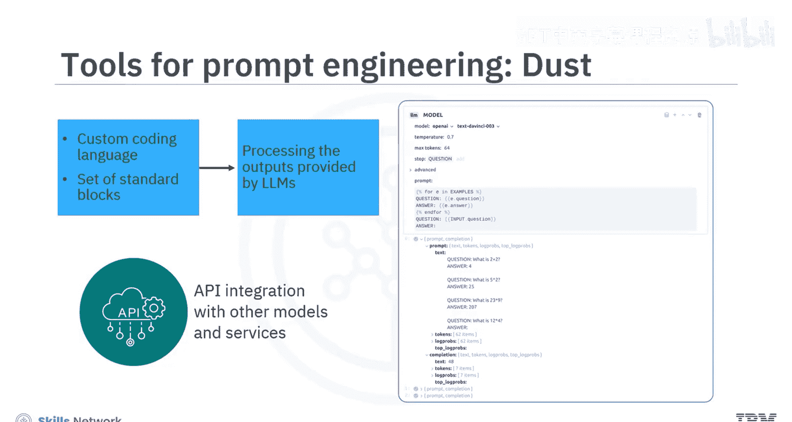

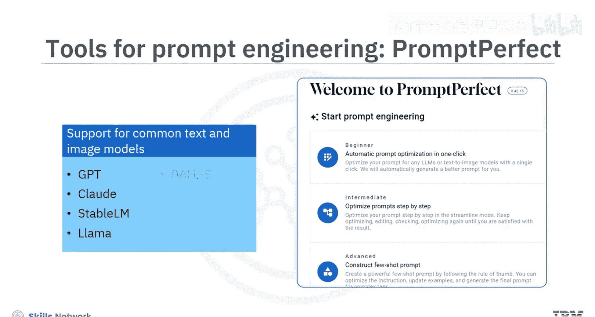

You write a prompt， optimize it and again， edit the prompt and optimize until you are satisfied with the output。

 Some other popular tools and interfaces provide resources for prompt engineering or help you experiment with prompts。

 Gitthub provides vast repositories for prompt engineering and LLms The guides。

 examples and tools provided in these repositories help improve prompt engineering skills。

 Open AI playground is a webbased tool that helps to experiment and test prompts with various models of open AI such as G Playground AI platform helps you experiment with text prompts for generating images with the stable diffusion model。

 Langcha is a python library that provides functionalities for building and chaining prompts。

 Finally， it's interesting to learn that prompts are also available for buying and selling。

 One such example of a marketplace for prompts as prompt base prompt base supports prompts for popular generative AI tools and models including midjoney chat G Dolly stable diffusion and lama Through prompt base you can buy prompts。

😊。

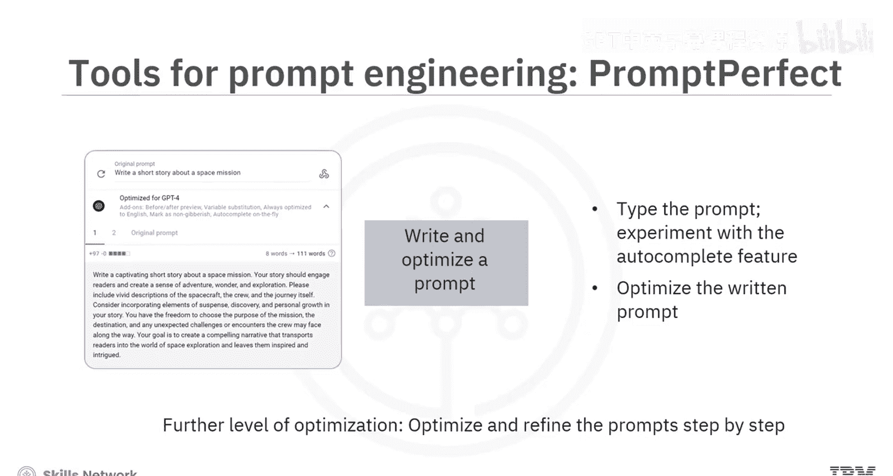

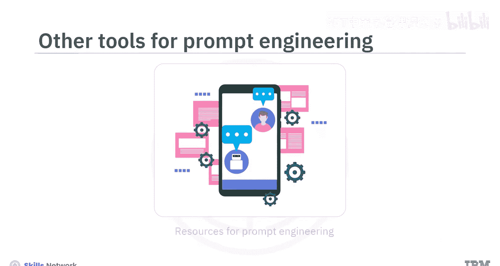

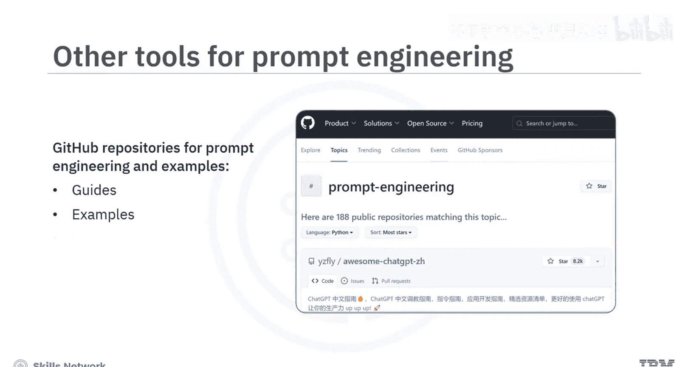

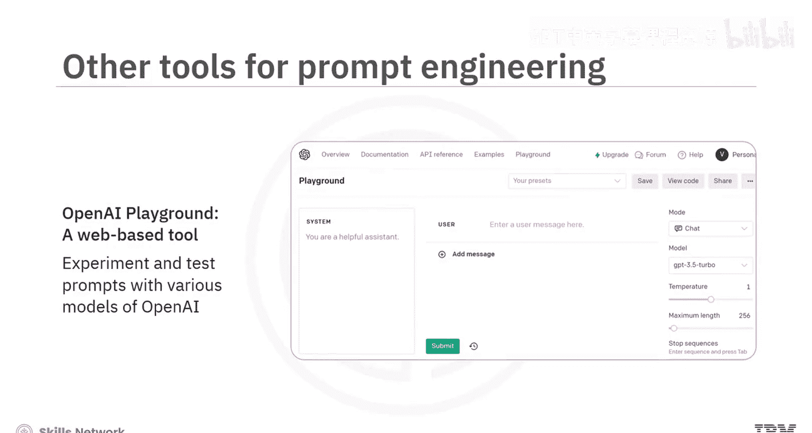

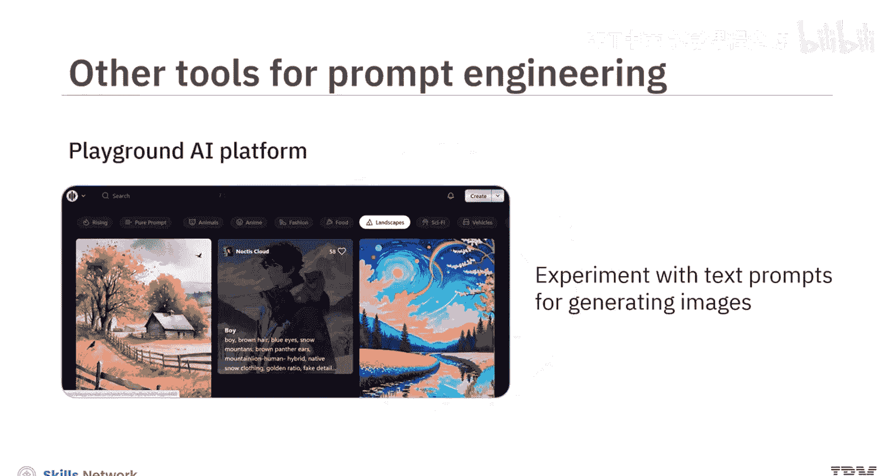

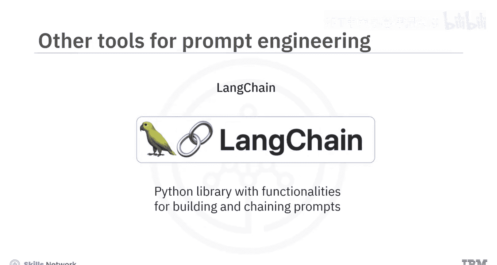

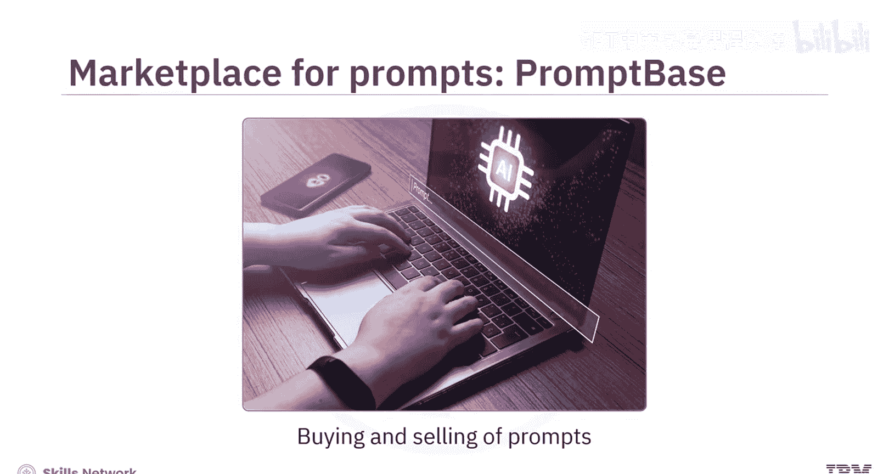

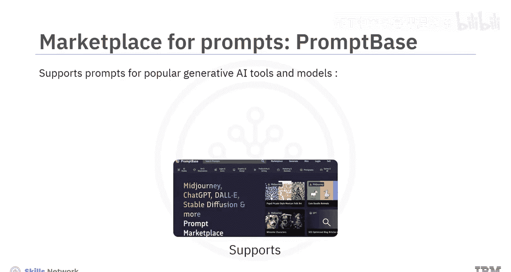

Specific to your requirements and specific to a model or tool。 For example。

 you can buy a prompt to generate comical cartoon characters through midjoney。 Also。

 if you have good prompt crafting skills， you can upload and sell prompts through promptbase。

 It also supports crafting prompts directly on the platform and selling them on its marketplace In this video。

 you learned that prompt engineering tools provide various features and functionalities to optimize prompts。

 Some of these functionalities include suggestions for prompts， contextual understanding。

 Iterative refinement， bias mitigation， domainspec aid and libraries of predefined prompts。

 A few common tools and platforms for prompt engineering include IBMWattson X do AI promptlab。

 spellbook， dust and prompt perfect。😊。

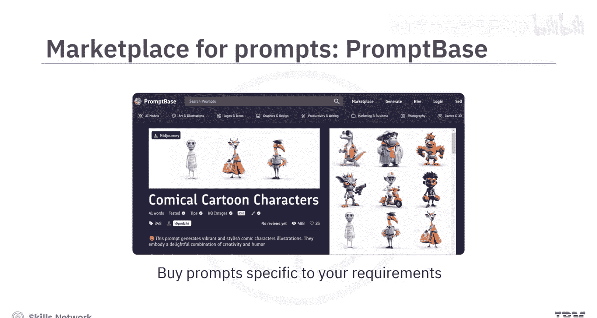

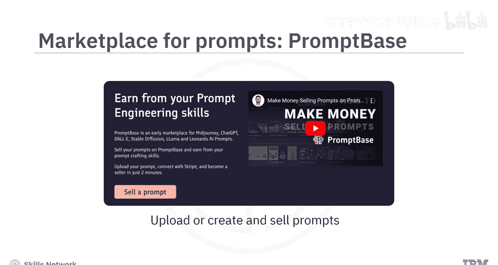

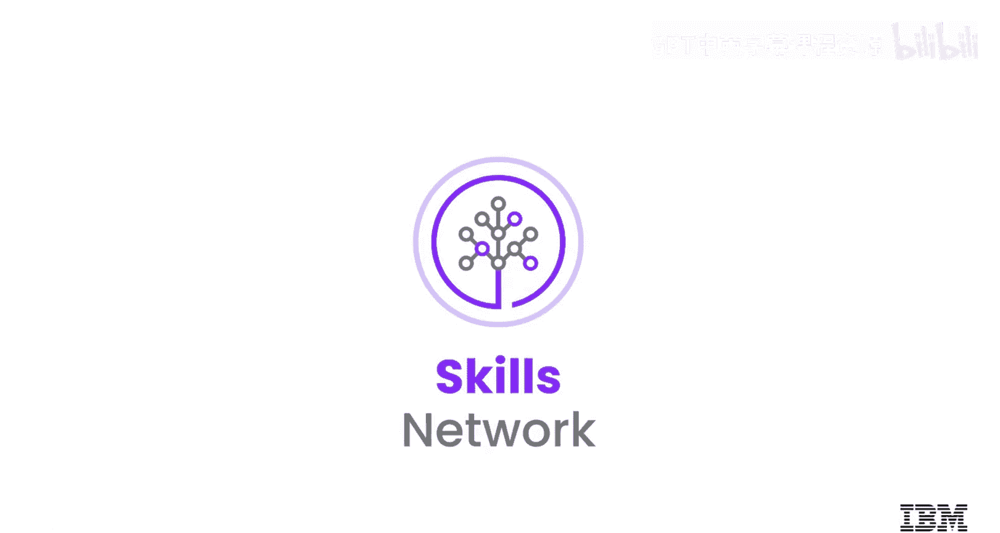