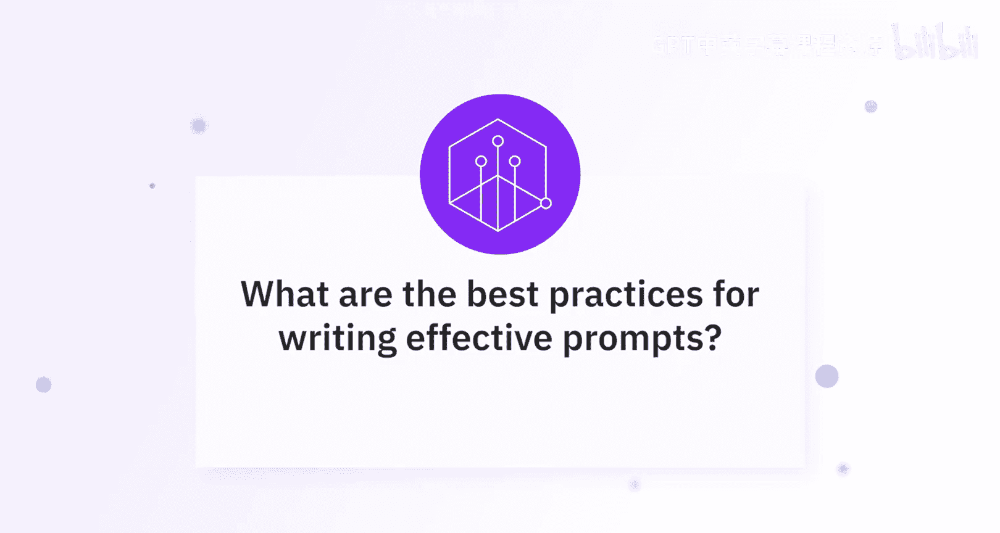
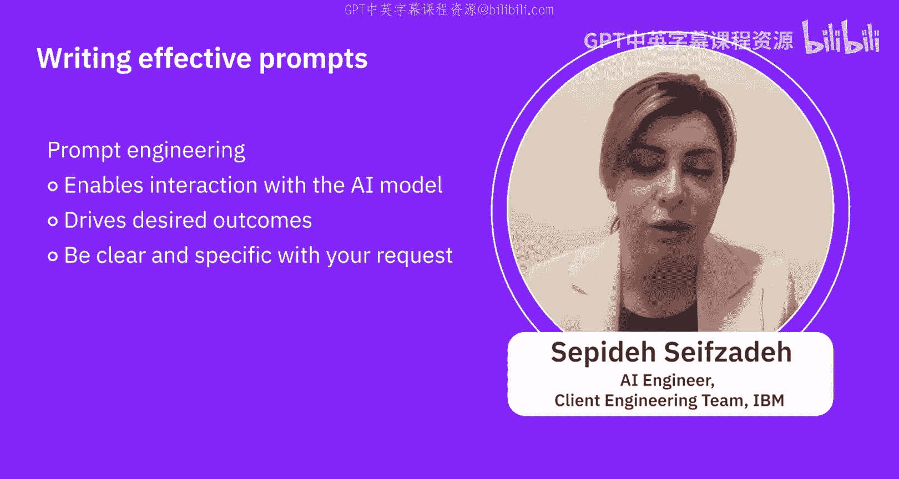
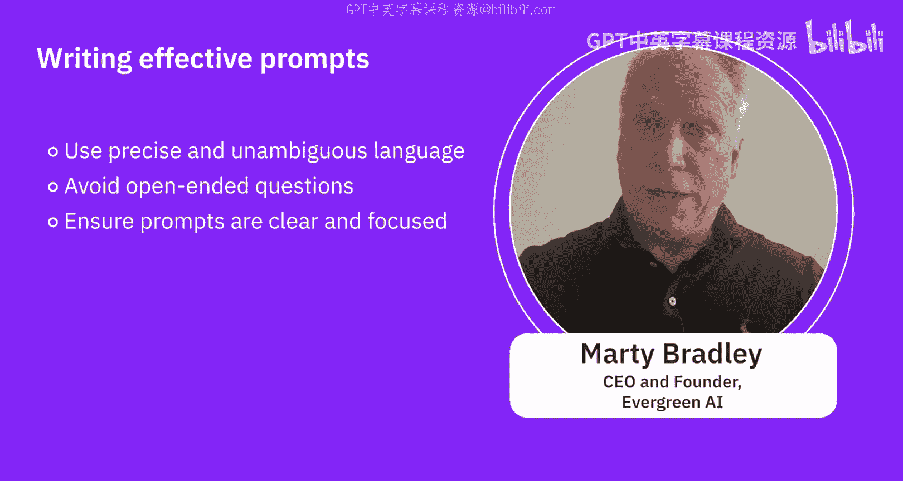
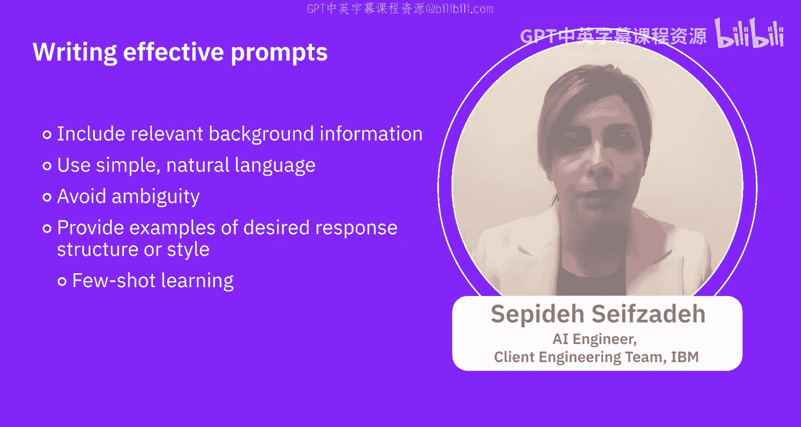
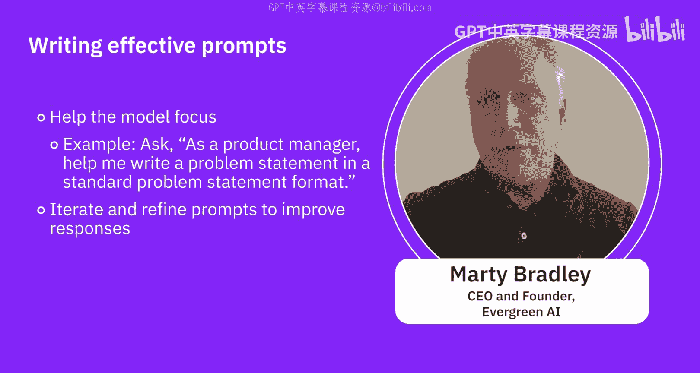
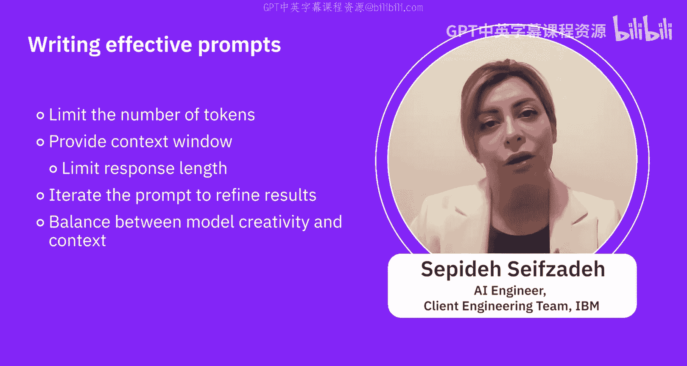
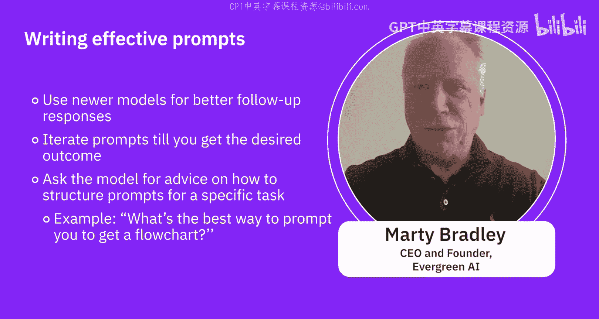
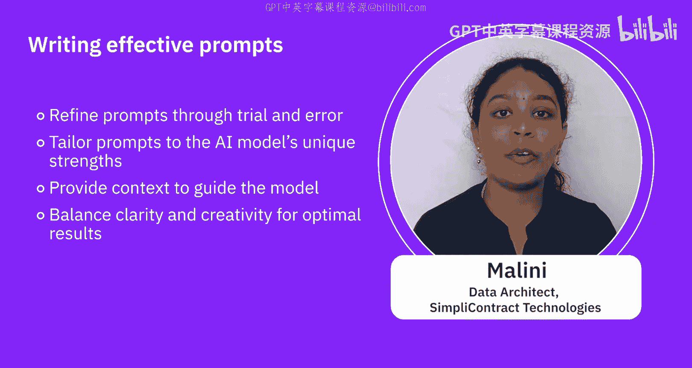
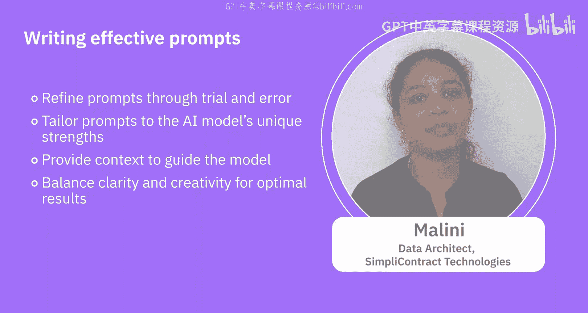

# IBM《生成式AI用于人力资源｜Generative AI for Human Resources (HR) Professionals》中英字幕 - P22：5_专家观点：高效提示词设计原则.zh_en - GPT中英字幕课程资源 - BV1Ese3zvEf4

Hello and welcome to this expert viewpoints video。 In this video。

 generative AI experts will share some best practices for writing effective prompts。😊。

So Prom engineering is very important step when using generative AI because this is the way that we can interact with our model and ask it for the desired outcome。

 so the first step is to be very clear and specific about our ask to our model。😊。

So really， what you want to do is you want to be clear and specific with your language。

 If you think about a lot of times when we coach or if we're talking to people。

 we ask open ended questions so to make sure that they have an opportunity to explore。

 But when we're working with their eye models， we want to be a little bit more specific and direct。

 okay。

The best practice for writing a prompt is being。Clear in your request。

Providing the context absolutely clearly， that is where which application are you targeting and then listing out the best all the features that you want from the response。

So these are the top three points for a， you know， the most generic and the most prominent aspects of writing any good prompt。

Imagine giving instruction to a super creative robot。

 keep it clear and concise like telling it to write a catchy robot song。

 Don't be too busy Leave room for its own cool ideas。 do experiment over the length。

Sometimes a short sentence is enough。 Other times the robot needs some more details。

The other one is to provide some context background information to our model so that it can use that information and it helps it to provide the response for us。

We also have to interact with their mother using natural language and avoid any difficult language or ambiguity so that it can understand clearly what we are asking it to do。

We have to include some examples， this is also a concept of future learning so that based on the examples of it can be question。

 answer or some examples about the structure of the response or style of the response so it can use those examples to then generate the result accordingly based on what we are looking for。

Is to use specific language and talk about an expert if you're talking about a certain area。

 say as a healthcare expert or as a product manager specific role or area of expertise helps the LLM kind of fine tune and focus in on the information that they want to talk about。

 For example， a prompt Ill use a lot of times when I'm work with my product management clients to say as a product manager help me write a problem statement in a standard problem statement format。

 and then itll come back and it'll give me consistent the output that looks like what I would consider a good problem statement。

 And then what you want to do is you want to go ahead and iterate after ask your question。

We can also provide some constraints if we want our content to be restricted or we want to avoid some type of structure or provide some guidelines。

 we can also limit the number of tokens or provide some context window and we can also do use prompt iteratively and evaluate and refine the prompt based on the result we ety and we also have to make sure that there is a balance between model creativity or random list and how much we want to stay within the context relevance context to background information that we have provided。

The newer models have a lot more memories。 so they'll remember what you're talking about。

 So if you go through and it's missing some information， ask it to add it。

 rewrite the application point。 So iterate through until you either get the right prompt or you get the answer you want。

 The one last thing that I think is great to do is if you're not sure how to prompt it ask。 Sa。

 what's the best way to prompt you to get a flowchar。 And it'll tell you。

 it'll actually tell you the type of prompt together。

Remember practice a mix perfect。 try different ways to phrase your instructions until you find the perfect match。

 Different robots have different skills， so tellor your prompts to their strength and finally give it context like the story are mo so it understands what you are aiming for。

 remember writing prompts as an art。With clarity， balance and a little robot love。

 you can unlock the amazing creative possibilities。 Let's try the future。 Thank you。😊。

。