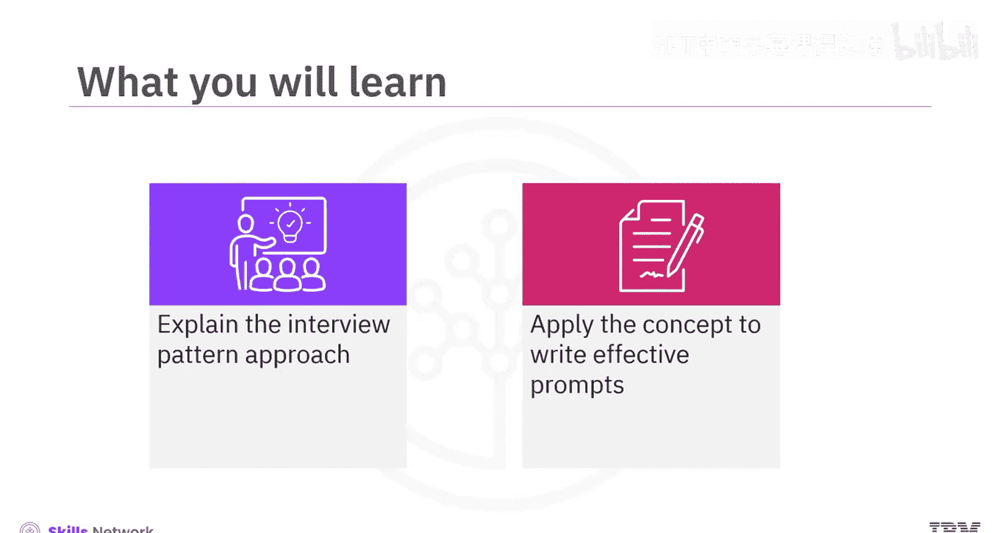
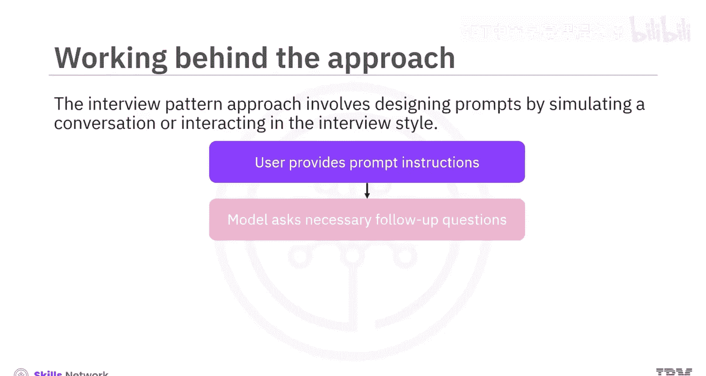
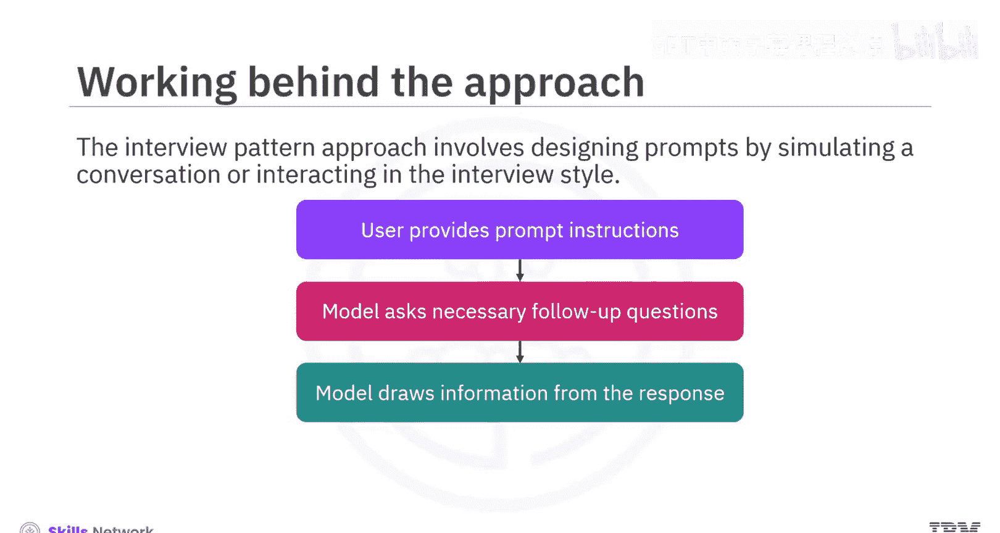
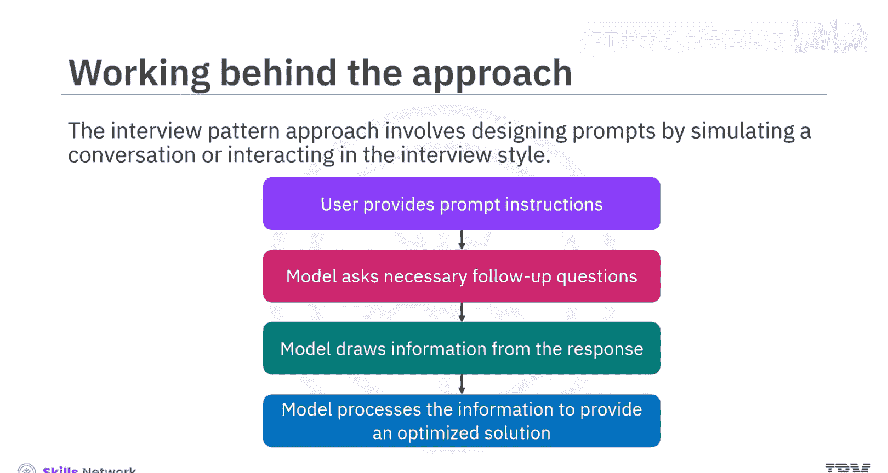
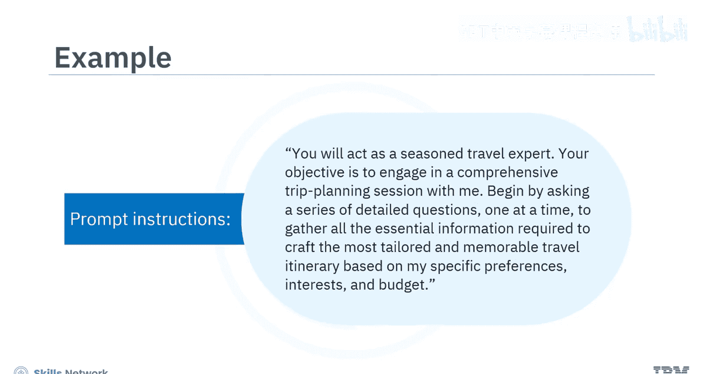
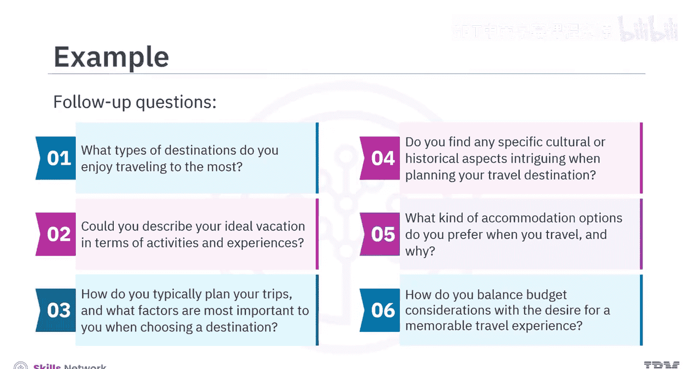
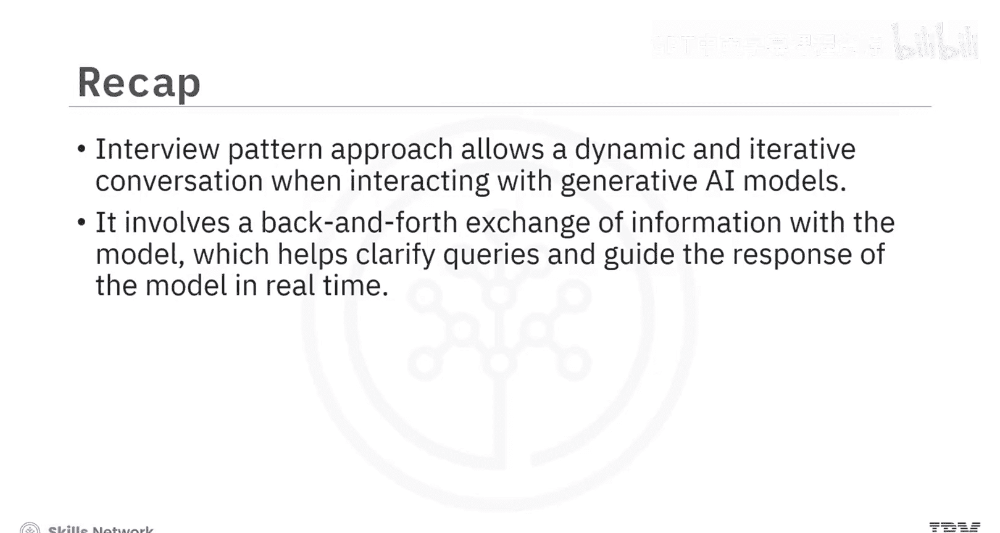

# IBM《生成式AI用于人力资源｜Generative AI for Human Resources (HR) Professionals》中英字幕 - P25：8_面试模式法.zh_en - GPT中英字幕课程资源 - BV1Ese3zvEf4

Welcome to interview pattern approach After watching this video。

 you'll be able to explain the interview pattern approach to prompt engineering you'll also learn to apply this concept to write more effective prompts for generative AI models to produce more specific responses。

 The interview pattern approach to prompt engineering is a strategy that involves designing prompts by simulating a conversation or interacting with the model in the style of an interview。

Let's learn how the interview pattern approach typically works。

 This approach requires meticulous optimization of the prompt to ensure the model generates responses that precisely meet your objectives。

 It involves providing specific prompt instructions to the model in response to which the model asks necessary followup questions from the user。

 depending on the response to these follow up questions。

 The model draws information relevant to its task processes it and provides a well optimized response to the user。

 The more information you provide the better the result will be。

 You'll understand this better with the help of an example。

 Suppose you want the model to behave like a travel consultant and plan your travel itinerary for a vacation。

 How will you prompt the model to do so。

You can give prompt instructions to the model saying you will act as a seasoned travel expert。

 your objective is to engage in a comprehensive trip planning session with me begin by asking a series of detailed questions one at a time to gather all the essential information required to craft the most tailored and memorable travel itinerary based on my specific preferences。

 interests and budget。

In response to this prompt instruction， the model will ask all the required follow up questions。

 such as what types of destinations do you enjoy traveling to the most。

 Could you describe your ideal vacation in terms of activities and experiences。

 how do you typically plan your trips and what factors are most important to you when choosing a destination Do you find any specific cultural or historical aspects intriguing when planning your travel destination。

 What kind of accommodation options do you prefer when you travel and why how do you balance budget considerations with the desire for a memorable travel experience？

 In this example， each question builds upon the previous one。

 creating a structured and informative conversation about travel preferences。

 depending on your response to these queries， the model will plan a memorable travel itinerary that aligns with your preferences and needs In this video。

 you learn that the interview pattern approach is superior to the conventional prompting approach。

 as it allows a more dynamic and iterative conversation when interacting with generative AI models。

 Instead of providing a single static prompt。😊。

🎼The interview pattern involves a back and forth exchange of information with the model。

 which helps clarify queries and guides the response of the model in real time This in turn enhances the capabilities of the users to optimize the results obtained。

