# IBM《生成式AI用于人力资源｜Generative AI for Human Resources (HR) Professionals》中英字幕 - P30：13_课程总结.zh_en - GPT中英字幕课程资源 - BV1Ese3zvEf4

Congratulations on completing the course on the basics of prompt engineering Now that you have a solid grasp on designing effective prompts。

 using generative AI tools to structure prompts and using text to text and text to image techniques。

 you will discover numerous opportunities to further your learning and apply your newly acquired skills Before moving ahead。

 let's recap the key concepts you learned throughout the course。

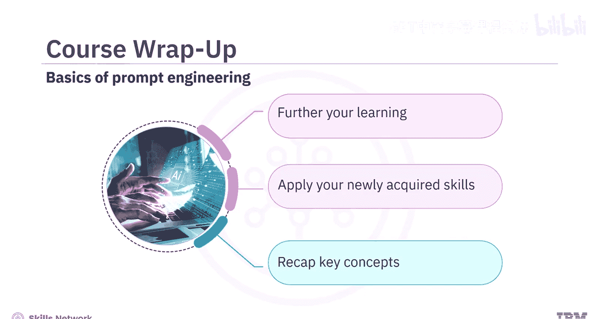

You learned that a prompt is any input or a series of instructions that you provide to a generative AI model that collects the information。

 draws inferences， and provides optimal responses。

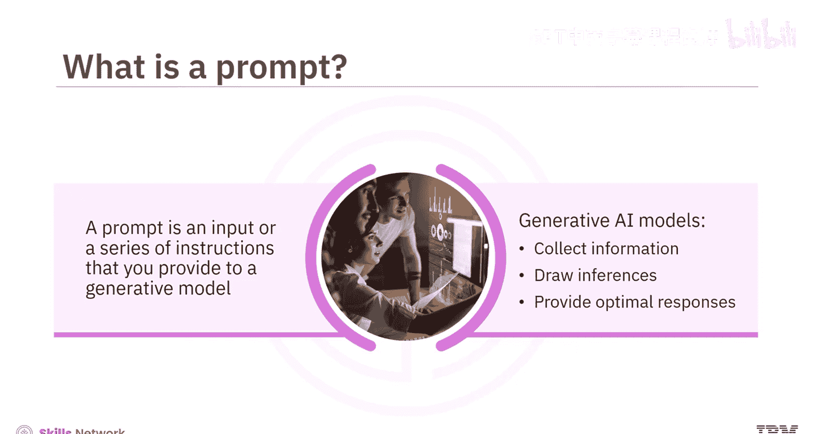

The building blocks of a well structured prompt include instruction， context， input data。

 and output indicators。

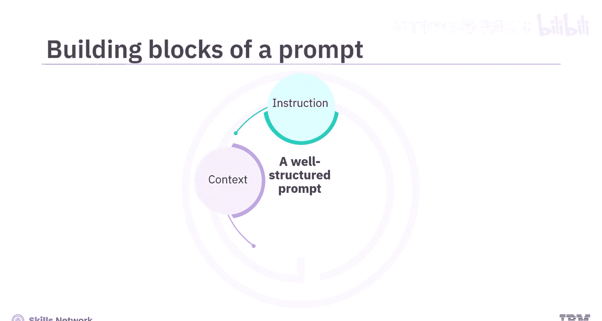

The process of designing effective prompt to leverage the full capabilities of generative AI models is calledPro engineering；

 the process boosts performance， understands model constraints， and enhances model security。

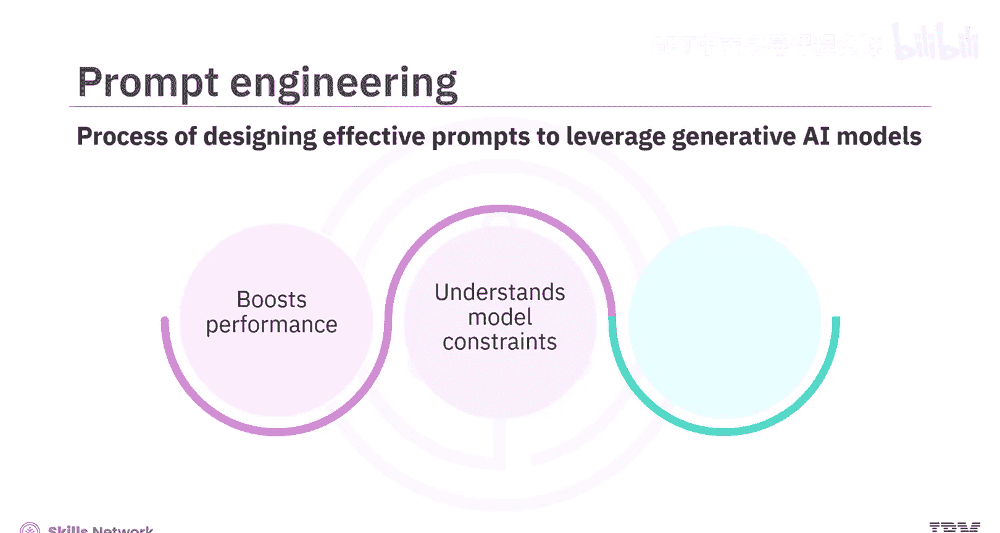

The best practices for writing effective prompts include using simple and concise language for clarity。

 providing background details for context， being specific， and providing examples for precision。

 and offering relevant context for role play。

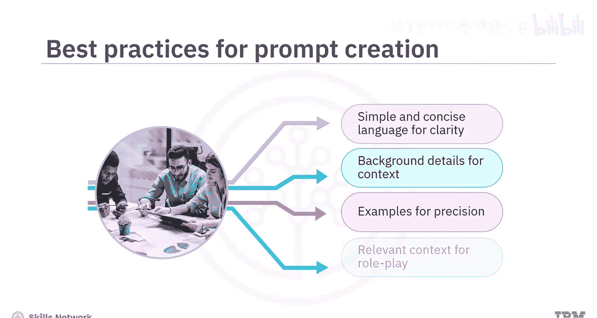

Prompt engineering tools provide features and functionalities to optimize prompts。

 you can use these tools to suggest prompts based on a given input to structure prompts for better contextual communication and to iteratively refine prompts to identify the most effective prompt。

 mitigate biases， and create prompts for specific domains。

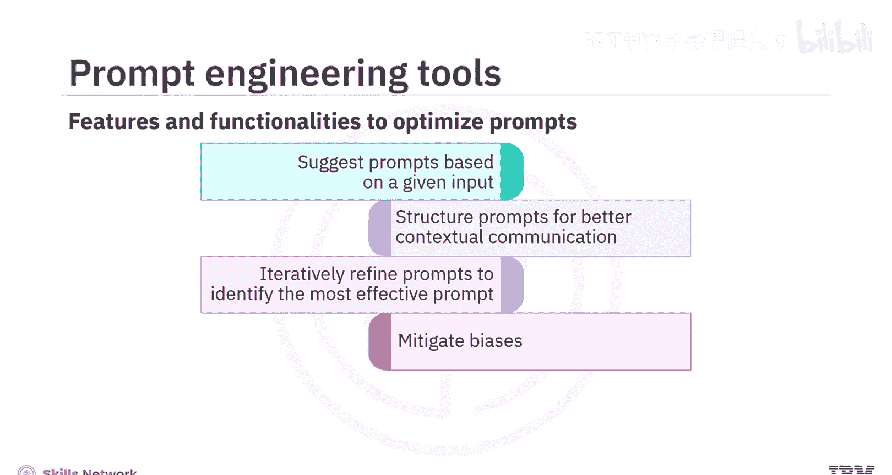

You also learned about the text to text prompt techniques that make text prompt effective and improve the reliability of outputs generated by large language models or LLMs。

 These are the task specification technique， context guidance， domain expertise， bias mitigation。

 framing， zero shot prompting， user feedback loop and few shot prompting。😡。

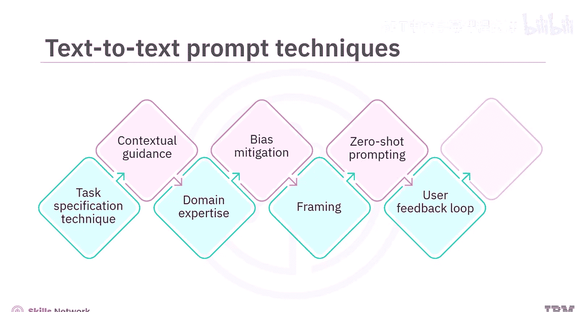

The interview pattern approach allows a dynamic and iterative conversation with generative AI models。

😡，Instead of providing a single static prompt， the interview pattern involves a back and forth exchange of information with the model。

 which helps clarify queries and guide the response of the model in real time。

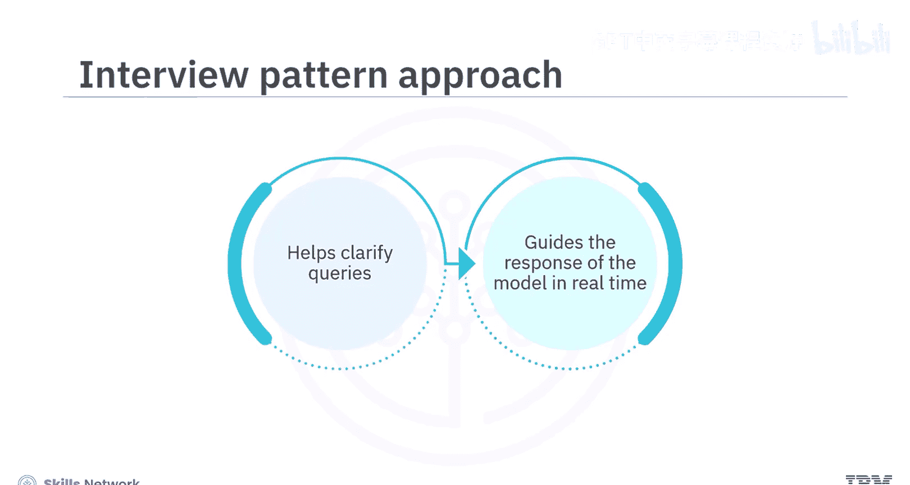

The chain of thought approach strengthens the cognitive abilities of generative AI models。

 It solicits a step by step thinking process。 This AI model is provided with related questions and their corresponding solutions to train it with the logic behind solving a problem and enable it to solve other similar problems。

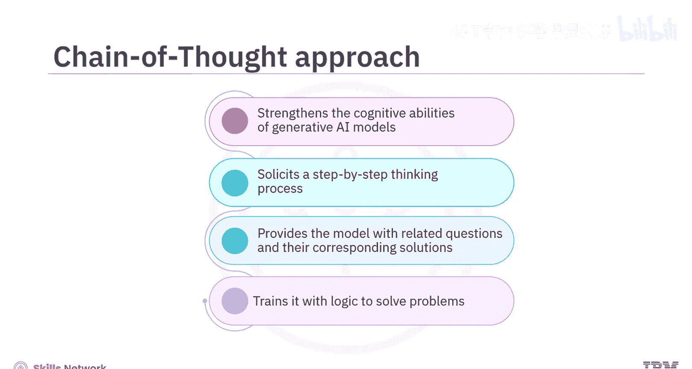

The tree of thought approach is an innovative technique that builds on the chain of thought approach。

 It involves structuring prompts hierarchically to guide the model's reasoning and generation of output。

 It enables the model to explore various possibilities and ideas simultaneously。

 branching out like a decision tree。😊。

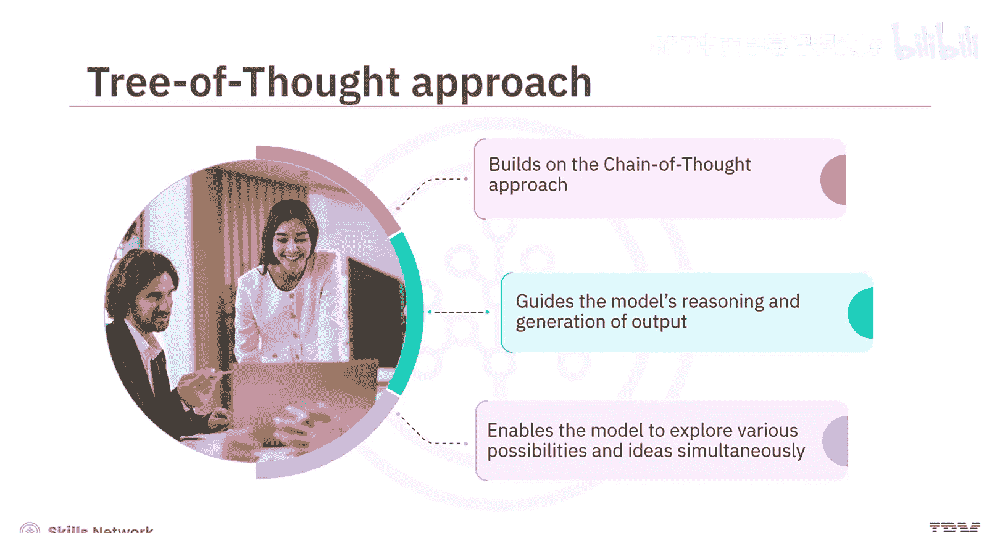

Multimodal prompting extends the capabilities of generative AI by integrating multiple input types such as text。

 images， and audio， and enabling richer and more accurate understanding。

 interaction and creativity across diverse scenarios。😡。

The playoff method involves generating multiple prompt response pairs and evaluating them based on criteria such as clarity。

 precision， and contextual relevance。

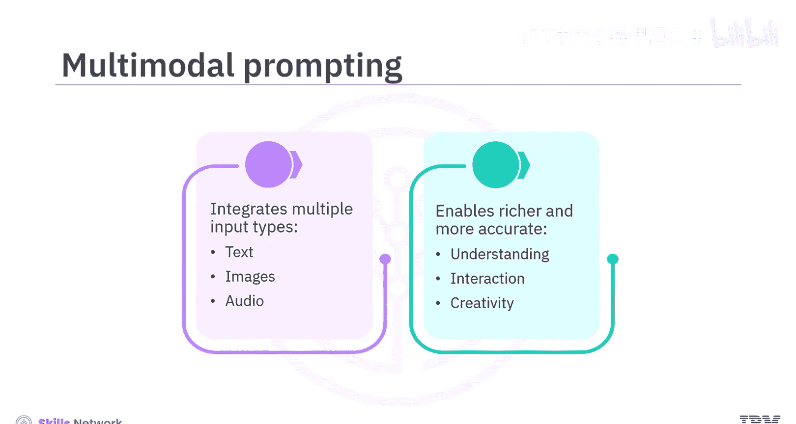

This iterative approach facilitates continual refinement of prompt design。

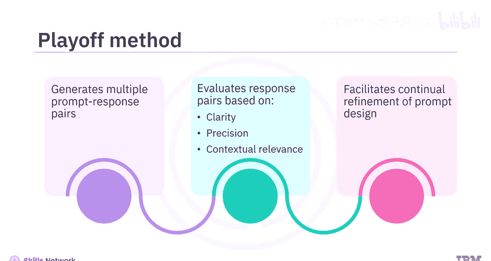

Image prompting techniques enhance the impact of images obtained through generative AI models and make them more convincing and appealing。

 The commonly used image prompting techniques are style modifiers， quality boosters， repetition。

 weighted terms， and fixed to form generation。

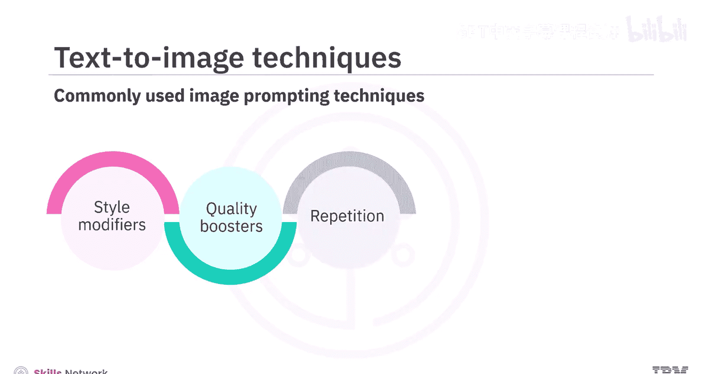

You have now reviewed the fundamental concept covered in this course。

 remember to go through the glossary at the end of the course to review the key terms discussed and their definitions。

😡。

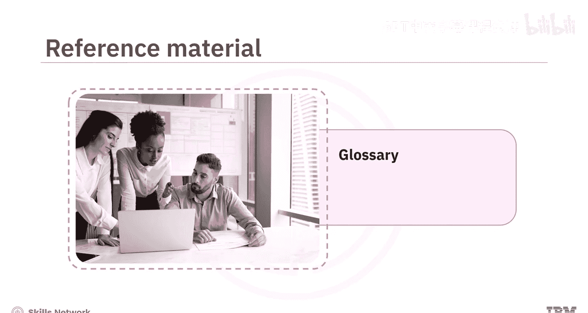

This course includes hands on labs and a final project。By completing the labs。

 you gained practical exposure to the following topics， getting to know our AI prompting tool。

 experimenting with prompt。Naive prompting and persona pattern。

The interview prompt approach in prompt engineering。

 the chain of thought approach in prompt engineering。

 the treee of thought approach in prompt engineering， multimodal prompts， playoff method。

 effective text prompts for image generation。 We recommend that you continue implementing the concepts learned in this course。

 We hope these principles will hone your skills and help you advance your career。

 Congratulations on completing this course。 We appreciate your participation in this learning journey and wish you the very best。

😊。

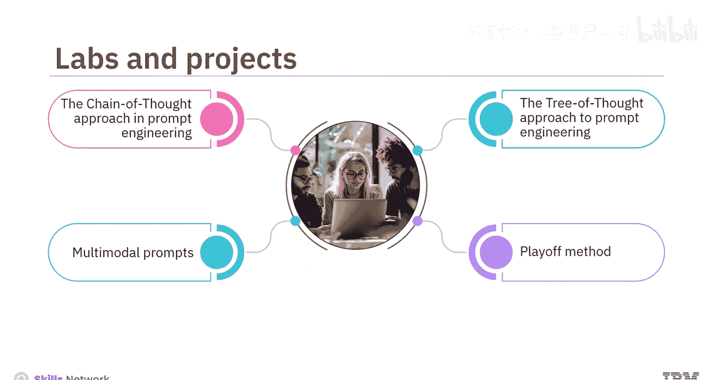

。

