# IBM《生成式AI用于人力资源｜Generative AI for Human Resources (HR) Professionals》中英字幕 - P31：0_课程介绍3.zh_en - GPT中英字幕课程资源 - BV1Ese3zvEf4

Welcome to the Generative AI and Human Resources HR courseur。

Leveraging the capabilities of generative AI and HR functions is crucial for enhancing efficiency。

 personalization， and strategic decision making。

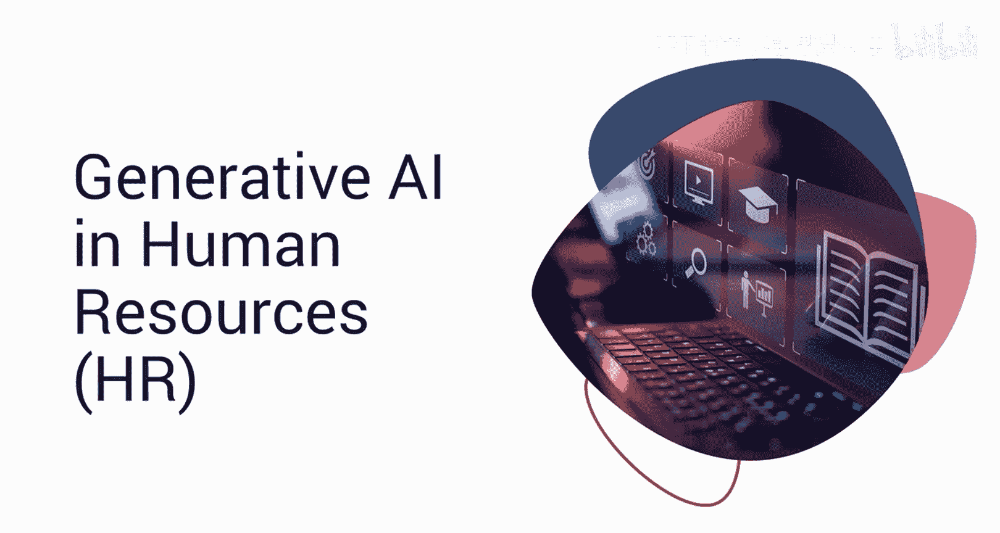

Generative AI can automate repetitive tasks， freeing up HR professionals to focus on more strategic activities。

Integrating generative AI into HR functions can lead to a more agile， informed。

 and employee centric organization。

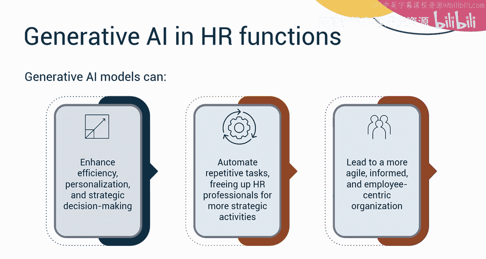

The transformation and work， jobs and market dynamics has inspired us to pose insightful questions like。

How can generative AI streamline key HR functions？How to apply generative AI capabilities for diverse use cases in human resources？

How can generative AI optimize HR processes and boost the productivity of professionals？

How can generative AI support strategic aspects of HR in areas like workforce planning and employee engagement？

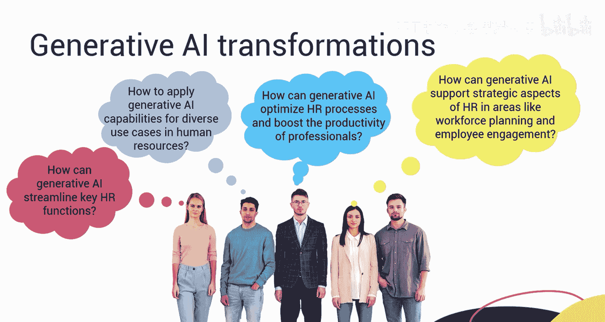

What capabilities and core concepts of generative AI are driving the use cases in the HR domain？

These are the questions well answered in this course。

 where you will discover the use of generative AI capabilities to increase the productivity of professionals in the HR domain。

This course is designed for existing HR professionals and those aspiring to build a career in HR。

If you are interested in learning how generative AI can enhance the effectiveness of different processes and boost productivity in various HR functions。

 this course is perfect for you。

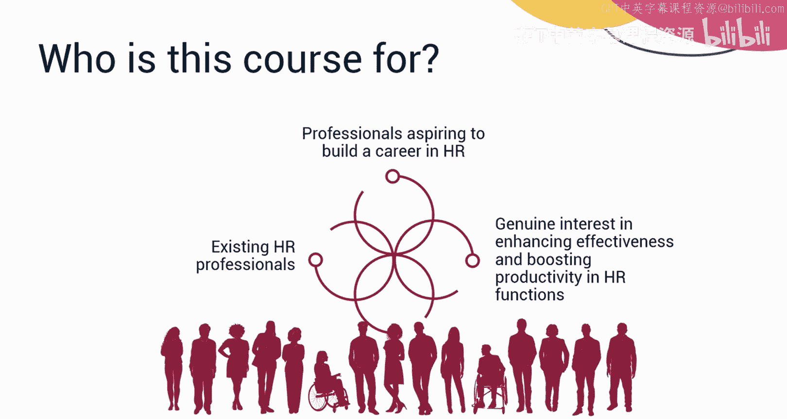

By the end of this course， you will be able to explain the benefits impact and use cases of generative AI and human resources。

Implement generative AI solutions across various HR functions。Discuss the ethical considerations。

 potential issues， and best practices for implementing generative AI in HR。

 develop an AI adoption roadmap for HR and build an AI enabled team。

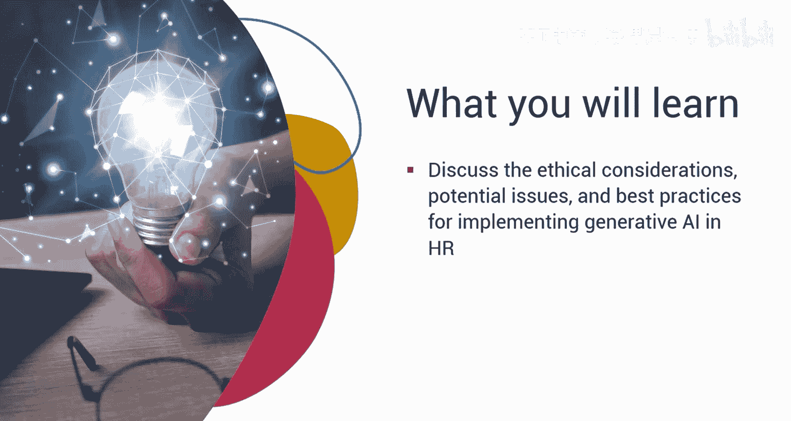

As this is a focused course comprising three modules。

 you are expected to spend one to two hours to complete each module。

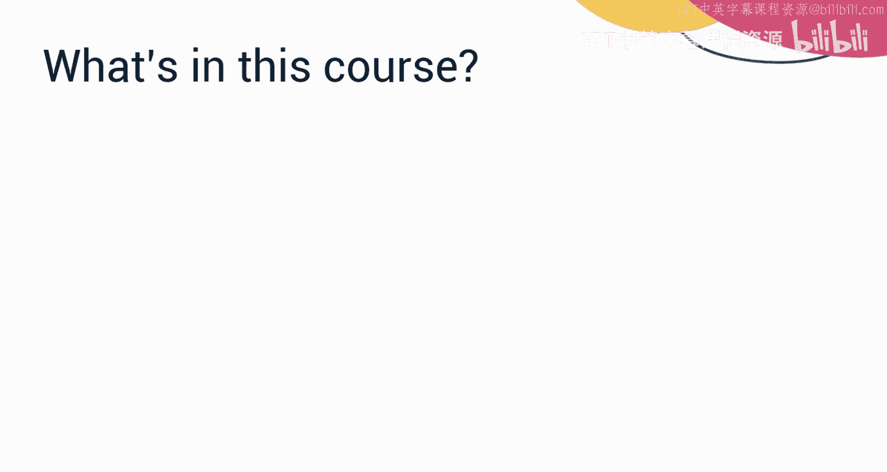

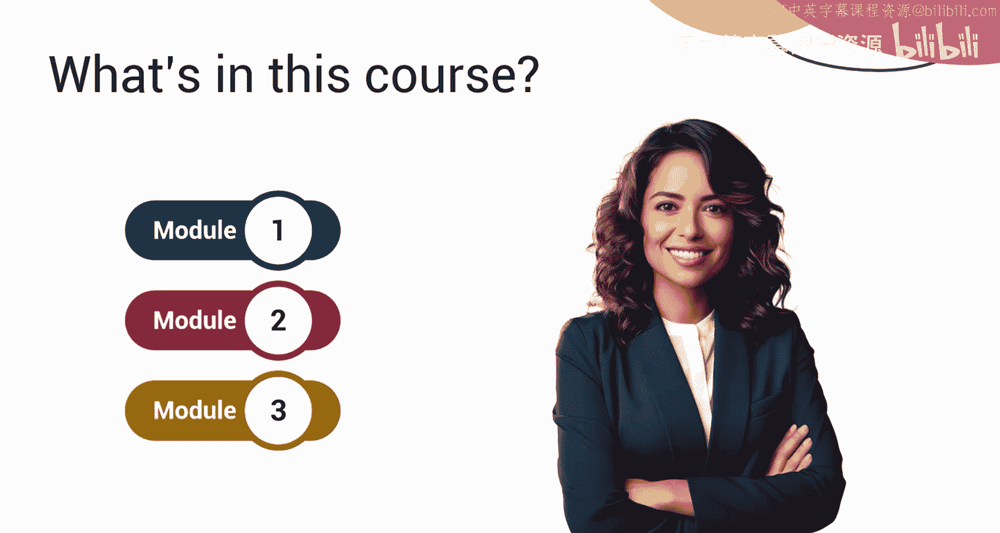

In moduleule1 of the course， you will learn the importance and practical applications of generative AI in HR。

You will explore the typical use cases where generated AI can be effectively utilized within HR functions。

You will also cover the fundamental concepts and capabilities of generative AI that are relevant to these HR functions。

Furthermore， you will be introduced to various generative AI tools designed for various HR functions。

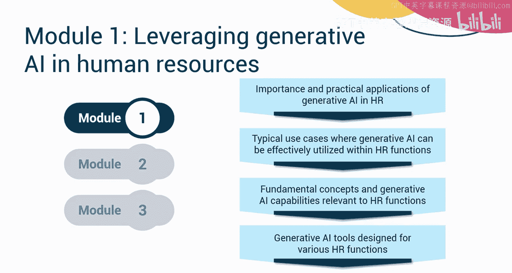

In Moule 2， you will examine the key scenarios within the HR domain where generative AI can optimize workflows。

You will also explore the strategic roles of HR demonstrating how generative AI can assist in critical areas such as workforce planning and employee engagement。

Additionally， you will also explore the requirements and considerations for successfully adopting generative AI and the HR practices of an organization。

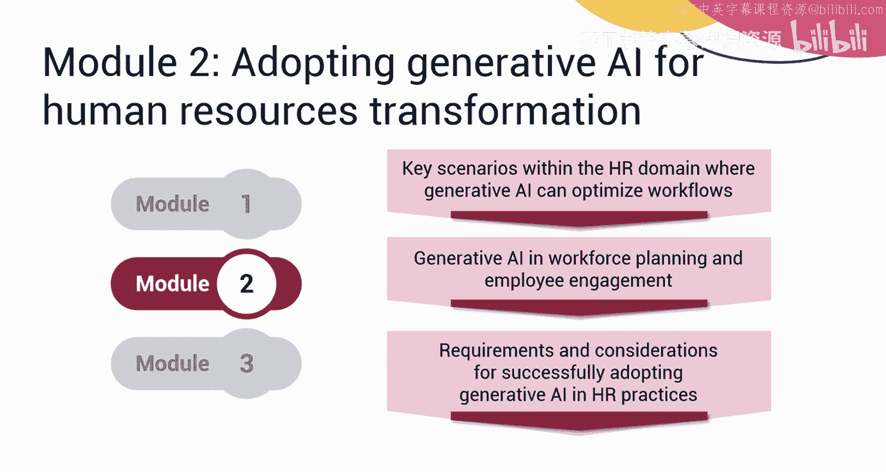

In Moule 3， you will explore the ethical considerations and responsible use of generative AI and discuss its limitations and potential issues。

To reinforce your understanding， the module features a graded quiz based on the core concepts covered。

Additionally， you will work on a final project that applies these concepts in a practical scenario。

To support your learning， a glossary is included to help you comprehend the meaning of technical terms related to generative AI。

You can also receive guidance on the next steps in your learning journey。

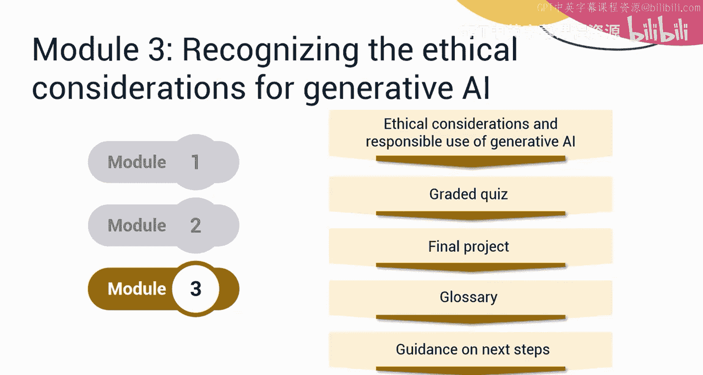

The course is curated with a mix of concept videos and supporting readings。

Watch all the videos to capture the full potential of the learning material。

You will work in hands on labs to learn implementing generative AI and various HR functions。

The final project provides an opportunity to demonstrate your knowledge of using generative AI in HR。

There are practice quizzes at the end of each lesson to help you reinforce your learning。

At the end of the course， you will also attempt a graded quiz。

The course also offers discussion forums to connect with the course staff and interact with your peers。

Most interestingly， the expert viewpoint videos feature experienced practitioners talking about leveraging generative AI capabilities in the HR domain。

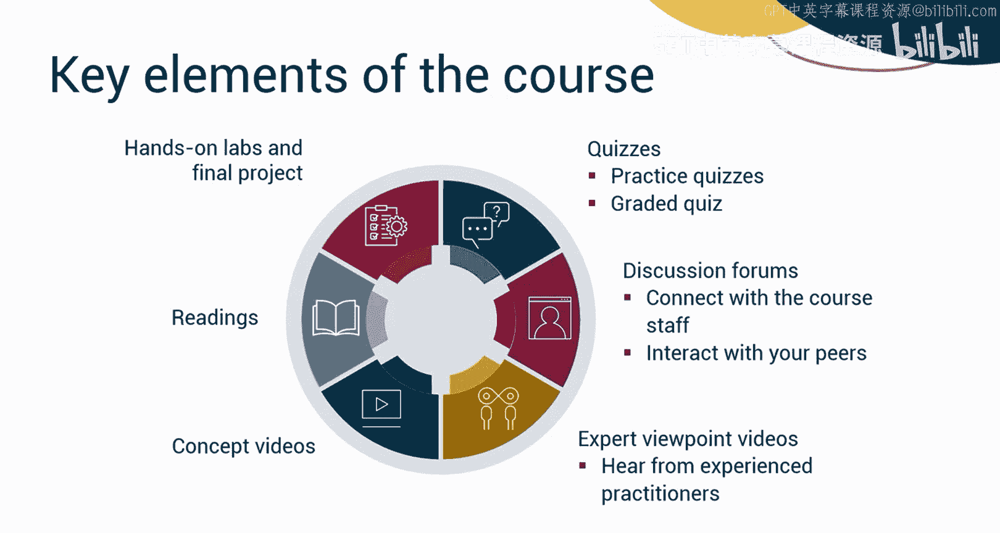

Empower your HR workforce with the brilliance of generative AI to explore limitless possibilities。

Let's get started。

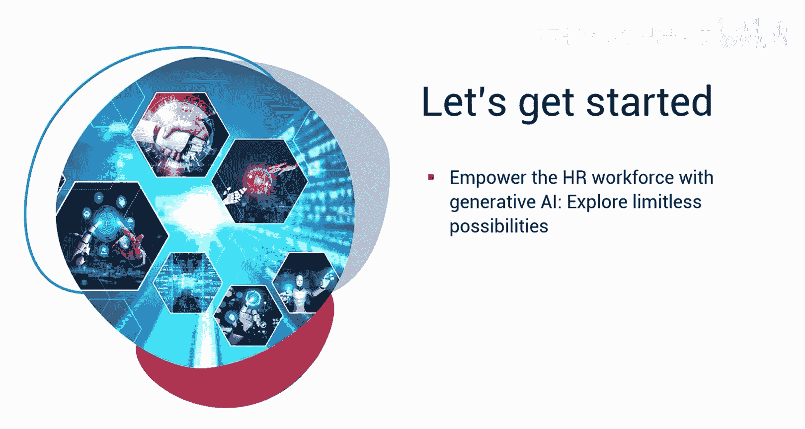

