# IBM《生成式AI用于人力资源｜Generative AI for Human Resources (HR) Professionals》中英字幕 - P32：1_生成式AI在人力资源中的意义与优势.zh_en - GPT中英字幕课程资源 - BV1Ese3zvEf4

Welcome to Signance and benefits of generative AI in HR After watching this video。

 you will be able to explain the significant potential for transformation by leveraging generative AI in HR。

 and explain the benefits of using generative AI in HR HR professionals play a critical role in an organization。

 handling a wide range of functions， including recruitment and selection， training and development。

 employee relations， compensation and benefits， performance management and various administrative responsibilities。

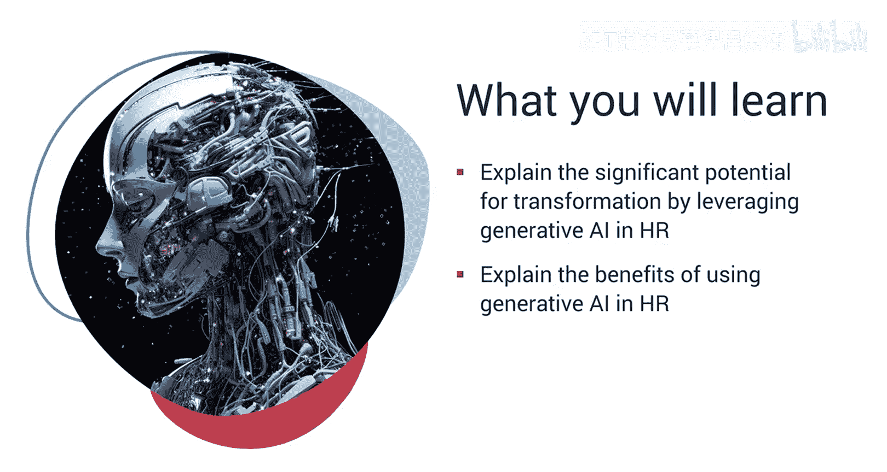

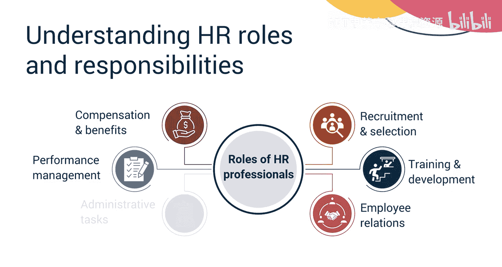

They serve as a vital link between management and employees。

 ensuring that management goals and policies are effectively conveyed to the workforce；

 they also communicate employee feedback， concerns， and suggestions to management。

Due to significant changes in the work dynamics， post pandemic the demands on HR professionals have escalated significantly。

 the HR functions are loaded with challenges and imperfections when HR professionals make decisions like who to hire。

 who to promote， or what should be the compensation of a resource。

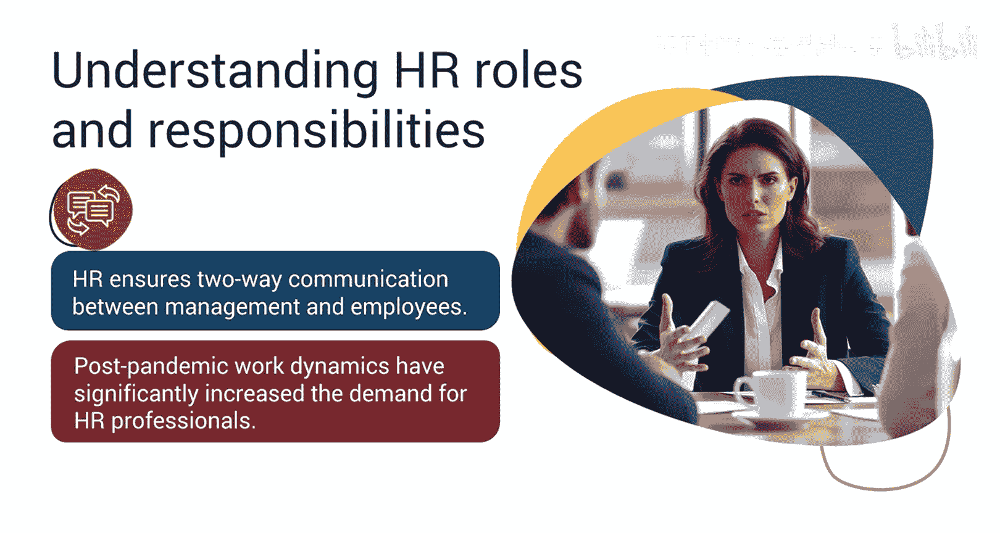

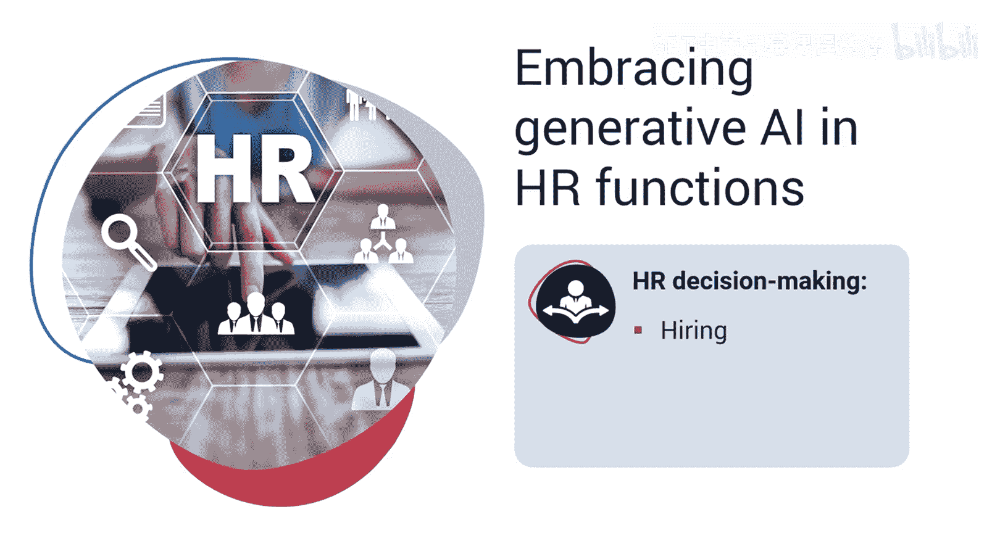

They often rely on their own experiences， personal opinions and certain data that they have accumulated This can sometimes lead to decisions that are biased or not entirely fair。

 Also， the manual work in various HR functions is more time consuming error prone inefficient and slow and reduces the overall productivity of the department。

 This is where generative AI comes in。 with the advent of generative AI companies are promoting HR professionals to leverage the capabilities of generative AI models to streamline various HR functions Automate repetitive tasks and make data drivenven informed decisions to ensure Ferrow comes in recruitment promotion and performance management。

 U generative AI and human resources offers a wide array of potential benefits。 Let's explore them。

 According to career builder HR managers lose an average of 14 hours per week on tasks that can be automated Auto can increase efficiency and productivity。

😊。

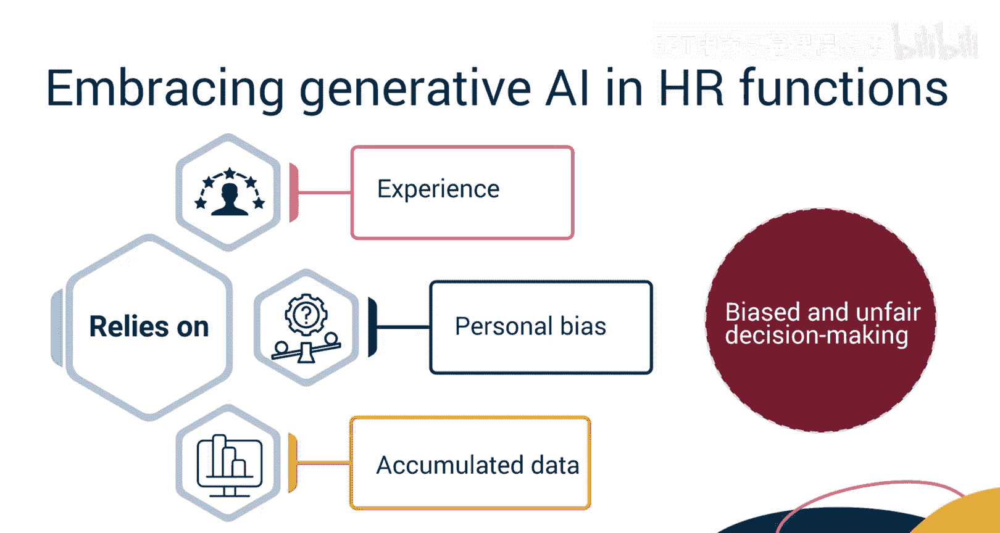

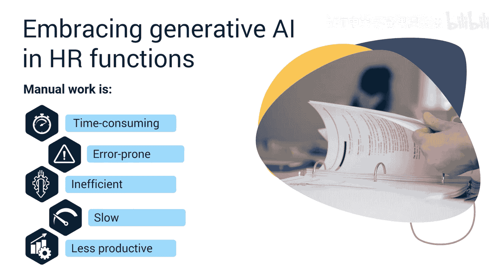

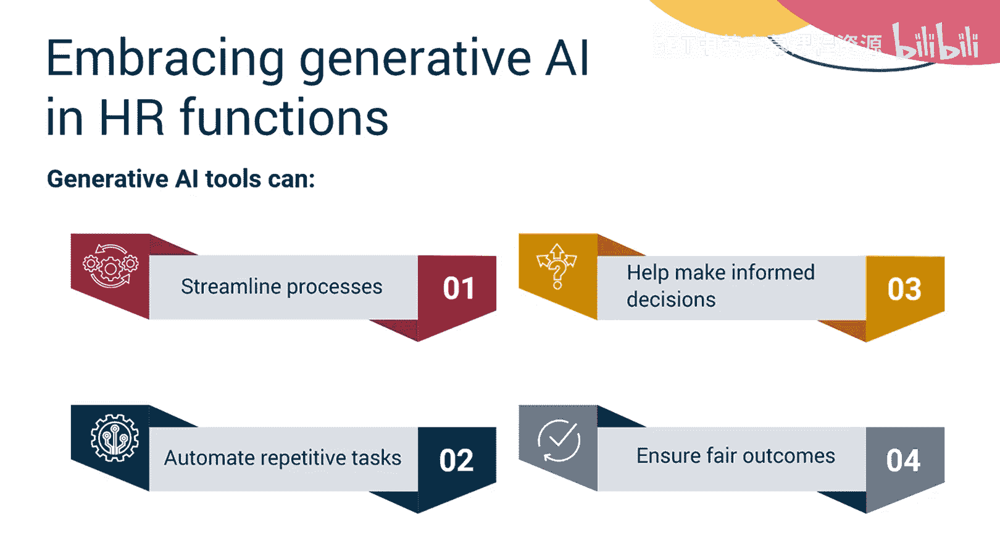

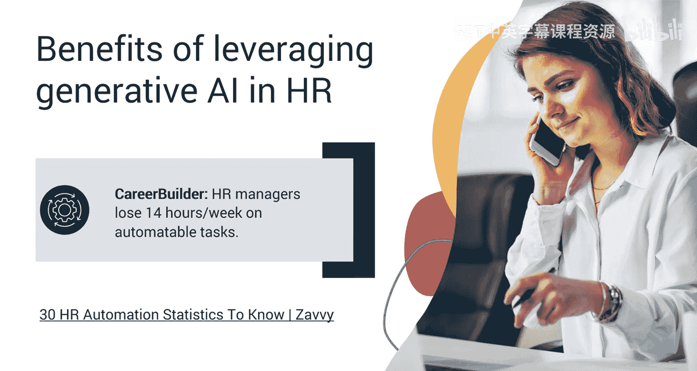

Automating repetitive tasks such as screening resumes。

 scheduling interviews and creating onboarding materials by leveraging generative AI can help increase the efficiency and productivity of HR professionals。

 generative AI driven chatbots can provide instant responses to employee queries offer personalized learning and development recommendations and streamline internal communication thus improving employee experience and engagement generative AI can analyze vast amounts of data to identify trends and predict future workforce needs enabling HR to make informed decisions regarding hiring promotions and employee retention strategies According to Frevo。

 a staggering 73% of an HR's time is consumed by mundane administrative duties administrative tasks such as payroll processing。

 management of benefits and compliance reporting can be streamlined using generative AI This can reduce the workload on HR staff and minimize the risk of errors geneative。

😊。

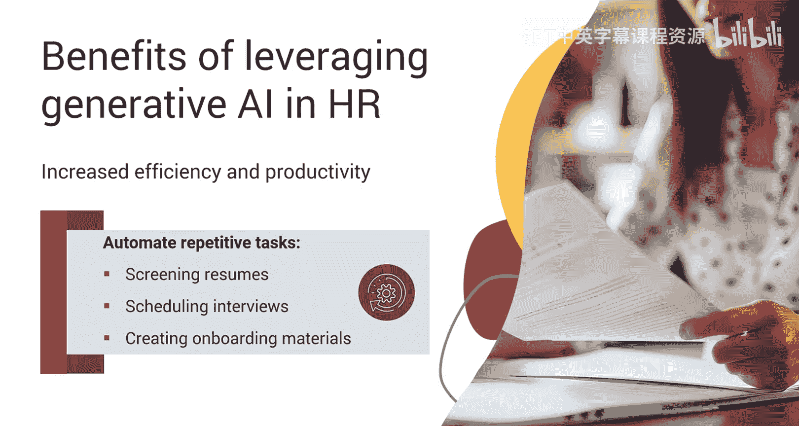

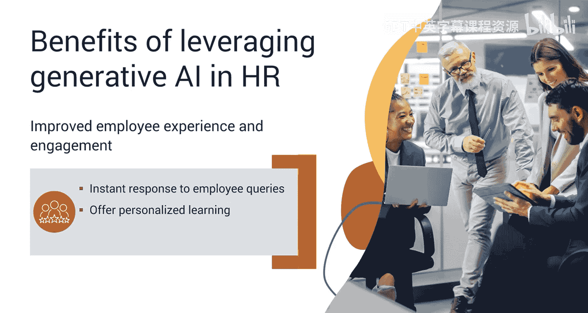

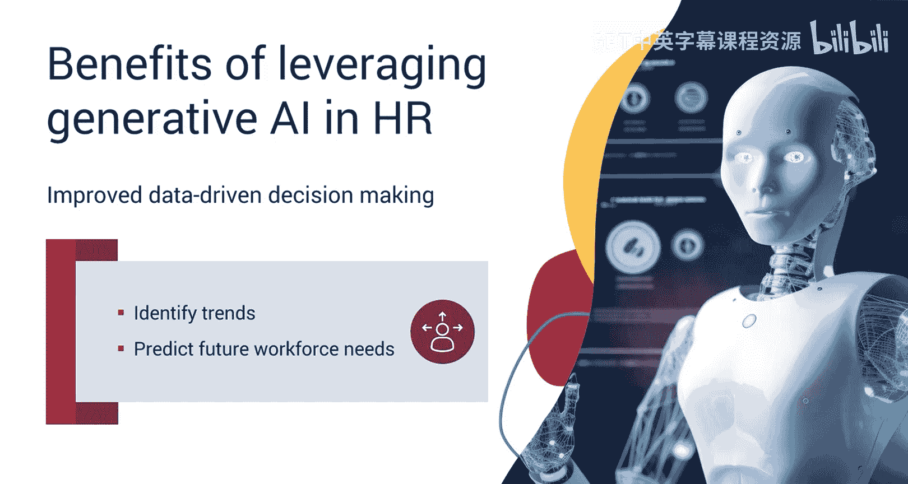

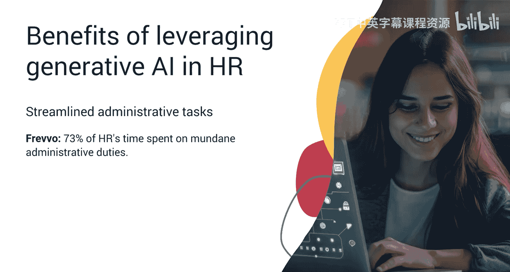

AI can help reduce biases in hiring and other HR processes by standardizing the process of evaluation This can promote diversity within the organization and ensure that all candidates are assessed fairly regardless of their background by freeing up time from monotonous tasks generative AI can help HR professionals take on more strategic roles like talent management workforce planning。

 culture and change management and employee engagement and retention。

 all of which are crucial for long-term organizational success。

 AI can assist HR in managing organizational change by providing insights into employee readiness and potential resistance by understanding these dynamics HR can develop more effective strategies for managing the changes。

 ensuring that initiatives for innovation are successfully implemented and finally。

 generative AI can provide platforms for seamless collaboration and sharing of information fostering a more connected organizational culture。

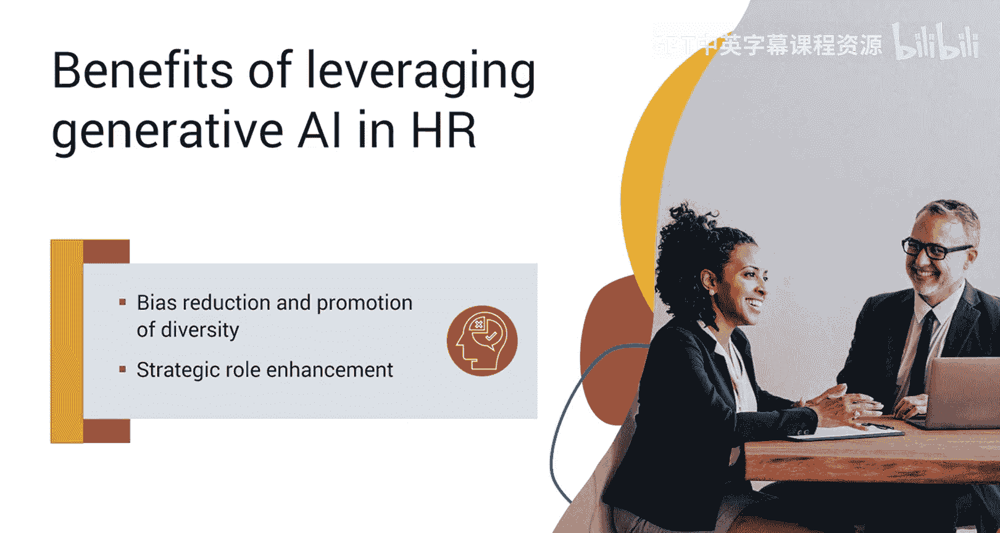

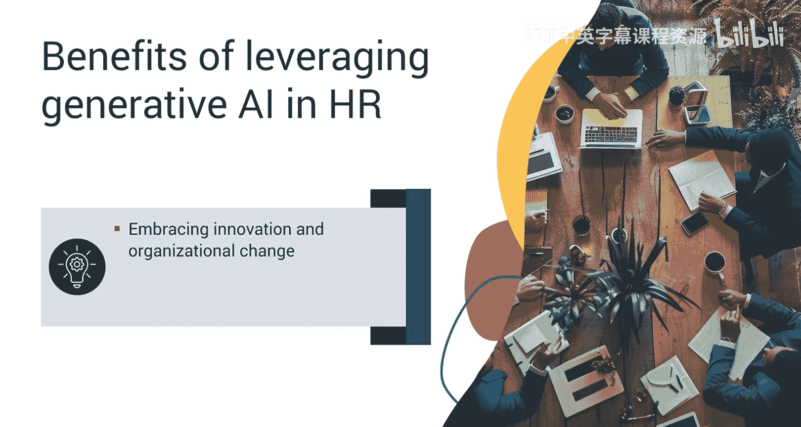

Amidst the era of digital transformation， the HR team can take the opportunity to lead by example in embracing generative AI across business units while the journey is challenging。

 it presents a significant opportunity for the HR team to spearhead organizational change and innovation In this video you learn the significance and benefits of using generative AI in human resources HR professionals handle numerous functions。

 acting as a crucial link between management and employees。

 generative AI can automate repetitive tasks， En efficiency and reduce errors。

 enabling data- drivenriven decisions for fairer outcomes It can improve employee experience and engagement and promote diversity by standardizing evaluations。

 by freeing HR from administrative burdens AI allows a focus on strategic roles。

 helping organizational change and fostering a connected culture Embracing AI and HR can lead to significant operationalal transformations。

😊。

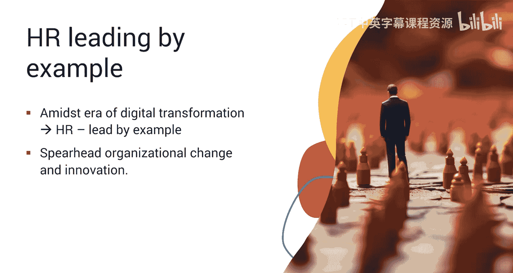

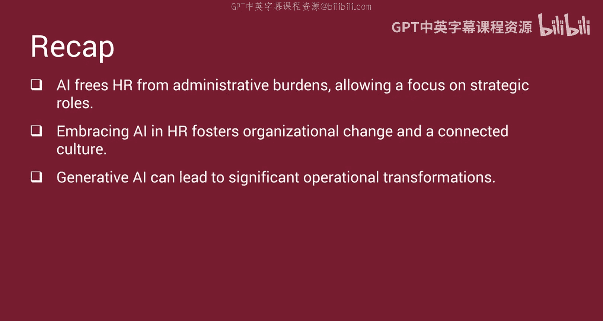

