# IBM《生成式AI用于人力资源｜Generative AI for Human Resources (HR) Professionals》中英字幕 - P33：2_生成式AI在人力资源中的应用.zh_en - GPT中英字幕课程资源 - BV1Ese3zvEf4

Welcome to the application of generative AI and HR After watching this video。

 you will be able to describe the applications of generative AI and HR you'll also be able to identify how generative AI can streamline operations across different HR functions in the ever-chan world of human resources or HR generative AI is making a big difference It's changing the old ways of doing things and bringing in new creative ideas a recent global survey conducted by LinkedIn revealed that 62% of talent acquisition professionals hold a positive outlook regarding the influence of AI on recruitment among them 14% reported having integrated generative AI into HR operations Let's understand the various facets where generative AI is leveraged in HR management generative AI is very helpful in recruitment onboarding support administrativeative work payroll learning and development performance management employee engagement。

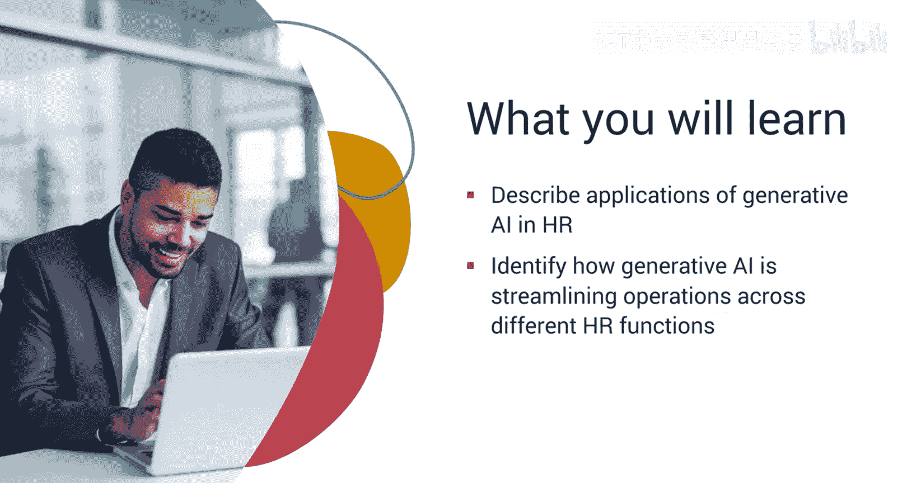

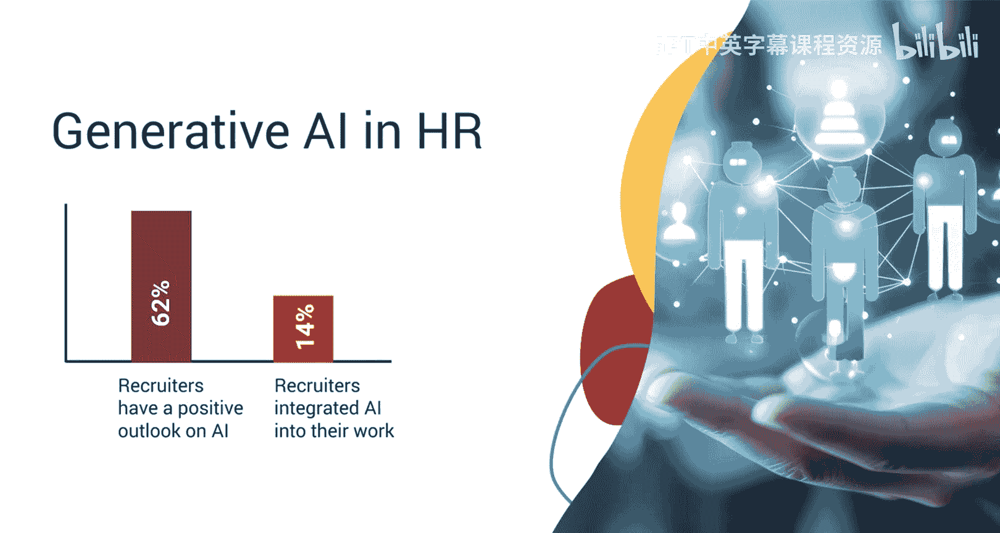

Employee benefits and compliance monitoring。The recruitment team can adeptly implement generative AI for smooth and swift functioning。

 wondering how generative AI can analyze job descriptions and candidate resumes to provide insights on the best matches for specific roles。

 It can also generate personalized interview questions based on candidate profiles and job requirements。

 enhancing the recruitment process。 Let's consider a scenario where an organization receives hundreds of resumes for a job opening Instead of manually reviewing each one。

 they employ generative AI to automate the screening process。

 The AI system uses natural language processing to analyze resumes and job descriptions identifying key skills。

 qualifications and experiences。 It then matches the candidate's profiles to the job requirements presenting a short list of the most suitable candidates to recruiters This reduces the time and effort spent on manual screening and improves the efficiency of the recruitment process。

 following the recruitment process。😊。

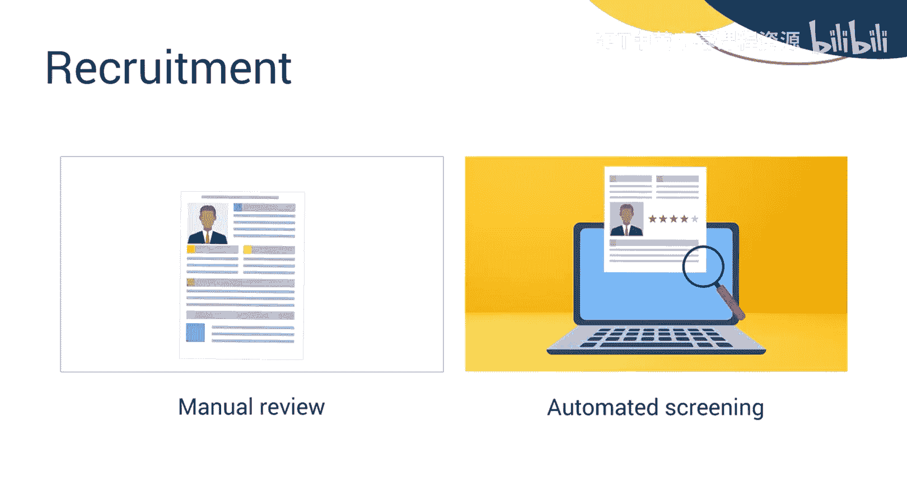

AI can provide onboarding support by creating personalized onboarding plans for new hires。

 which include training materials， introduction emails， and task schedule。

It can generate interactive onboarding modules or chatbots to guide new employees through company policies。

 procedures and culture routine administrative work can also be automated with the use of generative AI for example。

 scheduling interviews responding to basic HR inquiries and managing documentation you can also generate templates for various HR documents like offer letters。

 contracts and performance reviews， saving time for HR professionals。

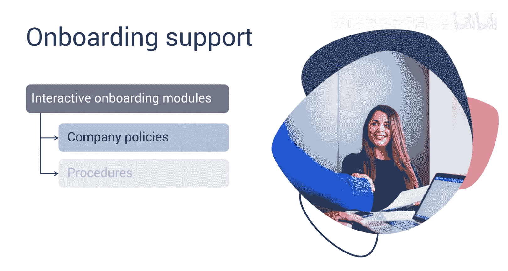

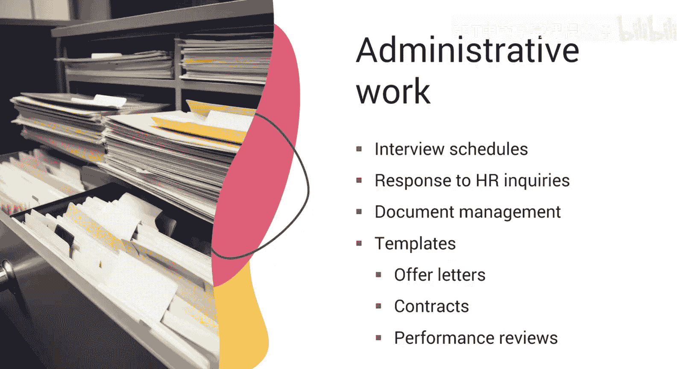

Another area of implementation of generative AI is in payroll processes generative AI can streamline payroll processes by automatically generating pay stubs。

 calculating deductions and processing employee reimbursements It can identify patterns in timesheet data to detect discrepancies。

 improving payroll accuracy Furthermore， generative AI can be employed in learning and development consider a tech company that uses generative AI to personalize employee training programs The AI system analyzes performance data skills assessments and learning preferences of individual employees based on this analysis it generates personalized learning paths for each employee recommending relevant courses。

 workshops or online resources For example， and employee interested in data science may receive recommendations for learning specific data analysis courses and programming languages It can generate interactive training modules。

 quizzes or simulations to enhance employee engagement and knowledge retention this tailored。😊。

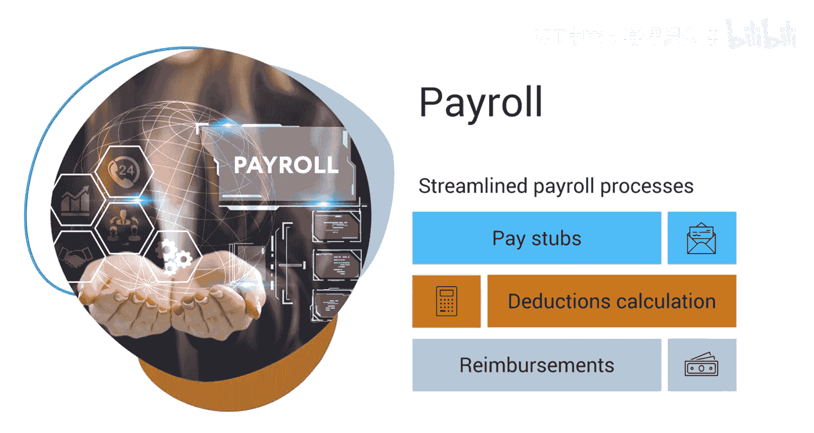

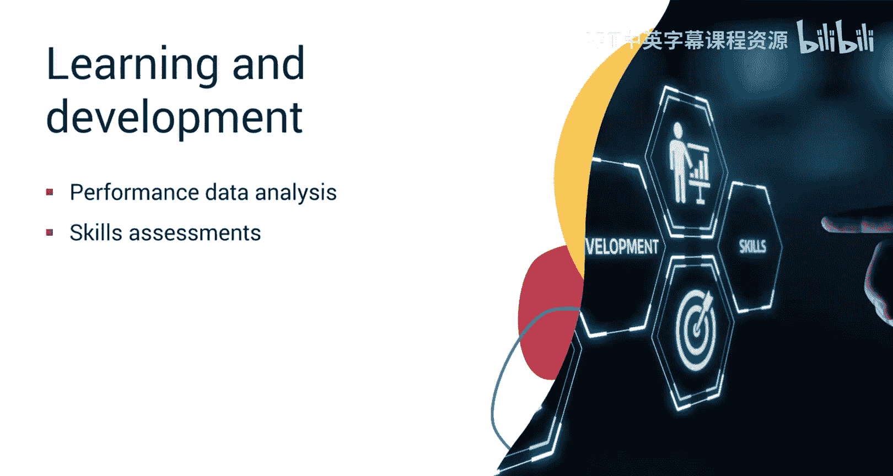

Appach to training enhances employee engagement and accelerates skill development generative AI can also be applied to performance management。

 it can provide real-time feedback to employees based on performance metrics， goals。

 and peer comparisons it can generate performance reports and visualizations for managers to track progress。

 identify areas for improvement and make data-driven decisions。

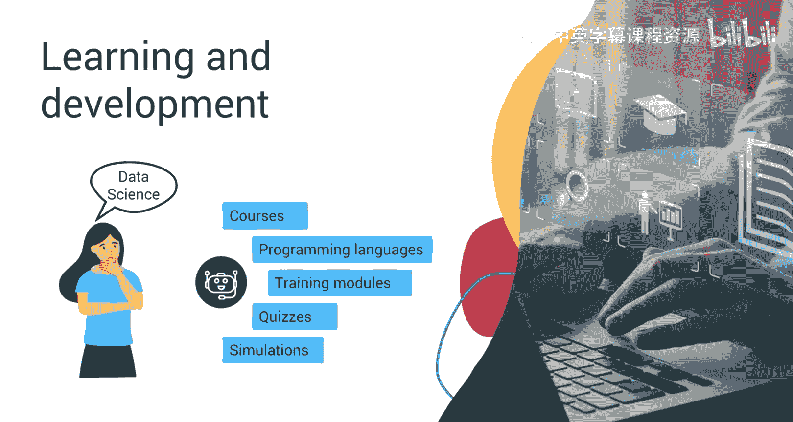

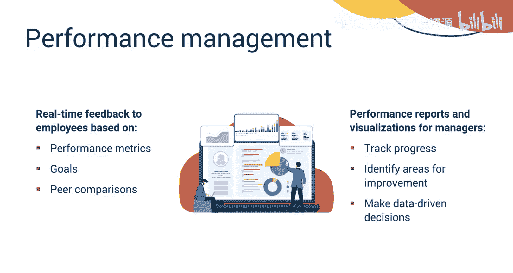

For employee engagement you can use generative AI to analyze employee feedback from surveys。

 performance reviews and social media to identify trends and suggest interventions to improve engagement It can generate personalized messages or recognition awards for employees based on their contributions and achievements what's more generative AI can assist employees in choosing the most suitable benefits packages based on their needs。

 preferences and life circumstances it can generate personalized recommendations for health care plans。

 retirement options and wellness programs generative AI can also be used to monitor compliance It can monitor regulatory changes and update HR policies and procedures accordingly to ensure compliance it can generate compliance reports and audits flagging any discrepancies or risks for further action In addition。

 generative AI powers the creation of self-service portals。

 offering employees seamless access to policy documents。😊。

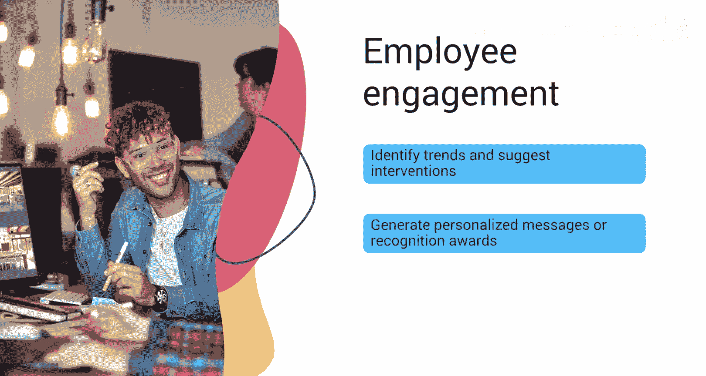

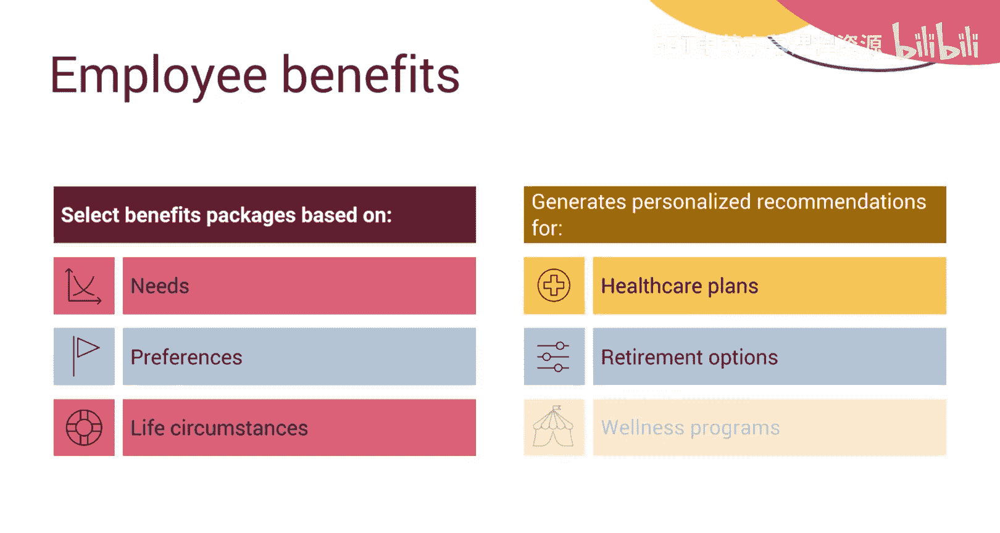

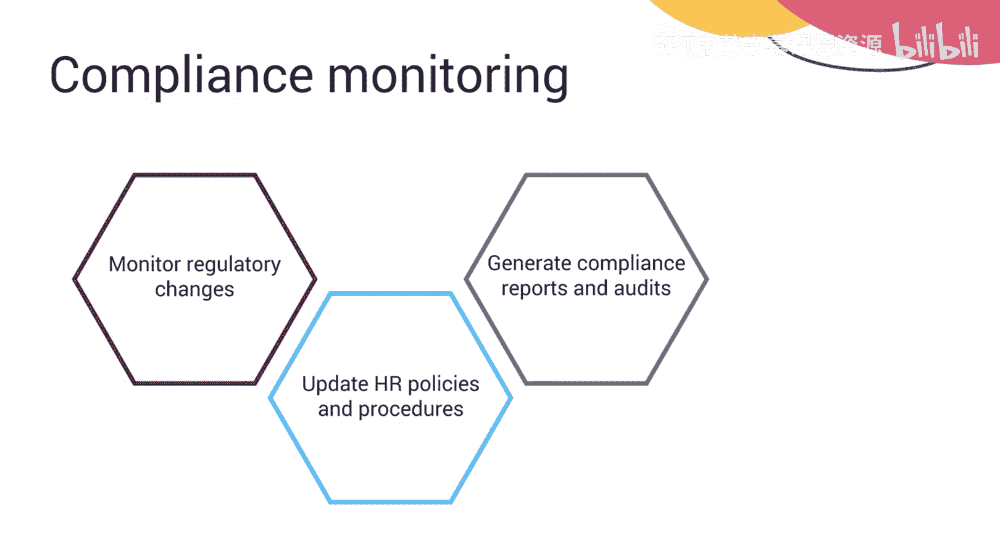

Benefits information and other essential resources This empowers employees to take control of their HRrelated queries and tasks。

 reducing the administrative burden on HR teams， Similarlyly。

 generative AI supports the development of question answering chatbots。

 providing employees with instant access to HR support and information For instance。

 an employee can ask about maternity leave policies and the chatbot provides detailed information along with relevant forms and procedures This improves employee satisfaction by providing quick and accessible support around the clock enhancing HR efficiency you have reached the end of this video In this video you learned how generative AI is transforming HR operations across various HR functions improving efficiency accuracy and employee experience in recruitment it automates resume screening matches candidates profiles to job requirements and generates personalized interview questions in onboarding it。

😊。

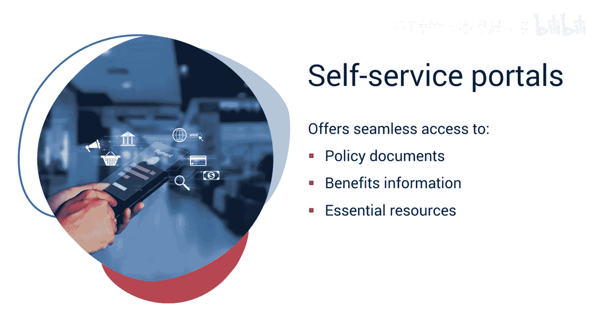

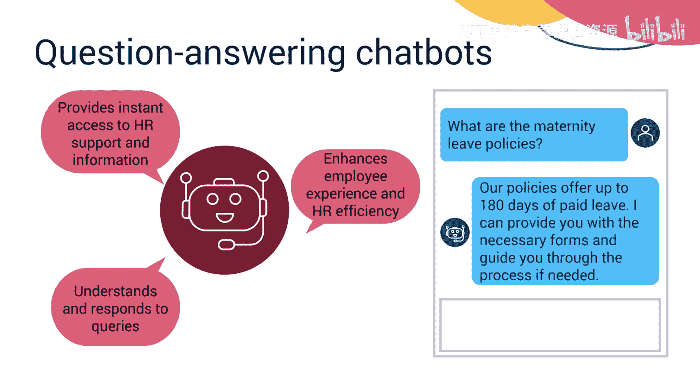

Psonalized plans for new hires administrativemin tasks such as scheduling interviews and managing documentation are streamlined through AI generated templates。

 payroll processes can be automated， ensuring precision in calculations and flagging anomalies learning and development initiatives benefit from personalized training programs and interactive modules for enhanced engagement performance management is enriched with realtime feedback while AI drivenn analytics predict future trends and challenges generative AI supports employee engagement by analyzing feedback and facilitating personalized communication compliance monitoring is streamlined through AI generated reports Finally。

 generative AI can support self-service portals and chatbots for seamless access to information and enhanced user experience。

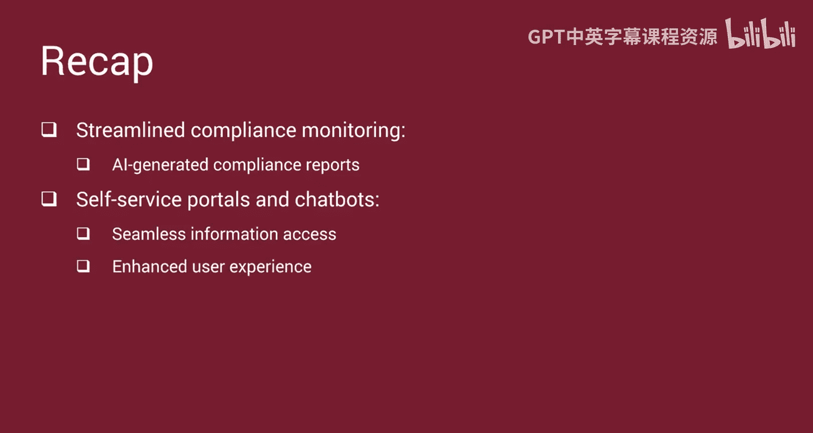

