# IBM《生成式AI用于人力资源｜Generative AI for Human Resources (HR) Professionals》中英字幕 - P34：3_推动人力资源用例的生成式AI能力.zh_en - GPT中英字幕课程资源 - BV1Ese3zvEf4

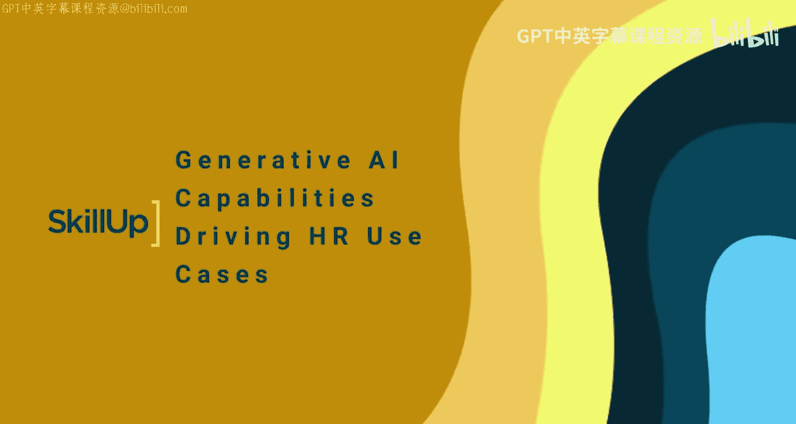

Welcome to generative AI capabilitiesities drivingiv HRs cases。After watching this video。

 you will be able to。

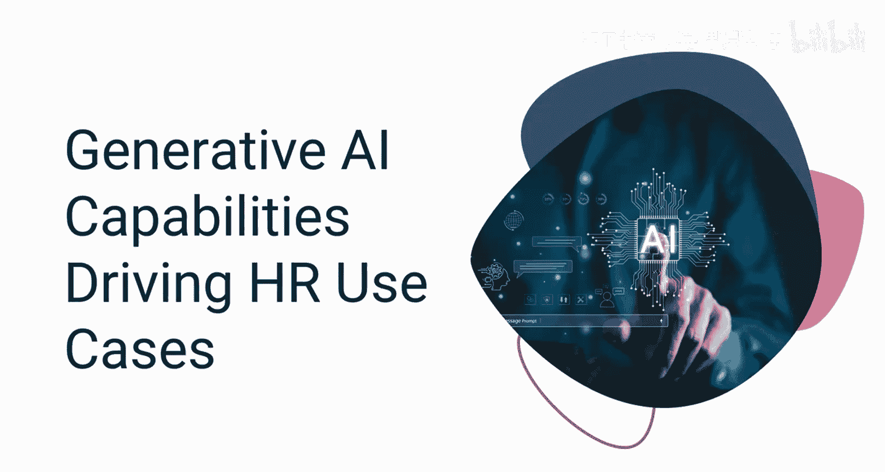

Identify the key capabilities of generative AI that can be leveraged in HR。

Explain the basic concepts and techniques enabling generative AI capabilities。

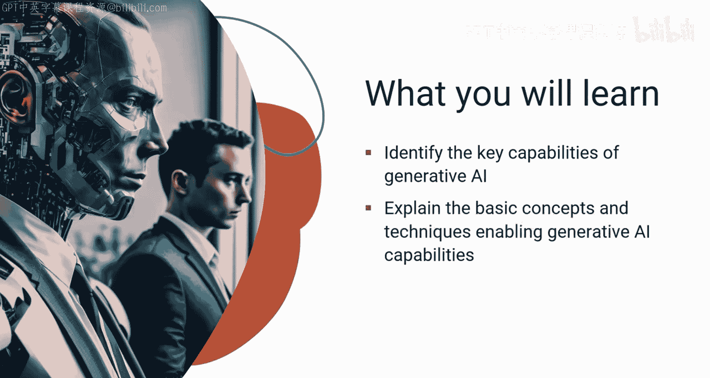

Generative AI enables a range of capabilities， including content generation， human like conversation。

 sentiment analysis， and predictive analysis。These capabilities hold immense potential for transforming the HR landscape by automating tasks。

 improving employee experiences， and enhancing decision making。

But what are the underlying models and AI techniques that enable these capabilities of generative AI？

Let's explore and understand them。A core strength of generative AI lies in its ability to generate realistic and relevant content。

 from text to images and videos。In HR， this capability is invaluable。

Imagine crafting compelling job descriptions， generating realistic interview and training scenarios。

 and creating personalized content tailored to employee roles and backgrounds。

So how does generative AI achieve these content generation and creative skills？

This is done through generative AI models， such as generative adversarial networks， organNs。

 variational autoencors or VAEs， and transformers， these models can be considered as the building blocks of generative AI。

Generative AI models utilize deep learning techniques to learn from vast data sets and generate new data。

The deep learning algorithms， inspired by the structure and function of the human brain are trained on massive amounts of data。

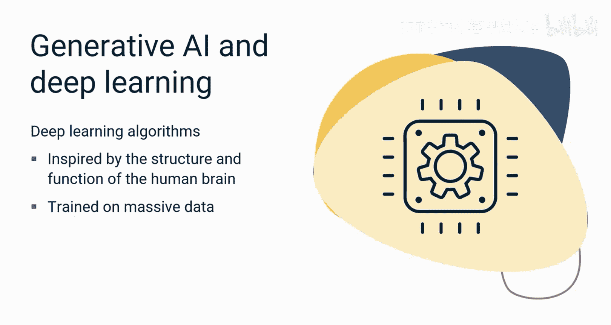

By analyzing the data， the algorithms learn the underlying patterns and relationships between words。

 allowing the models to generate new， grammatically correct， semantically sound。

 and stylistically appropriate text。

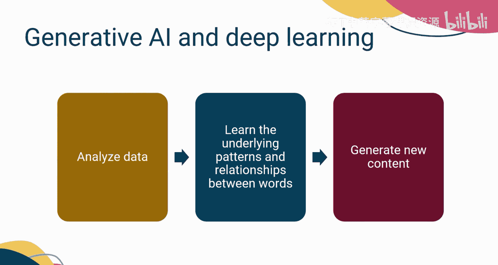

Further， we have foundation models， which are AI models with broad capabilities。

Foundation models can be fine tuned for any specific task， such as summarization or translation。

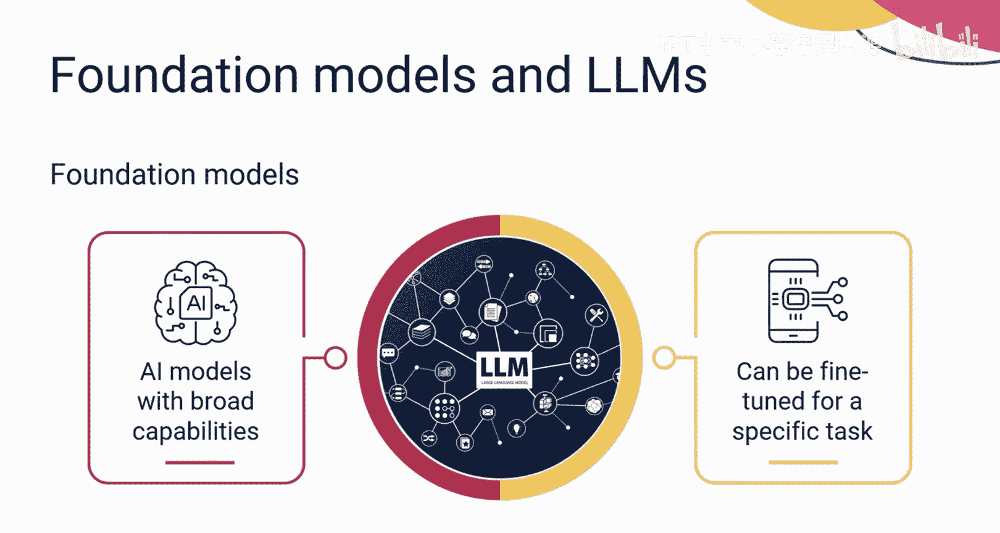

A specific type of foundation model called largege language models。

 or LLMs are trained to understand and generate context based text。

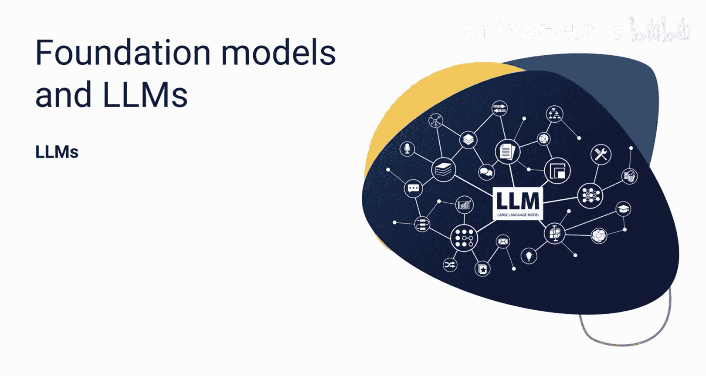

GPT from OpenAI， Bert and Gemini Pro from Google， and Lama from Meta are some examples of LLMs。

These LLMs form the foundation for many popular generative AI tools and applications， for example。

 Cha GPT is based on GPT and Google Gemini is based on Gemini Pro。

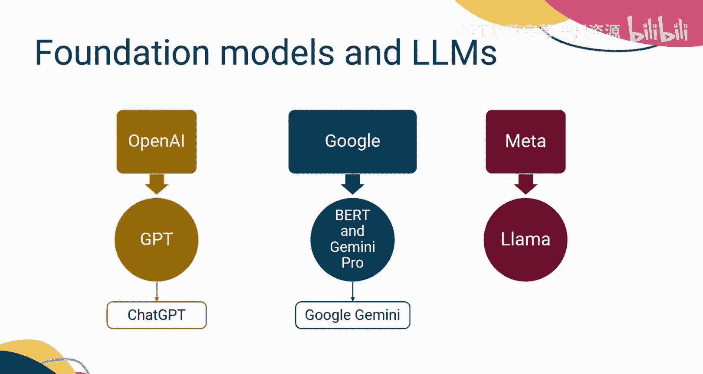

LLMs excel in NLP tasks， such as predicting the next word in a sentence。

 recognizing different writing styles such as formal or casual summarizing text。

 and performing sentiment analysis to understand emotional tone。

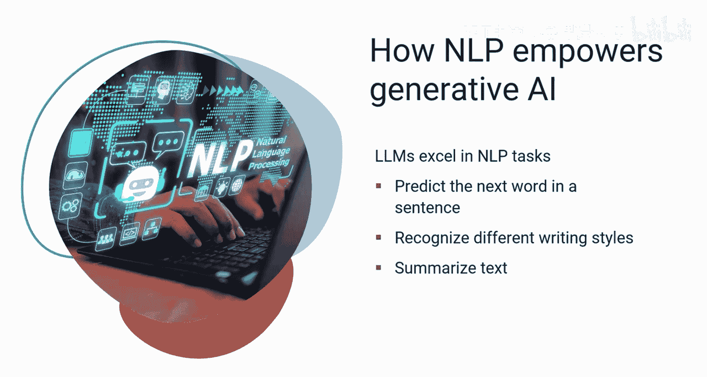

NLP is a field of AI that focuses on the interactions between computers and humans in natural human language。

It enables generative AI models to comprehend the data they're trained on to generate context based content and facilitate human light communication。

In HR。NLP based generative AI models can analyze employee feedback， surveys。

 and reviews to gauge sentiment and identify areas of concern or satisfaction。

By analyzing communication patterns and content， they can provide insights into employee engagement and morale。

Generative AI powered chatbots are transforming HR interactions。

These chatbots leverage NLP and reinforcement learning to have natural and dynamic conversations。

Reinforcement learning is a machine learning technique that trains models or software to make decisions by interacting with an environment。

The chatbot interacts with simulated users and receives feedback on its responses。

Based on this feedback， the model learns to refine its responses over time。

 becoming more adept at understanding user queries and providing helpful information。

Generative AI chatbots can be customized for specific domains， providing specialized knowledge。

The HR domain can benefit from NLP driven chatbots to engage with candidates， handle HR inquiries。

 screen resumes， and facilitate employee feedback surveys。

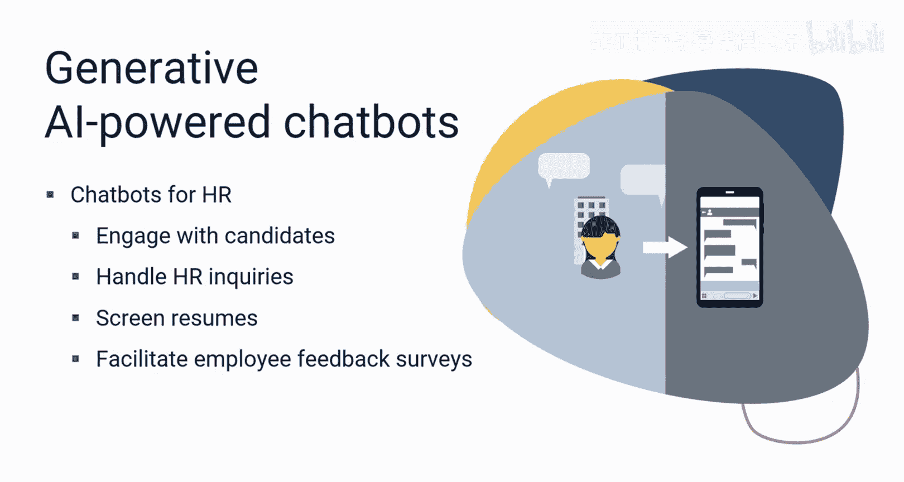

Another appealing capability of generative AI is performing predictive analytics by analyzing large data sets。

 spotting patterns， and identifying correlations。LLMs are trained to recognize trends。

 extract relevant features， and generate accurate predictions。By producing data driven predictions。

 these models enhance decision making processes。In HR generative。

 AI provides valuable insights for informed decisions on recruitment success。

 performance and productivity， training effectiveness， workforce planning， and employee engagement。

Generative AI models and other AI advancements are revolutionizing HR。

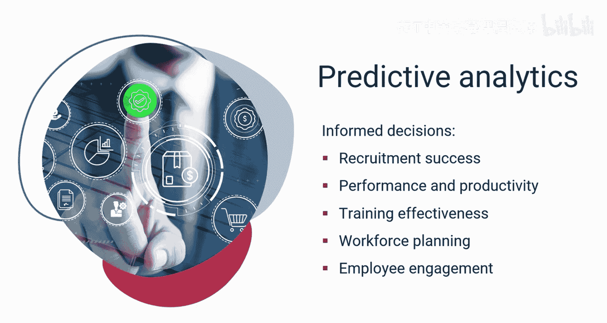

Multimodal models like Google Gemini can handle not just text。

 but also images and audio for richer content generation and analysis。

Mululttimodal models empower generative AI with richer capabilities for example。

 imagine integrating text， video tutorials and real time feedback for a more effective learning experience。

Or move beyond text based sentiment analysis。Mululttimodal AI can analyze vocal tone and facial expressions to reveal employee sentiment and stress。

As generative AI continues to evolve， we can expect even more innovative applications to emerge in the HR landscape。

 shaping the future of work you have now reached the end of the video in this video you've learned about the key capabilities of generative AI。

 including context based content generation， human light conversation。

 sentiment analysis and predictive analytics。

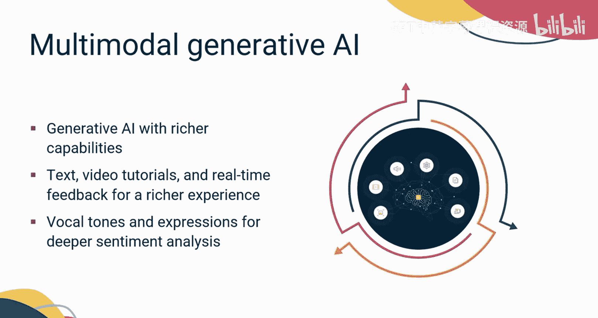

These capabilities are facilitated by generative AI models like LLMs。

 which are trained on large data sets to understand and generate context based text。

LLMs Excel and NLP tasks and are valuable for various HR functions such as crafting job descriptions。

 interview questions and personalized learning materials。

 as well as analyzing employee feedback and engagement， generative AI chatbots leverage。

 NLP and reinforcement learning to enable natural and dynamic conversations。

 they can be tailored for specific domains including HR。

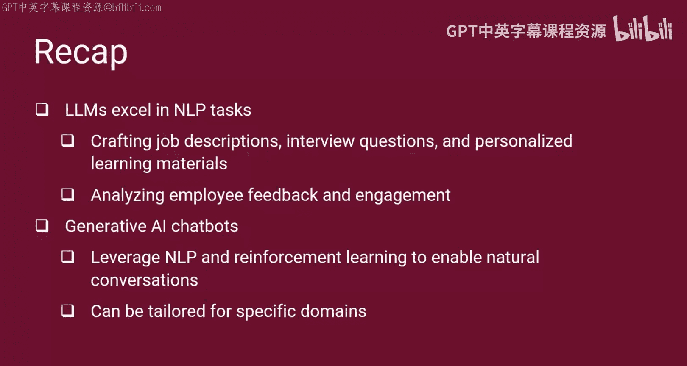

